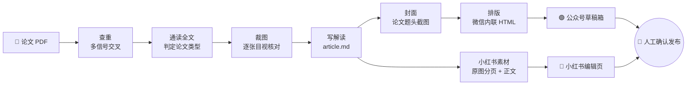
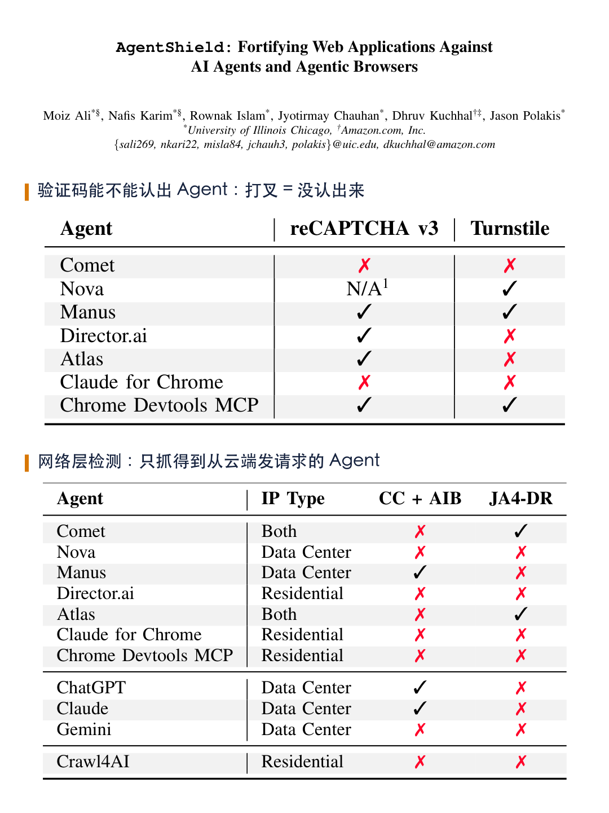

<div align="center">

# 供应链安全前沿 · paper-to-wechat

**把一篇安全顶会论文，变成公众号深度长文 + 小红书图文笔记**

软件供应链安全 × AI Agent 安全｜S&P · CCS · USENIX Security · NDSS · ICSE · FSE


</div>

---

## 📮 关注我们

每篇解读都会同时发在公众号和小红书。公众号是讲机制、讲案例的长文，小红书是论文原图加核心结论的速读版。

<table align="center">
  <tr>
    <td align="center" width="50%">
      <br>
      <b>微信公众号「供应链安全前沿」</b><br>
      <sub>深度长文 · 微信扫码关注</sub>
    </td>
    <td align="center" width="50%">
      <br>
      <b>小红书「供应链安全前沿」</b><br>
      <sub>小红书号 maliverse · 小红书扫码关注</sub>
    </td>
  </tr>
</table>

---

## 📚 已推送的论文

公众号文章按合集归档，下面的清单也按合集分组、从新到旧排列。点论文题目看原文，点「原稿」看中文解读。

| 合集 | 关注什么 |
|---|---|
| 🤖 **AI Agent 安全** | 恶意 Skill、提示注入、MCP、AI 浏览器、Agent 控制面 |
| 📦 **恶意包与威胁情报** | PyPI / npm 恶意包的检测、测量与情报 |
| 🔗 **供应链攻击与防御** | 攻击机理、事件复盘、防御机制、SBOM |
| 📊 **开源与安全测量** | 大规模实证研究、基准测评 |
| 🏆 **顶会论文清单** | 四大安全会议与软工顶会的供应链安全论文盘点（见 [`roundups/`](roundups/)） |

<!-- PAPER-INDEX:START -->

<details open>
<summary><b>🤖 AI Agent 安全</b>（39 篇）</summary>

| 时间 | 会议 | 论文 | 看点 | 解读 |
|---|---|---|---|---|
| 2026-11 | arXiv 2026 | [Say Shibboleth: Fingerprinting the LLMs and Harnesses Behind Agentic Attacks](https://arxiv.org/abs/2611.12386) | 15个模型识别准确率九成 · 提示注入问身份0次成功 · 让它撒谎仍77%能认出 | [原稿](papers/2026-11-shibboleth/article.md) |
| 2026-11 | ACM CCS 2026 | [PriMobiBench: Characterizing Visual Privacy Leakage in VLM-Driven Mobile GUI Agents](https://arxiv.org/abs/2609.13873) | 屏幕隐私被读出82.5% · 画像还原率近七成 · 遮挡后泄露降一半 | [原稿](papers/2026-11-primobibench/article.md) |
| 2026-11 | arXiv 2026 | [Characterizing LLM Agent Behaviors in Module Shadowing Environments](https://arxiv.org/abs/2610.40716) | 间接遮蔽触发率86.7% · 识破机制仍有三成中招 · 79%中招后报告未提 | [原稿](papers/2026-11-module-shadowing/article.md) |
| 2026-11 | arXiv 2026 | [GEOHunter: Mapping a Generative Engine Optimization Network in the Wild](https://arxiv.org/abs/2611.26564) | 46万篇软文喂给AI · 9个AI助手全部引用 · 账号中位数仅9个粉丝 | [原稿](papers/2026-11-geohunter/article.md) |
| 2026-11 | arXiv 2026 | [DecodingTrust-Agent Platform (DTap): A Controllable and Interactive Red-Teaming Platform for AI Agents](https://arxiv.org/abs/2605.04808) | 换框架被攻破率降三成 · 先执行坏操作再说拒绝 · Skill与工具注入最难防 | [原稿](papers/2026-11-dtap/article.md) |
| 2026-11 | ICSE 2027 | [Automated Safety Analysis for Agentic Workflows](https://arxiv.org/abs/2611.28469) | 框架原生校验0检出 · 大模型审查误报五到七成 · 21个真实仓库36个新bug | [原稿](papers/2026-11-apsis/article.md) |
| 2026-11 | IEEE S&P 2027 | [AgentShield: Fortifying Web Applications Against AI Agents and Agentic Browsers](https://arxiv.org/abs/2610.41181) | 本地Agent绕过多数反爬 · 反应节奏暴露Agent身份 · 让Agent装人反而更像机器 | [原稿](papers/2026-11-agentshield/article.md) |
| 2026-11 | arXiv 2026 | [Coding Agents Propagate Vulnerabilities in Code Bases](https://arxiv.org/abs/2611.11455) | 安全实现率平均掉35点 · 七成能认出自己写的漏洞 · 76%说是照着旧代码写的 | [原稿](papers/2026-11-agents-propagate-vulns/article.md) |
| 2026-10 | ACM CCS 2026 | [SkillScope: Toward Fine-Grained Least-Privilege Enforcement for Agent Skills](https://arxiv.org/abs/2605.05868) | 6590个真实技能存在越权 · 越权行为减少88.56% · 按任务放行不删功能 | [原稿](papers/2026-10-skillscope/article.md) |
| 2026-10 | arXiv 2026 | [Characterizing Security Effects of OSS Vulnerabilities in Agent Systems](https://arxiv.org/abs/2610.05036) | 62.7%的后果传进模型 · 后果识别F1达96.4% · 303个CVE仅9个生效 | [原稿](papers/2026-10-oss-vuln-agent/article.md) |
| 2026-10 | IEEE S&P 2026 | [Parasites in the Toolchain: A Large-Scale Analysis of Attacks on the MCP Ecosystem](https://arxiv.org/abs/2509.06572) | 三个清白工具拼出窃密链 · 强模型挡住弱模型沦陷 · 27%的server能当零件 | [原稿](papers/2026-10-mcp-parasites/article.md) |
| 2026-10 | ICLR 2026 Workshop | [Large-scale online deanonymization with LLMs](https://arxiv.org/abs/2602.16800) | 每号成本1到4美元 · Agent认出2/3用户 · 99%精确率召回45% | [原稿](papers/2026-10-llm-deanon/article.md) |
| 2026-10 | IEEE S&P 2026 | [When AI Meets the Web: Prompt Injection Risks in Third-Party AI Chatbot Plugins](https://arxiv.org/abs/2511.05797) | 8千网站能伪造系统消息 · 13%客服读了评论 · 73%的真实客服被套出提示词 | [原稿](papers/2026-10-chatbot-plugins/article.md) |
| 2026-10 | USENIX Security 2026 | [The Attacker Moves Second: Stronger Adaptive Attacks Bypass Defenses Against LLM Jailbreaks and Prompt Injections](https://arxiv.org/abs/2510.09023) | 人类红队全部攻破 · 500多人参加红队赛 · 多数防御成功率超90% | [原稿](papers/2026-10-attacker-moves-second/article.md) |
| 2026-09 | arXiv 2026 | [LLM-Based Agents for Software and Systems Security: Approaches, Applications, and Assessment](https://arxiv.org/abs/2608.28490) | 100篇同行评审论文 · 95%全自主，5%测边界 · 只有1%测工具调用 | [原稿](papers/2026-09-security-agents-slr/article.md) |
| 2026-09 | NDSS 2026 | [Les Dissonances: Cross-Tool Harvesting and Polluting in Pool-of-Tools Empowered LLM Agents](https://arxiv.org/abs/2504.03111) | 能偷住址也能改股价 · 四种现有防御基本失效 · 75%真实工具可被劫持 | [原稿](papers/2026-09-les-dissonances/article.md) |
| 2026-08 | arXiv 2026 | [Benchmarking Security Risk Detection and Verification in Open Agentic Skill Ecosystems](https://arxiv.org/abs/2606.00925) | 静态加沙箱两阶段审查 · 78个恶意技能零漏报 · 风险集中在高权限工具 | [原稿](papers/2026-08-skillvetbench/article.md) |
| 2026-08 | arXiv 2026 | [SkillSafetyBench: Evaluating Agent Safety under Skill-Facing Attack Surfaces](https://arxiv.org/abs/2605.12015) | 良性任务下的环境侧攻击 · 平均攻击成功率41.8% · 任务能力强不等于更安全 | [原稿](papers/2026-08-skillsafetybench/article.md) |
| 2026-08 | arXiv 2026 | [Agent Skills in the Wild: An Empirical Study of Security Vulnerabilities at Scale](https://arxiv.org/abs/2601.10338) | 3.1万技能26%带漏洞 · 带脚本的技能危险翻倍 · 勤更新不等于更安全 | [原稿](papers/2026-08-skills-wild-vulns/article.md) |
| 2026-08 | ASE 2026 | [How Your Credentials Are Leaked by LLM Agent Skills: An Empirical Study](https://arxiv.org/abs/2604.03070) | 1.7万技能520个漏密钥 · 73%泄露源于debug日志 · fork传播让删除失效 | [原稿](papers/2026-08-skill-credential-leak/article.md) |
| 2026-08 | arXiv 2026 | [Towards Secure Agent Skills: Architecture, Threat Taxonomy, and Security Analysis](https://arxiv.org/abs/2604.02837) | 三代扩展机制同表对比 · 结构性硬伤而非普通bug · 7类17场景威胁地图 | [原稿](papers/2026-08-secure-agent-skills-sok/article.md) |
| 2026-08 | arXiv 2026 | ["Elementary, My Dear Watson." Detecting Malicious Skills via Neuro-Symbolic Reasoning across Heterogeneous Artifacts](https://arxiv.org/abs/2603.27204) | 跨文件关联揪恶意技能 · 神经符号F1达93% · 15万技能挖出620恶意 | [原稿](papers/2026-08-malskills-neurosymbolic/article.md) |
| 2026-08 | arXiv 2026 | [MalSkillBench: A Runtime-Verified Benchmark of Malicious Agent Skills](https://arxiv.org/abs/2606.07131) | 3944个恶意Skill运行时验证 · 野外攻击86%集中于单一模式 · 最强检测器仍有系统性盲区 | [原稿](papers/2026-08-malskillbench/article.md) |
| 2026-08 | USENIX Security 2026 | [Do Not Mention This to the User": Detecting and Understanding Malicious Agent Skills in the Wild](https://arxiv.org/abs/2602.06547) | 9.8万技能挖出157个真恶意 · 84%的恶意藏在文档不在代码 · 一个攻击者独占54% | [原稿](papers/2026-08-malicious-skills-wild/article.md) |
| 2026-08 | arXiv 2026 | [A Survey of LLM-Driven Penetration Testing: Taxonomy, Co-Evolution, and Open Challenges](https://arxiv.org/abs/2607.02605) | 81篇论文四阶段演化线 · 攻击能力被瓶颈逐级驱动 · 现有成功率数字大多不可信 | [原稿](papers/2026-08-llm-pentest-survey/article.md) |
| 2026-08 | arXiv 2026 | [A Systematic Survey of Security Threats and Defenses in LLM-Based AI Agents: A Layered Attack Surface Framework](https://arxiv.org/abs/2604.23338) | 七层攻击面加四级时间轴 · 防御不可转移定理 · 最高危区仅占6.3%研究 | [原稿](papers/2026-08-lasm-survey/article.md) |
| 2026-08 | arXiv 2026 | [JailbreakSkill: Scaling Automated Red-Teaming with Reusable and Ever-Evolving Skills](https://arxiv.org/abs/2608.16465) | 16个初始技能可复用 · 失败经验沉淀成新技能 · GPT-5.4涨48.6个点 | [原稿](papers/2026-08-jailbreakskill/article.md) |
| 2026-08 | arXiv 2026 | [HarmfulSkillBench: How Do Harmful Skills Weaponize Your Agents?](https://arxiv.org/abs/2604.15415) | 近10万技能中4.93%有害 · 读技能就绕过拒绝机制 · 危害分0.27飙升至0.76 | [原稿](papers/2026-08-harmfulskillbench/article.md) |
| 2026-08 | arXiv 2026 | [Skills That Don't Exist: A Large-Scale Study of Hallucinated Skill Recommendation in LLM Agents](https://arxiv.org/abs/2607.12340) | 12个配置无一幸免全幻觉 · 真实问题幻觉率高达43.1% · 同一假名可跨模型稳定复现 | [原稿](papers/2026-08-hallucinated-skills/article.md) |
| 2026-08 | arXiv 2026 | [DreamGuard: Efficient Runtime Guardrail for LLM Agents via Risk-Aware World Model](https://arxiv.org/abs/2608.05695) | 世界模型预演风险再放行 · 长程累积风险也能拦 · 每次判定仅25毫秒 | [原稿](papers/2026-08-dreamguard/article.md) |
| 2026-08 | arXiv 2026 | [ColluSkill: Adversarial Cross-Skill Composition for Evading Agent Skill Scanners](https://arxiv.org/abs/2608.09732) | 拆成清白技能链绕检测 · 6扫描器96%绕过率 · 防御压到22.5%仍未归零 | [原稿](papers/2026-08-colluskill/article.md) |
| 2026-08 | arXiv 2026 | [A Survey on Agentic Security: Applications, Threats and Defenses](https://arxiv.org/abs/2510.06445) | 应用威胁防御三支柱全景 · 攻击型Agent成本仅人类1/9 · 单一防御守不住四个维度 | [原稿](papers/2026-08-agentic-security-survey/article.md) |
| 2026-08 | arXiv 2026 | [The Attack and Defense Landscape of Agentic AI: A Comprehensive Survey](https://arxiv.org/abs/2603.11088) | 128篇文献的攻防全景SoK · 6类攻击向量对7类风险 · AutoGPT五个CVE补丁均治标 | [原稿](papers/2026-08-agentic-ai-survey/article.md) |
| 2026-08 | arXiv 2026 | [AGENTFLOW: Building Agent Dependency Graphs for Static Analysis of Agent Programs](https://arxiv.org/abs/2607.01640) | 首个Agent程序静态分析器 · 框架无关的Agent依赖图 · 5399程序揪238处风险 | [原稿](papers/2026-08-agentflow-adg/article.md) |
| 2026-08 | arXiv 2026 | [A Comprehensive Survey on Agent Skills: Taxonomy, Techniques, and Applications](https://arxiv.org/abs/2605.07358) | 首篇Agent Skill全景综述 · 四阶段生命周期框架 · 共享技能可信是隐忧 | [原稿](papers/2026-08-agent-skills-survey/article.md) |
| 2026-08 | CAMLIS 2025 | [Agent Skill Security: Threat Models, Attacks, Defenses, and Evaluation](https://arxiv.org/abs/2607.13987) | 六阶段生命周期威胁建模 · 风险早于执行阶段就出现 · 单一防御守不住全链路 | [原稿](papers/2026-08-agent-skill-security-tmade/article.md) |
| 2026-08 | arXiv 2026 | [How Agents Ask for Permission: User Permissions for AI Agents, from Interfaces to Enforcement](https://arxiv.org/abs/2607.13718) | 21个权限系统提案分类学 · 五大商业Agent逐一实测 · Claude暗中自动批准实锤 | [原稿](papers/2026-08-agent-permissions/article.md) |
| 2026-08 | ACM 预印本 2026 | [Behavior Safety of Autonomous Interactive Agents: Risks, Attacks, Defenses and Evaluation](https://github.com/zuo-dot/Behavior-Safety-of-Autonomous-Interactive-Agents) | 内容安全转向行为安全 · 四层风险框架统一视角 · 能力越强攻击面越大 | [原稿](papers/2026-08-agent-behavior-safety-survey/article.md) |
| 2026-05 | ACM TOSEM 2026 | [Navigating the Risks: A Survey of Security and Privacy Threats in LLM-Based Agents](https://doi.org/10.1145/3807666) | 按威胁来源重建分类法 · 四个真实Agent做差分 · 十种威胁排出三个等级 | [原稿](papers/2026-05-llm-agent-threat-survey/article.md) |

</details>

<details>
<summary><b>📦 恶意包与威胁情报</b>（5 篇）</summary>

| 时间 | 会议 | 论文 | 看点 | 解读 |
|---|---|---|---|---|
| 2026-08 | USENIX Security 2026 | [Cutting the Gordian Knot: Detecting Malicious PyPI Packages via a Knowledge-Mining Framework](https://arxiv.org/abs/2601.16463) | 误报从两千降到2个 · 从工具错误里挖知识 · PyPI揪出219新恶意包 | [原稿](papers/2026-08-pyguard/article.md) |
| 2026-08 | ACM TOSEM 2026 | [Package Hallucinations as Phantoms in Open-source Software Supply Chains: An Empirical Security Analysis](https://doi.org/10.1145/3830237) | 107个幻觉包实测半年 · 35.2%安装来自真人开发者 · 联网搜索反而放大幻觉 | [原稿](papers/2026-08-package-hallucination/article.md) |
| 2026-08 | ASE 2026 | [How Effective Are NPM Malicious Package Detectors? A Large-Scale Empirical Study](https://arxiv.org/abs/2603.27549) | 11工具统一基准横向评测 · 逐个读源码解释成败 · 攻击变简单反而更难检测 | [原稿](papers/2026-08-npm-detector-eval/article.md) |
| 2026-08 | ISSTA 2026 | [MalTotal: Cost-Effective and Language-Agnostic Malicious Code Poisoning Detection for Millions of Repositories](https://doi.org/10.1145/3832228) | 五种语言平均F1达93.1% · 切片让token消耗直降94% · 338美元挖出564恶意仓库 | [原稿](papers/2026-08-maltotal/article.md) |
| 2026-08 | ICSE 2026 | [IntelliRadar: A Comprehensive Platform to Pinpoint Malicious Packages Information from Cyber Intelligence](https://arxiv.org/abs/2409.15049) | 34313个恶意包最大公开库 · 76.6%情报早于Snyk收录 · 每条情报成本仅3美厘 | [原稿](papers/2026-08-intelliradar/article.md) |

</details>

<details>
<summary><b>🔗 供应链攻击与防御</b>（3 篇）</summary>

| 时间 | 会议 | 论文 | 看点 | 解读 |
|---|---|---|---|---|
| 2026-10 | FSE 2025 🏆 | [Pinning Is Futile: You Need More Than Local Dependency Versioning to Defend against Supply Chain Attacks](https://arxiv.org/abs/2502.06662) | 获当年杰出论文奖 · 26%的项目锁了反而更危险 · 锁100个核心包风险降76% | [原稿](papers/2026-10-pinning-futile/article.md) |
| 2026-09 | ACM CCS 2026 | [An Empirical Study of Observability Limits in Advanced Software Supply Chain Attacks](https://arxiv.org/abs/2603.16694) | 七个真实场景复刻 · 单源还原不到四成 · 2919条IOC人工标注 | [原稿](papers/2026-09-supply-chain-observability/article.md) |
| 2026-08 | USENIX Security 2026 | [From Length to Content: Token-Length Side-Channel Attacks on LLM API Merged Outputs](https://www.usenix.org/conference/usenixsecurity26/presentation/li-sijia) | 加密包长度泄露对话 · 合并token没堵住漏 · 42.5%会话猜中话题 | [原稿](papers/2026-08-token-length-sidechannel/article.md) |

</details>

<details>
<summary><b>📊 开源与安全测量</b>（10 篇）</summary>

| 时间 | 会议 | 论文 | 看点 | 解读 |
|---|---|---|---|---|
| 2026-11 | IEEE TIFS 2026 | [CyberSploit: A Large-Scale Multi-Source Vulnerability PoC Dataset](https://dangwenjing.github.io/Cybersploit) | 六成PoC没有CVE编号 · 跨源补全可复现翻三倍 · 重放PoC查出122个漏修 | [原稿](papers/2026-11-cybersploit/article.md) |
| 2026-10 | NDSS 2026 🏆 | [One Email, Many Faces: A Deep Dive into Identity Confusion in Email Aliases](https://dx.doi.org/10.14722/ndss.2026.230148) | 获当年最佳论文奖 · 没有平台能挡住全部别名 · 一个邮箱刷出139个账号 | [原稿](papers/2026-10-email-alias/article.md) |
| 2026-08 | ASE 2026 | [Benchmarking Automated Security Patch Backporting: How Far Are We?](https://arxiv.org/abs/2608.17671) | 1234例补丁回移基准 · 跨调用链改动是死穴 · 难补丁成功率跌到24% | [原稿](papers/2026-08-porting-benchmark/article.md) |
| 2026-08 | USENIX Security 2026 | [SoK: History Doesn't Repeat Itself, but Android Design-Level Vulnerabilities Rhyme in OpenHarmony](https://doi.org/10.5281/zenodo.20655878) | 116篇论文提炼56设计漏洞 · 鸿蒙从零重写仍中招24个 · 设计漏洞会跨系统押韵 | [原稿](papers/2026-08-openharmony-dlv-sok/article.md) |
| 2026-08 | arXiv 2026 | [From Signals to Behaviors: Evidence-Based Android Malware Detection](https://arxiv.org/abs/2607.23272) | 假设确认裁决三段流水线 · F1超最强基线18.6个点 · 高权限良性误报降至13% | [原稿](papers/2026-08-evidence-android-malware/article.md) |
| 2026-03 | arXiv 2026 | [Real Money, Fake Models: Deceptive Model Claims in Shadow APIs](https://arxiv.org/abs/2603.01919) | 187篇论文用过影子API · 45.83%端点指纹对不上 · 医疗题83%掉到37% | [原稿](papers/2026-03-shadow-api/article.md) |
| 2026-02 | NDSS 2026 | [Chasing Shadows: Pitfalls in LLM Security Research](https://arxiv.org/abs/2512.09549) | 72篇顶会论文篇篇踩坑 · 越新的坑越没人讨论 · 四个实验坐实危害 | [原稿](papers/2026-02-llm-security-pitfalls/article.md) |
| 2025-08 | arXiv 2025 | [Open Source, Hidden Costs: A Systematic Literature Review on OSS License Management](https://arxiv.org/abs/2507.05270) | 80篇论文首篇系统综述 · 识别评估缓解三分类 · 学界与工业界的鸿沟 | [原稿](papers/2025-08-oss-license-slr/article.md) |
| 2025-08 | arXiv 2025 | [On the (In)Security of LLM App Stores](https://github.com/security-pride/LLM-App-Security) | 78万App三层风险普查 · 1.6万个生成有害内容 · 616个功能性后门 | [原稿](papers/2025-08-llm-app-store-insecurity/article.md) |
| 2025-06 | arXiv 2025 | [SoK: Evaluating Jailbreak Guardrails for Large Language Models](https://arxiv.org/abs/2506.10597) | 45项护栏6维度归类 · 有的护栏装了比不装差 · 多轮攻击成功率超九成 | [原稿](papers/2025-06-jailbreak-guardrail-sok/article.md) |

</details>

<!-- PAPER-INDEX:END -->

会议盘点和十年趋势在 [`roundups/`](roundups/)，会议报告现场解读在 [`talks/`](talks/)。

---

## ⚙️ 这个仓库做什么

一条半自动的内容流水线：**一个论文 PDF 进去，公众号草稿和小红书笔记出来，最后由人点发布。**

由 [Claude Code](https://claude.com/claude-code) 驱动，不调用任何 LLM API。需要判断力的环节（读论文、挑图、写稿）由 Claude 完成；确定性的环节（裁图、封面、排版、上传）由独立的 Python 脚本完成。



### 效果预览

<table>
  <tr>
    <td align="center"><br><sub>公众号封面：论文第一页的标题和作者</sub></td>
    <td align="center"><br><sub>小红书图：论文原图分页堆叠，配中文小标题</sub></td>
  </tr>
</table>

### 用法

在 Claude Code 里一句话：

```
/paper ~/Downloads/xxx.pdf
```

改完 `papers/<slug>/article.md` 后说"重新发布"，会原地更新同一篇草稿，不会产生重复。

---

## ✍️ 写作规范

解读要讲透，而不是写长：

- **讲机制，不止讲结论**：每个发现都说清"为什么会这样"，数字是证据，机制才是内容。
- **用论文里的具体案例**：那条真实样本、那个 CVE、那张消融表的崩盘数字。
- **深挖 2 到 3 个最反直觉的点**，其余快速带过；论文自己的局限和反例也要写。

按论文类型切换结构和配色，类型只体现在配色和标签上，不写进标题：

| 类型 | 分析侧重 | 强调色 |
|---|---|---|
| **survey** 综述 / SoK | 全景框架、交叉发现 | 青绿 |
| **benchmark** 基准 | 构建严谨性、反直觉结论 | 天蓝 |
| **method** 方法 | 痛点 → 一句话核心洞察 → 那张消融 | 紫 |
| **empirical** 实证测量 | 数字冲击、方法论、伦理设计 | 琥珀 |
| **system** 系统 | 工程取舍、规模化、实战战果 | 玫红 |

去 AI 味的硬约束：正文不用破折号；`1day` / `0day` 按业界写法不意译；红色重点全篇最多 3 处。

---

## 🗂️ 目录结构

```
pipeline/                    # 执行手册（Claude 按它一步步做）
  PAPER_WORKFLOW.md          #   单篇解读：查重 → 读 → 裁图 → 写 → 封面 → 公众号 → 小红书
  ROUNDUP_WORKFLOW.md        #   会议论文盘点
  TALK_WORKFLOW.md           #   会议报告现场解读
scripts/                     # 确定性环节，用 .venv/bin/python 运行
  extract_figures.py         #   PDF 页面渲染、按坐标裁图、题头
  header_cover.py            #   公众号封面：论文题头矢量排版成 1800×766
  render_cover.py            #   品牌封面（A/B 两套版式，点名时用）
  render_article.py          #   article.md → 微信内联 HTML
  wechat_publish.py          #   上传配图和封面 → 草稿箱（幂等）
  render_xhs.py              #   小红书：论文原图按页堆叠 + 配文
  gen_readme_index.py        #   从各篇 front matter 生成 README 论文清单
  setup.sh                   #   新机器初始化
templates/                   # 封面模板、排版主题、文章骨架
papers/<slug>/               # 每篇论文一个目录，素材与产物严格隔离
  paper.pdf · figspec.json · assets/ · article.md · publish.json
  xhs/                       #   小红书：xhs.json（配置）· images/ · post.txt
roundups/  talks/            # 会议盘点、会议报告
tests/                       # 脚本单元测试
```

---

## 🛠️ 本地运行

```bash
bash scripts/setup.sh        # 建 .venv、装依赖、装 chromium
cp .env.example .env         # 填入公众号 AppID / AppSecret
.venv/bin/python -m pytest tests/
```

再到公众号后台 → 设置与开发 → 开发接口管理 → API IP 白名单，加入本机公网 IP（`curl -4 -s https://ifconfig.me`）。报错 `40164` 就是 IP 变了。

> [!NOTE]
> - `.env` 和 `.claude/` 不入 git，工作流定义在 `pipeline/` 下受追踪。
> - 脚本最多写到草稿箱和编辑页，**发布永远由人点**。
> - 小红书没有个人发布 API，素材由 Claude 在已登录的浏览器里填好，停在「发布」前。

---

<div align="center">

如果这些解读对你有帮助，欢迎关注公众号和小红书「供应链安全前沿」，也欢迎 ⭐ 这个仓库。

</div>
