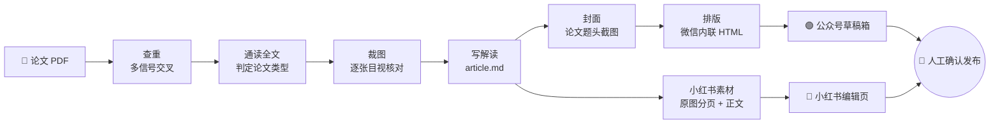
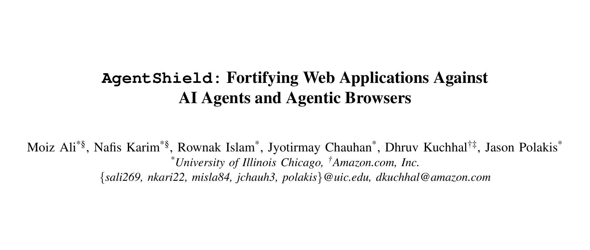

<div align="center">

# 供应链安全前沿 · paper-to-wechat

**把一篇安全顶会论文，变成公众号深度长文 + 小红书图文笔记**

软件供应链安全 × AI Agent 安全｜S&P · CCS · USENIX Security · NDSS · ICSE · FSE


</div>

---

## 📮 关注我们

每篇解读都会同时发在公众号和小红书。公众号是讲机制、讲案例的长文，小红书是论文原图加核心结论的速读版。

<table align="center">
  <tr>
    <td align="center" width="50%">
      <br>
      <b>微信公众号「供应链安全前沿」</b><br>
      <sub>深度长文 · 微信扫码关注</sub>
    </td>
    <td align="center" width="50%">
      <br>
      <b>小红书「供应链安全前沿」</b><br>
      <sub>小红书号 maliverse · 小红书扫码关注</sub>
    </td>
  </tr>
</table>

---

## 📚 最近的解读

| 会议 | 题目 |
|---|---|
| ACM CCS 2026 | 手机 AI 助手每一步都要截屏上传，大模型能从截图里拼出你的收入、健康和住址 |
| arXiv 2026 | Agent 打开一个陌生仓库，就可能跑了里面的恶意代码：15 个模型 14 个中招 |
| IEEE S&P 2027 | 验证码拦不住 AI 浏览器了，网站靠什么认出"对面是个 Agent"？ |
| ACM CCS 2026 | 同一个 Skill 动作换个任务就越权，6.8 万个技能里近一成越权 |
| FSE 2025 杰出论文 | 在 npm 里锁死依赖版本挡不住恶意更新，大项目锁了反而更危险 |
| IEEE S&P 2026 | 三个正常的 MCP server 拼出一条窃密链，1360 个 server 里 27% 能当零件 |
| NDSS 2026 最佳论文 | 一个邮箱在 npm 注册了 139 个账号，邮箱别名让平台和用户都认错了人 |

全部文章在 [`papers/`](papers/)（单篇解读）、[`roundups/`](roundups/)（会议盘点、十年趋势）和 [`talks/`](talks/)（会议报告）。每个目录里的 `article.md` 就是原稿。

公众号文章按合集归档：

| 合集 | 关注什么 |
|---|---|
| 🤖 **AI Agent 安全** | 恶意 Skill、提示注入、MCP、AI 浏览器、Agent 控制面 |
| 📦 **恶意包与威胁情报** | PyPI / npm 恶意包的检测、测量与情报 |
| 🔗 **供应链攻击与防御** | 攻击机理、事件复盘、防御机制、SBOM |
| 📊 **开源与安全测量** | 大规模实证研究、基准测评 |
| 🏆 **顶会论文清单** | 四大安全会议与软工顶会的供应链安全论文盘点 |

---

## ⚙️ 这个仓库做什么

一条半自动的内容流水线：**一个论文 PDF 进去，公众号草稿和小红书笔记出来，最后由人点发布。**

由 [Claude Code](https://claude.com/claude-code) 驱动，不调用任何 LLM API。需要判断力的环节（读论文、挑图、写稿）由 Claude 完成；确定性的环节（裁图、封面、排版、上传）由独立的 Python 脚本完成。



### 效果预览

<table>
  <tr>
    <td align="center"><br><sub>公众号封面：论文第一页的标题和作者</sub></td>
    <td align="center"><br><sub>小红书图：论文原图分页堆叠，配中文小标题</sub></td>
  </tr>
</table>

### 用法

在 Claude Code 里一句话：

```
/paper ~/Downloads/xxx.pdf
```

改完 `papers/<slug>/article.md` 后说"重新发布"，会原地更新同一篇草稿，不会产生重复。

---

## ✍️ 写作规范

解读要讲透，而不是写长：

- **讲机制，不止讲结论**：每个发现都说清"为什么会这样"，数字是证据，机制才是内容。
- **用论文里的具体案例**：那条真实样本、那个 CVE、那张消融表的崩盘数字。
- **深挖 2 到 3 个最反直觉的点**，其余快速带过；论文自己的局限和反例也要写。

按论文类型切换结构和配色，类型只体现在配色和标签上，不写进标题：

| 类型 | 分析侧重 | 强调色 |
|---|---|---|
| **survey** 综述 / SoK | 全景框架、交叉发现 | 青绿 |
| **benchmark** 基准 | 构建严谨性、反直觉结论 | 天蓝 |
| **method** 方法 | 痛点 → 一句话核心洞察 → 那张消融 | 紫 |
| **empirical** 实证测量 | 数字冲击、方法论、伦理设计 | 琥珀 |
| **system** 系统 | 工程取舍、规模化、实战战果 | 玫红 |

去 AI 味的硬约束：正文不用破折号；`1day` / `0day` 按业界写法不意译；红色重点全篇最多 3 处。

---

## 🗂️ 目录结构

```
pipeline/                    # 执行手册（Claude 按它一步步做）
  PAPER_WORKFLOW.md          #   单篇解读：查重 → 读 → 裁图 → 写 → 封面 → 公众号 → 小红书
  ROUNDUP_WORKFLOW.md        #   会议论文盘点
  TALK_WORKFLOW.md           #   会议报告现场解读
scripts/                     # 确定性环节，用 .venv/bin/python 运行
  extract_figures.py         #   PDF 页面渲染、按坐标裁图、题头
  header_cover.py            #   公众号封面：论文题头矢量排版成 1800×766
  render_cover.py            #   品牌封面（A/B 两套版式，点名时用）
  render_article.py          #   article.md → 微信内联 HTML
  wechat_publish.py          #   上传配图和封面 → 草稿箱（幂等）
  render_xhs.py              #   小红书：论文原图按页堆叠 + 配文
  setup.sh                   #   新机器初始化
templates/                   # 封面模板、排版主题、文章骨架
papers/<slug>/               # 每篇论文一个目录，素材与产物严格隔离
  paper.pdf · figspec.json · assets/ · article.md · publish.json
  xhs/                       #   小红书：xhs.json（配置）· images/ · post.txt
roundups/  talks/            # 会议盘点、会议报告
tests/                       # 脚本单元测试
```

---

## 🛠️ 本地运行

```bash
bash scripts/setup.sh        # 建 .venv、装依赖、装 chromium
cp .env.example .env         # 填入公众号 AppID / AppSecret
.venv/bin/python -m pytest tests/
```

再到公众号后台 → 设置与开发 → 开发接口管理 → API IP 白名单，加入本机公网 IP（`curl -4 -s https://ifconfig.me`）。报错 `40164` 就是 IP 变了。

> [!NOTE]
> - `.env` 和 `.claude/` 不入 git，工作流定义在 `pipeline/` 下受追踪。
> - 脚本最多写到草稿箱和编辑页，**发布永远由人点**。
> - 小红书没有个人发布 API，素材由 Claude 在已登录的浏览器里填好，停在「发布」前。

---

<div align="center">

如果这些解读对你有帮助，欢迎关注公众号和小红书「供应链安全前沿」，也欢迎 ⭐ 这个仓库。

</div>
