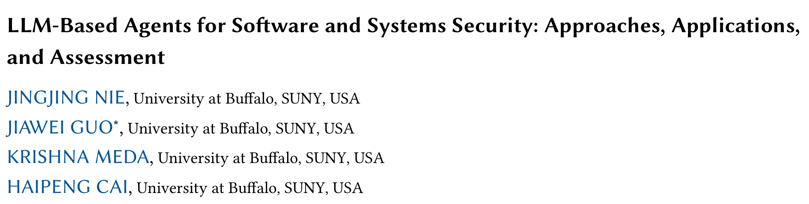
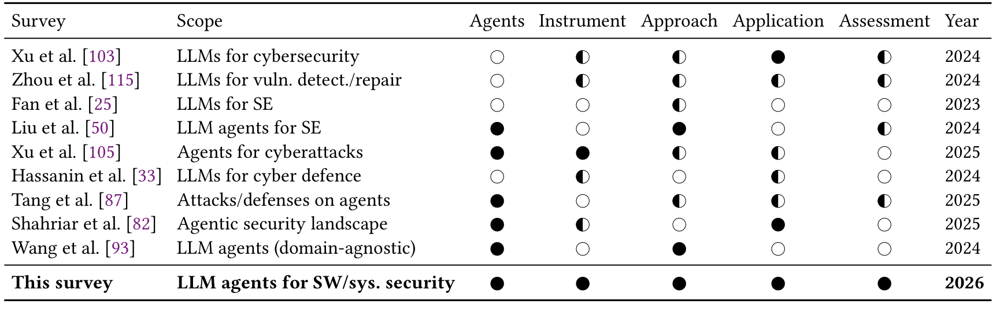
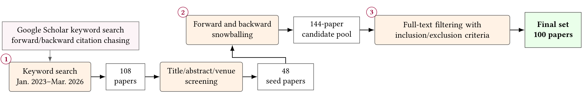
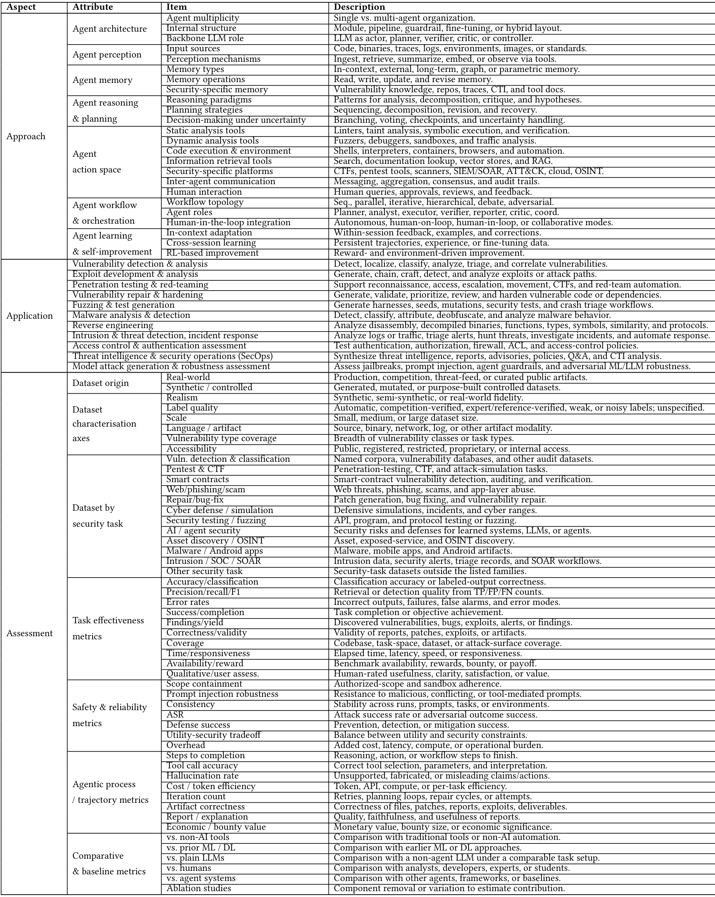
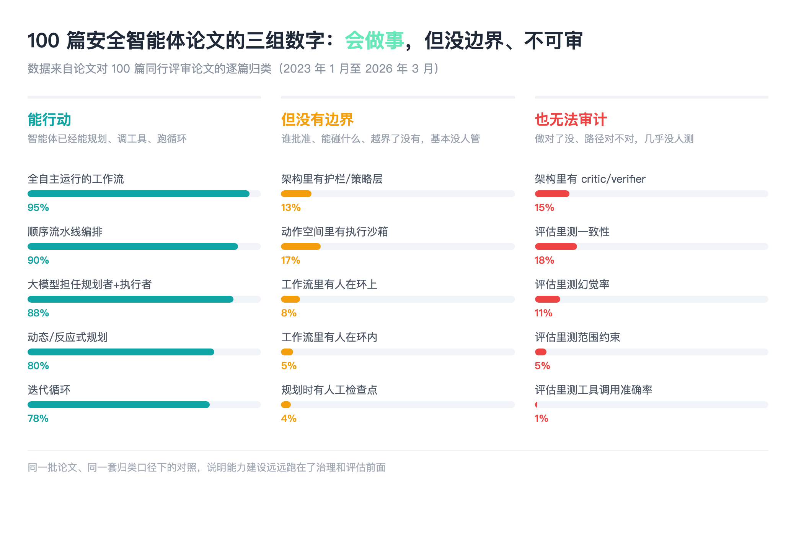

## PAPER INFO|论文信息

【论文题目】LLM-Based Agents for Software and Systems Security: Approaches, Applications, and Assessment
【论文链接】https://arxiv.org/abs/2608.28490

本文由 **University at Buffalo, SUNY** 的研究团队完成，通讯作者 Haipeng Cai 长期做软件分析与系统安全，团队此前在恶意软件演化、安卓生态测量等方向有持续产出。论文标注为投稿中的期刊长文，正文 72 页。

## OVERVIEW|导读

这两年"安全智能体"的论文密度高得离谱：渗透测试的、审仓库的、修漏洞的、盯 SOC 告警的，各家都说自己做了一个 agent。但**"agent"这个词到底指什么，各写各的**：有人把一个会调工具的大模型叫 agent，有人搭了带规划器、执行器、批评者、记忆层和策略层的多智能体系统，两者被放在同一个词底下比较。

这篇综述做的事是把 2023 年 1 月到 2026 年 3 月的 **100 篇同行评审论文**逐篇拆开，沿三条线归类：怎么造的（Approach）、拿去做什么（Application）、怎么评的（Assessment）。三条线合起来看，得出了一个单看任何一条都得不出的结论：

> 这个领域已经造出了**会行动**的智能体，但还没有造出**权限有边界、行为可审计**的智能体。

这句话不是修辞。它是从同一批论文的归类统计里对出来的：95% 的工作让智能体全自主运行，而架构里带护栏或策略层的只有 13%，评估里测过范围约束的只有 5%，==检查过智能体工具调用是否正确的，只有 1 篇==。

## WHY|为什么还需要再来一篇 Agent 综述

Agent 安全的综述这两年已经不少，本账号也解读过好几篇。这篇的位置和它们都不一样，作者用一张表说清了：

关键在 **Instrument** 那一列。市面上大量 Agent 安全综述处理的是"**智能体自己被攻击**"：提示注入、记忆投毒、技能投毒、越狱。本账号解读过的 Dawn Song 团队攻防版图、七层攻击面 LASM、Agent 行为安全综述都属于这一类。这篇反过来，处理的是"**智能体作为安全工人**"：它替你查漏洞、打靶、修补丁、盯告警时，这套系统是怎么被造出来、被评估的。

另一条分水岭是 Agents 那一列：**必须真的是 agent 才收**。已有的"大模型做网络安全"综述（如 Xu 等人那篇 185 篇的 SLR）把大模型当成一个应用到任务上的模型，不刻画规划、工具调用、记忆、编排这套执行模型，而恰恰是这套执行模型决定了智能体**能尝试什么**、以及**必须怎么被评估**。作者因此说自己的语料和那些综述"按构造就是不相交的"。

还有一个容易被忽略的口径选择：==这篇只收同行评审论文，明确排除只挂在 arXiv 上的预印本==。在一个新到不能再新的方向上这么做，代价是漏掉不少热门工作，收益是语料的可检查性。作者在效度威胁一节里如实承认了这个取舍。

## METHOD|三个问题，一张分类表

检索过程本身很规整：关键词组合搜出 108 篇，标题摘要筛到 48 篇种子，前向后向滚雪球扩到 144 篇候选，全文过筛选标准后剩 100 篇。

真正的工作量在分类体系上。作者先逐篇编码记录反复出现的术语和设计选择，再做归并泛化（比如把 tool invocation、shell execution、sandbox execution、browser automation 统一归到"动作空间"底下），最后落成下面这张表。**这张表本身就是这篇综述最有复用价值的产出**，做安全智能体的人可以拿它当自查清单：我这套系统在每一格里填的是什么，哪几格是空的。

有一个细节值得注意：**作者只记录论文明确写出来的东西**，某项能力如果论文没描述，就留空不记。所以下面所有的百分比，读法是"有多少篇论文明确做了并写清楚了"，而不是"有多少篇论文的系统客观具备"。这个口径偏保守，但它衡量的其实是**这个领域的报告规范到了什么程度**，而报告规范本身就是可复现性的一部分。

## GAP 1|自主度跑赢了治理

这是全文最硬的一组对照。

先看左边那一列，能力侧确实成熟了：**95% 的工作是全自主工作流**，90% 用顺序流水线编排，88% 让大模型同时担任规划者和执行者，80% 用动态反应式规划，78% 跑迭代循环。角色分工也已经标准化：分析者 93%、执行者 92%、规划者 74%。这确实是从"大模型是个答题机"到"大模型是个操作系统"的实质转变。

再看中间那一列。**架构里显式带护栏或策略执行层的只有 13%，动作空间里有执行沙箱的只有 17%，工作流里有人在环上的 8%、有人在环内的 5%，规划阶段设人工检查点的只有 4%。** 作者的措辞很克制：这个落差"很扎眼"（striking）。

为什么会这样？机制其实不复杂。**这些系统绝大多数是在基准上被评价的，而基准的成功判据是拿到 flag、复现 CVE、补丁通过测试，全都不需要人参与**。于是"全自主"既是卖点又是最省事的设计：加一个审批环节，benchmark 分数不会涨，论文还得多解释一段。自主度成了免费的加分项，边界成了纯成本。

问题是这些系统自动化的事情是**会打到真实系统上的**：生成利用代码、扫互联网资产、改生产代码、动访问控制策略。论文里点了 RepoAudit 和 ZT-ICAS 两个反例，它们把验证器和护栏做成了架构组件而不是外挂检查，但作者明说"它们仍是例外"。

一句话概括这一节的机制：==智能体的模块化目前是"够用来跑"，而不是"够用来查自己怎么错的"==。验证、策略执行、角色边界还被当成可选增强项，而不是核心架构要求。

## GAP 2|评估只看结果，不看过程

第二组数字更值得从业者警惕。

任务效果类指标用得很齐：成功/完成率 51%、准确率召回 F1 34%、耗时 25%、分类准确率 23%。但**过程类指标就稀薄得多**：token 成本 32%、完成步数 21%、幻觉率 11%、迭代次数 10%、产物正确性 3%，**工具调用准确率 1%**。

工具调用准确率只有 1 篇论文测过，这件事比听上去严重。智能体的整条工作链就是"观察 → 选工具 → 解释输出 → 决定下一步"，工具调用是这条链上唯一和外部世界接触的环节。**不测它，就等于承认你不知道这个成功是怎么来的**：可能是智能体正确理解了扫描器的输出，也可能是它把工具报的一堆噪声瞎猜对了一次。前者可复现，后者换个目标就崩。

为什么没人测？因为**成功率是免费的，轨迹是要标注的**。判断任务成没成，环境自己会给信号；判断这一步工具调得对不对，得有人逐条看轨迹、定义什么叫"对"。这是纯投入，且没有现成的评测口径。

安全侧指标同样稀薄：一致性 18%、攻击成功率 10%、防御成功率 8%、提示注入鲁棒性 6%、范围约束 5%、安全与效用的权衡 4%、开销 3%。**连最常用的那一项都不到五分之一。** 而这些智能体按设计就工作在对抗环境里：读不可信代码、解析攻击者可控的日志、浏览网页、检索外部知识、执行命令。论文提到 AgentDojo、AgentPoison、RedAgent 等工作已经证明智能体本身就是攻击面，但**对抗性评估还远没有成为常规动作**。

最后是我认为全文最锋利的一个数字。基线对比里：和传统非 AI 工具比的 36%，和其他智能体系统比的 28%，和早期 ML/DL 方法比的 27%，做了消融的 26%，和人类比的 12%，==而和"不带 agent 脚手架的裸大模型"比过的，只有 9%==。

这意味着什么？意味着**九成的论文没有证明"agent 化"这件事本身带来了增益**。你换了个更强的底座模型、给了更大的 token 预算、开放了更多工具权限，指标都会涨，这三者和"我设计的智能体架构好"在实验上是混在一起的。作者的原话是：agent 这个词"掩盖了很多组件"，包括规划、记忆、检索、工具封装、验证器、批评者、反馈循环，不做消融就无法归因。

雪上加霜的是报告规范：**18% 的论文根本没说清自己用的是什么推理范式，16% 没说规划范式**。连脚手架长什么样都没写，就更谈不上判断效果来自脚手架还是来自底座模型了。

## GAP 3|长期记忆 57%，但写入只有 7%

第三个缺口比较隐蔽，但对做长期运营的人最有价值。

记忆这一栏的数字乍看很健康：上下文工作记忆 60%，长期/持久记忆 57%，安全领域专用记忆也有模有样，工具文档 49%、执行轨迹与模糊测试日志 33%、漏洞知识库 25%、代码仓库与补丁历史 23%。

但读写是严重不对称的：**读操作 61%，更新/反思 42%，显式写入只有 7%，知识图谱式记忆 10%。**

这个不对称说明了一件事：==所谓的"长期记忆"，绝大多数其实是只读的知识库和 RAG 检索，而不是智能体自己积累下来的经验==。它能查漏洞库、查文档、查历史补丁，但它自己这一趟跑出来的东西，基本不往回写。

跨会话学习的数字坐实了这一点：会话内从反馈学习 32%，而**存下成功轨迹的只有 3%，用来更新微调数据的 2%，示例引导纠错 1%**，强化学习相关的各 9%。

对安全场景来说这是实打实的损失。作者列了一串本该被沉淀下来的东西：**反复出现的漏洞类型、反复失败的工具调用、常见的利用链、SOC 告警的分诊模式**。这些每跑一次都重新经历一遍，跑完就扔。一个盯了三个月告警的 SOC 智能体，和第一天上线的那个，能力上没有区别。

论文点名 Cognitive SOC 是少数把记忆当成"智能体生产出来的东西"而非"只供消费的东西"的系统，它把告警证据转成持久的事件叙事。这个设计思路和 ICSE 2026 那篇 TraceCaps 主张的内联溯源是一路的：**记忆不该只是上下文的堆积，而应该是一个有读写语义、有来源、有冲突处理、能遗忘的受管子系统**。

## APPLICATION|哪些安全任务被做透了，哪些没人碰

应用分布严重偏向漏洞生命周期和进攻侧：漏洞检测 32%、红队自动化 25%、渗透测试框架 25%、日志流量分析 22%、API 与输入面测试 21%、威胁情报合成 19%、事件响应自动化 17%、侦察 17%。

冷清的那一头是：**逆向工程 5%、模糊测试与测试生成 5%、0day 挖掘 4%、恶意软件分析 2%、访问控制与认证评估 1%**。

这个偏斜有清楚的机制：**智能体最擅长的是证据能被表达成自然语言、源码或者常见命令输出的场景**。反过来，需要专门表示和有状态执行语义的任务就吃力：反汇编、反编译代码、调试器状态、调用约定、协议状态机，这些没法靠往提示词里塞文本解决。

对本账号的读者，论文在未来方向那一节点了一份名单值得抄下来。作者明确说，这个领域需要更强的智能体支持的方向包括：==**软件供应链安全、依赖风险评估、访问控制审查、云与 IaC 治理、身份与权限分析、资产盘点、合规证据收集、安全配置管理、安全策略维护**==。原话是这些任务"不如打洞那么光鲜，但它们是真实安全项目里反复要做的工作，而且很适合那种能收集证据、核对文档、基于策略推理、产出可审计建议的智能体"。

这份名单基本就是供应链安全的日常。**一个被顶会论文集体冷落、却被综述作者点名的方向，对选题的人来说是信号而不是噪声。**

还有一条断裂值得说：**现有工作大多只覆盖生命周期里的一段**。检测型智能体停在候选发现，利用型停在证明可攻破，修复型假设缺陷已定位且测试齐备，SOC 型偏重证据合成而不做闭环处置。能把"发现 → 验证 → 定级 → 修复 → 回归验证 → 报告"串起来的设计还很少，BountyBench 因为显式区分了 detect/exploit/patch 三类任务而被单独点名。

## CAVEATS|论文自己承认的边界

综述最容易被当成权威名单来读，所以有必要把作者自己划的线也讲清楚。

**术语不稳是首要威胁。** 有些系统叫自己 assistant、copilot、planner、tool-augmented LLM、multi-step workflow，压根不用"agent"这个词，关键词检索抓不到；反过来，有些论文自称 agent，但实现上并不是这篇定义的智能体。作者靠多关键词组合、人工筛查和滚雪球来缓解，但没法完全消除。

**只收同行评审、排除 arXiv 预印本这条口径影响很大。** 在一个 2023 年才起步的方向上，最新最猛的工作往往还没走完审稿流程。这份 100 篇的名单因此更像"已经沉淀下来的部分"，而不是"当前最前沿"。

**双重用途限制了可报告的内容。** 大量被调研的工作涉及利用生成、红队、越狱，出于安全考虑本就无法完整发布数据集和产物，这反过来又影响了可复现性评估的结论。这是这个领域的结构性困难，不是作者的疏忽。

数据集那一栏也印证了这种张力：**专门构造的程序与环境占 50%，真实生产系统 28%，完全真实世界的数据集 36%，半合成 47%**；标签质量上，**只有 16% 用了专家或参考验证的标签**。可复现和真实性在这里几乎是互斥的。

最后一个数字很能说明这个领域的状态：**100 篇论文散落在 73 个不同的发表场地，其中 58 个场地只贡献了 1 篇**。最多的 TrustCom 只有 5 篇，USENIX Security 4 篇，ICSE 3 篇。==一个还没有主场的方向==，这既解释了为什么口径这么乱，也说明现在正是立规矩的窗口期。

## TAKEAWAYS|启发与点评

**对研究者：这篇的价值不在"有哪些工作"，在那张分类表和那几组空格。** 综述读多了会麻木，因为大多数综述给的是一份已完成工作的清单。这篇的三面耦合设计让它得出了单面综述得不出的结论：方法面的自主度、应用面的风险等级、评估面的安全指标，三者严重错配。作者提的"风险感知的自主度分级"我认为是全文最可落地的建议：**低风险任务（离线摘要、文档检索）可以全自主；中风险任务（漏洞分诊、补丁推荐）应该人在环上；高风险任务（执行利用、生产环境修复、披露决策、主动响应）必须人在环内或者策略校验后执行**。这个分级应该像模型卡一样，成为论文和基准的标配声明。选题上，前面那份被冷落的方向名单里，供应链安全排在第一个。

**对从业者：95% 对 13% 那组数字，可以直接变成采购和试用时的核对清单。** 当有人卖给你一个"全自主安全智能体"，值得问的不是它在某个 benchmark 上多少分，而是这四个问题：护栏在架构的哪一层，是组件还是外挂？哪些动作需要审批，谁定的？越出授权范围时是谁拦，怎么拦？完整轨迹能不能导出给我复盘？==按这篇的统计，绝大多数系统对这四个问题给不出答案，因为造它们的时候就没打算回答==。还有一条更直接的：既然只有 9% 的论文和裸大模型比过，那么当你评估一个智能体产品时，最省钱的对照组就是把同一个任务丢给它的底座模型裸跑一遍，很多时候差距没有宣传的那么大。

**串一条线：两条独立发展的 Agent 安全研究，正在同一个地方撞上。** 本账号过去一年解读的 Agent 安全工作，绝大多数是"把智能体当靶子"：恶意技能、共谋技能链、技能凭据泄露、记忆投毒、运行时护栏。这篇是"把智能体当工人"。两条线原本井水不犯河水，但它们给出的答案正在收敛到同一处：**边界和审计**。攻击侧的结论是"智能体的权限没有边界，所以一次注入就能拿到全部能力"；这篇建设侧的结论是"智能体的权限没有边界，所以你不知道它在替你做什么"。同一个缺失，从两头被撞见。ICSE 2026 的 AgentSpec 做运行时强制、FSE 2026 的 AgentBound 做执行边界、TraceCaps 做内联溯源，这三篇正好长在这个交汇点上，不是巧合。

**最后一句留给做供应链的人。** 我们这个方向过去二十年干的事，本质上就是给制品建立来源、边界和可审计性：签名、SBOM、依赖声明、构建溯源。现在智能体正在成为一种新的制品生产者，而这篇综述用 100 篇论文的统计证明了，==它目前既没有来源记录，也没有权限边界，更没有可审计的行为轨迹==。这三样恰恰是我们最熟的活。与其等 AI 那边重新发明一遍，不如现在就把包生态那套治理语言搬过去。
