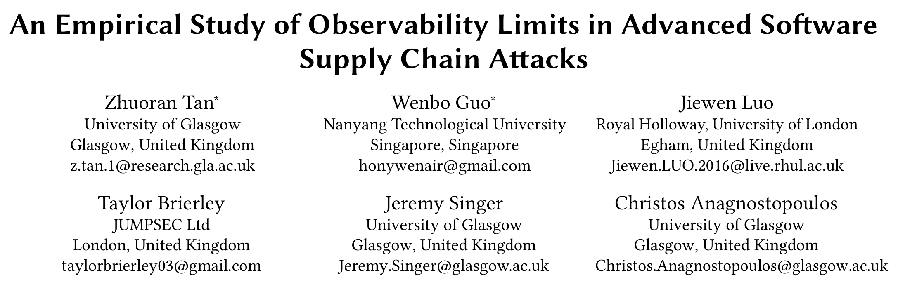
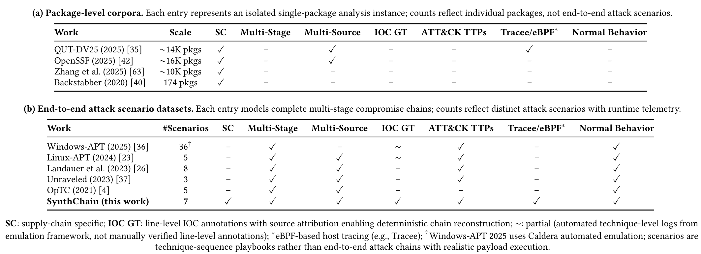
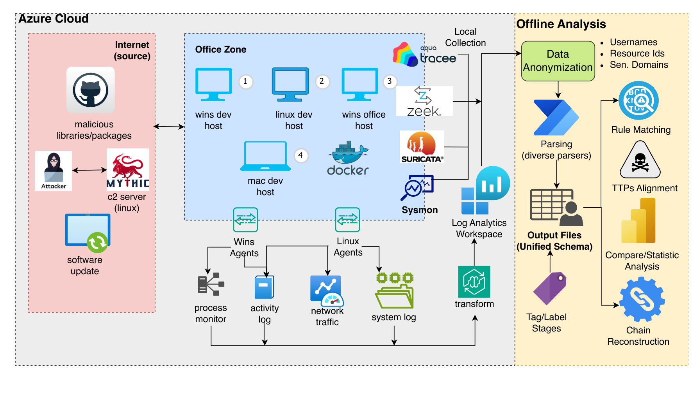
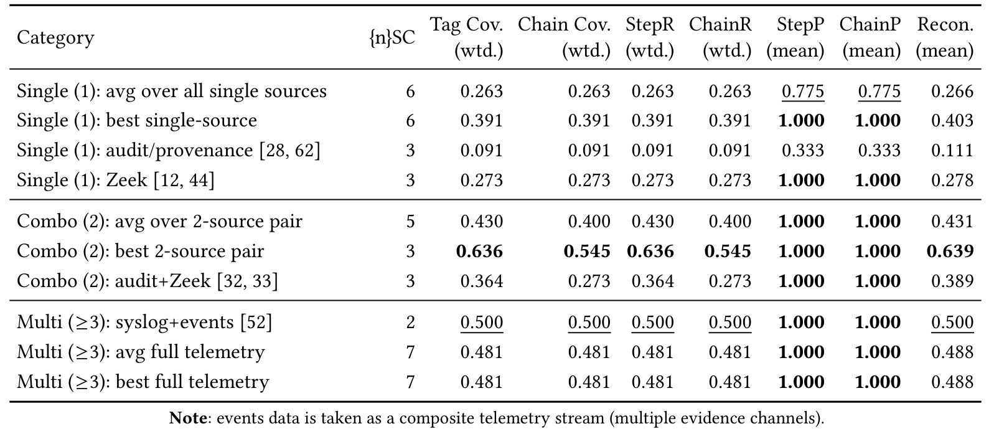
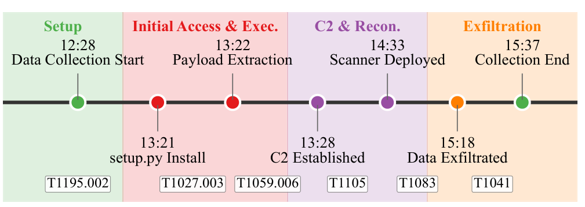

## PAPER INFO|论文信息

【论文题目】An Empirical Study of Observability Limits in Advanced Software Supply Chain Attacks
【论文链接】https://arxiv.org/abs/2603.16694
【数据集】SynthChain，将随论文公开（脱敏遥测、溯源信息与全部标注）

本文由 **University of Glasgow**、**Nanyang Technological University**、**Royal Holloway, University of London** 与安全公司 **JUMPSEC** 的研究者合作完成，发表于 **CCS 2026**。作者名单里带着一家做红队的安全公司，这在数据集类论文里不多见，也解释了场景设计上的实战味道。

## OVERVIEW|导读

这篇论文问的问题，和这两年绝大多数供应链安全研究都不一样。

主流研究在问"**这个包是不是恶意的**"：静态特征、机器学习签名、沙箱里跑一遍。本账号解读过的 MalTotal、PYGUARD、npm 检测器实测都属于这一类。而这篇问的是下一个问题：==假设一个恶意包已经装进来并且跑起来了，你手上的日志，能不能把它到底干了什么拼回来？==

答案是基本拼不回来。研究团队复刻了七个有真实事件出处的供应链攻击场景，采集主机、网络、容器三层的同步遥测，人工逐行标注了 2919 条 IOC 作为地面真相，然后测量"从日志重建攻击链"这件事的天花板：

> 最好的单一日志源只能还原 40% 的攻击步骤；把两个互补的源拼起来能提升约 1.6 倍；但**增益取决于拼的是哪两个，而不是拼了几个**。

更反直觉的是：**选对的两个源（0.639）比把所有日志都打开（0.488）还强**。

## GAP|为什么现有的数据集不够用

供应链安全不缺数据集，缺的是能支撑"链级"分析的数据集。作者用一张表把这件事讲清楚了。

看这张表的两个分组就明白症结在哪。

**上半部分是包级语料**，QUT-DV25 约 1.4 万个包、OpenSSF 约 1.6 万个包、Backstabber 174 个包。它们规模都不小，而且确实是供应链专用的（SC 列打勾），但 **Multi-Stage 一列全是横杠**：每个包被当作一个孤立的分析单元跑一遍沙箱，没有跨阶段的推进过程。这类数据能训检测器，但回答不了"装完之后发生了什么"。

**下半部分是端到端攻击场景数据集**，Windows-APT、Linux-APT、Unraveled、OpTC 这些都是多阶段的，但 **SC 一列全是横杠**：它们建模的是通用 APT 行为，不是由依赖解析和包分发驱动的供应链执行路径。而且 IOC 地面真相一栏，最好的也只是"~"（部分），指的是模拟框架自动导出的技术级日志，不是人工逐行核过的标注。

**两边各缺一半，中间那块正好是供应链攻击最需要的：多阶段、多源、有人工验证的行级 IOC 标注**。SynthChain 补的就是这一块。

顺带一提表格脚注里一个诚实的细节：Windows-APT 用 Caldera 自动化模拟，场景本质是"技术序列剧本"而不是带真实载荷执行的端到端攻击链。**做数据集的人愿意在对比表里把别人的口径讲清楚，比单纯堆自己的指标更可信。**

## BUILD|这个数据集是怎么造出来的

有几个设计决定值得单独说，因为它们直接决定了结论能不能站住。

**第一，攻击者侧的日志全部排除在评估之外。** C2 服务器上 Mythic 框架记录的操作员任务日志，被用来生成地面真相（这些任务自带 ATT&CK 标注），但在打标、建图、链重建、以及所有可观测性指标的计算之前就被剔除了。**这一条是整篇论文可信度的关键：如果拿攻击者自己的日志去评"防守方看不看得见"，那就是自己给自己送答案**。

**第二，故意保留遥测的天然缺口，不做人为补齐。** 不同场景下日志的可得性本来就不同（部分执行、无文件攻击、容器内行为），作者明确说不追求人工完整性，因为要研究的恰恰是"单源什么时候会失效"。

**第三，注入真实的良性背景噪声。** 主机被分配了不同的功能画像（开发机 vs 办公机），跑下载更新、文件操作、外发通信、浏览办公等日常活动，并且随机排程。这一点和很多用固定攻击脚本的测试床不同，目的是让罕见异常更难被孤立出来，更接近真实检测条件。

**第四，链级标注是两条路合并的**：C2 驱动的动作直接从 Mythic 的内置 ATT&CK 标注导出；载荷自身产生的动作走大模型辅助流水线再加人工校验。最终 22 个日志文件里标出 2919 条 IOC，每条都记录了确切的源文件和行号。

**一个很能说明真实性的数字**：采集到的 40 个日志文件里，**只有 22 个含有攻击痕迹，另外 18 个（包括 auth.log、zeek_ssh、suricata.log 等）一条都没有**。作者把这称为"多源环境下攻击信号的真实稀疏性"。做检测的人对此应该很有共鸣：你订阅了一堆日志，其中大半在事故发生时是空的。

## SCENARIOS|七个场景，每个都对着一起真实事件

七个场景不是凭空设计的，是从 **16272 个恶意包**的行为统计里选出的代表性组合，每一个都有公开事件出处：

- **SC1 Stegano**：PyPI 抢注，安装时拉取一张图片，用 LSB 隐写把载荷藏在像素里，内存中执行后经 C2 外传。出自 Checkmarx 追踪了近六个月的一起投毒活动。
- **SC2 Starter**：同一批活动里的另一种，显式多阶段链，靠改启动文件夹做持久化。
- **SC3 Parallel**：npm 生命周期钩子触发并行脚本，分离式侦察与外传。
- **SC4 NPMEX**：源自 Lazarus 相关的依赖链攻击，**多个包按顺序执行、制品在依赖之间传递**，然后才动态拉取代码。
- **SC5 3CX**：被木马化的安装包、DLL 侧加载、内存执行。样本以原始二进制形态执行，重度加壳的部分不做脱壳，只看运行时可观测量。
- **SC6 CloudEX**：CI/CD 场景，从暴露的服务进入，翻出残留的 CI/CD 凭据，访问内部制品仓库，篡改制品向下游传播。
- **SC7 LayerInj**：ML 供应链，被篡改的模型制品里嵌入持久后门，**不含显式恶意代码**，在推理时由触发器激活。

七个场景合起来覆盖了 Enterprise ATT&CK 全部 14 个战术和 216 个技术中的 161 个（75%）。**值得注意的是 SC7：模型文件里没有一行恶意代码，攻击藏在权重里，这类攻击对所有基于代码扫描的防线天然免疫**，而它在后面的结果里也确实是最难重建的一类。

## RESULTS|三组数字：单源、两源、全量

先读最右边的 Recon（还原度）列，从上往下：

- **所有单源平均：0.266**
- **最好的单源：0.403**
- **审计/溯源类日志单用：0.111**
- **Zeek 单用：0.278**
- **两源组合平均：0.431**
- **最好的两源组合：0.639**
- **审计 + Zeek 两源：0.389**
- **全量遥测：0.488**

三件事值得停下来想。

**第一，审计/溯源类日志单独用只有 0.111。** 这个数字扎心，因为基于溯源图的入侵检测是学术界这几年最热的方向之一，NDSS、S&P 上一堆工作建立在系统审计日志之上。这里的实测说明，**在供应链攻击这个具体场景下，审计日志单独拿出来几乎撑不起链重建**。

**第二，组合错了还不如不组合。** 审计 + Zeek 这个看起来很合理的"主机 + 网络"搭配，两个源加起来只有 0.389，**低于最好的单源 0.403**。而最好的两源组合能到 0.639。同样是两个源，差了 1.6 倍。这正是论文那句"取决于哪两个而不是几个"的实证。

**第三，也是最反直觉的：最好的两源 0.639 高于全量遥测 0.488。** 这里要诚实说明口径：这两行的场景数不同（前者 3 个场景，后者 7 个场景），**不是严格同口径的对比，不能简单读成"开满日志反而更差"**。更稳妥的读法是：全量遥测在七个场景上的平均只有 0.488，说明**把所有日志都打开并不能把还原度推到高位**；而在条件合适的场景里，两个互补的源就能达到 0.639。多出来的日志，很多时候只是增加了记录量，没有增加可用的锚点。

论文自己给的机制解释是：==多源只在两种情况下有用，一是补上了缺失的那个阶段，二是加强了跨源的连接；它无法恢复本来就不存在、或者存在但无法关联的证据==。

还有一个容易被跳过但很重要的发现：**在所有相邻步骤的连接里，没有任何一条达到"连通"状态**。四条是"弱连通"（时间上说得通但没有可观测的因果路径，Δt 从 2 分钟到 40 分钟），四条是硬断口（Δt 从 1.8 小时到 144.8 小时）。

作者特意强调了一句：**这不代表攻击证据不存在**。IOC 验证是独立进行的，确认了预期痕迹确实在日志里。Recon 衡量的是另一件事，**用通用的时间与实体关联手段，能不能把这条链拼回来**。证据在，但拼不起来，这是两个不同层次的问题，也是这篇论文最有价值的区分。

## CASE|一正一反两个案例

**正面例子 SC4（NPMEX）**：全量遥测下还原出四个预期步骤中的三个，StepR = 0.75，步骤精确率 1.0。重建出的链是 OUTBOUND_CONN → INSTALL → DOWNLOAD。为什么能拼起来？因为网络遥测提供了稳定的连接级证据把外联锚定在时间和端点上，主机遥测提供了安装的执行上下文和显式的拉取行为，**这些锚点在时间上一致，而且共享可连接的实体：主机身份、进程/用户上下文、端点**。

作者还诚实地解释了为什么没有 EXFIL 节点：观察到的包逻辑是"加载器 + 执行器"结构，它做令牌引导和载荷拉取执行，但公开制品里没有实现显式的"收集 → 序列化 → 发送"例程，所以任何外传行为都只能归到下载来的第二阶段脚本上，而那部分缺少能支撑可靠 EXFIL 锚点的主机侧标记。

**反面例子 SC1（Stegano）**：这个案例是全文最有说服力的一段。

从图上看，这条链清清楚楚：安装、载荷提取、C2、侦察、外传，五个阶段齐全，ATT&CK 编号一路标到 T1041。但**全量遥测跑下来，四个预期步骤里只还原出 INSTALL 一个，StepR = 0.25**。

这一趟摄入了 8534 条归一化记录，可是打标只在安装相关的进程活动上稀疏触发，DOWNLOAD、OUTBOUND_CONN、EXFIL 三个阶段没有产生任何可被规则匹配的锚点。原因是这些证据要么只是间接可见，要么缺少稳定的连接键，要么需要超出保守规则能力的语义理解。

**这就是"证据受限"的失败模式：加更多日志源只增加了数据量，没有增加可用的锚点，多源关联无法补偿缺失或无法关联的证据**。一个五阶段、每步都有真实痕迹的攻击，在开满日志的情况下只能还原出第一步。

## FAILURES|三类失败模式，和不需要预知攻击的部署建议

跨场景分析把失败归成三类：

1. **缺阶段**：真实的可观测性盲区，那个阶段根本没在任何日志里留下痕迹
2. **不可连接**：证据在，但缺少能把它和前后步骤关联起来的标识符，也就是归因断裂
3. **歧义与噪声**：事件太通用（LotL 手法用的都是系统自带工具），或者并发导致无法区分

对应到部署建议，论文给的三条我认为很值得抄下来，因为它们**不需要预先知道会遭遇什么攻击**：

- **确保覆盖基本攻击阶段**：进入、执行、外联、外传，每一段都得有源能看见
- **优先选能提供稳定跨层连接键的源**，而不是选日志量大的源
- **把重建失败本身当成盲区信号**：出现未匹配或被截断的链，就说明那一段的可见性有缺口，据此迭代调整日志配置

第三条是最巧的。它把"我不知道自己有哪些盲区"这个死结解开了：你不需要等一次真实攻击来暴露问题，**只要拿现有日志去尝试重建任何一条已知的多阶段行为，断在哪里，盲区就在哪里**。

采样敏感性分析补了一个实用结论：把每个源的采样率降下来之后，**多源配置的性能衰减曲线明显更平缓**，在采样率 0.25 时仍保留了较高比例的基线还原度，而单源掉得很陡。机制也很直白，一个流因为采样丢了事件，只要连接键还在，其他流的互补锚点就能顶上；单源丢了就是真丢了，没有备份。

## CAVEATS|作者自己划的边界

这篇的自我设限写得比较实在，值得原样转述。

**范围只覆盖利用阶段**。SynthChain 针对的是恶意制品被引入并执行之后、终端主机上的可观测行为，不建模长周期 APT 的大规模横向移动和复杂提权，那些在已有数据集里已经有代表。作者的论证是：供应链攻击利用的是包管理器和构建流水线的默认信任，从安装触发到外传通常在单个会话内完成。

**规则粒度是粗的**。打标和部分重建依赖正则与关键词这类可移植的规则匹配，好处是跨场景可比，代价是当日志模式不同、或者良性软件共享相似的表面词元时会低估行为。作者点名 INSTALL、DOWNLOAD 和依赖/生命周期钩子动作**尤其难以从文本字段上和正常行为区分**，这会拉低精确率。

**排除了 macOS 和 BSD**，理由是其内建保护更强、审计可见性受限，遥测可得性和可比性都不如 Linux 和 Windows。

**伦理设计**：公开发布的只有评估所需的制品（遥测、溯源信息、标注），**不公开可执行载荷和端到端攻击编排**；完整攻击模拟代码走受控访问，仅提供给经过验证的研究者。这个处理方式对做攻击性数据集的人有参考价值。

## TAKEAWAYS|启发与点评

**对研究者：这篇给运行时供应链防御立了第一个可比的靶子。** 过去做检测的论文各自在自己的数据上自评，因为压根没有带链级地面真相的公开数据。现在有了七个场景、多源同步遥测、2919 条行号级 IOC 标注，**检测系统和取证重建方法终于可以在同一张考卷上比**。选题上，论文自己指的未来方向也很具体：拓扑感知的溯源（进程与文件溯源图、包管理器与依赖解析的 trace、用 eBPF 做网络到进程的归因），目标是把关联从表面词元匹配升级成稳定的连接结构。**审计日志单源 0.111 那个数字，对做溯源式入侵检测的人应该是个提醒：在供应链这个场景下，你的输入可能撑不起你的方法**。

**对从业者：这篇能直接改变日志预算怎么花。** 大多数团队采购和配置日志的逻辑是"覆盖面越广越好、留存越久越好"，而这篇给的是另一套逻辑：**按阶段覆盖和连接键来选，而不是按日志量来选**。三个可以马上做的动作：一是拿四个基本阶段（进入、执行、外联、外传）去对照现有日志源，看哪一段没人管；二是检查跨源之间有没有稳定的连接键，主机身份、进程与用户上下文、网络端点，**没有连接键的日志，采得再多也只是存储成本**；三是拿一条已知的多阶段行为去做重建演练，断在哪里，盲区就在哪里。审计 + Zeek 这个看着很合理的组合还不如最好的单源，说明**"我主机和网络日志都有"并不等于你能看见攻击链**。

**串一条线：检测和取证之间，隔着一整层过去没被量化的可观测性。** 本账号解读过的供应链工作，绝大多数停在"这个包是不是坏的"：恶意包检测、包幻觉抢注、检测器横评、情报聚合。这些回答的是入口问题。而这篇把镜头推到入口之后，==发现即便你确知一个恶意包已经执行，你的日志也大概率拼不出它干了什么==。这两件事的落差，正是很多真实事故里"我们知道被打了，但说不清打到哪一步"的根源。做供应链治理的人习惯从制品侧建立信任，签名、SBOM、依赖声明、来源验证，而这篇提醒了另一半：**制品侧的信任建立得再好，运行时看不见，事故复盘依然是黑箱**。这两条线迟早要接上。
