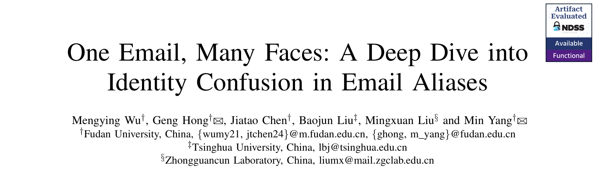
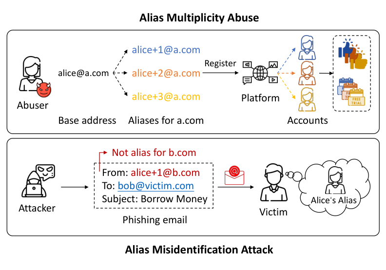
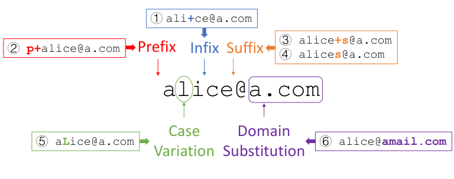
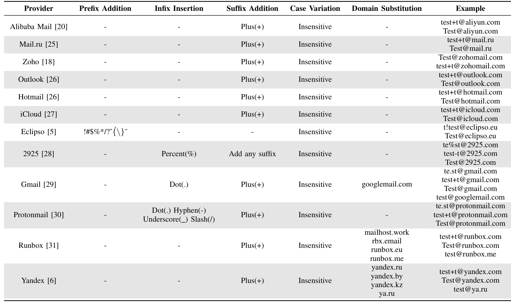
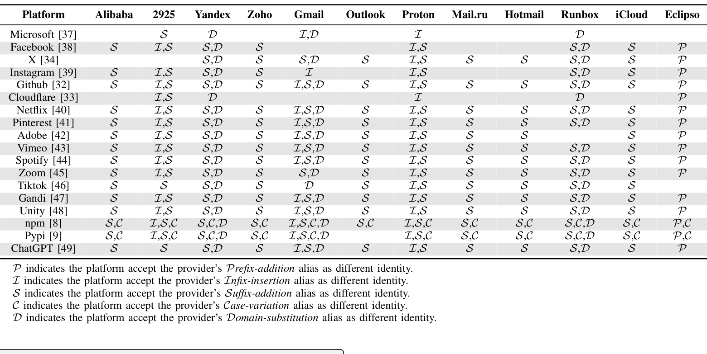
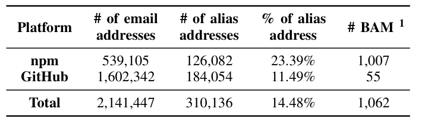
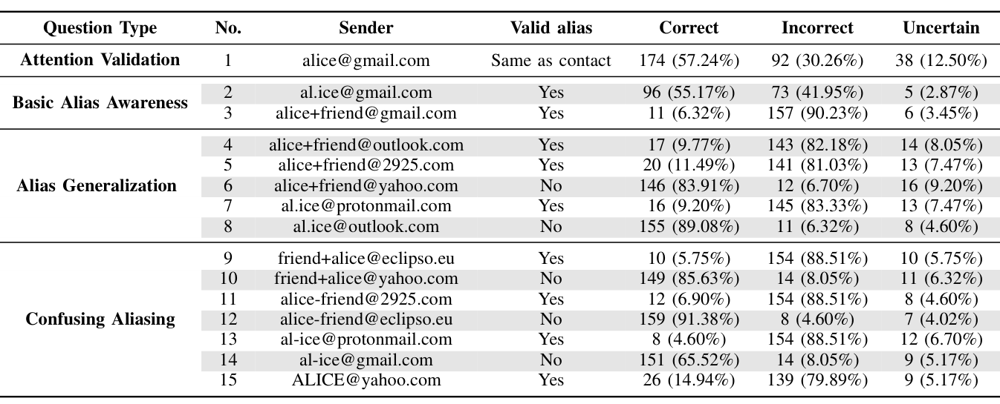
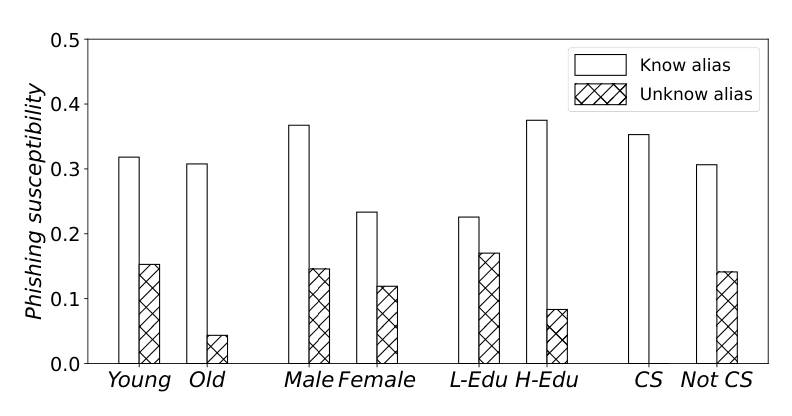

## PAPER INFO|论文信息

【论文题目】One Email, Many Faces: A Deep Dive into Identity Confusion in Email Aliases
【论文链接】https://dx.doi.org/10.14722/ndss.2026.230148
【作者团队】复旦大学、清华大学、中关村实验室

本文来自复旦大学杨珉、洪赓团队，合作方有清华大学刘保君和中关村实验室，发表在 NDSS 2026，**获得了当年的最佳论文奖**（NDSS 2026 共评出 4 篇），同时通过了 NDSS 的制品评估。这是一篇实测类论文：把邮箱服务商、互联网平台、普通用户三方对"邮箱别名"的理解摆在一起比，看它们之间的错位会造成什么后果。

## OVERVIEW|导读

很多人用过 Gmail 的一个小功能：在用户名后面加个加号和任意后缀，比如 alice+shop@gmail.com，邮件照样送到 alice@gmail.com 的收件箱。用户名中间加点也一样，al.ice@gmail.com 和 alice@gmail.com 是同一个邮箱。这叫**邮箱别名**，本意是方便用户按用途区分来信、保护主邮箱。

问题在于，邮箱地址同时还是几乎所有互联网平台的**身份标识**：注册账号、找回密码、限制免费试用次数，都靠它判断"这是不是同一个人"。于是出现了一个三方错位：

- **邮箱服务商**认为 alice+1@ 和 alice@ 是同一个人；
- **平台**往往认为它们是两个不同的用户；
- **用户**以为自己懂别名规则，其实各家规则完全不一样。

复旦团队把这个错位拆成了两类风险，并分别做了测量：

1. 平台分不清别名，一个邮箱就能注册无数账号。作者在 npm 上找到了真实案例：**一个 Gmail 地址通过别名注册了 139 个 npm 账号，10 天内发布了 3904 个垃圾包**。
2. 用户分不清别名，攻击者可以伪造一个"看起来像别名"的地址来钓鱼。实验发现，**自认为懂别名的用户，被骗的比例反而从 12.63% 升到 31.65%**。

## BACKGROUND|两类风险

**别名多账号滥用（Alias Multiplicity Abuse）**。平台用邮箱判断用户是否唯一，但只要邮箱服务商支持别名，一个人就能生成任意多个"不同"的地址。平台如果识别不了，就会把它们当成不同用户，各种按账号限制的东西（免费试用、API 配额、每人一次的福利）都会失效。

**别名误认攻击（Alias Misidentification Attack）**。这一类针对的是人。假设 Bob 知道 Gmail 支持加号别名，他收到一封来自 alice+1@b.com 的邮件，可能会顺理成章地以为这是熟人 alice@b.com 的别名。但如果 b.com 根本不支持加号别名，那 alice+1@b.com 就是另一个人注册的、完全独立的邮箱。邮箱服务商允许别人注册视觉上很像的地址，只要语法合法就行。

## METHOD|测量方法：三方各测一遍

### 邮箱服务商：文档怎么写，实际怎么做

作者先找了全球常用的 40 家邮箱服务商，成功注册了其中 28 家的免费账号（剩下的要付费或无法访问）。然后对每家做两件事：读官方文档里写的别名规则，再实际发信去测真实行为。

测试方法很直接：用自己搭的 SMTP 服务器，往基础地址的各种变体发信，看基础收件箱能不能收到。收到了，说明这个变体是有效别名。变体按五种方式构造：在用户名前面加东西、中间插东西、后面加东西、改大小写、换成同一服务商的其他域名。字符集按 SMTP 和邮件格式协议的规定，限定在 32 个可打印符号加字母数字。

伦理上，所有地址都是作者自己注册的，用 12 位随机用户名避免撞到真实用户，每封信都注明是科研测试，发信间隔控制在 10 分钟以上。

### 平台：注册时认不认得出别名

作者在 Tranco 前 100 的网站里，找到 18 个只用邮箱就能注册的平台，包括 GitHub、Facebook、X、Netflix、ChatGPT、npm、PyPI 等。先用基础地址注册一个账号，再用各种别名变体去尝试注册新账号，看平台是接受、拒绝，还是识别出它和已有账号是同一个人。

为了不真的批量创建账号，测试框架只观察两个时刻的页面反馈：填完邮箱时，以及提交注册表单时。页面弹错误提示就算被拒，没反应或跳到下一页就算被接受，大部分通过检查的账号都没有去激活。

### 用户：能不能分清别名和冒牌货

作者做了一个模拟邮箱界面，让 304 名参与者扮演收信人：通讯录里有几个熟人，然后收到 15 封来信，判断每个发件人是不是通讯录里的熟人。有的发件地址是真别名，有的是看起来像别名的冒牌地址。参与者事先不知道研究和别名有关。

## RESULTS|发现了什么

### 邮箱服务商：几乎没人把规则写清楚

几个关键发现：

- **所有 28 家都把用户名当成大小写不敏感**，ALICE@ 和 alice@ 收进同一个收件箱。但 SMTP 规范其实要求用户名部分**区分**大小写，而且没有一家在文档里写过这一点。
- **除了大小写，还有 12 家支持别的别名形式，只有 Gmail 完整写进了文档**。有 8 家悄悄支持别名却只字不提，比如 Outlook、iCloud、Zoho、阿里邮箱都支持加号后缀，但官方文档里找不到；另有 3 家写了一部分漏了一部分。
- **中缀别名的规则各家完全不同**：Gmail 只认点，Proton 认点、横杠、下划线、斜杠，2925 邮箱认百分号。也就是说，user-name@proton.me 是 username@proton.me 的别名，而 user-name@gmail.com 是一个完全不同的人。

最极端的例子是 Eclipso：它支持在用户名**前面**加一串特殊符号，符号之前的部分会被忽略。这意味着收件人看到一个形如 alice#bob@ 的地址，可能以为是 alice 的，实际上信是 bob 的。

### 平台：没有一个能挡住全部别名

- **18 个平台里，只有 5 个做了别名检测**（Cloudflare、Facebook、Instagram、TikTok、Zoom），而且都只针对特定服务商，比如 TikTok 只认得 Gmail 的加号别名。
- **Cloudflare 走了另一个极端**：凡是带加号的邮箱一律拒绝，不管这家服务商到底支不支持加号别名。这会误伤合法用户，因为没有任何标准规定"带加号就是别名"。
- **9 个平台对任何一家的别名都没有防御**。每家邮箱服务商的别名平均能在 17 个平台上注册出新账号，Yandex 和 Proton 的别名在全部平台上都能通过。
- 一个和软件供应链直接相关的发现：**npm 和 PyPI 把邮箱的用户名和域名都当成区分大小写**。域名部分按 DNS 规则本来就不区分大小写，这两个包管理平台的处理和协议是反的，Alice@example.com 和 alice@EXAMPLE.com 在 npm 上是两个人。

### 真实世界：npm 上的别名刷号

作者把 28 家服务商的别名规则做成了一个开源工具 **OriginMail**，能把一个别名地址还原成它背后的基础地址。然后用它去扫 npm 和 GitHub 上公开的用户邮箱：npm 有 53 万多个、GitHub 有 160 万多个地址。

大部分别名（97.92%）是一个别名对应一个基础地址，属于正常的隐私用法。值得警惕的是**一个基础地址对应多个账号**的情况：npm 上有 1007 个基础地址注册了 2737 个账号。作者拿这份名单去和已知的 npm 垃圾 SEO 包名单交叉比对，发现其中 **533 个基础地址（52.93%）参与过发布 SEO 垃圾包，一共发了 42699 个包**。这类包没有任何功能代码，只在 README 里塞推广内容，借 npm 的域名权重做搜索引擎优化。

最大的一个团伙用一个 Gmail 地址，通过加号后缀和大小写变化，注册了 **139 个 npm 账号**，在 10 天内发布了 **3904 个包**，平均每个账号发 36.87 个。论文另举了一个更小的例子：有人在同一个 Gmail 地址的不同位置插点，注册了 7 个 npm 账号，两天内发了 117 个垃圾包，四个月后才被 npm 下架。

这里能看出别名问题和包生态治理的直接关系：npm 的"每个账号"其实不等于"每个人"，基于账号的限流、信誉、封禁，都能被一个邮箱轻易绕开。

### 用户：越觉得自己懂，越容易被骗

304 份答卷里，有 174 份通过了注意力检查。有效样本的整体正确率只有 40.07%，而且**是否经常查看邮箱，对能否认出别名几乎没有影响**。

最反直觉的是下面这张图：

作者把"把一个不是别名的地址当成熟人的别名"定义为钓鱼误判。结果：

- 不知道别名的人，误判率是 **12.63%**；知道别名的人，误判率升到 **31.65%**。
- 自称了解别名的人里，有 22.78% 连 Gmail 最基本的加号别名都没认出来，主观认知和客观理解之间差了一大截。
- **高学历、男性、计算机背景的人，知道别名后误判率最高**：高学历组 37.5%，男性组 36.73%。计算机专业学生的变化最明显：不知道别名时误判率是 0，知道别名后升到 35.29%。

机制在于**过度泛化**：用户学到了 Gmail 的规则，就默认所有邮箱都一样。比如有人认出了 Gmail 的加号别名，就顺手把 alice+friend@yahoo.com 也当成了别名，可 Yahoo 根本不支持加号别名。半懂不懂的知识，比完全不懂更危险。

### 负责任披露

作者把可用来注册多账号的别名格式报告给了所有被测平台，并把 npm 和 GitHub 上用别名注册多账号的用户名单交给了平台。GitHub 确认用别名注册多个账号属于滥用，封禁了相关的垃圾账号，Cloudflare、Adobe 等也给了确认。

## TAKEAWAYS|启发与点评

**对研究者：身份是"共识"，不是"字段"。** 这篇的切入点很巧：邮箱别名这个功能本身没有任何漏洞，每一方单独看都有自己的道理。问题出在三方对"同一个人"的定义各不相同，而且没有一份公认的标准可以对齐。这和账号前面解读过的不少供应链问题是同一个结构：组件各自正确，组合起来出错。值得注意的是作者的测量设计，从文档、真实发信、平台注册、真实数据、用户认知五个层面交叉验证，把一个看起来很小的功能讲成了一个系统性问题。

**对平台和包管理生态：别把"一个邮箱"当成"一个人"。** 论文给出的建议都很好落地：

- 注册时用 OriginMail 这类工具把邮箱规范化到基础地址，再做去重；
- 前后端的邮箱校验规则要一致，X 的例子说明前端拦了的字符，后端去重接口可能照样放行；
- 有人用别名尝试注册时，给基础地址发一封通知，Facebook 就是这么做的；
- 对 npm、PyPI 这种包管理平台，邮箱的域名部分至少应该按协议做大小写归一。

对包生态来说，这篇还有一层意义：**npm 上那些"批量账号发垃圾包"的现象，背后的账号来源原来如此便宜**。基于账号数量的信誉和限流机制，在别名面前基本失效。

**对普通用户：遇到"像熟人"的陌生地址，先别信。** 作者的建议很朴素：除非你能确定对方邮箱服务商的别名规则，否则任何和熟人地址"只差一点"的发件人，都应该当成陌生人对待。==这篇最值得记住的一句话是：在没有统一标准的地方，半懂的知识比完全不懂更危险。==
