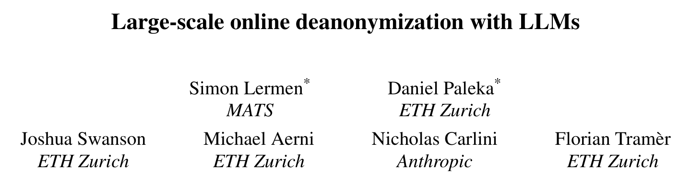
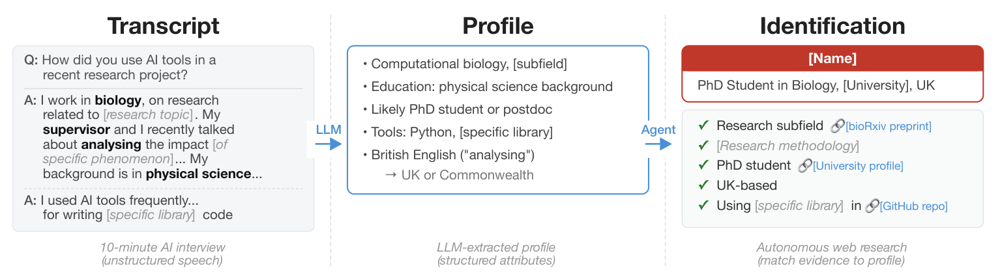
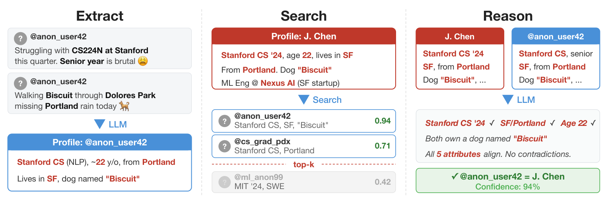
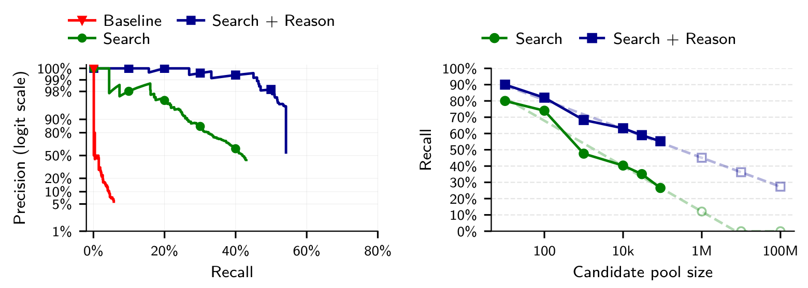
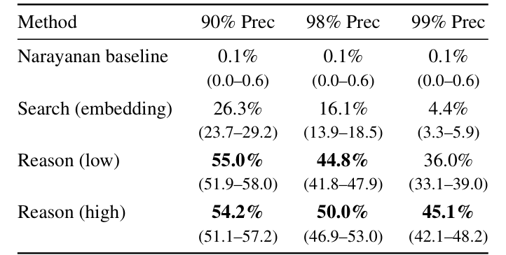
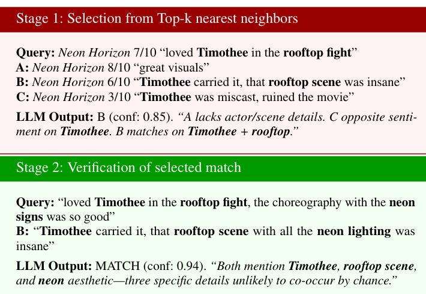
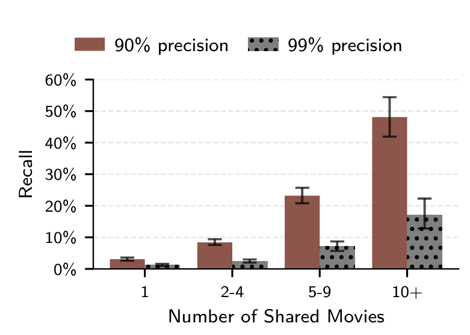
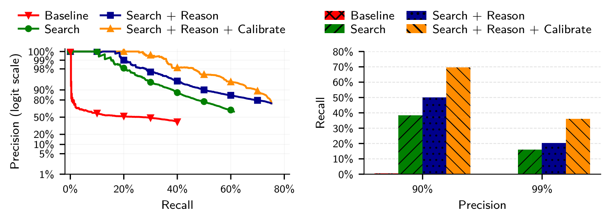
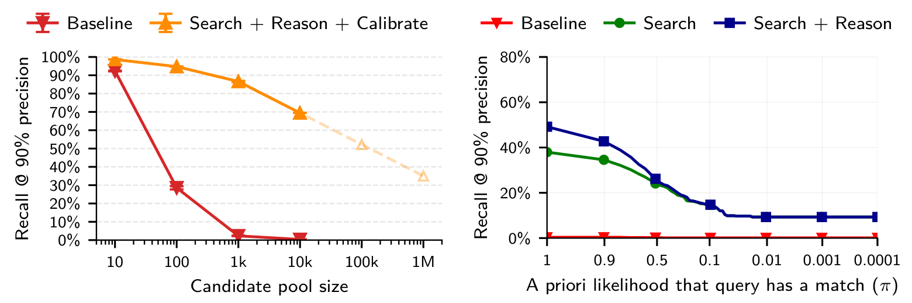

## PAPER INFO|论文信息

【论文题目】Large-scale online deanonymization with LLMs
【论文链接】https://arxiv.org/abs/2602.16800
【作者团队】ETH Zurich、Anthropic、MATS

本文来自 ETH 苏黎世联邦理工 Florian Tramèr 的团队，Anthropic 的 Nicholas Carlini 参与指导，入选 ICLR 2026 的 Agents in the Wild 研讨会。论文发布时上了不少科技媒体，标题大多是同一句话：网上的匿名，正在失效。

## OVERVIEW|导读

很多人在网上有个"马甲"：Reddit 小号、Hacker News 账号、匿名论坛 ID。大家默认它是安全的，理由不是"别人查不到"，而是"查起来太费劲，没人会专门查我"。学界把这种保护叫做**实际上的隐蔽性**（practical obscurity）。

这篇论文要证明的就是：**大模型把"费劲"这一条拆掉了**。核心结论有三条：

- **全自动 Agent 已经能做人肉搜索。** 给 Agent 一段去掉了名字和链接的匿名用户画像，让它自己上网搜，它在 338 个 Hacker News 用户里认出了 226 个（67%），精确率 90%。每个账号的成本只要 1 到 4 美元。
- **规模化之后，经典方法几乎归零，大模型方法依然有效。** 把 Hacker News 账号和 8.9 万份 LinkedIn 简历做匹配，2008 年的经典去匿名方法在 99% 精确率下只能对上 0.1%，大模型流水线能对上 45.1%。
- **用户越"能说"，越容易暴露。** 在 Reddit 电影社区的实验里，只提到 1 部共同电影的用户，识别率 3.1%；提到 10 部以上的，识别率升到 48.1%。

## BACKGROUND|去匿名不是新问题，新的是成本

去匿名攻击有很长的历史。最著名的是 2008 年 Narayanan 和 Shmatikov 的 **Netflix Prize 攻击**：Netflix 公开了一份"匿名化"的影评数据集，两人只用少量电影评分，就把其中的用户和 IMDb 上的实名账号对上了。更早还有 Sweeney 的经典发现：邮编、生日、性别三项就能唯一确定 87% 的美国人。

但这些攻击都有一个前提：**数据得是结构化的**。Netflix 数据是一张"用户 × 电影 × 评分"的表，可以直接算向量相似度。而真实的匿名账号留下的是大段大段的自由文本：一条吐槽、一句闲聊、一个技术问题。要从这些文本里拼出一个人，过去只能靠人工调查员一条条读、一条条搜，几个小时才能查一个人。所以对普通人来说，"没人会花几个小时查我"这个假设基本成立。

作者的判断是：大模型并没有超越人类调查员的**能力**，它利用的信号和一个老练的调查员看到的是同一批，但它把**成本**降低了几个数量级。

> 匿名的保护从来不是"不可能查到"，而是"不值得查"。大模型改变的是后者。

## EXPERIMENT 1|让 Agent 自己上网找人

第一组实验最直观：给一个能联网搜索的大模型 Agent 一份匿名用户画像，看它能不能自己找出这个人是谁。

图1 这个例子很能说明问题。访谈里这个人从没说过自己的名字和学校，但他提到自己做生物方向、背景是物理、有导师（所以大概率是博士生）、写代码用某个特定的库。还有一个很隐蔽的线索：他把"分析"拼成了英式的 analysing，大模型据此推断他在英国或英联邦国家。Agent 拿着这几条特征去搜 bioRxiv 预印本、大学主页和 GitHub，最后锁定了一个人，并且核对每一条特征都能对上。

**ground truth 从哪来？** 研究匿名账号最大的难题是：真正匿名的账号，你没法验证猜得对不对。作者的办法是反过来：找那些**本来就公开了身份的账号**（比如 Hacker News 简介里贴了自己 LinkedIn 链接的用户），再用大模型把直接身份标识抹掉，人为制造一个"匿名"版本，最后看攻击能不能把被抹掉的链接找回来。

抹的规则很讲究：个人网址、社交账号、GitHub 用户名这类一搜就中的信息直接删除；独特的项目名泛化成"创办了某个编程社区"；同事名字、所在城市、学校、兴趣爱好则保留，因为搜这些只会搜到别人或者范围太大，单独用不能定位到本人。这样构造出来的任务，对一个有动机的人类调查员来说也并不简单。

结果：

- **Hacker News**：338 个用户里正确识别 226 个（67%），精确率 90%，另有 25 个认错、86 个放弃。
- **Reddit 学术用户**：25 人里认出 13 个，精确率 72%；**Reddit 求职板块用户**：36 人里认出 9 个，精确率 90%。
- **Anthropic Interviewer 数据集**：这是 Anthropic 公开的 125 份科学家访谈记录，已经做过部分脱敏。此前有研究用"任务拆解"绕过模型的安全限制，在 24 份里认出了 6 个人。这篇不做拆解，直接让 Agent 去查，在 33 份里认出 9 个，精确率 82%。

==整个实验每个账号花费 1 到 4 美元，作者说这相当于一个专职调查员几个小时的工作量。==

作者也坦白了这种做法的局限：真实身份可验证的数据集很小；只能得到一个精确率、召回率的点，画不出完整曲线；而且 Agent 背后的搜索引擎是个黑盒，分不清功劳是大模型的还是搜索引擎的。所以论文的主体部分换了一种更可控的做法。

## FRAMEWORK|拆成四步：抽取、搜索、推理、校准

为了在大规模数据上做严谨评估，作者把去匿名拆成了四个步骤，沿用 Netflix Prize 攻击的骨架，每一步都换上大模型：

1. **抽取（Extract）**：经典攻击只能吃结构化数据，这一步用大模型把自由文本整理成半结构化的画像。图2 里，两条看似无关的帖子（"斯坦福 CS224N 课好难，大四太痛苦"和"带 Biscuit 在 Dolores 公园散步，想念波特兰的雨"）被整理成"斯坦福 CS 专业、约 22 岁、来自波特兰、住旧金山、养了一只叫 Biscuit 的狗"。
2. **搜索（Search）**：把画像转成语义向量，在几千到几百万份候选画像里找最相似的前 k 个。
3. **推理（Reason）**：向量相似度能把范围缩小，但排第一的往往不是正确答案。这一步让大模型把查询画像和前 k 个候选逐一比对，挑出最可能的那个。
4. **校准（Calibrate）**：让大模型给出置信度，低于阈值就放弃。这是控制误判的关键：攻击者宁可少认几个，也不想认错人。

作者在评测时特别强调**高精确率**。因为真实攻击里，认错一个人的代价很高；而一个校准得好的攻击者，在普通用户身上的误判率不会比在测试集上更高。所以论文的主要指标都是"在 90% 或 99% 精确率下，能认出多少人"。

## FINDINGS|发现一：经典方法在规模面前崩溃，大模型不会

第一个大规模实验是 Hacker News 和 LinkedIn 的跨平台匹配：987 份 LinkedIn 简历对应 995 个 Hacker News 账号，候选池是约 8.9 万个活跃的 Hacker News 用户。攻击者知道一个人的 LinkedIn，要在 8.9 万个账号里找出他的匿名号。

经典基线是把 Netflix Prize 攻击改造到职业属性上：把每个人表示成 332 维的属性向量（编程语言、城市、公司、学校、职级），按"越稀有的属性权重越高"来算相似度。

几个值得细看的数字：

- **经典方法几乎完全失效**：只有 5.1% 的人能被排在第一位，各个精确率下召回率都只有 0.1%。原因在于人工设计的属性向量太粗，"会 Python、在旧金山、做后端"的人成千上万，稀有属性又很少出现在简历和帖子里的同一处。
- **语义向量本身就强得多**：90% 精确率下召回 26.3%。但它的问题在高精确率区间：99% 精确率下只剩 4.4%。向量相似度擅长缩小范围，不擅长判断"就是这个人"。
- **推理这一步是关键**：加上大模型推理后，99% 精确率下的召回从 4.4% 升到 45.1%，翻了十倍。而且推理强度越高越好：高推理强度在 99% 精确率下比低推理强度多认出 9 个百分点（45.1% 对 36.0%）。

**规模的影响更说明问题。** 图3 右边，候选池从 1000 扩大到 8.9 万，纯向量搜索在 90% 精确率下的召回从 47.6% 跌到 26.6%，而加了推理的方法只从 68.3% 降到 55.2%。在 99% 精确率下差距更大：8.9 万候选时，推理方法还有 33.0%，纯搜索只剩 4.2%。作者按对数线性外推：到 100 万候选，推理方法还有约 45%（90% 精确率），纯搜索只剩 12%；到 1 亿候选，推理方法估计仍有 27%，纯搜索归零。

> 向量检索负责"把 9 万人缩到 100 人"，大模型推理负责"在 100 人里确定是谁"。经典方法两件事都做不好，而后一件才是高精确率去匿名的瓶颈。

## FINDINGS|发现二：你说得越多，越容易被认出来

第二个实验把条件做得更苛刻，也更接近 Netflix Prize 原题：只用电影讨论来匹配。作者收集了 2024 年同时在 r/movies 和另外五个电影小众社区（恐怖片、电影推荐、Letterboxd 等）发过帖的 9781 个用户，把 r/movies 的发言当作查询，把小众社区的发言当作候选，看能不能对上。

这个任务很难：两边平均只有 2.5 部共同电影，48% 的用户只有 1 部重叠。

图5 展示了大模型推理到底在干什么。它不是在比对"都喜欢某部电影"这种粗粒度特征，而是在找**具体细节的共现**：同一个演员、同一场戏、同一种审美偏好。单看每一个细节都很普通，三个凑在一起就成了指纹。这恰恰是经典方法做不到的：它只能看到"两人都给这部电影打了分"，看不到"两人都在意那场戏的霓虹灯"。

结果：

- 推理强度依然重要：高推理强度在 90% 精确率下的召回是 8.5%，低推理强度只有 5.2%，相对提升 63%。
- **识别率随发言量急剧上升**：在 90% 精确率下，只有 1 部共同电影的用户识别率 3.1%，10 部以上的升到 48.1%。

这个数字比整体识别率更值得普通用户记住。去匿名不是一个"要么安全要么暴露"的二元问题，**每多发一条带个人细节的内容，被认出的概率就上一个台阶**。

## FINDINGS|发现三：认出十万分之一的那个人

第三个实验规模最大，也最接近真实场景：同一个 Reddit 用户的历史发言，按时间切成两段，中间隔一年，模拟"老账号弃用、新开小号"或"主号和小号"的情况。查询端 5000 人，候选端 1 万人（其中 5000 个是没有对应查询的干扰项）。隔一年是为了让两段内容不会因为聊同一件时事而轻易对上，攻击只能依靠稳定的特征：职业、兴趣、生活习惯、表达方式。

这里作者还加了一个新的校准方法：让小模型对"查询与候选"的配对两两比较，看哪一对更像同一个人，用瑞士制锦标赛的方式跑 15 轮，再按 Bradley-Terry 评分排序。这种方法只在批量攻击很多人时才用得上，但效果很明显。

完整流水线在 90% 精确率下召回约 70%，在 99% 精确率下仍然能认出约三分之一的用户。经典方法在 90% 精确率下就已经认不出任何人。

**更关键的是两个"难度旋钮"实验。** 前面的实验都假设每个查询用户在候选里一定有对应账号，这对攻击者是最有利的情况。真实世界里，攻击者面对的候选池更大，查询的人也大多根本没有小号。作者分别调了这两个参数：

- **候选池扩大**：经典方法在 10 个候选时还有 92% 的召回，100 个候选就跌到 29%，1000 个时接近 0。大模型方法在 1 万候选时仍有约 70%，外推到 100 万候选还有约 35%（90% 精确率）。作者提醒这只是粗略外推，误差较大。
- **先验概率降低**：这个结果最反直觉。==即便一万个查询里只有一个人真的有对应账号，大模型方法仍能在 90% 精确率下认出其中约 9% 的人==。也就是说，攻击者不需要事先知道目标有没有小号，大模型对大多数人会选择放弃，对少数能认出的人则认得很准。

## CAVEATS|作者自己承认的局限

这篇论文的讨论部分很诚实，有几点值得一提：

- **数据集偏向"容易认"的用户。** 愿意在 Hacker News 简介里贴 LinkedIn 的人，本来就不太在乎匿名；同一用户切成两段，内容天然比两个独立的马甲更像。所以召回率可能高估了真实情况。但作者认为误判率是可以迁移的：校准得好的攻击者，在普通用户身上不会更容易认错。
- **会不会是模型背下了训练数据？** 大模型可能在训练时见过 Reddit 和 Hacker News。作者的反驳是：提高推理强度能显著提升效果，说明推理在起作用，不只是记忆；而且 LinkedIn 数据大概率不在训练集里。退一步说，主流社交平台大多在训练语料里，就算是记忆，威胁也只对没被收录的平台减弱。
- **伦理设计。** 研究经过 ETH 伦理审查委员会批准；没有对任何真正匿名的 Hacker News 或 Reddit 账号做去匿名；论文里不披露任何人的身份；不公开攻击代码、提示词和处理后的数据集。Agent 实验只在高层描述，不给具体配置。

## TAKEAWAYS|启发与点评

**对研究者：隐私的威胁模型需要重写。** k-匿名、差分隐私这些经典框架，是为结构化数据库设计的，假设攻击者只能做直接匹配或统计查询。这篇论文说明，非结构化文本里的语义信号同样足以识别个人，而且大模型能低成本地把它们拼起来。作者提出的"抽取、搜索、推理、校准"框架，以及用"公开身份账号人为匿名化"和"同一用户切分"来构造 ground truth 的方法，对后续做隐私评估、数据集发布前审查都很有参考价值。值得注意的是，用大模型做文本脱敏也只是部分缓解，此前已有研究表明脱敏后的文本仍会残留语义信号。

**对平台和大模型厂商：防御比想象中难。** 作者列了几条缓解思路：限制用户数据 API 的调用频率、检测自动化爬取、限制批量导出、模型厂商监测滥用行为。但作者自己也不乐观，因为这套攻击被拆成了总结画像、计算向量、比较排序这些看起来完全正常的任务，单看每一步都和正常用途无异，安全护栏很难拦。这和 Agent 安全里反复出现的一个问题是同一个道理：**危险的往往不是某一步操作，而是一串正常操作的组合**。

**对每个用马甲的人：** 论文的结论说得很直接，持久使用同一个用户名的人，应该默认攻击者能把你的账号和真实身份、以及你的其他账号关联起来，而且你每多发一条带个人细节的内容，这个概率就再升一点。具体来说，不同场景用不同账号，避免在小号里提到职业细节、城市、学校、宠物名这类组合起来能定位到人的信息。

**一个延伸的观察。** 这篇和 Carlini 等人之前那篇"大模型让漏洞利用变现的新路径"思路一脉相承：大模型未必带来全新的攻击能力，但它改变了攻击的**经济账**。过去只值得针对高价值目标的手工活，现在可以对每一个普通人批量做。论文里有一句话概括得很好：大模型像一台"信息显微镜"，把过去昂贵的人工攻击变成了可以规模化的流水线。对安全从业者来说，评估一个风险时只问"技术上能不能做到"已经不够了，还要问"做一次要花多少钱"。这个成本一旦降到每人几美元，很多过去被默认"没人会这么干"的威胁，就都要重新评估。
