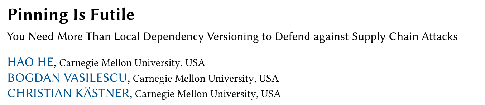
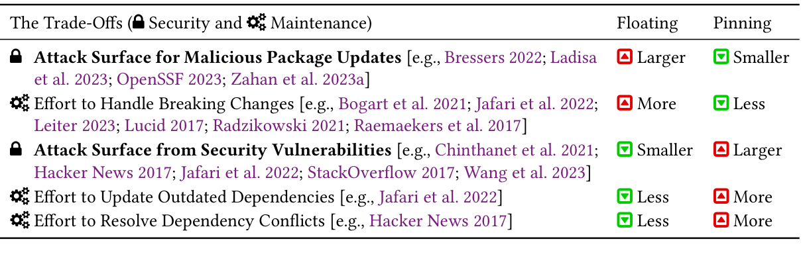
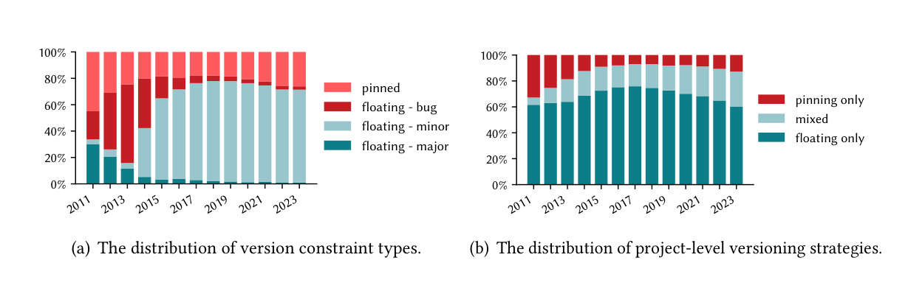
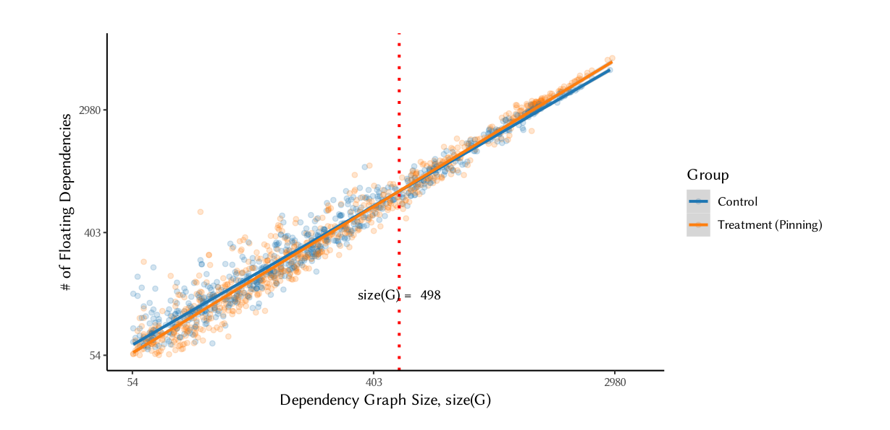
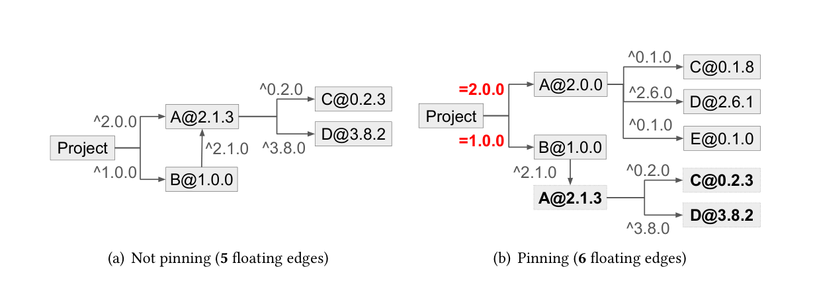
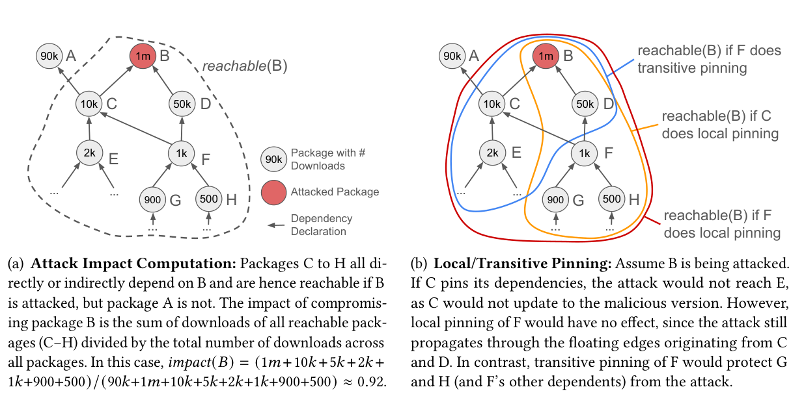
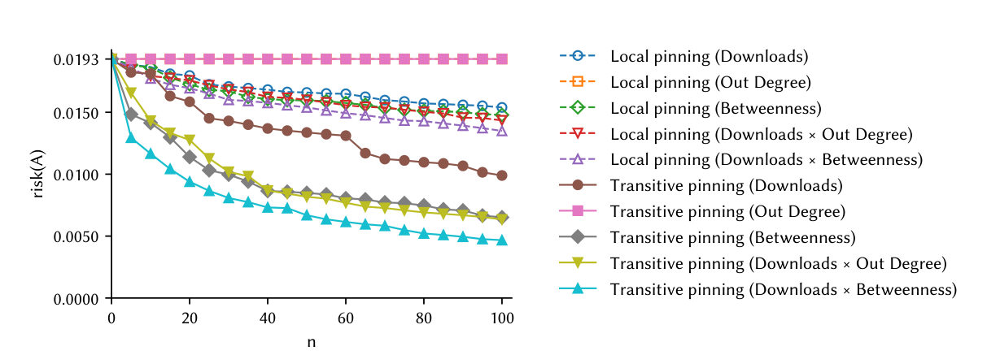

## PAPER INFO|论文信息

【论文题目】Pinning Is Futile: You Need More Than Local Dependency Versioning to Defend against Supply Chain Attacks
【论文链接】https://arxiv.org/abs/2502.06662
【数据开源】https://doi.org/10.5281/zenodo.14693233
【作者团队】Carnegie Mellon University

本文来自卡内基梅隆大学，作者是 Hao He、Bogdan Vasilescu 和 Christian Kästner。后两位是软件工程领域研究开源生态和依赖管理的代表人物。论文发表在 FSE 2025，并获得了 **ACM SIGSOFT 杰出论文奖**。它回答的是一个在业界争论了很多年、却一直没有数据的问题：锁定依赖版本，到底能不能防住供应链攻击。

## OVERVIEW|导读

npm 项目声明依赖时有两种写法。一种是**浮动**（floating），比如 `^1.2.0`，意思是"1.x 里最新的都行"，每次安装自动拿到最新的兼容版本；另一种是**锁定**（pinning），比如 `1.2.0`，只要这一个版本。

浮动的好处是安全补丁能自动传下来，坏处是恶意版本也能自动传下来。node-ipc 投毒、xz 后门这些事件之后，安全社区越来越倾向于锁版本：OpenSSF Scorecard 把"锁定依赖"列为 18 项安全最佳实践之一，有调查把它排进防供应链攻击性价比最高的前三项措施。

这篇论文用数据检验了这个"最佳实践"，结论很反直觉：

> ==在 npm 里锁定直接依赖，防恶意更新的作用很弱；依赖图超过 498 个包时，甚至会让攻击面变大。与此同时，它明确增加了漏洞、过期依赖和依赖冲突的维护成本。==

作者给出的替代方案是：与其让每个开发者各自锁版本，不如集中资源守住少数关键包。他们模拟发现，如果 npm 支持"传递锁定"，只守住 100 个关键包，整个生态被恶意更新波及的风险就能降低 75.81%。

## BACKGROUND|锁还是不锁，争了很多年

这张表是争论的全貌：锁定只在两项上占优（恶意更新攻击面更小、破坏性变更更少），在另外三项上吃亏（漏洞暴露更多、要手动更新的过期依赖更多、依赖冲突更多）。安全从业者看重第一项，npm 开发者社区则长期认为锁定是一种"坏味道"，会不断累积技术债。

争论之所以一直没结果，是因为缺一个关键事实：**一个项目只能控制自己的直接依赖**。一个典型的 GitHub 项目只有 11 个直接生产依赖，传递依赖却有 150 个；算上开发依赖，是 23 个对 848 个。你锁住的那一小部分，在整张依赖图里占比很小，剩下的版本范围都写在上游包的 package.json 里，你管不着。

作者统计发现，安全社区的呼吁确实被听进去了：大约从 2020 年起，npm 生态里锁定依赖的比例开始回升。所以这个问题已经不只是理论之争，越来越多项目正在按这条建议改自己的配置。

## METHOD|怎么测：让每个项目"穿越"回去锁一次

要知道锁定的真实效果，最理想的办法是让同一个项目在同一时间既锁又不锁，然后比较。这在现实中做不到，但作者借助 npm 一个没有写进文档的参数做到了。

**数据**：从 npm 下载量前 5%、仍在维护的包里选了 1 万个，再从 GitHub 上用 npm 的活跃项目里选了 1 万个，一共两万个项目。

**时间穿越**：npm 命令行有一个 `--before` 参数，可以按某个历史时间点的仓库状态来解析依赖。作者以 2022 年 9 月为起点，对每个项目做两件事：

- **对照组**：按项目原本的 package.json 解析依赖图；
- **实验组**：把 package.json 里所有直接依赖都改成锁定版本，再解析一次。

然后在接下来一年里每隔 90 天再解析一次，共 5 个时间点，观察两种依赖图怎么演化。这是标准的反事实分析：同一个项目、同一个时间点，唯一的区别就是锁没锁。

**五个指标**，对应前面表里的五项权衡：

- 浮动依赖数：整张图里有多少条边是浮动的，代表恶意更新的攻击面；
- 自动更新次数：代表破坏性变更的风险；
- 已知漏洞数：按 GitHub Advisory 统计；
- 过期的直接依赖数；
- 膨胀依赖数：同一个包在图里装了多个版本，代表依赖冲突。

最后用固定效应面板回归估计"锁定"对每个指标的影响，并加入锁定与依赖图规模的交互项，检验锁定的效果会不会随项目大小变化。

这里有一个保守假设需要说清：模拟里，锁定之后开发者**一次都不手动更新**。现实中勤快的开发者会定期更新，漏洞和过期依赖的成本会低一些，但相应要付出人工维护的成本。

## RESULTS|发现了什么

### 成本：和预期一致，锁了就要多干活

锁定直接依赖之后，三项成本指标都显著上升：过期依赖数的平均值从 5.96 升到 8.78，已知漏洞数从 2.13 升到 2.70，膨胀依赖也变多了。而且依赖图越大，这三项成本涨得越多，漏洞暴露受规模影响最明显。

这部分是业界早就预料到的，本身不算新闻。真正的发现在收益那一侧。

### 收益：攻击面基本没缩小，大项目反而变大

锁定确实能减少一点浮动依赖，但这个效果随依赖图变大而迅速减弱。回归模型给出的交叉点是 **498 个依赖**：超过这个规模，锁了直接依赖的项目，整张图里的浮动依赖反而**比不锁更多**。数据集里有 **26% 的 GitHub 项目**落在这个区间。

至于另一个预期收益"减少破坏性变更"，回归模型几乎解释不了什么（R² 小于 0.1），说明自动更新多不多，主要取决于选了哪些依赖，而不是锁没锁。

### 为什么锁了反而更多：npm 的去重机制

这是全文最值得讲透的一点。原因不在锁定本身，而在 npm 解析依赖的方式。

npm 有一个其他包管理器很少有的特点：同一个包可以在依赖图里同时装多个版本。解析时，npm 会尽量找一个能同时满足所有约束的版本，只装一份，这叫去重。浮动约束范围宽，去重的余地就大；一旦你把直接依赖锁死，约束变窄，npm 就更难找到一个公共版本，只好多装几个版本。而每多装一个版本，就可能连带多出一串它自己的浮动依赖。

图里的例子只是简化版，真实情况发生在几百上千个依赖的大图里。机制是一样的：**你在自己这一层锁死一个版本，并没有让上游停止浮动，反而迫使 npm 引入更多版本的副本，攻击者能下手的版本范围、甚至能下手的包都变多了。**

作者也提醒，这个"反而变大"的效应是 npm 特有的。Maven 这类每个包只能装一个版本的生态里，锁定的安全收益同样很小，但不会变成负的；代价是依赖冲突会更难解决。

### 换个思路：守住少数关键包

既然每个项目单独锁版本没用，那如果集中力量，让少数关键包的维护者锁定依赖、认真审查每次更新再升级，能不能保护整个生态？

作者在完整的 npm 依赖网络上做了模拟：156 万个包、787 万条依赖边。攻击者随机攻击下载影响力前 1000 的包之一；不做任何防护时，一次攻击平均会波及 **1.93% 的 npm 下载量**。按 2024 年每天约 120 亿次下载估算，这个量级非常大。

这里区分了两种锁定方式：

- **本地锁定**：就是 npm 现在能做的，维护者只能锁自己的直接依赖；
- **传递锁定**：npm 目前**不支持**，需要改工具链，让包的发布者把自己的 lock 文件一起发布出去，下游安装时也遵守它。这样维护者锁住的是自己的整张依赖图。

结果差距很大：

- 用现有的本地锁定，守住 20 个关键包能把生态风险降低 12.21%，守住 100 个降低 30.09%；
- 如果支持传递锁定，守住 20 个包就能降低 **51.34%**，守住 100 个降低 **75.81%**。

两种方式下，按"下载量 × 中介中心性"挑包的效果都最好，也就是优先守那些下载多、又处在大量依赖路径上的包。传递锁定的效果是本地锁定的两到三倍。

这组数字有一些乐观假设：被选中的维护者能立刻审查每次更新、而且一定能识别出恶意版本。作者明确说，这应当看作一次可行性探索，不是可以直接照搬的实施方案。

## TAKEAWAYS|启发与点评

**对研究者：供应链防护要算整张图，不能只看一个节点。** 这篇最大的价值，是把"锁版本更安全"这条直觉放进真实的依赖图里检验，发现它在局部成立、在整体失效。作者用的方法也值得借鉴：用包管理器自带的时间穿越能力做反事实模拟，把一个只能靠经验争论的问题，变成了可以回归分析的数据问题。它还留下了不少开放问题：其他生态里结论会不会不同、怎么更好地挑选要守护的关键包、锁定会不会给下游带来额外的依赖冲突。

**对从业者：别把锁直接依赖当成安全措施，用 lock 文件。** 论文给出的建议很具体：

- 应用项目应该**提交 lock 文件**（npm 里就是 package-lock.json），它锁住的是整张依赖图，包括传递依赖，而且能防止 CI/CD 环境自动装上新版本。数据集里只有 44.21% 的 GitHub 项目这么做了；
- 在 npm 这样以浮动为主流的生态里，"锁定了直接依赖"并不能说明一个项目更安全，作者认为 Scorecard 这类安全评分**不应该**因此加分；
- 如果确实锁了版本，要配套定期更新的流程，否则漏洞和过期依赖会持续堆积。

**对生态治理：资源应该往少数关键包集中。** 作者的思路和当年 Heartbleed 之后 Linux 基金会发起核心基础设施计划、Google 提供 Assured Open Source Software 是一脉相承的：说服 100 个关键包的维护者改变做法，比说服 npm 上几乎每一个维护者现实得多。前提是工具链要跟上，比如支持发布并遵守包的 lock 文件。

**一个延伸的观察。** 整场"锁还是不锁"的争论，其实都建立在一个前提上：恶意版本发布后，会在很长时间里不被发现。论文引用的数据是，从发布到下架平均要 209 天。如果恶意包能更快被发现、甚至在发布前被拦下，版本策略本身的重要性就会小很多。所以这篇论文和恶意包检测是同一件事的两面：前者讨论怎么减少暴露，后者讨论怎么缩短暴露时间，两者都需要。
