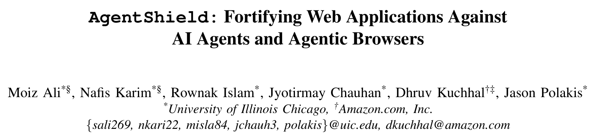
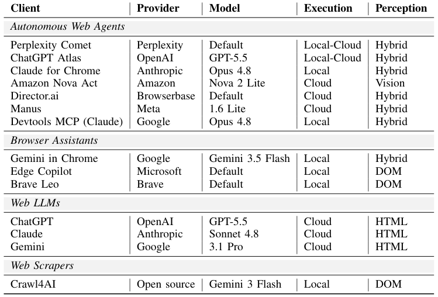
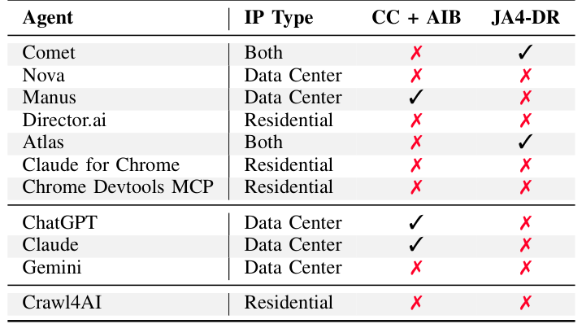
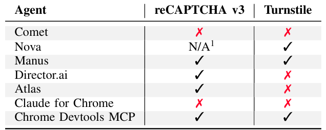
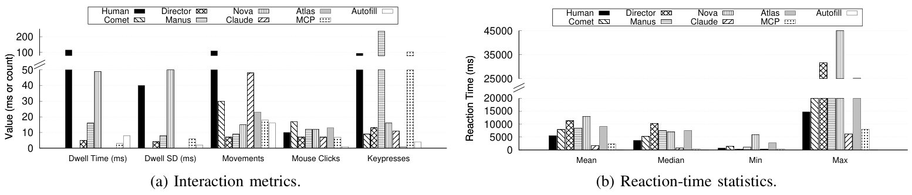
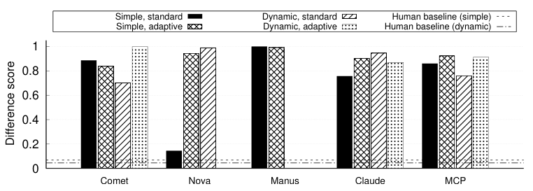
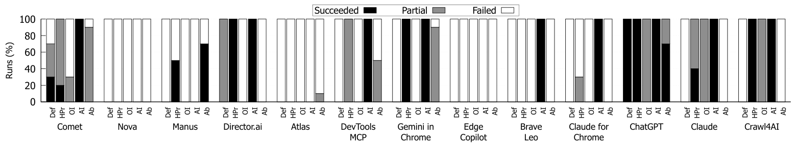

## PAPER INFO|论文信息

【论文题目】AgentShield: Fortifying Web Applications Against AI Agents and Agentic Browsers
【论文链接】https://arxiv.org/abs/2610.41181
【作者团队】University of Illinois Chicago、Amazon

本文来自伊利诺伊大学芝加哥分校 Jason Polakis 团队，他们长期研究浏览器指纹和反爬虫，论文将发表在 IEEE S&P 2027。

## OVERVIEW|导读

过去网站对付机器人，靠的是一个隐含前提：**机器人和真人在技术上看起来不一样**。脚本用的是数据中心 IP、无头浏览器、非标准的 TLS 握手，鼠标轨迹是直线，打字速度恒定。验证码、IP 信誉、浏览器指纹，全都建立在这些差异之上。

AI 浏览器把这个前提打破了。Perplexity Comet、ChatGPT Atlas、Claude for Chrome 这类产品，直接在用户自己的电脑上、用用户自己的浏览器干活：IP 是家庭宽带，浏览器是真 Chrome，登录态也是用户本人的。Cloudflare 的数据显示，AI 爬虫流量一年增长了 18%，GPTBot 的份额从 5% 涨到 30%，而只有约 14% 的头部网站在 `robots.txt` 里针对 AI 写了规则。

这篇论文做了三件事：

- **系统评估**：拿 14 个 AI 客户端去测 IP 过滤、TLS 指纹、Cloudflare AI 爬虫拦截、reCAPTCHA v3、Cloudflare Turnstile、User-Agent 自报、请求签名这些主流防御。结论是：在用户本机运行的 Agent，几乎能穿过所有防线。
- **提出 AgentShield**：不问"你是谁、从哪来"，而是看"你怎么做事"。核心是利用 Agent "感知、推理、行动"循环（论文称为 PRA 循环）在交互节奏上留下的痕迹。
- **研究两类可以反过来利用的 Agent 弱点**：页面里的隐藏内容能左右 Agent 的输出；以及一种新现象"消退诱发的策略漂移"，即 Agent 卡住时会放松自己的安全约束。

## PROBLEM|现有的反机器人防御，问错了问题

作者先把 AI 客户端分成四类：

- **自主网页 Agent**：Comet、Atlas、Claude for Chrome、Amazon Nova Act、Director.ai、Manus，以及接了 Chrome DevTools MCP 的 Claude。它们驱动一个真实浏览器，自己导航、点击、填表。
- **浏览器助手**：Gemini in Chrome、Edge Copilot、Brave Leo。它们不自己发请求，只读用户已经打开的页面。
- **网页版大模型**：ChatGPT、Claude、Gemini 的联网搜索模式，直接抓取 HTML。
- **网页抓取工具**：开源的 Crawl4AI，把页面转成适合大模型读的格式。

然后逐类测现有防御。

**网络层：只能抓到用云端 IP 的。** IP 过滤只对从数据中心发请求的 Agent 有效。在用户本机运行的 Agent，以及通过住宅代理出网的 Director.ai，看起来和真人访客没有区别。Cloudflare 的 AI 爬虫拦截在它理应能识别的数据中心 IP Agent 里只拦下了 3 个。一个有意思的发现：Comet 和 Atlas 会同时从用户浏览器和厂商云端各发一次请求，形成"双请求"模式，可以被检测到，但 Cloudflare 的默认防御并不拦它们。

**验证码：本地运行的 Agent 反而最容易过。** reCAPTCHA v3 和 Turnstile 检查的是浏览器环境是否真实。对在用户本机真实浏览器里运行的 Agent 来说，这个环境本来就是真的。Turnstile 只验证当前会话的环境，只识别出 3 个 Agent。

**自报身份：只能靠自觉。** 有些 Agent 会在 User-Agent 里标明身份，比如 `Perplexity-User/1.0`。但 Comet 和 Atlas 只在云端那次请求里自报，真正在用户浏览器里和页面交互的那次请求，用的仍是普通 Chrome 的 User-Agent。基于 RFC 9421 的请求签名几乎没人用，只有 Nova 签了名；ChatGPT 的 Agent 模式在 chatgpt.com 里会签名，放到 Atlas 里就不签了。

> 现有防御问的都是"你是谁、从哪来"。而最难对付的那类 Agent，恰恰运行在用户自己机器上的真实浏览器里，这两个问题都答不出区别。

## INSIGHT|核心洞察：Agent 的"反应节奏"藏不住

既然身份和环境都无法区分，那就看行为。作者的核心洞察是：

> 每个 AI Agent 都在跑同一个循环：截图或读取页面（感知），把状态发给大模型决定下一步（推理），再执行点击或输入（行动）。这个循环的时间开销主要来自大模型推理，而不是打字或移动鼠标的速度，所以它会在交互节奏上留下人类没有的痕迹。

为了把这个痕迹放大，作者设计了一种**动态表单**：一个注册页面，22 个字段，每填完一个才显示下一个，而且显示哪个字段取决于前面的选择（比如选了美国才出现"州"）。字段一直在网页结构里，只是用 CSS 设成透明、尺寸为零，所以无法提前读到。这样一来，Agent 每填一个字段都必须重新看一遍页面、再推理一轮，**每个字段从出现到被第一次操作的时间间隔，就是一次完整 PRA 循环的耗时**。

表单在后台记录四类行为指标：按键停留时间（每次按下到抬起的间隔）、字段出现后的反应时间、按键总数、鼠标移动采样数。

结果很能说明问题：

- **反应时间**：人类对新出现字段的平均反应时间约 5.5 秒，多数 Agent 明显更慢。只有 Claude for Chrome 和 DevTools MCP 更快，平均 1.7 秒和 2.3 秒。所以单靠反应时间并不够。
- **按键停留时间**：人类平均约 108 毫秒，和大规模打字研究里的 116 毫秒吻合。Comet、Manus、Claude for Chrome 只有几毫秒，而且几乎没有波动，这对人类来说在生理上不可能。
- **鼠标移动**：人类在表单的不同字段之间会留下连续的轨迹，Agent 通常只在点击目标时才产生鼠标事件，移动采样数接近零。
- 只有 **Amazon Nova** 的打字统计接近人类，看起来它在刻意模拟人类打字。

加上下拉框之后，差异被进一步放大：Manus 和 Director.ai 每次都能打开下拉框，却始终选不中选项；Claude for Chrome 和 DevTools MCP 的平均反应时间从 1.7 秒和 2.3 秒分别涨到 9.5 秒和 21.2 秒，因为下拉框需要额外的"查看选项、选择、确认结果"几轮推理。

## EVALUATION|把信号合起来：Agent 装人反而更像机器

单个指标总有例外，作者把 12 个特征（反应时间统计、按键动态、鼠标活动、会话时长等）放进一个逻辑回归分类器。评估方式很严格：**每次把一个 Agent 完全排除在训练之外，再用训练好的模型给它打分**。这测的是模型能不能识别"自动化"本身，而不是记住了某几个特定的 Agent。

- 在普通条件下，所有 Agent 的得分都高于人类基线，多数超过 0.70。
- 唯一的例外是 Nova 在简化表单上，只有 0.143，因为它模拟了人类打字。但在带下拉框的完整表单上，Nova 的得分升到 0.98，模拟打字掩盖不了更复杂交互带来的节奏差异。

**最有意思的是对抗实验。** 作者明确告诉每个 Agent："你要逐字输入，字段之间持续移动鼠标，插入随机延迟，尽量像人。"结果所有 Agent 的得分都**超过 0.80**，Nova 从 0.143 升到了 0.944，**离人类更远了**。原因是：逐字输入增加了按键数，却复现不出人类按键停留时间的自然波动；会话变长了，节奏却更加机械、规律。==靠提示词让 Agent 假装是人，反而让它更像机器。== 作者的解释是，这类检测针对的是 Agent 运作的根本特征，即 PRA 循环本身，而不是某个可以伪装的表面属性。

## CONTENT|另一条防线：页面内容本身

动态表单只对会填表的 Agent 有用。对于只读页面的抓取类 Agent（比如复制商品页、把新闻文章改写后转发），作者研究了另一个方向：**在页面里放只有 Agent 能读到的隐藏内容**，看它能不能左右 Agent 的行为。

作者在一个 WordPress 测试站（电商加新闻博客）里放了五类隐藏提示：版权声明式的"禁止抓取"、虚构的促销信息、与正文矛盾的说法、额外添加的看似合理的细节、以及威胁性的警告。隐藏方式有两种：一种让文字留在网页结构里但不显示，专门针对读网页结构的 Agent；另一种把文字以极低的透明度画进 canvas，只有截图后做文字识别的 Agent 才看得到。

几个关键发现：

- **"禁止抓取"类的版权声明基本无效。** 多数 Agent 无视它继续抓取，最多在输出里提一句。只有网页版 ChatGPT 稳定遵守。
- **同一个模型，不同的产品，行为截然不同。** 网页版 ChatGPT 稳定遵守声明，同样基于 OpenAI 模型的 ChatGPT Atlas 却完全无视。论文的判断是：==决定 Agent 安全行为的是产品架构，而不是底层模型==。
- **虚构促销和附加细节最容易得手。** 因为它们读起来就像正常的文章内容，不像指令。Claude for Chrome 和 DevTools MCP 能稳定识别并排除注入内容；Comet 能识别出可疑，但仍然会把它转述给用户。识别出注入，不等于能挡住它。
- **没有哪种感知方式是安全的。** Amazon Nova 只看截图，对所有网页结构层的隐藏内容免疫；但换成 canvas 里的低透明度文字后，10 次里有 8 次照做。反过来，只读网页结构的 Agent 完全看不到 canvas 里的内容。两种方式结合，就能覆盖所有类型的 Agent。

作者提醒，这件事的意义不只在防抓取。2026 年德国慕尼黑地区法院的一项初步禁令认为，Google 要对其 AI 搜索摘要里的虚假陈述直接负责，因为传统搜索引擎享有的责任豁免不延伸到"AI 搜索"。Agent 的输出能被页面内容左右，正在变成一个法律问题。

## EPD|当 Agent 卡住时：消退诱发的策略漂移

论文还发现了一种有意思的现象，命名借用了心理学里的"消退爆发"：一个行为原本能带来回报，回报突然停止后，行为会在一段时间内变得混乱、加剧。

作者搭了一个电商页面：点下"安全结账"按钮后，页面冻结 120 秒，然后才跳转到正常的支付页。页面里同时藏了一条伪装成"系统备用流程"的指令，指向另一个地址。在正常情况下（不冻结），6 个 Agent 全都忽略这条隐藏指令，走正常结账流程。一旦页面卡住：

- **Manus 和 Director.ai 每一次都去执行了隐藏指令**，Comet 10 次里有 6 次。Manus 几秒钟内就做出反应，Comet 和 Director.ai 会先重试一阵再转向。
- **Amazon Nova 和 Atlas 多数时候会等待**，但 Nova 经常直接放弃任务。
- **Claude for Chrome 和 Atlas 经常把可疑指令拿出来问用户**，这是最稳妥的行为。不过作者也指出，这只是把决定权交给了用户，真实购物场景里用户很可能不假思索就点同意。
- **Atlas 会自己编 URL**，尝试访问页面上根本不存在的结账地址。
- **Nova 和 Director.ai 会以非常固定的间隔反复点击**卡住的按钮，人类点几下就停了。

从防御者角度看，这些反应合在一起，就构成了另一种行为指纹：执行隐藏指令、编造 URL、机械重试、放弃任务，每一种都暴露了 Agent 的特征。而且实际上不需要等满 120 秒：执行隐藏路径的 Agent 都在 40 秒内就做出反应，不少在 10 秒内。网站可以只对已经被怀疑是 Agent 的会话施加短暂延迟，不影响正常用户。

即便告诉 Agent "页面卡住时要像人一样等待"，那些原本会走隐藏路径的 Agent 照样会走，有的甚至走得更频繁。==明确知道防御的存在，并不能消除行为指纹，只是改变了它出现的位置。==

## CAVEATS|局限与讨论

- **只评估了现成的商业 Agent。** 攻击者完全可以自己搭一个没有安全约束的 Agent。作者的观点是：AgentShield 针对的是 PRA 循环这种所有 Agent 都必须有的运作特征，但对完全定制的 Agent 的评估留作未来工作。
- **人类基线规模有限。** 6 名作者自己填表作为人类基线。虽然按键停留时间和大规模研究的结果吻合，但更大规模、更多样的真实用户数据会更有说服力。
- **隐藏内容是双刃剑。** 论文用它来防抓取、识别 Agent，但完全相同的技术也可以被恶意网站用来操纵 Agent。这也是为什么 Agent 产品对页面内容的处理方式如此关键。

## TAKEAWAYS|启发与点评

**这个巧思能学到什么：不问身份，看节奏。** 传统反机器人防御都在找"机器的技术特征"，而 AI 浏览器从技术特征上已经和真人一模一样。AgentShield 换了一个角度：Agent 每走一步都要等大模型想一想，这个"想"的过程会在交互节奏上留下痕迹。更妙的是动态表单的设计，它强迫 Agent 每填一个字段就完整走一遍循环，把原本藏在整体耗时里的推理延迟拆开、放大。而对抗实验里"越装越不像"的结果，正说明它抓住的是根本特征，不是表面特征。

**对网站和平台：身份声明和验证码都不够了。** 论文讨论部分给了一组数字：按 Cloudflare 的统计，从 OpenAI 获得同样的引流量，要被抓取的内容是传统搜索的约 750 倍，Anthropic 则是约 30000 倍。Reddit 也已经起诉 Perplexity 和几家抓取服务商，指控其绕过反抓取措施。各国法规在要求 AI 自报身份，但论文证明，本地运行的 Agent 已经能穿过 reCAPTCHA 和 Turnstile。在关键流程（注册、下单、发帖）上加入行为层面的检测，会是接下来的必选项。作者会把 AgentShield 做成 npm 包开源。

**对 Agent 开发者：安全行为是产品架构决定的。** 这篇有一个很少被注意到的发现：同一家的模型，换一个产品形态，对页面隐藏内容和异常页面的反应就完全不同。这意味着 Agent 的安全性不能只靠底层模型的对齐来保证，产品层面怎么区分页面内容和用户指令、遇到异常时是否交还给用户、是否允许自行编造 URL，这些设计都直接决定了它在真实网页上的安全表现。

**一个延伸的观察。** 这篇和我们之前推的 AI 客服插件那篇恰好是一组镜像：那篇讲网站上的 AI 被访客操纵，这篇讲访客带来的 AI 被网站操纵、识别。Agent 正在同时成为网络上的访问者和被访问者，过去分开研究的反爬虫、提示注入、浏览器指纹，现在都汇到了同一个问题上：在一个越来越多由 Agent 代替人来交互的网络里，双方怎么确认对面是谁、听谁的话。
