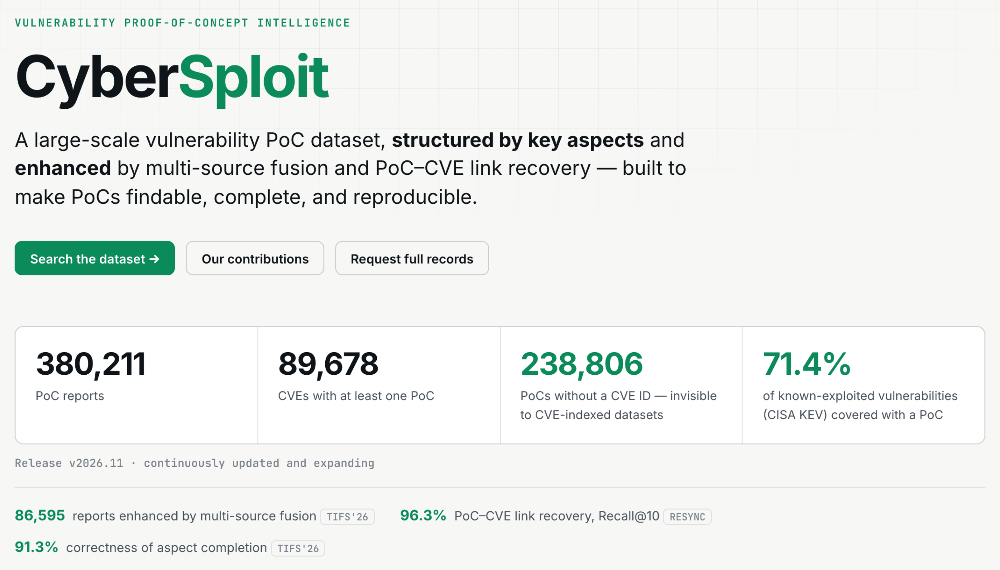
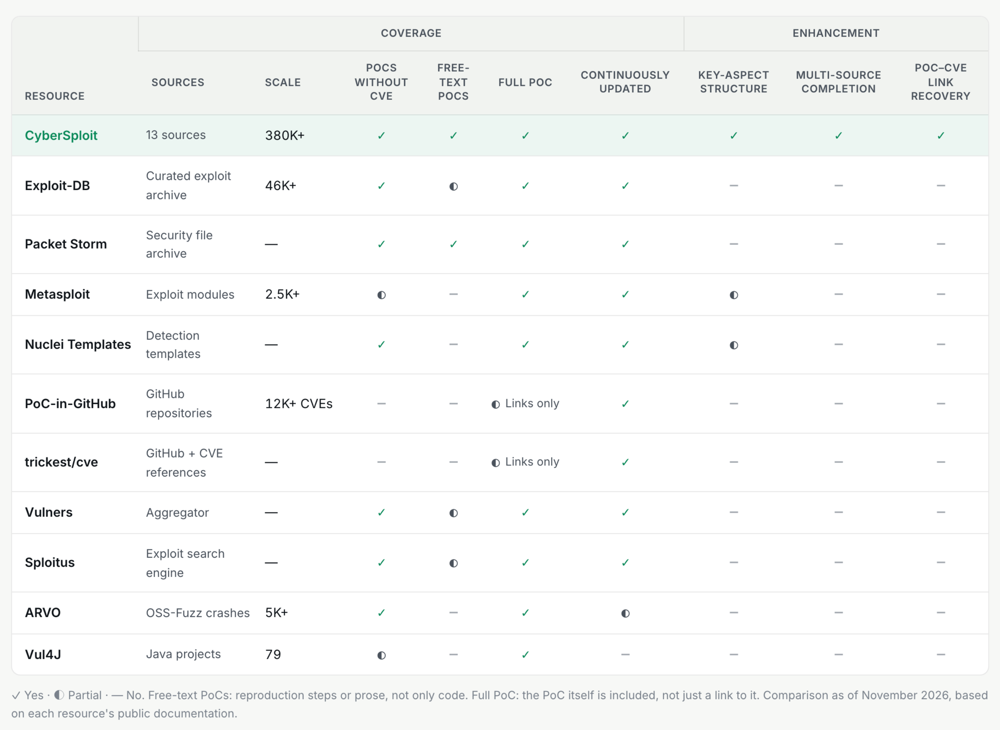
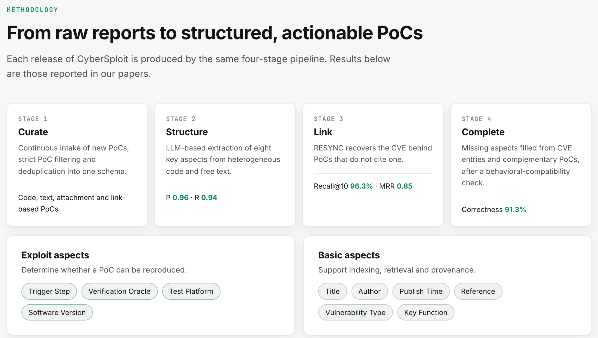
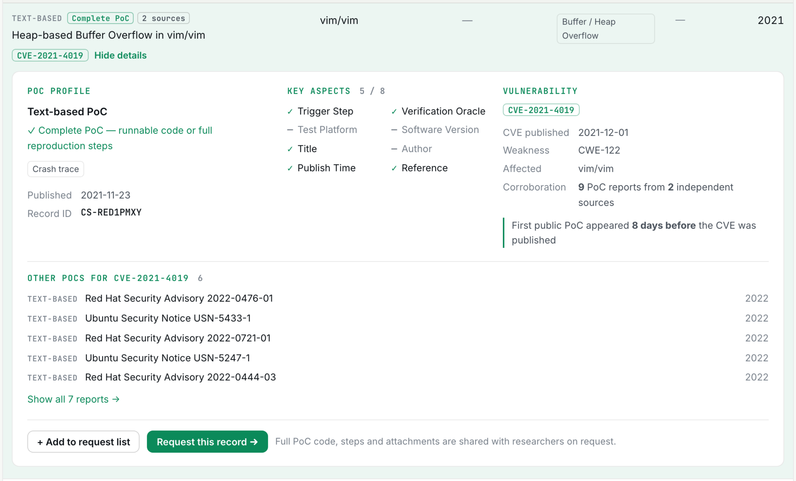
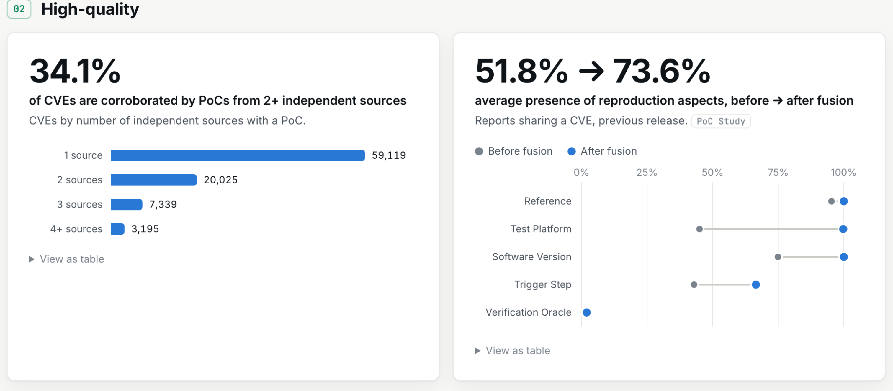
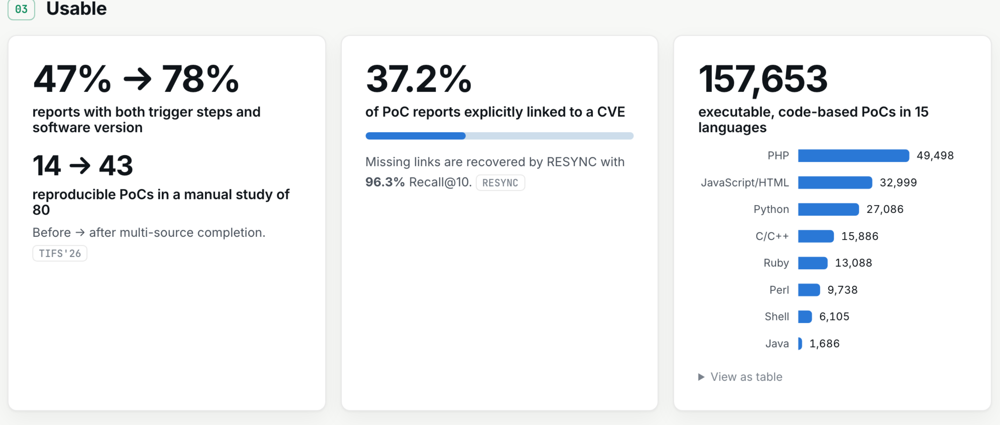
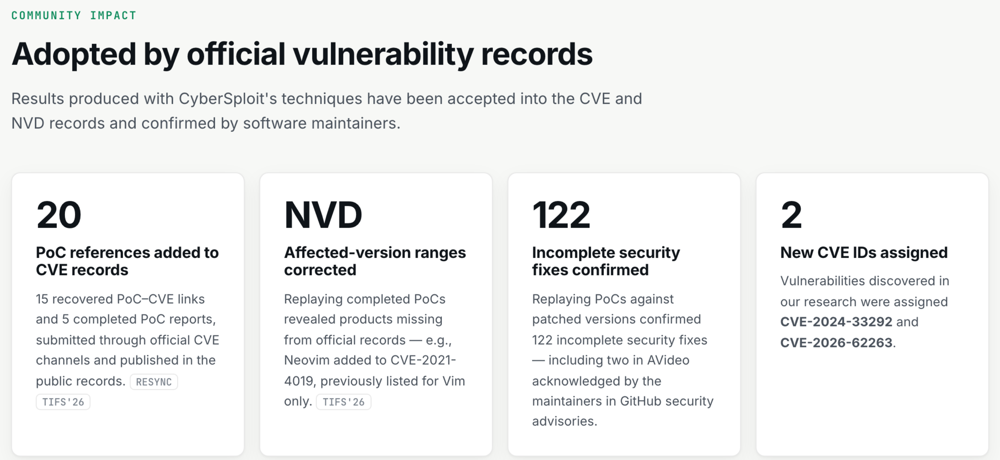
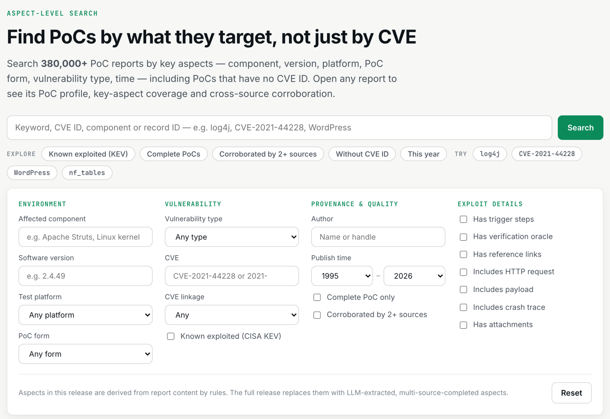
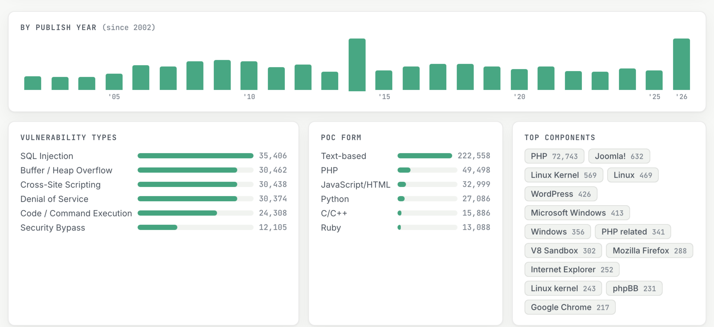
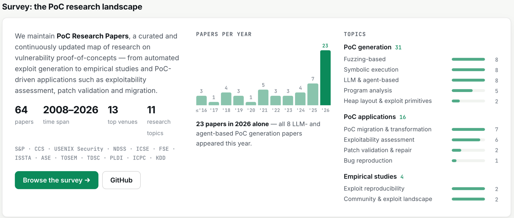

## PAPER INFO|论文信息

【项目名称】CyberSploit: A Large-Scale Multi-Source Vulnerability PoC Dataset
【论文链接】https://dangwenjing.github.io/Cybersploit
【作者团队】天津大学、南开大学、南洋理工大学（党文婧、张吕晔、王凌霄、李凯旋、赵梦瑶、李晓红、陈森等，刘杨教授参与指导）
【发表情况】核心方法见 IEEE TIFS 2026「Synchronizing Key Aspects: Enhancing Vulnerability PoC Reports From Multiple Sources」与 FSE 2025 Companion；数据集当前为 v2026.11 版，持续更新
【数据获取】检索与元数据公开；完整 PoC 代码、复现步骤与附件面向研究者申请，仅限研究与防御用途

## OVERVIEW|导读

漏洞的概念验证（Proof-of-Concept，PoC）是安全工作里最「硬」的一类证据：漏洞是不是真的、影响到哪些版本、补丁到底修没修好，最后都要靠一份能跑起来的 PoC 来回答。可真要用的时候，PoC 往往很难找：它们散落在 Exploit-DB、Packet Storm、缺陷追踪系统、厂商公告、邮件列表和 GitHub 仓库里，格式五花八门；**很多根本没标 CVE 编号**，按 CVE 去搜就找不到；找到了也常常缺触发步骤、缺测试环境、缺受影响版本，照着做复现不出来。

天津大学、南开大学和南洋理工大学的研究者把这几年在 PoC 方向的工作，汇成了一个公开的数据集和检索网站：CyberSploit。当前版本的规模是：

- **38 万多份 PoC 报告**（380,211 份），来自 13 个公开来源，外加团队在研究中自研的 PoC；
- **覆盖 8.9 万多个 CVE**（89,678 个），涉及 3,917 个厂商、10,258 个产品、569 类 CWE；
- 其中 **23.9 万份没有 CVE 编号**（238,806 份），占六成以上；
- CISA 已知被利用漏洞（KEV）目录中，1,790 个 CVE 里有 1,278 个能找到 PoC，覆盖率 71.4%；
- 15.7 万份是可执行的代码型 PoC，覆盖 PHP、JavaScript/HTML、Python、C/C++、Ruby 等 15 种语言，其余是复现步骤、请求报文这类文本型 PoC。

光是「收得全」并不稀奇。这个数据集真正值得讲的，是它在收集之后做的三件事：把每份报告**拆成要素**、给没编号的 PoC **找回 CVE**、用同一漏洞的其他来源**补全缺失信息**。下面重点讲这三件事各自为什么必要、怎么做、效果如何。

## DIFFERENCE|和已有 PoC 资源差在哪

现有资源大致分三类，各有一个绕不开的短板：

- **单平台档案库**，如 Exploit-DB（4.6 万多份）、Packet Storm、Metasploit（2,500 多个模块）、Nuclei Templates。PoC 本体都在，但只覆盖自家平台，而且都是原样存放，没有结构化。
- **以 CVE 为索引的聚合**，如 PoC-in-GitHub、trickest/cve。它们按 CVE 去 GitHub 上找仓库，天然漏掉所有没标 CVE 的 PoC，而且只存链接不存 PoC 本体，仓库一删就断。
- **研究型数据集**，如 ARVO（5,000 多个 OSS-Fuzz 崩溃）、Vul4J（79 个 Java 漏洞）。质量高、可复现，但规模小、领域窄。

CyberSploit 的定位是把这三类的长处拼起来：多源、收录无 CVE 和文本型 PoC、保留 PoC 本体、持续更新。对比表右侧三列（要素结构化、多源补全、PoC–CVE 关联恢复）是其他 10 个资源都没有的，这也是它和「又一个漏洞库」的区别所在。

## PIPELINE|从原始报告到能用的 PoC

**第一步：收集与去重。** 13 个来源的漏洞库条目、技术公告、缺陷报告、邮件讨论和代码仓库被统一进同一套数据模型。这里有个关键决定：**没有 CVE 编号的 PoC 不丢**，同样入库、同样可检索。很多聚合工具的第一步就是按 CVE 过滤，这一步下去，六成 PoC 就没了。

**第二步：拆成 8 个关键要素。** 一份 PoC 报告能不能用，取决于几样具体信息在不在。CyberSploit 把它们分成两组：

- **利用要素**（决定能不能复现）：触发步骤（Trigger Step）、验证条件（Verification Oracle，即怎么判断触发成功了）、测试平台、软件版本；
- **基本要素**（决定能不能被找到和溯源）：标题、作者、发布时间、参考链接，以及漏洞类型、关键函数。

不管原报告是代码还是一段自然语言，都用大模型抽成这几个字段，**抽取精确率 0.96、召回率 0.94**。拆开之后，检索就不再只能靠 CVE 编号，可以按「组件是 Apache Struts、版本 2.5.x、平台 Linux、有触发步骤」这样组合条件去找。

**第三步：给没编号的 PoC 找回 CVE（RESYNC）。** 这是整条流水线里最难的一步，后面单独讲。

**第四步：跨源补全。** 同一个漏洞往往有好几份 PoC，分别来自不同平台，各缺各的信息。补全就是拿 CVE 记录和同一漏洞的其他 PoC 去填当前报告缺的要素。目前已有 **86,595 份报告得到补全，补全正确率 91.3%**。

## FINDING 1|六成 PoC 没有 CVE 编号，问题出在时间差

先看一个数：在 38 万份报告里，**显式标了 CVE 的只有 37.2%**。

为什么这么多 PoC 没编号？最主要的原因是时间顺序。PoC 经常比 CVE 先出现：研究者在 huntr、GitHub Issue、邮件列表里报告漏洞时附上复现步骤，CVE 要等几天甚至几周后才分配下来，而原帖不会回头补编号。网站上能直接看到这样的例子：vim 的堆溢出漏洞 CVE-2021-4019，**第一份公开 PoC 比 CVE 发布早了 8 天**（PoC 2021-11-23，CVE 2021-12-01）。

这就带来一个实际后果：**以 CVE 为索引的资源，天然看不见这六成 PoC。** 防守方想知道「某个 CVE 有没有公开 PoC」时，查 PoC-in-GitHub 之类的工具得到「没有」，并不代表真的没有，可能只是那份 PoC 发在了一个没标编号的地方。

RESYNC 要解决的就是这个关联问题：给一份没写 CVE 的 PoC，从几十万个 CVE 里找出它对应的那个。难点在于，PoC 和 CVE 描述的往往是同一件事的两个侧面：PoC 写的是「往某个参数塞一段超长字符串，程序崩在某个函数」，CVE 写的是「某产品某版本之前存在堆溢出」，字面上几乎不重合。RESYNC 的做法分三层：

- 先用第二步抽出的要素（组件、版本、漏洞类型、关键函数）建一个**要素引导的知识图谱**，把 PoC 和 CVE 放到同一套概念上对齐；
- 再**自适应筛选候选**，把几十万个 CVE 缩到一个小集合；
- 最后用大模型做**语义重排序**，判断哪个 CVE 和这份 PoC 描述的是同一个缺陷。

效果是 **Recall@10 为 96.3%、MRR 为 0.85**，比基线方法高 1.2 到 3.9 倍。MRR 0.85 意味着正确答案平均几乎排在第一位，这个精度已经能直接用来给官方记录提交补充：团队通过 CVE 官方渠道提交的 PoC 引用里，有 15 条就来自 RESYNC 恢复的关联，已经出现在公开的 CVE 记录中。

## FINDING 2|跨源补全让可复现 PoC 翻了三倍，但有一样东西补不出来

补全的思路很直接：A 平台的报告有触发步骤但没写版本，B 平台的公告写了受影响版本但没给步骤，合在一起就是一份完整的 PoC。但这里有个陷阱：**同一个 CVE 下的两份 PoC，不一定在描述同一种触发方式。** 一个漏洞可能有多条触发路径，把 A 的步骤和 B 的环境硬拼在一起，可能得到一份谁都复现不了的「缝合报告」。所以 CyberSploit 只在两份报告**行为上互补**时才融合，先做一次兼容性检查，确认它们描述的是同一个触发行为，再互相填空。

融合的效果按要素看差别很大：

- **测试平台**从不到一半补到接近 100%，**软件版本**从七成多补到接近 100%：这两样信息在厂商公告和 CVE 记录里通常写得很全，正好能填给只有代码的 PoC；
- **触发步骤**从四成多提到近七成：只要同一漏洞的某个来源写过步骤，就能补过来；
- **验证条件**融合前后都接近 0。

最后这一条最值得注意。验证条件回答的是「怎么判断攻击成功了」：程序崩溃、返回了某个特征字符串、拿到了更高权限。==几乎没有哪个来源会把这一点写下来，所以无论融合多少份报告都补不出来。== 这也解释了为什么团队把「验证条件合成」列为下一步的开放方向：它不能靠搬运，只能靠推断或实际运行来生成。

整体上，补全把同时具备触发步骤和软件版本的报告从 **47% 提到 78%**，复现要素的平均覆盖率从 **51.8% 提到 73.6%**。最有说服力的是人工复现实验：随机取 80 份 PoC，补全前能直接复现的只有 **14 份**，补全后是 **43 份**，翻了三倍。基于要素的检索 Hit@10 也从 0.66 升到 0.88。反过来看，补全后仍有 37 份复现不了，说明缺要素之外，还有环境搭建、依赖版本这些更难的问题在挡着。

## FINDING 3|PoC 能反过来查出官方记录的错漏

一份补全好的 PoC 不只是「能复现」，它还能拿来做验证：在别的版本、别的产品上重放一遍，看漏洞还在不在。团队用这个思路得到了几类实际成果：

- **补全受影响范围**：Neovim 是从 Vim 分叉出来的，共享了大量代码。重放 CVE-2021-4019 的补全版 PoC，发现 Neovim 同样中招，但官方记录里原本只列了 Vim。这个修正已进入 NVD 记录。分叉项目继承了漏洞却不在通告里，下游用户就收不到预警，这是软件供应链里很典型的一类盲区。
- **确认不完整修复**：在已打补丁的版本上重放 PoC，漏洞照样能触发，说明补丁没修全。用这种办法确认了 **122 个不完整的安全修复**，其中 AVideo 的两个已由维护者在 GitHub 安全公告中确认。
- **完善 CVE 记录**：向 CVE 官方记录补充了 20 条 PoC 引用，包括 15 条 RESYNC 恢复的关联和 5 份补全后的 PoC 报告。
- **新漏洞**：研究中发现的漏洞获批 CVE-2024-33292、CVE-2026-62263。

这几条说明，PoC 数据集的价值不止于「查」，结构化之后它可以变成一个**批量验证工具**：对着补丁版本和下游分叉批量重放，直接产出可提交给维护者和 CVE 的证据。

## USAGE|怎么用

网站提供面向要素的检索，检索页**只展示公开元数据，不展示 PoC 正文**：

- **多入口检索**：关键词、CVE 编号、组件名、记录编号都能搜，还能叠加组件、版本、平台、PoC 形式、漏洞类型、作者、时间等条件；
- **质量筛选**：一键筛 KEV 漏洞、完整 PoC、两个以上来源佐证、无 CVE 编号；
- **结果分布**：实时给出结果的年份分布、漏洞类型、PoC 形式和热门组件，点击即可继续筛；
- **报告详情**：展开任一报告，能看到 PoC 画像、8 个要素具备哪些、对应 CVE 的发布时间与 CWE、这个漏洞共有多少份 PoC 来自几个独立来源（见图 3）；
- **数据申请**：完整 PoC 代码、复现步骤、验证条件和附件面向研究者开放申请，把感兴趣的记录加入申请清单一次性提交，或发邮件至 dangwenjing@tju.edu.cn 注明姓名、单位与用途。数据仅限研究与防御用途，不得再分发。

另外，团队同步维护了一份 PoC 方向的研究综述 PoC Research Papers（marklee131.github.io/PoC-Research-Papers），整理了 2008 到 2026 年间 S&P、CCS、USENIX Security、NDSS、ICSE、FSE、ISSTA、ASE 等 13 个会议和期刊上的 64 篇论文，分为 PoC 生成、PoC 应用、实证研究三大方向。**仅 2026 年就有 23 篇**，其中基于大模型和 Agent 的 PoC 生成论文全部 8 篇都出现在今年。

## CAVEATS|值得注意的地方

- **公开检索页的要素是规则抽取的。** 网站说明当前公开版的要素由规则从报告内容中推出，完整版才换成大模型抽取、多源补全后的要素。所以在检索页上看到的要素覆盖情况，会比论文里报告的补全后数字保守。
- **「PoC 报告」的口径比较宽。** 22 万多份文本型报告里，包括 Red Hat、Ubuntu 这类安全公告，一份公告往往对应多个 CVE，本身未必带触发步骤。按「可直接运行的 PoC」算，代码型的 15.7 万份是更保守的口径。
- **复现实验样本不大。** 14 到 43 的提升来自 80 份 PoC 的人工复现，方向很清楚，但放到 38 万份的规模上，具体比例还需要更大样本验证。
- **RESYNC 仍在审稿中。** 关联恢复的 96.3% Recall@10 来自在审工作，评测细节要等论文正式发表后再看。
- **完整数据需申请。** PoC 本体涉及可利用代码，采用申请制而非直接下载，这是合理的取舍，但也意味着复现论文结果需要走一道流程。

## TAKEAWAYS|启发与点评

**对研究者：** 做漏洞复现、可利用性评估、补丁验证或 PoC 自动生成的工作，过去常常卡在数据上：要么只用 Exploit-DB 一个来源，要么只取带 CVE 的那部分。CyberSploit 把无 CVE 的六成也纳入进来并做了结构化，一些以前没法做的问题现在有了数据基础，比如「没编号的 PoC 和有编号的在漏洞类型分布上有什么系统差异」。而**验证条件几乎全缺**这个发现本身就是一个好题目：它是 PoC 自动验证的前提，也是大模型生成 PoC 时最容易「自以为成功」的地方。

**对从业者：** 判断一个 CVE「有没有公开 PoC」时，只查以 CVE 为索引的工具会系统性低估风险，因为 PoC 经常比 CVE 先出、且不回头补编号。对于用了分叉项目的团队，Neovim 的例子也值得记住：上游的漏洞通告不一定会列出你，拿上游 PoC 在自己的分支上重放一次，比等通告可靠。

**一个观察：** 这个合集里之前讲过不少「用大模型生成 PoC」和「用 Agent 复现漏洞」的工作，它们的评测基本都依赖一小批手工整理的可复现样本。PoC 数据的规模化和结构化，可能是这类方法从演示走向实用的下一个瓶颈，而 CyberSploit 正好补在这个位置上。
