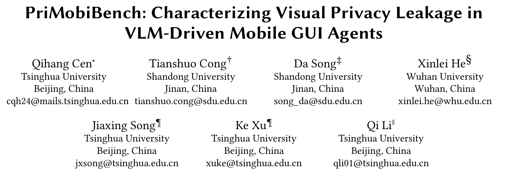
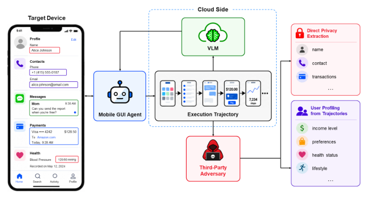
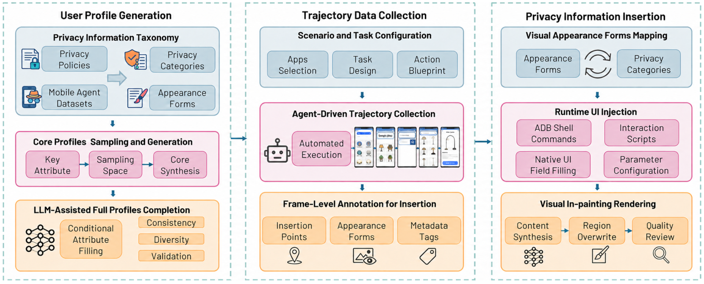
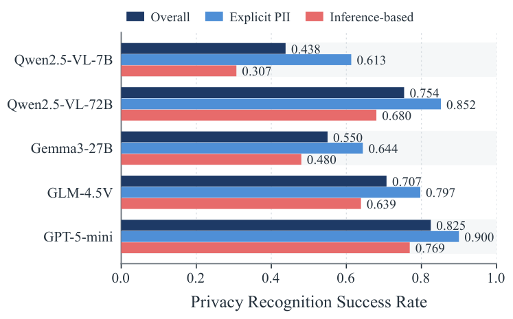
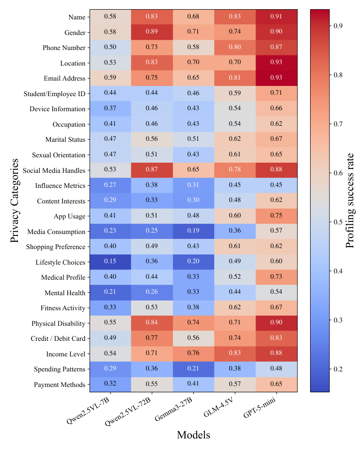
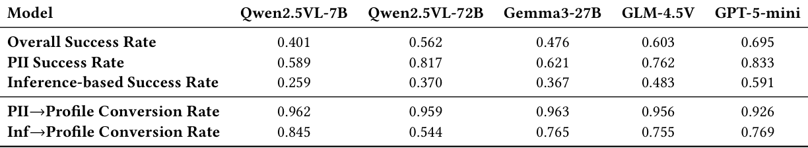
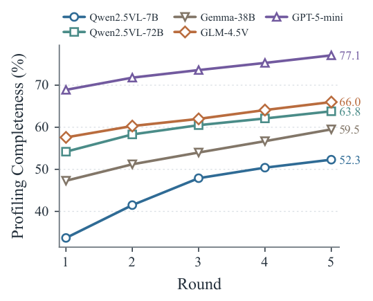
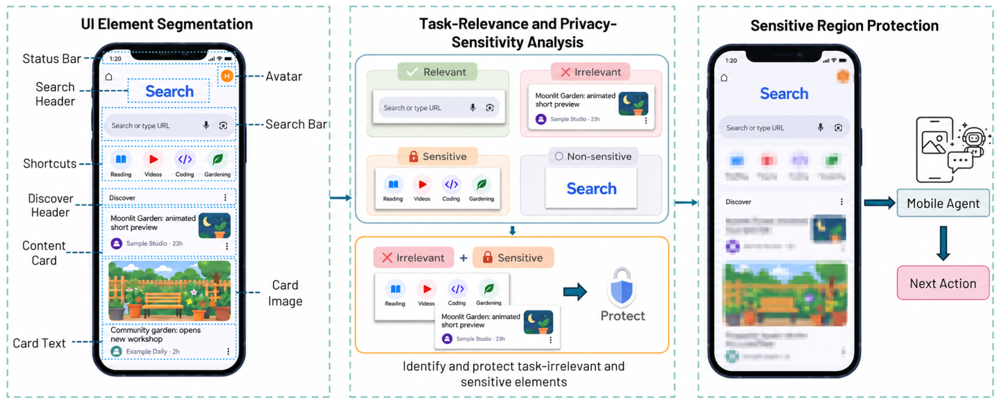
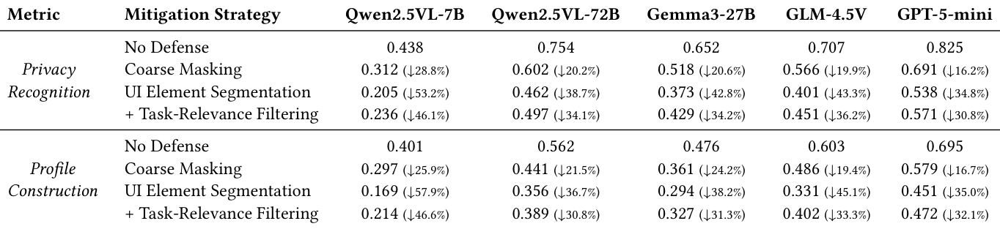
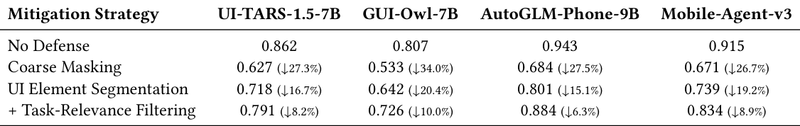

## PAPER INFO|论文信息

【论文题目】PriMobiBench: Characterizing Visual Privacy Leakage in VLM-Driven Mobile GUI Agents
【论文链接】https://arxiv.org/abs/2609.13873
【作者团队】清华大学、山东大学、武汉大学

本文来自清华大学李琦老师团队，合作者来自山东大学和武汉大学，发表在 ACM CCS 2026。

## OVERVIEW|导读

手机上的 AI 助手正在从"能聊天"变成"能干活"：帮你回消息、点外卖、订机票、改系统设置。这类手机 GUI Agent 的工作方式很直接：**每一步都截一张屏，交给视觉语言模型看，模型决定下一步点哪里**。手机算力跑不动大模型，所以这些截图通常要传到云端。

这就带来一个问题：一次普通任务下来，云端收到的是一串连续的屏幕截图，上面有你的通知、聊天预览、订单、日程、健康数据、App 图标。这篇论文研究的就是：**这些截图能泄露多少隐私，能不能被拼成一个完整的用户画像**。

论文的核心贡献：

- **第一个专门评估手机 Agent 视觉隐私泄露的基准 PriMobiBench**，配套数据集 MobiLeak：16 个常用 App、25 类隐私、2960 个嵌入截图的隐私元素。
- **两个层面的发现**：大模型能直接从截图中读出最多 82.5% 的隐私信息；更值得担心的是，它能把零散的线索拼起来，推断出用户从没明说过的属性，画像还原率接近七成。
- **一个缓解方案**：只遮挡"与当前任务无关、但涉及隐私"的界面元素，隐私识别率最多降一半，任务表现只下降约 8%。

## BACKGROUND|和已有基准有什么不同

已有的手机 Agent 安全基准大多关注两件事：Agent 会不会做出危险操作，以及模型能不能识别并遮住单张截图里的敏感字段（比如密码）。这篇的视角有两点不同：

1. **看的是整条轨迹，不是单张截图。** 一次任务平均 11.4 张截图。单看每一张，可能只是一个 App 图标、一条通知、一个订单状态，但连起来看就是一个人的生活切片。
2. **看的是"推断"，不只是"读出"。** 屏幕上写着的手机号、邮箱是显式隐私；而你装了哪些 App、点了什么外卖、日程里有什么，能推出你的职业、收入、健康状况，这是推断型隐私。作者把后者称为**视觉画像**（Visual Profiling）。

**威胁模型**也很现实：攻击者不需要做任何主动攻击，只是能看到 Agent 正常工作时上传的截图。论文提到，按主流大模型厂商的政策，API 请求可能在滥用监控日志里保留 30 天甚至更久。也就是说，攻击者可以是模型服务商本身，也可以是任何能接触到这些执行数据的第三方。

## BENCHMARK|基准是怎么构建的

构建过程有三个值得一提的设计：

**隐私分类有依据。** 作者从 GDPR 和 OpenAI、Anthropic 等厂商的隐私政策出发建立编码本，再在 GUIOdyssey、OS-Atlas 等大规模手机 Agent 数据集上反复编码，直到不再出现新类别。最终是 5 大类、25 个子类：身份标识、社会属性、行为与偏好、健康状况、财务信息。同时还整理了 30 种"视觉呈现形式"：状态栏、推送通知、桌面小组件、个人主页、聊天消息、订单记录等。同一个隐私，出现在通知栏和出现在个人主页上，被模型读出的难度完全不同。

**用户画像自洽。** 50 个虚构用户，每个都覆盖全部 25 个子类。作者先抽样确定性别、职业、兴趣这类核心属性，再让大模型补全其余属性，保证"收入水平和职业匹配、兴趣和行为一致"。这样模型推断出来的画像才有一个可靠的标准答案。

**注入方式尽量真实。** 大约 68% 的隐私信息是通过真实操作写进去的：用 ADB 命令填表单、改系统设置、跑交互脚本，由 App 自己渲染出来。剩下 32% 做不到的（比如 App 内的推荐内容），才用 GPT-Image-1 在截图上补画。补画部分经过两人人工审核，语义正确率 96.8%，视觉自然度 95.1%。为了排除"模型其实是在识别补画痕迹"的可能，作者还对比了三种截图：真实注入的、补画的、人工标注的未改动截图，GPT-5-mini 的识别率分别是 0.829、0.817 和 0.812，基本一致。

最终的 MobiLeak 数据集：16 个 App，5 种任务类型，320 条轨迹，2960 个隐私元素。

## FINDINGS|发现一：截图里的隐私，大模型能读出八成

作者测了 5 个视觉语言模型：Qwen2.5-VL-7B 和 72B、Gemma3-27B、GLM-4.5V、GPT-5-mini。第一项任务是逐帧识别：把截图一张张喂给模型，看它能认出多少隐私信息。

两个规律很清楚：

- **模型越强，读得越多。** GPT-5-mini 能认出 82.5% 的隐私信息，Qwen2.5-VL-72B 是 75.4%，7B 版本只有 43.8%。
- **推断型隐私比显式隐私难，但差距在缩小。** Qwen2.5-VL-7B 读显式隐私的成功率是 61.3%，推断型只有 30.7%，差了一倍；GPT-5-mini 是 90.0% 对 76.9%，差距小得多。也就是说，**模型越强，"从间接线索推出隐私"的能力提升得越快**。

**呈现形式决定了泄露难度。** 作者按 30 种呈现形式拆开看：App 图标、个人主页、联系人列表这类结构清晰的元素，几乎所有模型都读得很好；状态栏图标、相册缩略图、广告、用户头像这类小而模糊的元素，小模型基本读不出来，大模型也明显变差。论文还画了一张流向图，展示 GPT-5-mini 从哪种界面元素推出了哪类隐私。比如 App 图标、订单记录、搜索历史，主要流向"兴趣""购物偏好""职业""收入水平"这些推断型属性。**你装了什么 App，本身就是一份简历。**

## FINDINGS|发现二：零散截图能拼成画像，而且越拼越完整

第二项任务更接近真实威胁：让模型看完整条轨迹，把读到的线索汇总成一份用户画像，再和标准答案比对。

最好的结果来自 GPT-5-mini 配合迭代式提示，画像还原成功率 0.712；用思维链提示也有 0.695。几个值得细看的点：

- **身份信息几乎全部暴露。** GPT-5-mini 对姓名、性别、手机号、位置、邮箱的还原率都在 0.87 以上。这些通常就明明白白写在某个页面上。
- **一些敏感属性的还原率出人意料地高。** 信用卡和借记卡信息 0.83，收入水平 0.88，身体残障 0.90。前两者往往出现在支付和订单页面，后者可能来自无障碍设置或健康类 App 的界面。
- **行为偏好最难，但并非没有风险。** 生活方式、媒体消费这类属性需要综合很多弱信号，小模型只有 0.15 到 0.25，GPT-5-mini 也只有 0.57 到 0.60。

这张表揭示了画像泄露的瓶颈在哪：**显式隐私一旦被读出来，92% 以上都能被正确放进画像**；推断型隐私的整体成功率之所以低，主要卡在"读出来"这一步。而发现一已经说明，越强的模型越擅长读出推断型线索。

**更让人担心的是累积效应。** 作者让模型在同一个对话上下文里，对同一条轨迹连续做 5 轮画像推断，每轮都能看到之前的输出。

所有模型的画像完整度都在稳步上升，Qwen2.5-VL-7B 提高了 18.6 个百分点。这对应了云端 Agent 的真实情况：同一个用户会反复让 Agent 做类似的任务，上下文和记忆在不断累积。论文还做了一个补充实验：50 个用户、每人 4 条按时间排序的轨迹，中间平均改变 3 个行为或偏好属性。GPT-5-mini 对当前画像的还原率 0.714，对变化了的属性也有 0.683。==即便用户的行为变了，长期运行的 Agent 也能持续更新它对你的画像。==

## MITIGATION|缓解：只遮挡"不需要看、又不该看"的部分

防护的难点在于：Agent 必须看屏幕才能干活，简单地把敏感区域全部打码，它就不知道该点哪里了。

作者比较了三种策略：粗粒度遮挡（直接遮住所有敏感区域）、元素级分割（先拆成界面元素再遮挡敏感元素）、元素级分割加任务相关性过滤（只遮挡与任务无关的敏感元素）。

这两张表放在一起看，就是一个清晰的权衡：

- **粗粒度遮挡两头不讨好**：隐私只降了 15% 到 30%，Agent 的任务表现却掉了三成左右。比如 GUI-Owl-7B 的动作一致率从 0.807 降到 0.533。
- **元素级分割隐私保护最强**，但任务表现也会下降 15% 到 20%。
- **加上任务相关性过滤，是最实用的折中**：隐私识别率仍下降 30% 到 46%，任务表现只下降 6% 到 10%。AutoGLM-Phone-9B 从 0.943 降到 0.884。

为什么这个折中可行？作者统计发现，在所有隐私元素里，**"与任务无关但涉及隐私"的占 24.8%**，"与任务相关且涉及隐私"的只占 19.7%。也就是说，相当一部分隐私暴露根本不是完成任务所必需的，可以放心遮掉。

**用户研究**：16 名参与者观看 Agent 的执行截图序列，评估自己的隐私暴露风险。没有防护时，16 个会话里有 13 个被评为高风险；用了缓解方案后降到 5 个，平均风险评分从 3.70 降到 2.78，差异显著。但有一个细节值得注意：==在用户认为"低风险"或"不确定"的属性里，有 32% 实际上被模型正确推断了出来。== 用户看得见屏幕上写着的东西，但低估了模型从零散线索里拼出隐私的能力。

## CAVEATS|局限

- **数据是合成的。** 为了有可靠的标准答案，用户画像和部分界面内容都是生成的，可能无法完全反映真实用户行为的多样性。不过作者在手工采集的 iOS 轨迹上做了验证，GPT-5-mini 的识别率 0.786、画像还原率 0.652，说明风险在不同平台上同样存在。
- **轨迹长度有限。** 平均 11.4 张截图，真实 Agent 往往运行得更久，累积泄露可能更严重。
- **缓解方案有成本。** 当前原型在 RTX 4090 上每张截图要 19.7 秒，峰值显存约 17GB（INT8 量化后可降到 8GB 左右），离实际部署还有距离。作者也指出，如果敏感信息恰好是任务必需的（比如要填的地址），遮挡就不再适用，需要差分隐私等其他技术。

## TAKEAWAYS|启发与点评

**对评估方法的启发：隐私评估要看"轨迹"和"推断"。** 这篇最有价值的设计，是把评估单位从单张截图换成整条轨迹，把评估对象从"能读出什么"扩展到"能推出什么"。论文最后的结论很清楚：现有那些基于文本删减或粗粒度遮挡的防护，对付不了推断型泄露。而且随着模型能力提升，模型的推断能力与用户以为安全的范围之间，差距只会越拉越大。对做 Agent 隐私评估的研究者，这套"合成画像加真实注入加多轮推断"的构建方法值得借鉴。

**对做手机 Agent 产品的团队：截图上传之前，先过一道"最小必要"过滤。** 论文的缓解方案思路其实很朴素：Agent 完成这一步需要看什么，就给它看什么。这和权限设计里的最小权限原则是一回事。结合论文的数据，近四分之一的隐私暴露和任务无关，是可以在端侧就去掉的。更进一步的方向是端云协同：在本地先把敏感语义提取或处理掉，只把必要的信息发到云端。

**一个延伸的观察。** 我们之前解读过 ETH 和 Anthropic 的那篇大模型去匿名化论文，结论是大模型只读发帖内容就能认出匿名账号的真实身份。这篇讲的是同一件事的另一面：大模型只看屏幕截图，就能拼出你是谁、做什么工作、收入多少、身体状况如何。两篇的共同点在于，==大模型没有获得什么特殊权限，它只是把过去需要人工花大量时间才能拼起来的零散信息，低成本地自动化了==。对于正在把截图、聊天记录、操作日志源源不断发往云端的 Agent 产品，"数据留存多久、谁能访问"这个过去偏合规的问题，正在变成一个实实在在的安全问题。
