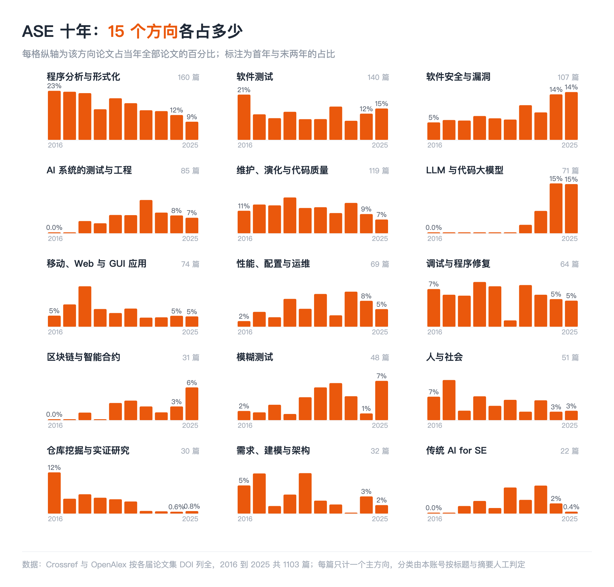
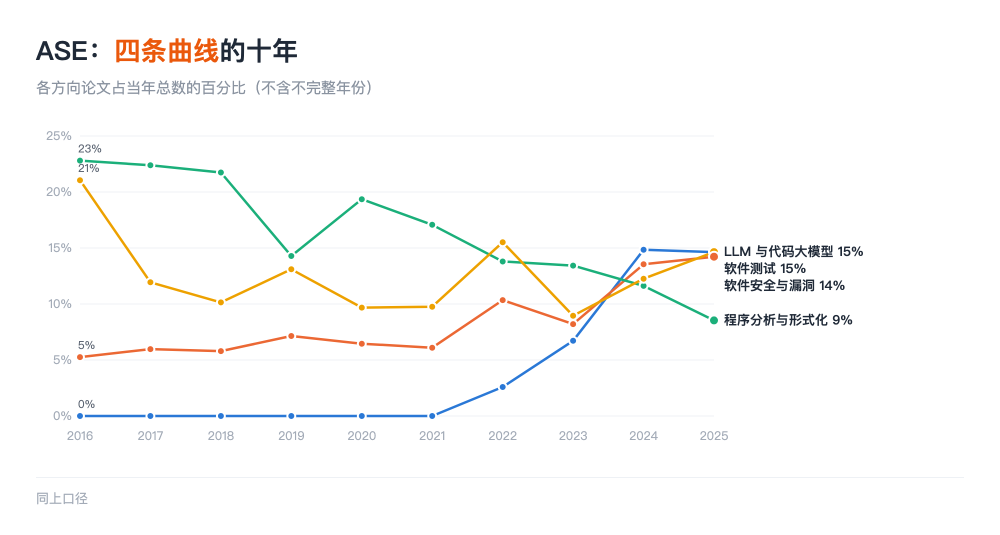
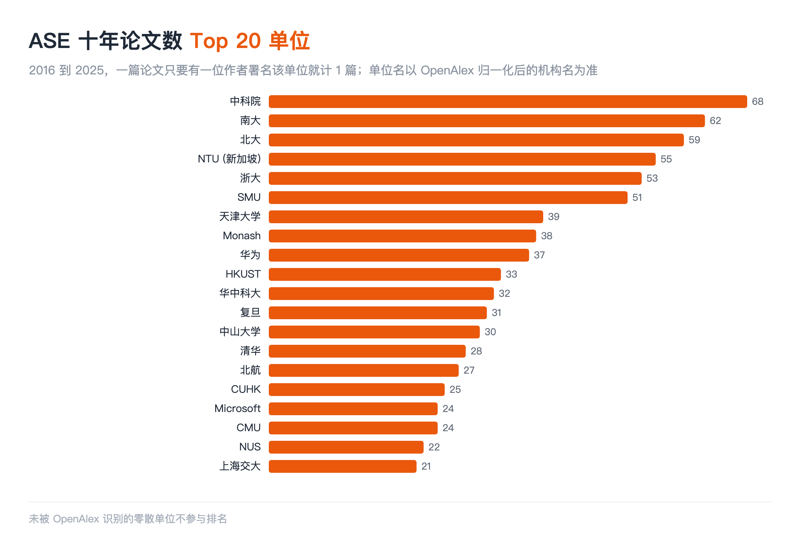
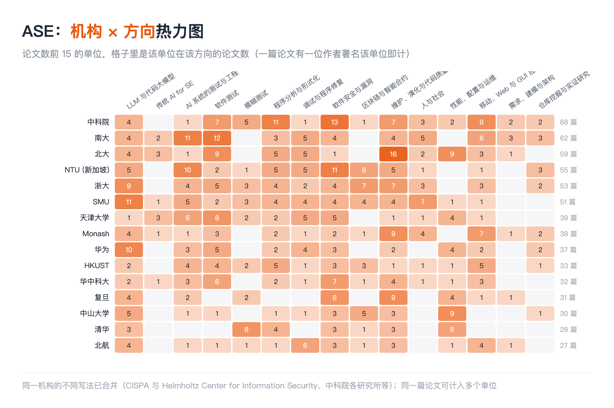
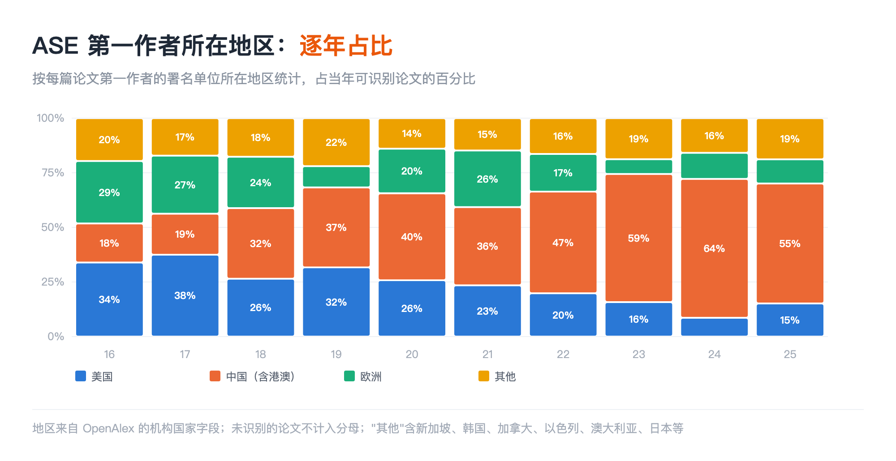

## LIST INFO|本期说明

【范围】ASE（IEEE/ACM International Conference on Automated Software Engineering）2016 到 2025 十届研究轨的全部论文，共 1103 篇。ASE 2026 要到 11 月才开，本期不含
【来源】按每届论文集从 Crossref 列全标题与作者，再用 OpenAlex 补摘要、作者单位和国家，并逐年和 DBLP 目录、官网的研究轨录用清单核对；工业展示轨（Industry Showcase，2023 到 2025 年每年 12 到 54 篇）、NIER、Tool Demo、Journal-First、Workshop 等其他轨道不计。2025 年 ASE 研究轨的接收量比上一年多了六成，本期照单全收
【口径】每篇只归一个主方向（可带一个次方向），共 15 个方向，和本账号 ICSE、FSE 两期用的是同一套分类，对照了 ICSE 2026、ASE 2025、FSE 2026、ISSTA 2026 四家 CFP 的主题分区。分类是逐篇人工判定，个位数的出入不影响趋势

分类规则和前两期一样：**"用大模型做某个任务"的论文归到任务方向，大模型只记为次方向；只有研究对象就是代码大模型本身的论文才把"LLM 与代码大模型"记为主方向。**软件供应链的论文按题材分在软件安全（恶意包、漏洞传播）和维护（依赖管理、版本演化）两个方向里，文中单独拉了一段。

@stats
- 57 → 246 篇 | 研究轨年接收量，2025 年比 2024 年多了 91 篇
- 5% → 45% | 主方向或次方向涉及大模型的论文比例，2022 到 2025
- 23% → 9% | 程序分析与形式化的份额，2016 到 2025
- 18% → 54% | 第一作者来自中国的论文比例，2016 到 2025

先交代规模。ASE 研究轨 2016 年 57 篇，2021 年 82 篇，2022 年 116 篇，2024 年 155 篇，2025 年 246 篇，十年扩了 4.3 倍，是软工四大会里扩张最猛的。2025 年一届接收的论文和 2016 到 2019 四届加起来差不多，所以看趋势必须看占比，而且 2025 年的份额变化要打个折扣：软件安全从 2024 年的 13.5% 涨到 2025 年的 14.2% 只涨了不到一个点，绝对数却从 21 篇涨到 35 篇。

## BIG PICTURE|十年三个大迁移

#### 大模型三年渗透到 45%

主方向记为"LLM 与代码大模型"的论文 2022 年 3 篇（2.6%），2023 年 9 篇（6.7%），2024 年 23 篇（14.8%），2025 年 36 篇（14.6%）。把次方向算进去，2022 年 6 篇（5.2%），2023 年 25 篇（18.7%），2024 年 56 篇（36.1%），2025 年 111 篇（45.1%）。再把传统机器学习方法也算进去，==2025 年 ASE 有 128 篇论文（52%）的方法或对象是 AI==，这是软工四大会里第一次过半。

#### 软件安全从 5% 到 14%，和软件测试并列第一

软件安全与漏洞 2016 年 3 篇（5.3%），2022 年 12 篇（10.3%），2024 年 21 篇（13.5%），2025 年 35 篇（14.2%），只比同年的软件测试（36 篇）少一篇。加上区块链与智能合约（2025 年 15 篇，6.1%），两者合计 20.3%；再把次方向算进去，2025 年有 63 篇（26%）和安全沾边。

#### 程序分析从 23% 跌到 9%，维护从 17% 跌到 7%

程序分析与形式化是 ASE 早年的第一大方向，2016 到 2018 年稳在 22% 上下，2025 年跌到 8.5%（但绝对数 21 篇是历年最多）。维护、演化与代码质量 2019 年 16.7% 是高峰，2025 年 6.5%。仓库挖掘与实证研究从 2016 年的 12.3% 跌到 2025 年的 0.8%，但作为次方向每年仍有 10 篇上下，说明实证方法没消失，只是不再单独成题。

## LLM|大模型：从压缩模型到 Agent 安全

@timeline
- 2020 | Multi-task learning based pre-trained language model for code completion | 北大，ASE 上第一篇用预训练语言模型做补全的论文
- 2022 | Compressing Pre-trained Models of Code into 3 MB | 新加坡管理大学把代码模型压到 3 MB
- 2023 | The Plastic Surgery Hypothesis in the Era of Large Language Models | UIUC 用 LLM 重新检验修复领域的"整形手术假说"
- 2023 | Nuances are the Key: Unlocking ChatGPT to Find Failure-Inducing Tests with Differential Prompting | 让 ChatGPT 找出触发失败的测试
- 2024 | Promise and Peril of Collaborative Code Generation Models: Balancing Effectiveness and Memorization | 多方协作训练代码模型时的记忆泄露
- 2024 | RMCBench: Benchmarking Large Language Models' Resistance to Malicious Code | 测大模型会不会写恶意代码
- 2025 | Understanding Software Engineering Agents: A Study of Thought-Action-Result Trajectories | 拆解 SE Agent 的思考、动作、结果轨迹，当年杰出论文
- 2025 | SPICE: An Automated SWE-Bench Labeling Pipeline for Issue Clarity, Test Coverage, and Effort Estimation | 给 SWE-bench 的任务自动打标签
- 2025 | HFuzzer: Testing Large Language Models for Package Hallucinations via Phrase-based Fuzzing | 测大模型会不会编造不存在的包名
- 2025 | Backdoors in Code Summarizers: How Bad Is It? | 新加坡管理大学，代码摘要模型里的后门

#### 2020 到 2023：代码模型的工程问题

ASE 上大模型的起点是 2020 年北大的 **Multi-task learning based pre-trained language model for code completion**，2022 年三篇主方向论文都在处理预训练模型本身的工程问题：**Compressing Pre-trained Models of Code into 3 MB**（新加坡管理大学）、**CoditT5: Pretraining for Source Code and Natural Language Editing**（UT Austin）、**AST-Probe: Recovering abstract syntax trees from hidden representations of pre-trained language models**。2023 年 9 篇主方向、25 篇任意位置：**An Empirical Study of Parameter-Efficient Fine-Tuning Methods for Pre-Trained Code Models**（复旦）、**What Makes Good In-Context Demonstrations for Code Intelligence Tasks with LLMs?**（哈工大）、**The Devil is in the Tails: How Long-Tailed Code Distributions Impact Large Language Models**（新加坡管理大学）是三篇方法论研究；应用侧修复方向最快，**Gamma: Revisiting Template-Based Automated Program Repair Via Mask Prediction**（南大）、**The Plastic Surgery Hypothesis in the Era of Large Language Models**（UIUC）、**An Empirical Study on Fine-Tuning Large Language Models of Code for Automated Program Repair**；测试方向的 **Nuances are the Key: Unlocking ChatGPT to Find Failure-Inducing Tests with Differential Prompting**（港科大）和 **CAT-LM Training Language Models on Aligned Code And Tests**（CMU）。

#### 2024：评测、记忆和恶意代码

2024 年 23 篇主方向、56 篇任意位置。仓库级补全和评测是主线：**GraphCoder: Enhancing Repository-Level Code Completion via Coarse-to-fine Retrieval Based on Code Context Graph**（北大）、**JavaBench: A Benchmark of Object-Oriented Code Generation for Evaluating Large Language Models**（港科大）、**ComplexCodeEval: A Benchmark for Evaluating Large Code Models on More Complex Code**、**A Systematic Evaluation of Large Code Models in API Suggestion: When, Which, and How**（港中文）。安全侧出现了三条新线：**Promise and Peril of Collaborative Code Generation Models: Balancing Effectiveness and Memorization**（新加坡管理大学）研究协作训练的记忆泄露，**Imperceptible Content Poisoning in LLM-Powered Applications**（清华）和 **Attribution-guided Adversarial Code Prompt Generation for Code Completion Models**（信工所）是投毒和对抗，**RMCBench: Benchmarking Large Language Models' Resistance to Malicious Code**（中山大学）测大模型会不会写恶意代码。从业者视角的论文也开始出现：**What Makes a High-Quality Training Dataset for Large Language Models: A Practitioners' Perspective**（华为）。形式化方向 **Proof Automation with Large Language Models**（普渡）、**LLM Meets Bounded Model Checking: Neuro-symbolic Loop Invariant Inference**（南大）、**LLM-Generated Invariants for Bounded Model Checking Without Loop Unrolling** 三篇同届。

#### 2025：Agent 和 Agent 的安全

2025 年 36 篇主方向、111 篇任意位置。Agent 是新的主题：**Understanding Software Engineering Agents: A Study of Thought-Action-Result Trajectories**（CISPA，杰出论文）、**MCTS-Refined CoT: High-Quality Fine-Tuning Data for LLM-Based Repository Issue Resolution**、**SPICE: An Automated SWE-Bench Labeling Pipeline for Issue Clarity, Test Coverage, and Effort Estimation**、**Wired for Reuse: Automating Context-Aware Code Adaptation in IDEs via LLM-Based Agent**、**An Agent-based Evaluation Framework for Complex Code Generation**（哈工大）、**Why AI Agents Still Need You: Findings from Developer-Agent Collaborations in the Wild**（微软）。Agent 本身成了被研究的软件系统：**Security Debt in LLM Agent Applications: A Measurement Study of Vulnerabilities and Mitigation Trade-offs**（复旦）、**Watson: A Cognitive Observability Framework for the Reasoning of LLM-Powered Agents**（华为加拿大）。

代码大模型的安全问题在 2025 年集中爆发：**HFuzzer: Testing Large Language Models for Package Hallucinations via Phrase-based Fuzzing**（宁波大学与浙大）专门测包名幻觉，这是供应链攻击 slopsquatting 的源头；**DrainCode: Stealthy Energy Consumption Attacks on Retrieval-Augmented Code Generation via Context Poisoning**（中山大学）、**Effective Code Membership Inference for Code Completion Models via Adversarial Prompts**（哈工大）、**Backdoors in Code Summarizers: How Bad Is It?**（新加坡管理大学）、**Uncovering Prompt Elements: Cloning System Prompts from Behavioral Traces**、**ORFuzz: Fuzzing the "Other Side" of LLM Safety - Testing Over-Refusal**（浙大）。

按任务看，2025 年 75 篇"次方向是大模型"的论文里，软件测试 16 篇、软件安全 15 篇、区块链 9 篇、修复 8 篇、维护 6 篇。安全方向的 **Vul-R2: A Reasoning LLM for Automated Vulnerability Repair**（腾讯）、**Not Every Patch is an Island: LLM-Enhanced Identification of Multiple Vulnerability Patches**（武大，杰出论文）、**RFCAudit: AI Agent for Auditing Protocol Implementations Against RFC Specifications**（普渡）、**Exploring Static Taint Analysis in LLMs: A Dynamic Benchmarking Framework for Measurement and Enhancement**（复旦）；测试方向的 **FlakyGuard: Automatically Fixing Flaky Tests at Industry Scale**（UT Austin，杰出论文）、**Clarifying Semantics of In-Context Examples for Unit Test Generation**（天津大学，杰出论文）、**Do LLMs Generate Useful Test Oracles? An Empirical Study with an Unbiased Dataset**。

> ASE 上大模型论文和 ICSE、FSE 的区别在于"安全"。==2025 年 ASE 至少有 10 篇论文的对象是代码大模型或 Agent 自身的安全==：包名幻觉、投毒、后门、成员推断、系统提示词泄露、Agent 安全债。这是软工四大会里最早把"AI 编程工具的安全"当成独立题材的。

## SECURITY|软件安全与漏洞：ASE 是软工里的安全会

软件安全与漏洞十年 107 篇，2016 年 3 篇，2022 年 12 篇（10.3%），2024 年 21 篇（13.5%），2025 年 35 篇（14.2%）。中科院（软件所加信工所）和南洋理工各 11 篇并列第一，华科和复旦各 7 篇。

#### 早期：Web 与旁路

2016 年 **SOFIA: an automated security oracle for black-box testing of SQL-injection vulnerabilities**（FBK，杰出论文）和 **Finding access control bugs in web applications with CanCheck**，2017 年 **Static detection of asymptotic resource side-channel vulnerabilities in web applications**（UT Austin），2018 年 **ReScue: crafting regular expression DoS attacks**（南大，杰出论文），2019 年 **Debreach: Mitigating Compression Side Channels via Static Analysis and Transformation**。二进制分析从 2017 年 **In-memory fuzzing for binary code similarity analysis**（宾州州立）到 2018 年 **αDiff: cross-version binary code similarity detection with DNN**（信工所），2019 年 **DIRE: A Neural Approach to Decompiled Identifier Naming**（CMU），2024 年 **RCFG2Vec: Considering Long-Distance Dependency for Binary Code Similarity Detection** 和 **WaDec: Decompiling WebAssembly Using Large Language Model**，2025 年 **A Large Scale Study of AI-based Binary Function Similarity Detection Techniques for Security Researchers and Practitioners**（信工所）。

#### 2022 年之后：人的因素和隐私合规

2022 年 12 篇里有 2 篇是人的因素：**An Empirical Study of Automation in Software Security Patch Management**（阿德莱德）和 **Leveraging Practitioners' Feedback to Improve a Security Linter**。隐私合规也是 2022 年起来的：**Are they Toeing the Line? Diagnosing Privacy Compliance Violations among Browser Extensions**（新加坡国立）、**Scrutinizing Privacy Policy Compliance of Virtual Personal Assistant Apps**（昆士兰），2023 年 **Wemint:Tainting Sensitive Data Leaks in WeChat Mini-Programs**，2024 年 **MiniChecker: Detecting Data Privacy Risk of Abusive Permission Request Behavior in Mini-Programs**（西交，杰出论文）、**Giving without Notifying: Assessing Compliance of Data Transmission in Android Apps**，2025 年 **PoliCond: Condition-Aware Ontology-Driven LLMs for Privacy Policy Contradiction Analysis**。

#### 学习式漏洞检测：从 2021 年到 LLM

2021 年 **DeepCVA: Automated Commit-level Vulnerability Assessment with Deep Multi-task Learning**（阿德莱德）和 **Unsupervised Labeling and Extraction of Phrase-based Concepts in Vulnerability Descriptions**（天津大学），2023 年 **When Less is Enough: Positive and Unlabeled Learning Model for Vulnerability Detection**（哈工大）、**Learning to Locate and Describe Vulnerabilities**（南洋理工），2024 年 **Coding-PTMs: How to Find Optimal Code Pre-trained Models for Code Embedding in Vulnerability Detection?**、**Snopy: Bridging Sample Denoising with Causal Graph Learning for Effective Vulnerability Detection**、**Effective Vulnerable Function Identification based on CVE Description Empowered by Large Language Models**（华科）、**VulAdvisor: Natural Language Suggestion Generation for Software Vulnerability Repair**（南洋理工）。2025 年 LLM 接管：**Interpretable Vulnerability Detection Reports**（CMU）、**LOSVER: Line-Level Modifiability Signal-Guided Vulnerability Detection and Classification**（KAIST，杰出论文）、**Towards Generalizable Instruction Vulnerability Prediction via LLM-Enhanced Code Representation**、**Hit The Bullseye On The First Shot: Improving LLMs Using Multi-Sample Self-Reward Feedback for Vulnerability Repair**、**Vul-R2**。补丁这条线是 ASE 独有的密度：2021 年 **Finding A Needle in a Haystack: Automated Mining of Silent Vulnerability Fixes**，2024 年 **Unveiling the Characteristics and Impact of Security Patch Evolution**（华科）、**REACT: IR-Level Patch Presence Test for Binary**（浙大）、**PatUntrack: Automated Generating Patch Examples for Issue Reports without Tracked Insecure Code**，2025 年 **Lares: LLM-driven Code Slice Semantic Search for Patch Presence Testing**、**LLMPort: Cross-file Patch Porting via Task Decomposition and Self-correction**（复旦）、**LLM-Based Identification of Null Pointer Exception Patches**。

## SUPPLY|软件供应链：ASE 是恶意包检测最密的会

这是本账号最关心的题材。ASE 上的供应链论文分在安全和维护两个方向里，按年份排一遍：

- 2017 到 2020：**Can automated pull requests encourage software developers to upgrade out-of-date dependencies?**（NC State）研究自动升级依赖的 PR 有没有用，是 Dependabot 类工具最早的实证，**Scalable incremental building with dynamic task dependencies**（代尔夫特），**B2SFinder: Detecting Open-Source Software Reuse in COTS Software**（信工所）从二进制里找开源组件复用，**Automated third-party library detection for Android applications: are we there yet?**（港理工）系统评估安卓第三方库检测工具
- 2021 到 2022：**Finding A Needle in a Haystack: Automated Mining of Silent Vulnerability Fixes** 挖静默修复的漏洞，**REPFINDER: Finding Replacements for Missing APIs in Library Update**（复旦），**Has My Release Disobeyed Semantic Versioning? Static Detection Based on Semantic Differencing**（南洋理工，杰出论文）静态检测违反语义化版本的发布，**smartPip: A Smart Approach to Resolving Python Dependency Conflict Issues**（厦大），**Not All Dependencies are Equal: An Empirical Study on Production Dependencies in NPM**（Concordia），**Insight: Exploring Cross-Ecosystem Vulnerability Impacts**（东北大学）研究漏洞跨生态传播，**Towards Understanding Third-party Library Dependency in C/C++ Ecosystem**（清华）
- 2023：恶意包检测开始集中出现，**A Needle is an Outlier in a Haystack: Hunting Malicious PyPI Packages with Code Clustering**（软件所）和 **An Empirical Study of Malicious Code In PyPI Ecosystem**（四川大学）同届（华科的 MalWuKong 同年走的是工业挑战赛轨，本期不计）；此外 **Mitigating Persistence of Open-Source Vulnerabilities in Maven Ecosystem**（南洋理工）、**Where to Go Now? Finding Alternatives for Declining Packages in the npm Ecosystem**、**A Large-Scale Empirical Study on Semantic Versioning in Golang Ecosystem**、**Understanding and Remediating Open-Source License Incompatibilities in the PyPI Ecosystem**（北大）
- 2024：**1+1>2: Integrating Deep Code Behaviors with Metadata Features for Malicious PyPI Package Detection**（扬州大学）、**SpiderScan: Practical Detection of Malicious NPM Packages Based on Graph-Based Behavior Modeling and Matching**（复旦）；**Vision: Identifying Affected Library Versions for Open Source Software Vulnerabilities**（复旦）、**Magneto: A Step-Wise Approach to Exploit Vulnerabilities in Dependent Libraries via LLM-Empowered Directed Fuzzing**（复旦）、**How Does Code Optimization Impact Third-party Library Detection for Android Applications?**（华科，杰出论文）、**Balancing the Quality and Cost of Updating Dependencies**（索邦）
- 2025：**ProfMal: Detecting Malicious NPM Packages by the Synergy between Static and Dynamic Analysis**（复旦）、**Propagation-Based Vulnerability Impact Assessment for Software Supply Chains**（新加坡国立）、**Which Is Better For Reducing Outdated and Vulnerable Dependencies: Pinning or Floating?**（NC State）和 FSE 2025 那篇 Pinning Is Futile 是同一个问题的两面，**Vulnerability-Affected Versions Identification: How Far Are We?**（信工所）、**Demystifying Cross-Language C/C++ Binaries: A Robust Software Component Analysis Approach**、**Automatic Fixing of Missing Dependency Errors**（南大）、**An Empirical Study of Python Library Migration Using Large Language Models**、**Diplomatist: What Do Cross-language Dependencies Reflect Software Ecosystem Health?**、**HFuzzer** 的包名幻觉

ASE 上供应链的特点有两个。一是==恶意包检测的密度是软工四大会里最高的==，2023 到 2025 年研究轨至少 5 篇，软件所、复旦、扬州大学是主力；华科的 MalWuKong 和 Models Are Codes（把投毒扩展到模型仓库）走的是工业轨，本期不计但值得一读。二是"受影响版本识别"这条线（Vision、Vulnerability-Affected Versions Identification、Propagation-Based Vulnerability Impact Assessment）是 2024 年之后的新热点，这是 SCA 工具误报的根源问题。

## CHAIN|区块链与智能合约：2025 年 LLM 接管

区块链与智能合约 33 篇，2018 年 **ContractFuzzer: fuzzing smart contracts for vulnerability detection**（北航）是 ASE 上第一篇，2020 年 **Summary-based symbolic evaluation for smart contracts**（杰出论文）和 **Cross-contract static analysis for detecting practical reentrancy vulnerabilities in smart contracts**（中科大），2021 年 **SMARTIAN: Enhancing Smart Contract Fuzzing with Static and Dynamic Data-Flow Analyses**，2022 年 **Effectively Generating Vulnerable Transaction Sequences in Smart Contracts with Reinforcement Learning-guided Fuzzing**（中山大学），2023 年 **DeFiWarder: Protecting DeFi Apps from Token Leaking Vulnerabilities** 和 **SmartCoCo: Checking Comment-Code Inconsistency in Smart Contracts via Constraint Propagation and Binding**（都是中山大学）。

2024 年之后 LLM 进入这个方向，2025 年 15 篇里 9 篇用了 LLM：2024 年 **Semantic Sleuth: Identifying Ponzi Contracts via Large Language Models**、**AdvSCanner: Generating Adversarial Smart Contracts to Exploit Reentrancy Vulnerabilities Using LLM and Static Analysis**（西交），2025 年 **ACTaint: Agent-Based Taint Analysis for Access Control Vulnerabilities in Smart Contracts**（浙大）、**Learning from the Past: Real-World Exploit Migration for Smart Contract PoC Generation**（南洋理工）、**Detecting Various DeFi Price Manipulations with LLM Reasoning**、**VeriExploit: Automatic Bug Reproduction in Smart Contracts via LLMs and Formal Methods**、**PromFuzz: Leveraging LLM-Driven and Bug-Oriented Composite Analysis for Detecting Functional Bugs in Smart Contracts**（浙大）。两篇实证值得看：**Have We Solved Access Control Vulnerability Detection in Smart Contracts? A Benchmark Study**（港科大）和 **Demystifying OpenZeppelin's Own Vulnerabilities and Analyzing Their Propagation in Smart Contracts**（港科大），后者把智能合约的库依赖当成供应链问题来研究。

## SE4AI|AI 系统的测试与工程：从 DeepGauge 到 Agent 框架

这个方向十年 85 篇，2018 年 4 篇同届起步：**DeepGauge: multi-granularity testing criteria for deep learning systems**（南洋理工与哈工大，杰出论文）、**DeepRoad: GAN-based metamorphic testing and input validation framework for autonomous driving systems**（UT Austin）、**Automated directed fairness testing**、**Concolic testing for deep neural networks**（牛津）。2022 年 18 篇（15.5%）是高峰，2025 年 18 篇（7.3%）。南洋理工和南大各 10 篇并列第一。

2019 到 2021 年的题材是 DNN 本身的测试和验证，2020 年一届有 **Cats are not fish: deep learning testing calls for out-of-distribution awareness**（南洋理工）、**Problems and opportunities in training deep learning software systems: an analysis of variance**（滑铁卢，杰出论文）、**Audee: automated testing for deep learning frameworks**（天津大学）、**Multiple-boundary clustering and prioritization to promote neural network retraining**（南大）。之后扩展到 NLP 系统：2021 年 **Testing Your Question Answering Software via Asking Recursively**（武大）和 **Automated Testing for Machine Translation via Constituency Invariance**（南大），2022 年 **QATest: A Uniform Fuzzing Framework for Question Answering Systems**（南大，杰出论文）和 **Boosting the Revealing of Detected Violations in Deep Learning Testing: A Diversity-Guided Method**（武大，杰出论文），2023 年 **An Image is Worth a Thousand Toxic Words: A Metamorphic Testing Framework for Content Moderation Software**（港中文）和 **ASTER: Automatic Speech Recognition System Accessibility Testing for Stutterers**（南洋理工）。

2024 到 2025 年，自动驾驶和 LLM 系统是两个新焦点。自动驾驶：2024 年 **ROCAS: Root Cause Analysis of Autonomous Driving Accidents via Cyber-Physical Co-mutation**（普渡，杰出论文）和 **Bridging the Gap between Real-world and Synthetic Images for Testing Autonomous Driving Systems**，2025 年 **When Autonomous Vehicle Meets V2X Cooperative Perception: How Far Are We?**（南大）、**Argus: Resilience-Oriented Safety Assurance Framework for End-to-End ADSs**（复旦）、**ADPerf: Investigating and Testing Performance in Autonomous Driving Systems**。LLM 系统：2024 年 **Efficient Detection of Toxic Prompts in Large Language Models**（南洋理工），2025 年 **TensorGuard: Gradient-Based Model Fingerprinting for LLM Similarity Detection and Family Classification**（华科）、**Demystifying the Evolution of Neural Networks with BOM Analysis: Insights from a Large-Scale Study of 55,997 GitHub Repositories**（中科大）把 BOM 概念用到模型上。

## TESTING|软件测试与模糊测试：ASE 的看家方向

软件测试 140 篇，2016 年 12 篇（21.1%）是历史最高份额，2025 年 36 篇（14.6%）是历史最多篇数，也是 2025 年的第一大方向。南大 12 篇第一，北大 9 篇，天津大学 8 篇。

早年的题材是组合测试、并发测试和编译器测试：2019 年 **History-Guided Configuration Diversification for Compiler Test-Program Generation**（天津大学，杰出论文），2022 年 **Compiler Testing using Template Java Programs**（UT Austin，杰出论文）和 **Learning to Construct Better Mutation Faults**（天津大学，杰出论文），2024 年 **Rust-twins: Automatic Rust Compiler Testing through Program Mutation and Dual Macros Generation**（中科大）。游戏测试是 ASE 独有的线：2019 年 **Wuji: Automatic Online Combat Game Testing Using Evolutionary Deep Reinforcement Learning**（天津大学与网易，杰出论文），2022 年 **Automatically Detecting Visual Bugs in HTML5 Canvas Games**、**Neuroevolution-Based Generation of Tests and Oracles for Games**（帕绍），2025 年 **MIMIC: Integrating Diverse Personality Traits for Better Game Testing Using Large Language Model**、**Agents in the Sandbox: End-to-End Crash Bug Reproduction for Minecraft**。量子软件测试从 2021 年 **QDiff: Differential Testing of Quantum Software Stacks**（UCLA）到 2025 年 **Exact Inference for Quantum Circuits: A Testing Oracle for Quantum Software Stacks**（KAIST）和 **AutoFid: Adaptive and Noise-Aware Fidelity Measurement for Quantum Programs via Circuit Graph Analysis**（浙大）。

2024 年之后 LLM 做测试生成是最大的子题材：2024 年 **On the Evaluation of Large Language Models in Unit Test Generation**（天津大学）、**HITS: High-coverage LLM-based Unit Test Generation via Method Slicing**（北大）、**Towards Understanding the Effectiveness of Large Language Models on Directed Test Input Generation**（华科，杰出论文），2025 年 **Navigating the Labyrinth: Path-Sensitive Unit Test Generation with Large Language Models**、**PALM: Synergizing Program Analysis and LLMs to Enhance Rust Unit Test Coverage**（南大）、**Enhancing LLM's Ability to Generate More Repository-Aware Unit Tests Through Precise Context Injection**（浙大）、**Beyond Static GUI Agent: Evolving LLM-based GUI Testing via Dynamic Memory**（软件所）。

模糊测试 48 篇，2025 年 18 篇（7.3%）是历史最多，清华 7 篇第一。这个方向在 ASE 上偏系统软件：2020 年 **Zeror: speed up fuzzing with coverage-sensitive tracing and scheduling**（清华），2022 年 **Griffin : Grammar-Free DBMS Fuzzing**（清华）、**Efficient Greybox Fuzzing to Detect Memory Errors**（新加坡国立，杰出论文）、**Fuzzle: Making a Puzzle for Fuzzers**（KAIST，杰出论文），2023 年 **Thunderkaller: Profiling and Improving the Performance of Syzkaller**（清华）、**MLIRSmith: Random Program Generation for Fuzzing MLIR Compiler Infrastructure**（天津大学），2024 年 **Differential Fuzzing for Data Distribution Service Programs with Dynamic Configuration**（宾州州立），2025 年 **DualFuzz: Detecting Vulnerability in Wi-Fi NICs through Dual-Directional Fuzzing**（清华，杰出论文）、**WingMuzz: Blackbox Testing of IoT Protocols via Two-dimensional Fuzzing Schedule**（阿德莱德，杰出论文）、**Tephra: Principled Discovery of Fuzzer Limitations**（杰出论文）、**DNAFuzz: Descriptor-Aware Fuzzing for USB Drivers**、**BCFuzz: Bytecode-Driven Fuzzing for JavaScript Engines**、**LspFuzz: Hunting Bugs in Language Servers**（港科大）。2025 年三篇 fuzzing 杰出论文，是 ASE 历史上最多的一年。

## ANALYSIS|程序分析、维护与修复：老方向的份额都在跌

程序分析与形式化 160 篇是累计最大的方向，但份额从 22.8% 跌到 8.5%。早期的题材是并发（2016 年 **Sound static deadlock analysis for C/Pthreads**（牛津）和 **Static race detection for device drivers: the Goblint approach**，2017 年 **UNDEAD: Detecting and preventing deadlocks in production software**）、符号执行和不变量推断（2017 年 **FiB: Squeezing loop invariants by interpolation between forward/backward predicate transformers**（南洋理工，杰出论文），2018 年 **Control flow-guided SMT solving for program verification**（清华，杰出论文））。2019 年 **Performance-Boosting Sparsification of the IFDS Algorithm with Applications to Taint Analysis**（UNSW，杰出论文），2020 年 **Broadening horizons of multilingual static analysis: semantic summary extraction from C code for JNI program analysis**（杰出论文），2022 年 **Detecting Blocking Errors in Go Programs using Localized Abstract Interpretation**（奥胡斯，杰出论文），2023 年 **EndWatch: A Practical Method for Detecting Non-Termination in Real-World Software**（天津大学，杰出论文）。2024 年之后 LLM 进入形式化：**Proof Automation with Large Language Models**、**LLM Meets Bounded Model Checking**，2025 年 **PAT-Agent: Autoformalization for Model Checking**（新加坡国立）、**Agentic Specification Generator for Move Programs**（佐治亚理工）、**Bridging Natural Language and Formal Specification: Automated Translation of Software Requirements to LTL via Hierarchical Semantics Decomposition Using LLMs**（西电，杰出论文）。C 到 Rust 翻译是 2024 年起的新线：**To Tag, or Not to Tag: Translating C's Unions to Rust's Tagged Unions**（KAIST）、2025 年 **Forcrat: Automatic I/O API Translation from C to Rust via Origin and Capability Analysis**、**VERT: Polyglot Verified Equivalent Rust Transpilation with Large Language Models**（亚马逊）、**RustAssure: Differential Symbolic Testing for LLM-Transpiled C-to-Rust Code**（UC Davis）。

维护、演化与代码质量 119 篇，北大 16 篇第一。这个方向 2017 到 2021 年是神经网络做代码摘要和提交信息生成的主场：2017 年 **Automatically generating commit messages from diffs using neural machine translation**（圣母大学），2018 年 **Neural-machine-translation-based commit message generation: how far are we?**（浙大，杰出论文）是最早质疑这条线的论文，**Improving automatic source code summarization via deep reinforcement learning**（浙大），2020 年 **Automating just-in-time comment updating**（浙大，杰出论文）、**Retrieve and refine: exemplar-based neural comment generation**（北大），2021 年 **EditSum: A Retrieve-and-Edit Framework for Source Code Summarization**（北大）。2022 年之后换成 LLM：**A Light Bug Triage Framework for Applying Large Pre-trained Language Model**，2023 年 **Towards Automatically Addressing Self-Admitted Technical Debt: How Far Are We?**、**ZC3: Zero-Shot Cross-Language Code Clone Detection**（北大），2024 年 **iSMELL: Assembling LLMs with Expert Toolsets for Code Smell Detection and Refactoring**（北航），2025 年 **Enhancing LLMs with Staged Grouping and Dehallucination for Header File Decomposition**（北大，杰出论文）、**Root Cause Analysis of RISC-V Build Failures via LLM and MCTS Reasoning**（软件所）。

调试与程序修复 64 篇，份额稳在 4% 到 8%。2020 年 **On the effectiveness of unified debugging: an extensive study on 16 program repair systems**（UT Dallas）和 **Automated patch correctness assessment: how far are we?**（国防科大）是两篇系统评估，2022 年 **SelfAPR: Self-supervised Program Repair with Test Execution Diagnostics**（KTH）、**StandUp4NPR: Standardizing SetUp for Empirically Comparing Neural Program Repair Systems**（南大），2023 年 LLM 三篇（Gamma、Plastic Surgery Hypothesis、Fine-Tuning LLMs for APR），2024 年 **Exploring Parameter-Efficient Fine-Tuning of Large Language Model on Automated Program Repair**（浙大）、**Do not neglect what's on your hands: localizing software faults with exception trigger stream**（武大，杰出论文），2025 年 **Seeing is Fixing: Cross-Modal Reasoning with Multimodal LLMs for Visual Software Issue Repair**（慕尼黑工大，杰出论文）、**Characterizing Multi-Hunk Patches: Divergence, Proximity, and LLM Repair Challenges**（UBC，杰出论文）、**Issue Localization via LLM-Driven Iterative Code Graph Searching**（浙大）、**Defects4C: Benchmarking Large Language Model Repair Capability with C/C++ Bugs**（新加坡管理大学）。

## PERF|性能、配置与运维：AIOps 的另一个主场

性能、配置与运维 69 篇，2016 年 1 篇，2023 年 14 篇（10.4%），2025 年 13 篇（5.3%）。中山大学 9 篇第一，港中文和北大各 8 篇。和 FSE 上微软主导不同，ASE 上这条线从一开始就是中国团队：2019 年 **iFeedback: Exploiting User Feedback for Real-Time Issue Detection in Large-Scale Online Service Systems**（复旦）和 **Continuous Incident Triage for Large-Scale Online Service Systems**（天津大学），2020 年 **How incidental are the incidents?: characterizing and prioritizing incidents for large-scale online service systems**（天津大学），2021 年 **Graph-based Incident Aggregation for Large-Scale Online Service Systems**（港中文）、**Log-based Anomaly Detection Without Log Parsing**，2022 年 **Graph based Incident Extraction and Diagnosis in Large-Scale Online Systems**（中山大学），2023 年 **Maat: Performance Metric Anomaly Anticipation for Cloud Services with Conditional Diffusion**（港中文）、**DeepScaler: Holistic Autoscaling for Microservices Based on Spatiotemporal GNN with Adaptive Graph Learning**（中山大学），2024 年 **MRCA: Metric-level Root Cause Analysis for Microservices via Multi-Modal Data**、**Root Cause Analysis for Microservice System based on Causal Inference: How Far Are We?**（RMIT）。2025 年 LLM 和 Agent 进入运维：**iKnow: an Intent-Guided Chatbot for Cloud Operations with Retrieval-Augmented Generation**（港中文，杰出论文）、**LLM-Powered Multi-Agent Collaboration for Intelligent Industrial On-Call Automation**（南开）、**Triangle: Empowering Incident Triage with Multi-Agent**（清华）、**Improving LLM-based Log Parsing by Learning from Errors in Reasoning Traces**（新加坡国立与武大）、**LogMoE: Lightweight Expert Mixture for Cross-System Log Anomaly Detection**（北航，杰出论文）。

## MOBILE|移动应用：从 19% 到 7%

移动、Web 与 GUI 应用 74 篇，2018 年 13 篇（18.8%）是历史最高，2025 年 12 篇（4.9%）。Monash 7 篇第一，南大和北邮各 6 篇。2016 年 **Taming Android fragmentation: characterizing and detecting compatibility issues for Android apps**（港科大，杰出论文）开了兼容性问题这条线，2018 年 **Understanding and detecting callback compatibility issues for Android applications**（港科大）、**Understanding and detecting evolution-induced compatibility issues in Android apps**（计算所），2021 年 **Characterizing and Detecting Configuration Compatibility Issues in Android Apps**（港科大）。鸿蒙是 2025 年的新题材：**Cross2OH: Enabling Seamless Porting of C/C++ Software Libraries to OpenHarmony**（东北大学）。可访问性从 2021 年 **Automated Repair of Size-Based Inaccessibility Issues in Mobile Applications**（南加大）到 2022 年 **Groundhog: An Automated Accessibility Crawler for Mobile Apps** 和 **Too Much Accessibility is Harmful! Automated Detection and Analysis of Overly Accessible Elements in Mobile Apps**（都是 UC Irvine），2025 年 **Characterizing and Repairing Color-Related Accessibility Issues in Android Apps**。

## AWARDS|杰出论文十年：测试和分析拿奖最多

ASE 的 ACM SIGSOFT 杰出论文每年 3 到 21 篇，2016 到 2025 年公开可查的名单里，2021 年那届和 2023 年的大部分没有找到官方名单，本文按已知的统计。三个特点：

- 软件测试和程序分析拿奖最多：2018 年 6 篇里 4 篇（DeepGauge、ReScue、Control Flow-Guided SMT Solving、ClDiff），2019 年 6 篇里 4 篇（History-Guided Configuration Diversification、Performance-Boosting Sparsification of the IFDS Algorithm、Wuji、Regexes are Hard），2022 年 11 篇里 6 篇（Compiler Testing using Template Java Programs、Detecting Blocking Errors in Go、Efficient Greybox Fuzzing to Detect Memory Errors、Fuzzle、Learning to Construct Better Mutation Faults、QATest）
- 安全与供应链从 2022 年起每年有：Has My Release Disobeyed Semantic Versioning?（2022），How Does Code Optimization Impact Third-party Library Detection、MiniChecker（2024），DualFuzz、WingMuzz、Tephra、Not Every Patch is an Island、LOSVER（2025）
- 2025 年 21 篇杰出论文里大模型相关的至少 9 篇：Enhancing LLMs with Staged Grouping and Dehallucination for Header File Decomposition、iKnow、Bridging Natural Language and Formal Specification、Not Every Patch is an Island、Seeing is Fixing、Understanding Software Engineering Agents、FlakyGuard、"My productivity is boosted, but …"、Clarifying Semantics of In-Context Examples for Unit Test Generation

天津大学是 ASE 杰出论文的常客：Wuji 和 History-Guided Configuration Diversification（2019），Learning to Construct Better Mutation Faults（2022），EndWatch（2023），Clarifying Semantics of In-Context Examples（2025）。

## WHO|谁在做：机构图谱、团队和地区

按"论文有至少一位作者署名该单位"计，把软件所、信工所、计算所等各研究所合并之后，十年榜首是中科院，68 篇，2022 年起每年 10 篇上下，2025 年 18 篇是当年最多，软件安全 13 篇和程序分析 11 篇都是该方向第一。南大 62 篇，2024 年 19 篇，软件测试 12 篇和 AI 系统测试 11 篇都是该方向第一。北大 59 篇，从 2019 年起每年 5 篇以上，维护与演化 16 篇是该方向第一，遥遥领先第二名的 9 篇。南洋理工 55 篇，2025 年一届 15 篇，杰出论文 7 篇是所有单位里最多的。浙大 53 篇，2025 年 18 篇和中科院并列当年最多，大模型 9 篇、区块链 7 篇是各自方向的第一或第二。新加坡管理大学 51 篇，大模型 11 篇和人与社会 7 篇都是该方向第一。往下是天津大学 39 篇（杰出论文 6 篇）、Monash 38 篇（2020 年 11 篇是它的高峰）、华为 37 篇（2022 年之前只有 4 篇，2024 到 2025 年 25 篇）、港科大 33 篇、华中科大 32 篇、复旦 31 篇、中山大学 30 篇、清华 28 篇、北航 27 篇。美国单位里最高的是微软和 CMU，各 24 篇，排在第 17 和第 18 位。

热力图里最深的几个格子说明了各家的"主业"：北大的维护与演化（16 篇）、中科院的软件安全（13 篇）和程序分析（11 篇）、南大的软件测试（12 篇）和 AI 系统测试（11 篇）、新加坡管理大学的大模型（11 篇）、南洋理工的软件安全（11 篇）和 AI 系统测试（10 篇）、华为的大模型（10 篇）、中山大学和北大的性能运维（各 9 篇）、复旦的维护（9 篇）和软件安全（8 篇）、清华的模糊测试（8 篇）。有些方向是一两家单位撑起来的：模糊测试 48 篇里清华一家 8 篇，性能运维 69 篇里港中文、北大、中山大学三家 29 篇，区块链 31 篇里浙大、南洋理工、中山大学三家 18 篇。另一些方向很分散：程序分析 160 篇里第一名中科院只有 11 篇，前八名合起来不到三成，美国（南加大、微软）、欧洲（达姆施塔特）和韩国（KAIST）都在前八里。下面按方向说团队，作者名后的"N 篇署名"是该作者十年在 ASE 研究轨的署名总数。

#### 软件测试：南大、北大、天津大学、UT Austin

软件测试 140 篇，南大 12 篇（Zhenyu Chen、Chunrong Fang、Yuming Zhou），北大 9 篇（Dan Hao、Yingfei Xiong、Lu Zhang），天津大学 8 篇，中科院 7 篇，瑞士意大利语区大学和 UT Austin 各 6 篇。这个方向拿奖最多的作者是天津大学的 Junjie Chen（18 篇署名，其中 6 篇测试，杰出论文 3 篇），三篇获奖论文正好是三个时期的题材：2019 年 **History-Guided Configuration Diversification for Compiler Test-Program Generation**（编译器测试，当时他署名北大），2022 年 **Learning to Construct Better Mutation Faults**（学习式变异），2025 年 **Clarifying Semantics of In-Context Examples for Unit Test Generation**（大模型生成单元测试）。华中科大的 Ming Wen（13 篇署名，4 篇测试）2024 年的 **Towards Understanding the Effectiveness of Large Language Models on Directed Test Input Generation** 也是杰出论文。美国这条线以 UT Austin 的 Milos Gligoric 和 August Shi 为主，2022 年 **Compiler Testing using Template Java Programs** 和 2024 年 **Reducing Test Runtime by Transforming Test Fixtures** 两篇杰出论文都在测试基础设施上下功夫，flaky test 和测试加速是他们的标签。微软和 TU Wien 的 Maria Christakis 专做"测试程序分析器"，2024 年一届两篇。

#### 软件安全与模糊测试：中科院、南洋理工、复旦、华中科大、清华

软件安全与漏洞 107 篇，中科院 13 篇（信工所 Wei Huo、Feng Li、Yeting Li），南洋理工 11 篇（Yang Liu、Chengwei Liu、Zhengzi Xu），复旦 8 篇，华中科大 7 篇，昆士兰大学 6 篇，Purdue 和天津大学各 5 篇。南洋理工的 Yang Liu 是 ASE 十年署名最多的作者（40 篇，其中软件安全 11 篇、AI 系统测试 8 篇、维护 6 篇），他的组在这个方向上从二进制相似性做到漏洞修复建议，2025 年 **A Large Scale Study of AI-based Binary Function Similarity Detection Techniques for Security Researchers and Practitioners** 是和信工所合作的。信工所 Wei Huo 的组是二进制分析的老线，2019 年 **B2SFinder: Detecting Open-Source Software Reuse in COTS Software** 从二进制里找开源组件，2025 年 **Understanding Resource Injection Vulnerabilities in Kubernetes Ecosystems** 转向云原生。华中科大 Hai Jin（13 篇署名）和 Haoyu Wang（17 篇署名）的组偏移动和二进制，2019 年 **MalScan: Fast Market-Wide Mobile Malware Scanning by Social-Network Centrality Analysis**，2024 年 **WaDec: Decompiling WebAssembly Using Large Language Model**。昆士兰大学 Guangdong Bai 的组做新平台的隐私合规，2024 年 **Exploring ChatGPT App Ecosystem: Distribution, Deployment and Security** 是杰出论文。模糊测试 48 篇是清华的主场，Yu Jiang 的组 8 篇（2020 年 **Zeror: speed up fuzzing with coverage-sensitive tracing and scheduling**，2022 年 **Griffin : Grammar-Free DBMS Fuzzing**，2025 年 **DNAFuzz: Descriptor-Aware Fuzzing for USB Drivers**），中科院 Purui Su 的组 5 篇（2022 年 **HTFuzz: Heap Operation Sequence Sensitive Fuzzing**，2023 年 **VD-Guard: DMA Guided Fuzzing for Hypervisor Virtual Device**），题材从数据库、驱动到虚拟设备，都是系统层的目标。

#### 软件供应链与恶意包：复旦、软件所、南洋理工、东北大学

这是本账号最关心的一条线，论文分在安全和维护两个方向里，团队分工很清楚。复旦 Xin Peng（19 篇署名）、Bihuan Chen（10 篇署名）和 Min Yang、Yuan Zhang 两个组合起来是最集中的一家：恶意 npm 包检测 2024 年 **SpiderScan: Practical Detection of Malicious NPM Packages Based on Graph-Based Behavior Modeling and Matching**、2025 年 **ProfMal: Detecting Malicious NPM Packages by the Synergy between Static and Dynamic Analysis**，受影响版本识别 2022 年 **Precise (Un)Affected Version Analysis for Web Vulnerabilities**、2024 年 **Vision: Identifying Affected Library Versions for Open Source Software Vulnerabilities**，依赖库漏洞可达性 2024 年 **Magneto: A Step-Wise Approach to Exploit Vulnerabilities in Dependent Libraries via LLM-Empowered Directed Fuzzing**。软件所 Jingzheng Wu、Xiang Ling、Tianyue Luo 的组做恶意 PyPI 包，2023 年 **A Needle is an Outlier in a Haystack: Hunting Malicious PyPI Packages with Code Clustering**。南洋理工 Chengwei Liu（8 篇署名）和 Zhengzi Xu（9 篇署名）是 Yang Liu 组里做 SCA 和生态的两条线，2022 年 **Has My Release Disobeyed Semantic Versioning? Static Detection Based on Semantic Differencing**（杰出论文）、2023 年 **Mitigating Persistence of Open-Source Vulnerabilities in Maven Ecosystem**，2023 年和四川大学合作的 **An Empirical Study of Malicious Code In PyPI Ecosystem**，2025 年和信工所、港科大合作的 **Vulnerability-Affected Versions Identification: How Far Are We?**。东北大学 Ying Wang、Hai Yu 的组做跨生态和二进制的依赖问题，2022 年 **Insight: Exploring Cross-Ecosystem Vulnerability Impacts**，2025 年 **Demystifying Cross-Language C/C++ Binaries: A Robust Software Component Analysis Approach**（和华为合作）。新加坡国立 2025 年 **Propagation-Based Vulnerability Impact Assessment for Software Supply Chains** 是这个方向上少见的非中国团队的系统性工作。

#### 大模型：新加坡管理大学、华为、浙大、港中文、中山大学

大模型方向 71 篇，新加坡管理大学 11 篇，华为 10 篇，浙大 9 篇，港中文 6 篇，南洋理工、哈工大、中山大学各 5 篇。新加坡管理大学 David Lo（24 篇署名，其中大模型 7 篇、人与社会 6 篇）的组在"怎么评价代码生成"上连续做了三年：2023 年 **The Devil is in the Tails: How Long-Tailed Code Distributions Impact Large Language Models**，2024 年 **B4: Towards Optimal Assessment of Plausible Code Solutions with Plausible Tests**，2025 年 **Code-DiTing: Automatic Evaluation of Code Generation without References or Test Cases** 和与浙大合作的 **SE-Jury: An LLM-as-Ensemble-Judge Metric for Narrowing the Gap with Human Evaluation in SE**。浙大 Xin Xia（31 篇署名，大模型 7 篇）和 Zhongxin Liu（11 篇署名）的组做训练和微调，2025 年 **FGit: Fault-Guided Fine-Tuning for Code Generation**；华为的 10 篇偏仓库级补全和检索增强，2025 年 **AlignCoder: Aligning Retrieval with Target Intent for Repository-Level Code Completion** 是和中山大学 Yanlin Wang 合作的。港中文 Michael R. Lyu（17 篇署名）和哈工大 Cuiyun Gao 的组做系统评测，2024 年 **A Systematic Evaluation of Large Code Models in API Suggestion: When, Which, and How**，2025 年 **Interaction2Code: Benchmarking MLLM-based Interactive Webpage Code Generation from Interactive Prototyping**。中山大学 Zibin Zheng（13 篇署名）的组是最早把大模型安全带进 ASE 的，2024 年 **RMCBench: Benchmarking Large Language Models' Resistance to Malicious Code**，2025 年 **DrainCode: Stealthy Energy Consumption Attacks on Retrieval-Augmented Code Generation via Context Poisoning**。

#### 程序分析与形式化：中科院、南加大、达姆施塔特、KAIST、UNSW

程序分析 160 篇是 ASE 累计最大的方向，也是最分散的：中科院 11 篇，微软、南加大、达姆施塔特各 6 篇，北大、南洋理工、KAIST、港科大各 5 篇。这里是美国和欧洲团队存在感最强的地方。南加大 Chao Wang 的组做并发和不变量，2017 年 **Modular verification of interrupt-driven software**，2024 年 **Discovering Likely Program Invariants for Persistent Memory**；KAIST 的 Sukyoung Ryu（10 篇署名，5 篇分析，杰出论文 2 篇）从 JavaScript 规范做到 C 到 Rust 的翻译，2020 年 **Broadening horizons of multilingual static analysis: semantic summary extraction from C code for JNI program analysis** 是杰出论文，2025 年 **Forcrat: Automatic I/O API Translation from C to Rust via Origin and Capability Analysis**；UNSW 的 Jingling Xue 做指针分析和 IFDS，2019 年 **Performance-Boosting Sparsification of the IFDS Algorithm with Applications to Taint Analysis** 是杰出论文，2023 年 **Two Birds with One Stone: Multi-Derivation for Fast Context-Free Language Reachability Analysis**。中科院软件所 Jun Yan 的组专门做特定语言的内存错误检测，2023 年 **Detecting Memory Errors in Python Native Code by Tracking Object Lifecycle with Reference Count**，2024 年 **Detecting Element Accessing Bugs in C++ Sequence Containers**。新加坡管理大学 Jun Sun（16 篇署名）2017 年的 **FiB: Squeezing loop invariants by interpolation between forward/backward predicate transformers** 是杰出论文，港科大 Charles Zhang 的组做值流分析，南洋理工 Yi Li 2023 年的 **EndWatch: A Practical Method for Detecting Non-Termination in Real-World Software** 也是杰出论文。

#### AI 系统的测试与工程：南大、南洋理工、天津大学、九州大学

AI 系统测试 85 篇，南大 11 篇，南洋理工 10 篇，天津大学 6 篇，九州大学和新加坡管理大学各 5 篇。这个方向的起点是 2018 年南洋理工、九州大学合作的杰出论文 **DeepGauge: multi-granularity testing criteria for deep learning systems**，Yang Liu、Lei Ma、Jianjun Zhao 三个组从此在这条线上持续了七年：2020 年 **Cats are not fish: deep learning testing calls for out-of-distribution awareness**，2023 年 **Generative Model-Based Testing on Decision-Making Policies**，2024 年 **Efficient Detection of Toxic Prompts in Large Language Models** 把被测对象换成了大模型。Xiaofei Xie（17 篇署名，7 篇 AI 系统测试）2020 年在南洋理工的 **Audee: automated testing for deep learning frameworks** 开了框架测试这条线，2022 年到新加坡管理大学之后继续做。南大 Zhenyu Chen、Chunrong Fang、Baowen Xu 三个组从框架测试做到自动驾驶，2022 年 **QATest: A Uniform Fuzzing Framework for Question Answering Systems** 是杰出论文，2025 年 **When Autonomous Vehicle Meets V2X Cooperative Perception: How Far Are We?**。港科大 Shuai Wang（11 篇署名）的组以蜕变测试为工具，从目标检测（2020 年 **Metamorphic object insertion for testing object detection systems**）做到 DNN 决策边界（2022 年 **Unveiling Hidden DNN Defects with Decision-Based Metamorphic Testing**）和音频内容审核。

#### 维护、演化与程序修复：北大、复旦、Monash、北航、重庆大学

维护与演化 119 篇里北大 16 篇是第一，复旦和 Monash 各 9 篇，浙大和中科院各 7 篇。这个方向的三篇代表性杰出论文都出自 Xin Xia 在 Monash 时期和浙大 Zhongxin Liu 的合作：2018 年 **Neural-machine-translation-based commit message generation: how far are we?**，2019 年 **Automatic Generation of Pull Request Descriptions**，2020 年 **Automating just-in-time comment updating**，题材都是"用模型写文字"。北大 Zhi Jin（13 篇署名）、Ge Li 的组从代码摘要做到仓库级补全，2024 年 **Detect Hidden Dependency to Untangle Commits**；复旦 Xin Peng 的组 2018 年 **ClDiff: generating concise linked code differences** 是杰出论文，2021 年 **REPFINDER: Finding Replacements for Missing APIs in Library Update** 是库升级的题材；北理工 Hui Liu 的组做重构和坏味道，2024 年 **A Position-Aware Approach to Decomposing God Classes**。调试与修复 64 篇更分散，北航 6 篇（Fang Liu、Li Zhang，2024 年 **FastFixer: An Efficient and Effective Approach for Repairing Programming Assignments** 做编程作业修复），南大、北大、南洋理工、天津大学、重庆大学各 5 篇。重庆大学 Yan Lei 的组专做偶然正确性，2024 年 **Combining Coverage and Expert Features with Semantic Representation for Coincidental Correctness Detection** 是杰出论文；UIUC 的 Lingming Zhang 2023 年 **The Plastic Surgery Hypothesis in the Era of Large Language Models** 是修复方向进入大模型时代的标志；2025 年新加坡管理大学、南洋理工合作的 **Seeing is Fixing: Cross-Modal Reasoning with Multimodal LLMs for Visual Software Issue Repair** 是杰出论文。

#### 移动、Web 与 GUI 应用：中科院、Monash、南大、港科大、UC Irvine

移动应用 74 篇，中科院 9 篇，Monash 7 篇，南大和北邮各 6 篇，港科大、UC Irvine、南方科大各 5 篇。港科大 Shing-Chi Cheung（15 篇署名，5 篇移动）和南方科大 Yepang Liu（11 篇署名，2018 年之前在港科大）是这个方向的老线，2016 年 **Taming Android fragmentation: characterizing and detecting compatibility issues for Android apps** 是杰出论文，2021 年 **Characterizing and Detecting Configuration Compatibility Issues in Android Apps** 是同一问题的延续，2025 年 **Cross2OH: Enabling Seamless Porting of C/C++ Software Libraries to OpenHarmony** 转向鸿蒙。UC Irvine 的 Sam Malek 是美国团队里唯一集中在这个方向的（7 篇署名，全部是移动），题材是可访问性，2022 年 **Groundhog: An Automated Accessibility Crawler for Mobile Apps** 和 **Too Much Accessibility is Harmful! Automated Detection and Analysis of Overly Accessible Elements in Mobile Apps** 同届。Monash 的 Chunyang Chen（10 篇署名）做 GUI 的视觉理解，2020 年 **Owl eyes: spotting UI display issues via visual understanding**，2022 年 **The Metamorphosis: Automatic Detection of Scaling Issues for Mobile Apps**；北邮到华中科大的 Haoyu Wang 做安卓生态的测量，2020 年 **Demystifying diehard Android apps**，2025 年 **Demystifying Cookie Sharing Risks in WebView-based Mobile App-in-app Ecosystems**。南大 Minxue Pan（12 篇署名）的组做安卓测试，2025 年 **NATE: A Network-Aware Testing Enhancer for Network-Related Fault Detection in Android Apps**。

#### 性能、配置与运维：港中文、北大、中山大学、微软、清华

性能运维 69 篇，港中文 11 篇，北大和中山大学各 9 篇，微软 7 篇，清华 6 篇，纽卡斯尔和南开各 5 篇。港中文 Michael R. Lyu（17 篇署名，其中运维 7 篇）和 Pinjia He 的组是 AIOps 这条线在 ASE 上最稳定的团队，2021 年 **AID: Efficient Prediction of Aggregated Intensity of Dependency in Large-scale Cloud Systems**，2023 年 **Maat: Performance Metric Anomaly Anticipation for Cloud Services with Conditional Diffusion**，2025 年 **iKnow: an Intent-Guided Chatbot for Cloud Operations with Retrieval-Augmented Generation** 是杰出论文。微软亚洲研究院 Qingwei Lin 的组在研究轨的 4 篇都是和高校合作的事件管理，2019 年 **Continuous Incident Triage for Large-Scale Online Service Systems**，2020 年 **How incidental are the incidents?: characterizing and prioritizing incidents for large-scale online service systems**。中山大学 Pengfei Chen 的组做微服务和 serverless，2022 年 **Graph based Incident Extraction and Diagnosis in Large-Scale Online Systems**，2025 年 **AlertGuardian: Intelligent Alert Life-Cycle Management for Large-scale Cloud Systems**；清华 Dan Pei 和南开 Shenglin Zhang 的组 2024 年之后转向多模态和多 Agent，2024 年 **Giving Every Modality a Voice in Microservice Failure Diagnosis via Multimodal Adaptive Optimization**，2025 年 **Triangle: Empowering Incident Triage with Multi-Agent**。纽卡斯尔和重庆大学的 Hongyu Zhang（14 篇署名，6 篇运维）2024 年 **Root Cause Analysis for Microservice System based on Causal Inference: How Far Are We?** 是对这条线的一次冷静评估。欧洲的 Norbert Siegmund 做的是另一种"性能"，可配置系统的性能建模，2017 到 2020 年 4 篇。

#### 人在动，方向跟着动

十年数据里有几条明显的人员流动，每一条都带走了一个方向。Xin Xia 从浙大到 Monash（2018 到 2021）、华为（2022 到 2024）、再回浙大（2025），Monash 的维护方向、华为的大模型方向、浙大 2025 年的 18 篇都能看到他的影子，31 篇署名分在三家单位。Xiaofei Xie 2022 年从南洋理工到新加坡管理大学，AI 系统测试这条线跟着走，两家在这个方向上都排进了前五。Haoyu Wang 2022 年从北邮到华中科大，华中科大在 ASE 的论文从 2021 年的 3 篇跳到 2023 年的 7 篇，移动生态和安卓安全那条线整个搬了过去。Li Li 2023 年从 Monash 到北航、Chunyang Chen 2024 年到慕尼黑工大，Monash 的移动方向从 2020 年的 11 篇年度总量降到 2025 年的 6 篇。Junjie Chen 2019 年从北大到天津大学，天津大学在 ASE 的论文从此多数年份有 4 到 7 篇，测试和修复是主线。Yepang Liu 2018 年从港科大到南方科大，Ming Wen 2020 年从港科大到华中科大，港科大 Shing-Chi Cheung 组的移动和测试两条线因此在深圳和武汉各有了一个分支。看一个单位的方向曲线，先要看它的人是不是还在。

按第一作者的署名单位所在地区看，这是软工四大会里变化最陡的一家之一。2016 年美国 33%，欧洲 28%，中国大陆与港澳 18%。2018 年中国 32% 第一次超过美国的 26%，2020 年 40%，==2023 年 58%，2024 年 62%，2025 年 54%==；美国 2024 年跌到 8%，2025 年 15%；欧洲从 28% 跌到 11%。"其他"地区（新加坡、澳大利亚、韩国、加拿大等）稳在 14% 到 21%，2025 年 19%。地区由 OpenAlex 的机构国家字段推断，每年最多有 4% 的论文没能识别，不计入分母。

方向和地区的耦合：中国团队在软件安全、供应链、区块链、性能运维、模糊测试、移动应用上占绝对多数；美国团队在程序分析与形式化、编译器测试上仍有存在感（UT Austin、普渡、UCSB）；欧洲团队集中在程序分析（达姆施塔特、LMU、奥胡斯）和实证方法。2025 年 246 篇里第一作者来自中国的约 130 篇，比 2016 到 2017 两届的论文总数还多。

## TAKEAWAYS|一点观察

**ASE 十年最大的变化是规模。** 从 57 篇到 246 篇，四倍多的扩张让所有份额曲线都要重新解读：程序分析份额跌了六成但篇数涨了六成，测试份额掉三成但篇数翻了三倍。ASE 2025 年的研究轨论文数已经和 ICSE 持平，是软工四大会里地区最集中、AI 渗透最深的一家。

**ASE 是软工四大会里最像安全会的。** 软件安全 2025 年和软件测试并列第一，恶意包检测的密度四会最高，代码大模型和 Agent 的安全在 2025 年集中爆发。这和它偏工具、偏自动化的传统一致：安全问题天然适合做检测工具。

**对做供应链的人，三条建议。** 一是跟 ASE 的恶意包检测线，软件所、复旦、扬州大学 2023 年之后每年都有新方法，加上工业轨上华科从 PyPI、npm 到模型仓库的几篇；二是"受影响版本识别"（Vision、Vulnerability-Affected Versions Identification、Propagation-Based Vulnerability Impact Assessment）是 2024 到 2025 年的新问题，直接决定 SCA 工具的误报率；三是 HFuzzer 那篇包名幻觉的工作值得跟，AI 编程助手编造包名是供应链攻击的新入口，2025 年还只有这一篇系统测试。
