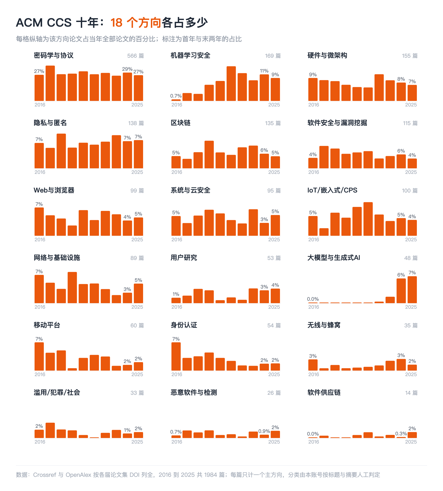
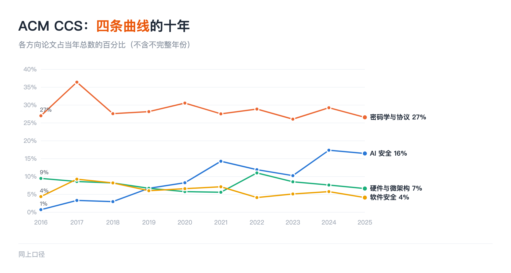
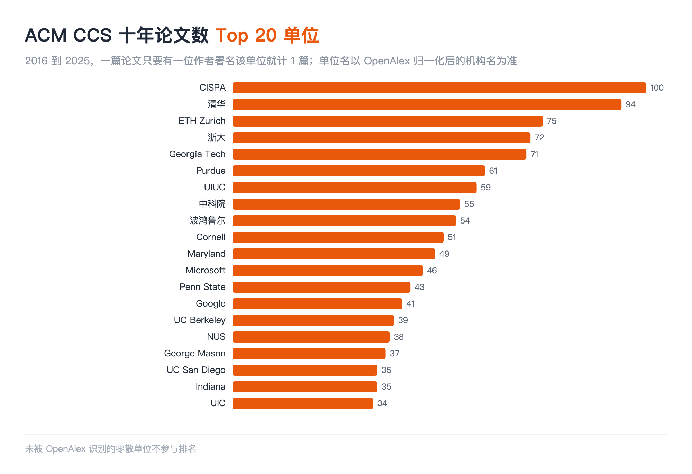
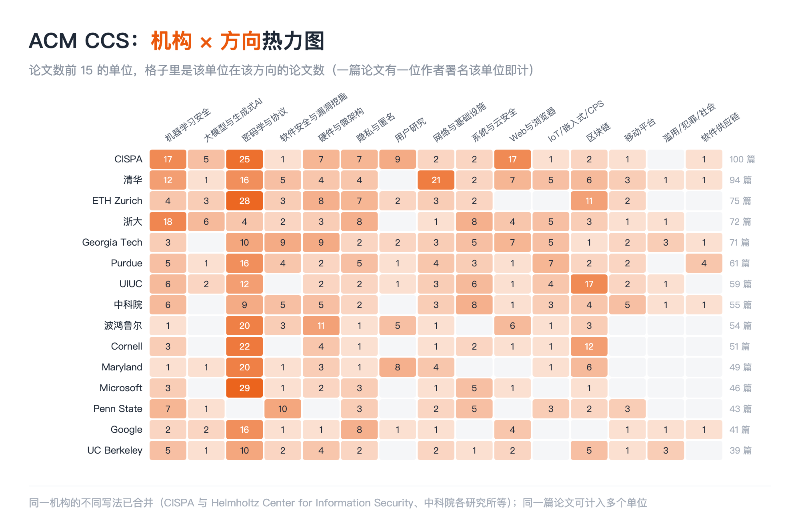
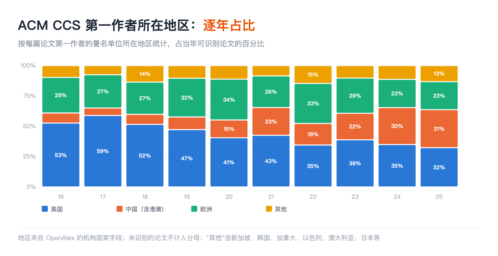

## LIST INFO|本期说明

【范围】ACM Conference on Computer and Communications Security（CCS）2016 到 2025 十届的全部正式论文，共 1984 篇。CCS 2026 要到年底才开，本期不含
【来源】按每届论文集的 DOI 从 Crossref 列全标题与作者，再用 OpenAlex 补摘要、作者单位和国家，逐年和 DBLP 目录核对过；会议同期的 workshop 论文集、poster、demo 与 keynote 不计
【口径】每篇只归一个主方向（可带一个次方向），共 18 个方向，判定依据是标题和摘要，分类体系与本系列 USENIX Security、NDSS、S&P 三期一致。分类是逐篇人工判定，同一篇论文换个人分可能落到相邻方向，个位数的出入不影响趋势

@stats
- 137 → 316 篇 | 年接收量，2024 年一度到 328 篇
- 26% 到 36% | 密码学与协议每年的份额，十年没跌出过第一
- 1 → 52 篇 | AI 安全（机器学习加大模型）的年论文数
- 8% → 30% | 第一作者来自中国大陆与港澳的比例

先交代规模。CCS 的年接收量从 2016 年的 137 篇涨到 2024 年的 328 篇，2025 年 316 篇，十年扩了 2.3 倍。这个扩张比 USENIX Security（6 倍）温和得多，所以 CCS 的曲线里绝对数和占比的走向大体一致，但下面的"涨"和"跌"仍然按占比说，这样能和另外三家横向比。

另一件事先说清楚：CCS 是四大安全顶会里密码学比重最高的一家。这决定了它的很多方向看起来比别家"小"，不是那些方向弱，是分母里有三成被密码学占着。

## BIG PICTURE|十年三个大迁移

把 18 张小图摊开看，最显眼的是三件事。

#### 密码学十年稳坐第一，而且份额没有被 AI 吃掉

密码学与协议每年占 26% 到 36%，2017 年最高（55 篇、36.4%），2025 年 83 篇、26.3%。这是 CCS 和另外三家最大的不同：USENIX Security 的密码学在 14% 上下，NDSS 在 10% 上下，S&P 在 11% 到 24% 之间。CCS 的密码学论文数在 2024 年达到 96 篇，一届会议的密码学论文比 NDSS 2019 整届的论文还多。

#### AI 安全从 1 篇涨到 52 篇，2021 年之后成了稳定的第二大方向

2016 年整个 CCS 只有 1 篇论文在讲攻击机器学习，就是 **Accessorize to a Crime: Real and Stealthy Attacks on State-of-the-Art Face Recognition**，用一副打印的眼镜框骗过人脸识别。2021 年机器学习安全跳到 28 篇、14.4%，2024 年机器学习加大模型合计 57 篇、17.4%，2025 年 52 篇、16.5%。把次方向也算进去，2024 和 2025 年各有 87 篇论文涉及 AI 安全，占当年的四分之一以上。

#### 硬件、区块链、IoT 各有一波高峰，然后回落

硬件与微架构 2022 年冲到 25 篇、11.4%；区块链 2019 年 17 篇、11.4%，2023 年 22 篇、9.4%；IoT 与嵌入式 2021 年 17 篇、8.7%。三个方向的高峰分别对应瞬态执行攻击的第二波、加密货币的两轮行情和自动驾驶安全最热的两年，之后都回到 5% 到 7% 的区间。==CCS 的方向结构十年基本没变，变的是密码学以外那七成里谁在轮流领跑==。

## CRYPTO|密码学与协议：564 篇，题材换了三轮

密码学十年 565 篇，占全部论文的 28.5%。份额稳，但里面的题材换了三轮。

#### 2016 到 2018：打协议、打实现

这三年的密码学论文里，最出圈的是攻击真实部署系统的那批。2016 年 **A Surfeit of SSH Cipher Suites** 系统分析了 OpenSSH 支持的密码套件，**A Systematic Analysis of the Juniper Dual EC Incident** 复盘了 Juniper 后门事件，两篇都拿了当年的最佳论文；同年 **On the Practical (In-)Security of 64-bit Block Ciphers: Collision Attacks on HTTP over TLS and OpenVPN** 就是 Sweet32 攻击。2017 年 **Key Reinstallation Attacks: Forcing Nonce Reuse in WPA2** 是 KRACK，2018 年同一组作者又发了 **Release the Kraken: New KRACKs in the 802.11 Standard**；2017 年 **The Return of Coppersmith's Attack: Practical Factorization of Widely Used RSA Moduli** 是 ROCA，打的是 Infineon 芯片生成的 RSA 密钥。同期形式化验证的密码库开始出现：2017 年 **HACL\*: A Verified Modern Cryptographic Library** 和 **Jasmin: High-Assurance and High-Speed Cryptography** 两篇，前者后来进了 Firefox 和 Linux 内核。

#### 2019 到 2022：MPC、ZK、PIR 的工程化

从 2019 年开始，安全多方计算、零知识证明和私密信息检索三条线的论文数持续增长，题材从"能不能做"转向"多快、多便宜"。MPC 这边，2017 年 **Authenticated Garbling and Efficient Maliciously Secure Two-Party Computation**（最佳论文）之后，2020 年 **Ferret: Fast Extension for Correlated OT with Small Communication** 和 **MP-SPDZ: A Versatile Framework for Multi-Party Computation** 一个把相关 OT 的通信压到极低，一个把几十种协议放进同一个框架，后者成了这个领域的公共基础设施。ZK 这边，2017 年 **Ligero: Lightweight Sublinear Arguments Without a Trusted Setup** 开头，2019 年 **Sonic**、**LegoSNARK**，2021 年 **QuickSilver** 把交互式 ZK 做到接近电路求值的速度，2022 年 **Caulk: Lookup Arguments in Sublinear Time** 开了查找参数这条线，同年 **Proving UNSAT in Zero Knowledge**（杰出论文）把 ZK 用到了 SAT 求解器的输出上。PIR 这边，2021 年 **OnionPIR: Response Efficient Single-Server PIR**，2024 年 **Respire: High-Rate PIR for Databases with Small Records**、**ThorPIR** 和 **Faster FHE-Based Single-Server Private Information Retrieval** 三篇同届，单服务器 PIR 的吞吐在这几年里提升了两个数量级。

同态加密是这一轮里增长最快的子题材。2018 年 **ALCHEMY: A Language and Compiler for Homomorphic Encryption Made easY** 还是在做编译器，2023 年 **HE3DB: An Efficient and Elastic Encrypted Database Via Arithmetic-And-Logic Fully Homomorphic Encryption**（杰出论文）已经是一个完整的加密数据库，2024 年 **NeuJeans**、**Rhombus**、**Fast and Accurate Homomorphic Softmax Evaluation** 三篇在做同态加密下的神经网络推理，2025 年 **THOR: Secure Transformer Inference with Homomorphic Encryption** 直接做 Transformer。

#### 2023 到 2025：后量子落地与安全消息的形式化

后量子这条线的标志是从"新方案"变成"怎么部署"。2016 年 **Frodo: Take off the Ring! Practical, Quantum-Secure Key Exchange from LWE** 还在提方案，2020 年 **Post-Quantum TLS Without Handshake Signatures** 是 KEMTLS，2022 年 **Post Quantum Noise** 给 Noise 协议族做后量子改造，2024 年 **Keeping Up with the KEMs: Stronger Security Notions for KEMs and Automated Analysis of KEM-based Protocols** 给 KEM 定义了更强的安全概念并自动分析基于 KEM 的协议，2025 年 **CuKEM: A Concise and Unified Hybrid Key Encapsulation Mechanism** 做混合 KEM。侧信道防护也跟上了：2024 年 **The Insecurity of Masked Comparisons: SCAs on ML-KEM's FO-Transform** 打 ML-KEM 的掩码实现，2025 年 **mUOV** 给 UOV 签名做高阶掩码。

安全消息的形式化是另一条主线。2018 年 **On Ends-to-Ends Encryption: Asynchronous Group Messaging with Strong Security Guarantees** 提出 TreeKEM 的雏形，2021 年 **Modular Design of Secure Group Messaging Protocols and the Security of MLS** 给 MLS 做了模块化的安全证明，2022 年 **Server-Aided Continuous Group Key Agreement** 和 **How to Hide MetaData in MLS-Like Secure Group Messaging** 继续补，2024 年 **Quarantined-TreeKEM** 处理不活跃成员的问题，同年 **On the Tight Security of the Double Ratchet** 给 Signal 的双棘轮做紧致证明。这条线从协议设计到 IETF 标准再到紧致证明，正好走完一个周期。

真实系统的密码学漏洞每年都有，而且越来越贴近日常软件。2021 年 **On the (In)Security of ElGamal in OpenPGP**（最佳论文），2022 年 **Victory by KO: Attacking OpenPGP Using Key Overwriting**（杰出论文），2023 年 **Passive SSH Key Compromise via Lattices** 从被动观察到的 SSH 签名里用格算法恢复私钥，2024 年 **End-to-End Encrypted Cloud Storage in the Wild: A Broken Ecosystem** 一口气打了多家端到端加密云盘，2025 年 **On the Security of SSH Client Signatures** 和 **Finding SSH Strict Key Exchange Violations by State Learning** 两篇继续盯着 SSH。

## AI|AI 安全：从对抗样本到 RAG 投毒

机器学习安全 169 篇加大模型 48 篇，合计 217 篇，是第二大方向。曲线分三段。

@timeline
- 2016 | Accessorize to a Crime: Real and Stealthy Attacks on State-of-the-Art Face Recognition | 打印眼镜框骗人脸识别，CCS 上第一篇攻击机器学习的论文
- 2017 | Deep Models Under the GAN: Information Leakage from Collaborative Deep Learning | 用 GAN 从协作训练里把别人的训练数据"画"出来
- 2018 | LEMNA: Explaining Deep Learning based Security Applications | 给安全领域的深度学习模型做可解释，当年最佳论文
- 2019 | ABS: Scanning Neural Networks for Back-doors by Artificial Brain Stimulation | 逐个刺激神经元来找后门
- 2021 | Backdoor Pre-trained Models Can Transfer to All | 预训练模型里的后门能传到所有下游任务
- 2022 | Truth Serum: Poisoning Machine Learning Models to Reveal Their Secrets | 用投毒放大成员推断，训练数据更容易被泄露
- 2023 | Large Language Models for Code: Security Hardening and Adversarial Testing | 用受控生成让代码 LLM 更安全或更不安全，当年杰出论文
- 2024 | "Do Anything Now": Characterizing and Evaluating In-The-Wild Jailbreak Prompts on Large Language Models | 第一次系统测量野外的越狱提示
- 2025 | Here Comes the AI Worm: Preventing the Propagation of Adversarial Self-Replicating Prompts Within GenAI Ecosystems | 自我复制的提示在 GenAI 生态里传播，蠕虫的概念搬到 LLM 上

#### 2016 到 2020：攻击面从输入扩到训练数据和模型本身

早期论文主要在两个题材上：对抗样本和成员推断。2017 年 **Machine Learning Models that Remember Too Much** 证明模型能被训练成"记住"训练数据，2018 年 **Property Inference Attacks on Fully Connected Neural Networks using Permutation Invariant Representations** 从模型里推断训练集的整体属性，2019 年 **MemGuard: Defending against Black-Box Membership Inference Attacks via Adversarial Examples** 反过来用对抗样本防成员推断。后门这条线从 2018 年 **Model-Reuse Attacks on Deep Learning Systems** 开始，2019 年 **Latent Backdoor Attacks on Deep Neural Networks** 把后门藏进迁移学习的教师模型，2020 年 **Composite Backdoor Attack for Deep Neural Network by Mixing Existing Benign Features** 不需要特殊触发器，只用已有特征的组合。

#### 2021 到 2023：预训练、联邦学习和隐私的交叉

2021 年是拐点，一届 28 篇。题材上有两个新东西：一是预训练模型和对比学习的安全，**EncoderMI: Membership Inference against Pre-trained Encoders in Contrastive Learning**、**Quantifying and Mitigating Privacy Risks of Contrastive Learning** 和 2022 年 **StolenEncoder: Stealing Pre-trained Encoders in Self-supervised Learning** 都盯着编码器；二是机器遗忘的反作用，2021 年 **When Machine Unlearning Jeopardizes Privacy** 证明遗忘前后的模型差异本身就泄露信息，2022 年 **Graph Unlearning** 把遗忘搬到图上，2025 年 **Split Unlearning** 做拆分学习里的遗忘。联邦学习的攻防在这三年密集出现：2022 年 **Eluding Secure Aggregation in Federated Learning via Model Inconsistency** 绕过安全聚合，2023 年 **MESAS** 防自适应投毒，**martFL** 做可验证的联邦学习数据市场。

2023 年还有一篇值得单说：**"Get in Researchers; We're Measuring Reproducibility": A Reproducibility Study of Machine Learning Papers in Tier 1 Security Conferences** 复现了顶会上的机器学习安全论文，结论是相当一部分不可复现。这篇和 USENIX Security 2022 的 Dos and Don'ts of Machine Learning in Computer Security 是同一个精神。

#### 2024 到 2025：大模型接管

大模型方向 2023 年 4 篇，2024 年 21 篇，2025 年 22 篇。题材集中在四件事。

- 越狱与内容安全：2024 年 **"Do Anything Now"** 测量野外越狱提示，**SafeGen** 和 **SurrogatePrompt** 分别防和攻文生图模型的安全过滤，**Moderator: Moderating Text-to-Image Diffusion Models through Fine-grained Context-based Policies**（杰出论文）给文生图做细粒度策略；2025 年 **SafeGuider** 继续做文生图的内容安全控制
- 提示注入与提示泄露：2024 年 **PLeak: Prompt Leaking Attacks against Large Language Model Applications**、**Optimization-based Prompt Injection Attack to LLM-as-a-Judge**；2025 年 **SecAlign: Defending Against Prompt Injection with Preference Optimization** 用偏好优化防注入，**You Can't Steal Nothing: Mitigating Prompt Leakages in LLMs via System Vectors** 用系统向量替代系统提示
- RAG 与 Agent：2025 年 **FlippedRAG: Black-Box Opinion Manipulation Adversarial Attacks to Retrieval-Augmented Generation Models**、**Riddle Me This! Stealthy Membership Inference for Retrieval-Augmented Generation**、**DCMI: A Differential Calibration Membership Inference Attack Against Retrieval-Augmented Generation** 三篇都打 RAG，**AgentSentinel: An End-to-End and Real-Time Security Defense Framework for Computer-Use Agents** 防电脑操作 Agent
- LLM 与代码和逆向：2023 年 **Large Language Models for Code: Security Hardening and Adversarial Testing**，2024 年 **ReSym: Harnessing LLMs to Recover Variable and Data Structure Symbols from Stripped Binaries**（杰出论文）用 LLM 恢复剥离二进制的符号，**Demystifying RCE Vulnerabilities in LLM-Integrated Apps** 找 LLM 集成应用里的远程代码执行；2025 年 **ImportSnare: Directed 'Code Manual' Hijacking in Retrieval-Augmented Code Generation** 劫持代码生成的检索文档，**Give LLMs a Security Course: Securing Retrieval-Augmented Code Generation via Knowledge Injection** 是它的防御面

> 从 2016 年的眼镜框到 2025 年的 AI 蠕虫，CCS 上 AI 安全的攻击面走了一条清楚的路：输入 → 训练数据 → 预训练模型 → 联邦与拆分训练 → 提示 → 检索到的外部内容 → Agent 的环境。==每往外走一层，"模型"就越不像攻击对象，越像一个被攻击的系统的组件==。

传统机器学习安全那一支 2025 年还有 30 篇，题材换成了深伪检测（2024 年 **ProFake**、2025 年 **UnsafeBench**）、模型知识产权（2024 年 **Neural Dehydration** 去水印、2025 年 **Removal Attack and Defense on AI-generated Content Latent-based Watermarking**）和物理世界的对抗攻击（2025 年 **ControlLoc: Physical-World Hijacking Attack on Camera-based Perception in Autonomous Driving**）。

## HW|硬件与微架构：156 篇，每年一个新家族

硬件安全十年 156 篇，份额在 5.6% 到 11.4% 之间，2022 年最高。CCS 的硬件论文和 USENIX Security、S&P 的最大不同是它更偏"密码学与硬件的交界"：掩码、故障注入、常量时间验证这一支占了相当比重。

瞬态执行攻击这条线 CCS 上没有缺席。2018 年 **ret2spec: Speculative Execution Using Return Stack Buffers** 用返回栈缓冲做推测执行攻击，2019 年 **ZombieLoad: Cross-Privilege-Boundary Data Sampling**、**Fallout: Leaking Data on Meltdown-resistant CPUs** 和 **SMoTherSpectre: Exploiting Speculative Execution through Port Contention** 三篇同届，2022 年 **Automatic Detection of Speculative Execution Combinations**（杰出论文）开始自动组合已知的推测执行原语找新变体，2024 年 **SysBumps: Exploiting Speculative Execution in System Calls for Breaking KASLR in macOS for Apple Silicon** 打到了 Apple Silicon。

TEE 是硬件和系统共享的一条线。2017 年 **Leaky Cauldron on the Dark Land: Understanding Memory Side-Channel Hazards in SGX** 系统梳理 SGX 的内存侧信道，2019 年 **A Tale of Two Worlds: Assessing the Vulnerability of Enclave Shielding Runtimes** 审计了各家 enclave 运行时的接口，2021 年 **One Glitch to Rule Them All: Fault Injection Attacks Against AMD's Secure Encrypted Virtualization**（最佳论文）用电压故障注入打 AMD SEV，2024 年 **TDXdown: Single-Stepping and Instruction Counting Attacks against Intel TDX** 打 Intel TDX，2025 年 **RMPocalypse: How a Catch-22 Breaks AMD SEV-SNP**、**Heracles: Chosen Plaintext Attack on AMD SEV-SNP** 和 **WireTap: Breaking Server SGX via DRAM Bus Interposition** 三篇同届，最后一篇用 DRAM 总线插入器打服务器版 SGX。GPU TEE 是 2022 年之后的新支：**StrongBox: A GPU TEE on Arm Endpoints** 提方案，2025 年 **MOLE: Breaking GPU TEE with GPU-Embedded MCU** 打方案。

密码硬件那一支是 CCS 的特色。2016 年 **Strong Non-Interference and Type-Directed Higher-Order Masking** 给掩码定义了强非干扰，2022 年 **Power Contracts: Provably Complete Power Leakage Models for Processors** 和 2023 年 **Specification and Verification of Side-channel Security for Open-source Processors via Leakage Contracts**（杰出论文）把"泄露契约"这个概念从功耗扩到微架构，2025 年 **Synthesis of Sound and Precise Leakage Contracts for Open-Source RISC-V Processors** 开始自动合成契约。

物理侧信道每年都有一两篇让人记住的。2018 年 **Screaming Channels: When Electromagnetic Side Channels Meet Radio Transceivers** 让混合信号芯片的密码运算通过无线电泄露到几米外，2021 年 **Glowworm Attack: Optical TEMPEST Sound Recovery via a Device's Power Indicator LED** 从电源指示灯恢复声音，2023 年 **Optical Cryptanalysis: Recovering Cryptographic Keys from Power LED Light Fluctuations** 从 LED 亮度波动恢复密钥，2024 年 **GAZEploit: Remote Keystroke Inference Attack by Gaze Estimation from Avatar Views in VR/MR Devices** 从 VR 头显的虚拟形象眼神推断键入内容。

## PRIVACY|隐私与匿名：差分隐私是 CCS 的主场

隐私方向 139 篇，份额在 5% 到 9% 之间。把次方向算进去，2024 年涉及隐私的论文有 64 篇，占 19.5%。CCS 是四大会里差分隐私论文最集中的一家。

差分隐私这条线从 2016 年 **Deep Learning with Differential Privacy** 开始，这篇是 DP-SGD 的出处，十年后仍是差分隐私机器学习的默认基线。之后的题材沿三个方向走：一是本地差分隐私的协议，2018 年 **CALM: Consistent Adaptive Local Marginal for Marginal Release under Local Differential Privacy**，2021 年 **AHEAD**，2024 年 **Data Poisoning Attacks to Locally Differentially Private Frequent Itemset Mining Protocols** 和 2025 年 **Mitigating Data Poisoning Attacks to Local Differential Privacy** 是攻防一对；二是差分隐私的验证与审计，2018 年 **Detecting Violations of Differential Privacy**（最佳论文）和 **DP-Finder** 找实现里的违规，2020 年 **CheckDP** 自动证明或找反例，2022 年 **Widespread Underestimation of Sensitivity in Differentially Private Libraries and How to Fix It** 发现主流库普遍低估敏感度，2023 年 **Group and Attack: Auditing Differential Privacy**，2025 年 **Timing Attacks on Differential Privacy are Practical** 证明时序侧信道能打穿差分隐私实现；三是洗牌模型，2021 年 **On the Rényi Differential Privacy of the Shuffle Model**（最佳论文），2023 年 **Amplification by Shuffling without Shuffling**（杰出论文），2024 年 **Computationally Secure Aggregation and Private Information Retrieval in the Shuffle Model**。

Tor 和网站指纹那一支在 CCS 上没有 USENIX 那么密，但每两三年有一篇关键工作：2018 年 **Deep Fingerprinting: Undermining Website Fingerprinting Defenses with Deep Learning** 用深度学习把网站指纹的准确率推到 98%，2021 年 **The One-Page Setting: A Higher Standard for Evaluating Website Fingerprinting Defenses** 重新定义了评估标准，2023 年 **Realistic Website Fingerprinting By Augmenting Network Traces** 和 2024 年 **Towards Fine-Grained Webpage Fingerprinting at Scale** 往真实流量和页面粒度推。

隐私合规是 2023 年之后的新题材：**PolicyChecker: Analyzing the GDPR Completeness of Mobile Apps' Privacy Policies**、**General Data Protection Runtime: Enforcing Transparent GDPR Compliance for Existing Applications**，2024 年 **VPVet: Vetting Privacy Policies of Virtual Reality Apps**，2025 年 **Layered, Overlapping, and Inconsistent: A Large-Scale Analysis of the Multiple Privacy Policies and Controls of U.S. Banks**。

## CHAIN|区块链：134 篇，跟着行情走

区块链 135 篇，曲线和加密货币市场高度重合：2019 年 17 篇（11.4%）、2023 年 22 篇（9.4%）是两个高峰，2020 年和 2025 年是两个谷。

题材分三层。共识与协议层是 CCS 的强项：2016 年 **The Honey Badger of BFT Protocols** 是第一个实用的异步 BFT，2018 年 **RapidChain: Scaling Blockchain via Full Sharding** 和 **Ouroboros Genesis**，2020 年 **Dumbo: Faster Asynchronous BFT Protocols**、2022 年 **Dumbo-NG** 和 **Bullshark: DAG BFT Protocols Made Practical**，2023 年 **Themis: Fast, Strong Order-Fairness in Byzantine Consensus**，2024 年 **Sui Lutris: A Blockchain Combining Broadcast and Consensus**（杰出论文）。这条线从 HoneyBadger 到 Bullshark 再到 Sui，正好是异步 BFT 从论文走进生产链的过程。

智能合约层从 2016 年 **Making Smart Contracts Smarter** 开始（这篇提出了 Oyente，是合约分析的起点），2018 年 **Securify: Practical Security Analysis of Smart Contracts**，2020 年 **eThor: Practical and Provably Sound Static Analysis of Ethereum Smart Contracts**，2022 年 **VRust: Automated Vulnerability Detection for Solana Smart Contracts** 和 2023 年 **Fuzz on the Beach: Fuzzing Solana Smart Contracts** 把目标换成了 Solana，2024 年 **FORAY: Towards Effective Attack Synthesis against Deep Logical Vulnerabilities in DeFi Protocols** 自动合成 DeFi 逻辑漏洞的攻击。

经济与生态层是近年增长最快的：2023 年 **Demystifying DeFi MEV Activities in Flashbots Bundle** 和 2024 年 **Rolling in the Shadows: Analyzing the Extraction of MEV Across Layer-2 Rollups** 测量 MEV，2023 年 **Uncle Maker: (Time)Stamping Out The Competition in Ethereum**（杰出论文）发现矿池通过操纵时间戳获利，2024 年 **DoubleUp Roll: Double-spending in Arbitrum by Rolling It Back**（杰出论文）和 2025 年 **Denial of Sequencing Attacks in Ethereum Layer 2 Rollups** 盯着二层网络，2025 年 **Forking the RANDAO: Manipulating Ethereum's Distributed Randomness Beacon** 打以太坊的随机信标。

## SWSEC|软件安全与漏洞挖掘：CCS 上的份额不到一成

软件安全 115 篇，份额在 4% 到 9% 之间，2017 年最高。这个方向在 USENIX Security 上长期是第一大方向，在 CCS 上只排第七。不过把次方向算进去，2025 年有 47 篇论文涉及软件安全，其中 34 篇的主方向在别处（LLM、硬件、系统），说明软件安全的方法正在被别的方向借用。

fuzzing 这条线 CCS 上有几篇奠基作。2016 年 **Coverage-based Greybox Fuzzing as Markov Chain** 是 AFLFast，2017 年 **Directed Greybox Fuzzing** 是 AFLGo，2018 年 **Hawkeye: Towards a Desired Directed Grey-box Fuzzer** 和 **Evaluating Fuzz Testing**，后者指出了 fuzzer 评估里的系统性问题，是后来所有 fuzzing 论文都要引的一篇。2022 年 **LibAFL: A Framework to Build Modular and Reusable Fuzzers** 把 fuzzer 拆成可组合的模块，2023 年 **Hopper: Interpretative Fuzzing for Libraries** 不写 harness 直接 fuzz 库，2024 年 **Prompt Fuzzing for Fuzz Driver Generation** 和 2025 年 **PromeFuzz: A Knowledge-Driven Approach to Fuzzing Harness Generation with Large Language Models** 用 LLM 生成 harness。

内存安全的防御从 2016 年 **TypeSan: Practical Type Confusion Detection** 到 2022 年 **PACMem: Enforcing Spatial and Temporal Memory Safety via ARM Pointer Authentication**，再到 2023 年 **Cryptographically Enforced Memory Safety** 和 2025 年 **Securing Mixed Rust with Hardware Capabilities**，硬件辅助的比重越来越高。Rust 是 2021 年之后的新支：**MirChecker: Detecting Bugs in Rust Programs via Static Analysis**，2024 年 **Rust for Embedded Systems: Current State and Open Problems**，2025 年 **Don't Panic! Finding Bugs Hidden Behind Rust Runtime Safety Checks**。

二进制分析里，2018 年 **Debin: Predicting Debug Information in Stripped Binaries** 用机器学习预测剥离二进制的调试信息，2021 年 **PalmTree: Learning an Assembly Language Model for Instruction Embedding** 给汇编训练语言模型，2022 年 **SymLM**，2024 年 **ReSym** 换成 LLM，2025 年 **Walking The Last Mile: Studying Decompiler Output Correction in Practice** 研究人怎么修反编译输出。这条线从"小模型预测符号"到"大模型恢复符号"，五年走完。

## WEB|Web 与浏览器：99 篇，CSP 到 XS-Leaks

Web 安全 99 篇，份额从 2016 年的 7.3% 降到 2019 年的 2.7% 再回到 4% 到 6%。题材上有三条稳定的线。

内容安全策略：2016 年 **CSP Is Dead, Long Live CSP! On the Insecurity of Whitelists and the Future of Content Security Policy** 证明基于白名单的 CSP 在真实网站上几乎全部可绕过，直接推动了 strict-dynamic 的采纳；2017 年 **Code-Reuse Attacks for the Web: Breaking Cross-Site Scripting Mitigations via Script Gadgets** 用脚本 gadget 绕过 XSS 缓解；2021 年 **12 Angry Developers - A Qualitative Study on Developers' Struggles with CSP** 访谈开发者为什么配不好 CSP。

跨站泄露：2021 年 **XSinator.com: From a Formal Model to the Automatic Evaluation of Cross-Site Leaks in Web Browsers**（最佳论文）给 XS-Leaks 建了形式模型并自动测试所有主流浏览器，2023 年 **Finding All Cross-Site Needles in the DOM Stack** 继续。浏览器扩展：2018 年 **Mystique: Uncovering Information Leakage from Browser Extensions**，2021 年 **DoubleX: Statically Detecting Vulnerable Data Flows in Browser Extensions at Scale**，2022 年 **Helping or Hindering?: How Browser Extensions Undermine Security**，2023 年 **CoCo**（杰出论文）。

追踪与合规是这个方向和隐私方向的交界：2016 年 **Online Tracking: A 1-million-site Measurement and Analysis** 是第一次百万站点规模的追踪测量，2019 年 **(Un)informed Consent: Studying GDPR Consent Notices in the Field**，2022 年 **Privacy Limitations of Interest-based Advertising on The Web: A Post-mortem Empirical Analysis of Google's FLoC** 和 2024 年 **The Privacy-Utility Trade-off in the Topics API** 分别给 Google 的两代隐私沙盒方案做了体检。2025 年 **Pixnapping: Bringing Pixel Stealing out of the Stone Age** 把像素窃取攻击带回了 Android。

## SYS|系统与云安全：从审计日志到 Kubernetes

系统安全 95 篇，份额在 3% 到 7% 之间。CCS 上这个方向有一条别家少见的线：溯源图和攻击调查。2017 年 **RAIN: Refinable Attack Investigation with On-demand Inter-Process Information Flow Tracking**，2018 年 **NodeMerge** 和 **Runtime Analysis of Whole-System Provenance**，2019 年 **POIROT: Aligning Attack Behavior with Kernel Audit Records for Cyber Threat Hunting**，2023 年 **Are we there yet? An Industrial Viewpoint on Provenance-based Endpoint Detection and Response Tools** 从工业界视角审视这类工具的落地，2025 年 **OCR-APT: Reconstructing APT Stories from Audit Logs using Subgraph Anomaly Detection and LLMs** 让 LLM 来写攻击故事。

内核安全的主线是 fuzzing 和利用。2017 年 **DIFUZE: Interface Aware Fuzzing for Kernel Drivers**，2021 年 **SyzGen: Automated Generation of Syscall Specification of Closed-Source macOS Drivers**，2023 年 **SyzDirect: Directed Greybox Fuzzing for Linux Kernel**，2025 年 **SyzSpec** 和 **SyzParam** 两篇继续改 Syzkaller。利用这边，2022 年 **DirtyCred: Escalating Privilege in Linux Kernel** 提出了一种通用的内核提权原语，2023 年 **RetSpill**，2025 年 **CROSS-X: Generalized and Stable Cross-Cache Attack on the Linux Kernel** 和 **Reviving Discarded Vulnerabilities: Exploiting Previously Unexploitable Linux Kernel Bugs Through Control Metadata Fields** 把被认为不可利用的漏洞重新变成可利用。

云原生是 2023 年之后的新题材：**Take Over the Whole Cluster: Attacking Kubernetes via Excessive Permissions of Third-party Applications**，**Lost along the Way: Understanding and Mitigating Path-Misresolution Threats to Container Isolation**，2025 年 **Dangers Behind Access Control: Understanding and Exploiting Implicit Permissions in Kubernetes**。

## IOT|IoT 与嵌入式：100 篇，车和语音助手

IoT 方向 100 篇，2021 年 17 篇是高峰。2017 年 **DolphinAttack: Inaudible Voice Commands**（最佳论文）用超声波给语音助手下命令，是这个方向十年里被引最多的论文之一，2021 年 **CapSpeaker: Injecting Voices to Microphones via Capacitors** 和 **FakeWake: Understanding and Mitigating Fake Wake-up Words of Voice Assistants** 是同一条线的延续，2025 年 **Threat from Windshield: Vehicle Windows as Involuntary Attack Sources on Automotive Voice Assistants** 把攻击面搬到了车窗上。

自动驾驶的感知攻击从 2019 年 **Adversarial Sensor Attack on LiDAR-based Perception in Autonomous Driving** 开始，2021 年 **Can We Use Arbitrary Objects to Attack LiDAR Perception in Autonomous Driving?** 和 **I Can See the Light: Attacks on Autonomous Vehicles Using Invisible Lights**，2023 年 **TileMask: A Passive-Reflection-based Attack against mmWave Radar Object Detection in Autonomous Driving** 打毫米波雷达，2024 年 **PhySense** 和 **VisionGuard** 做防御，2025 年 **Asymmetry Vulnerability and Physical Attacks on Online Map Construction for Autonomous Driving** 打在线建图。

固件分析是 IoT 和软件安全共享的线：2022 年 **What Your Firmware Tells You Is Not How You Should Emulate It: A Specification-Guided Approach for Firmware Emulation** 和 **MetaEmu**，2025 年 **FlexEmu: Towards Flexible MCU Peripheral Emulation** 和 **Protocol-Aware Firmware Rehosting for Effective Fuzzing of Embedded Network Stacks**。车载网络从 2016 年 **Error Handling of In-vehicle Networks Makes Them Vulnerable** 到 2022 年 **CANflict** 再到 2024 年 **ERACAN: Defending Against an Emerging CAN Threat Model**（杰出论文），CAN 总线的攻防持续了整整十年。

## NET|网络与基础设施：DNS 投毒的四次复活

网络安全 89 篇，份额在 2% 到 8% 之间，2025 年回升到 16 篇。这个方向十年里最有辨识度的是 DNS 缓存投毒的反复复活：2020 年 **DNS Cache Poisoning Attack Reloaded: Revolutions with Side Channels**（最佳论文）用 ICMP 速率限制的侧信道复活了 Kaminsky 攻击，2021 年 **DNS Cache Poisoning Attack: Resurrections with Side Channels** 找到新的侧信道，2025 年 **RebirthDay Attack: Reviving DNS Cache Poisoning with the Birthday Paradox** 用生日悖论再来一次。DNS 的其他问题也没断：2023 年 **TsuKing: Coordinating DNS Resolvers and Queries into Potent DoS Amplifiers** 和 **Silence is not Golden: Disrupting the Load Balancing of Authoritative DNS Servers**（杰出论文），2024 年 **The Harder You Try, The Harder You Fail: The KeyTrap Denial-of-Service Algorithmic Complexity Attacks on DNSSEC**（杰出论文）用一个 DNSSEC 响应就能让解析器停摆几分钟。

PKI 与证书是另一条线：2016 年 **Measurement and Analysis of Private Key Sharing in the HTTPS Ecosystem**，2019 年 **Let's Encrypt: An Automated Certificate Authority to Encrypt the Entire Web** 是 Let's Encrypt 团队自己写的设计论文，2021 年 **Let's Downgrade Let's Encrypt** 和 **Rusted Anchors: A National Client-Side View of Hidden Root CAs in the Web PKI Ecosystem**，2022 年 **Hammurabi: A Framework for Pluggable, Logic-Based X.509 Certificate Validation Policies**。审查与规避从 2016 年 **Practical Censorship Evasion Leveraging Content Delivery Networks** 到 2019 年 **Geneva: Evolving Censorship Evasion Strategies**（用遗传算法自动演化规避策略）再到 2020 年 **Censored Planet: An Internet-wide, Longitudinal Censorship Observatory**。

清华在这个方向一家 21 篇，远超第二名的 5 篇，DNS、DDoS、TCP 侧信道、加密流量分类都有。

## SHRINK|缩小的三个方向：移动、身份认证、用户研究

三个方向在 CCS 上的份额都很小，原因各不相同。

移动平台从 2016 年的 10 篇（7.3%）降到 2025 年的 7 篇（2.2%）。早年（2016 年）是平台机制（**Android ION Hazard**、**The Misuse of Android Unix Domain Sockets and Security Implications**、**TaintART**），2020 年之后转向生态（**Deploying Android Security Updates: an Extensive Study Involving Manufacturers, Carriers, and End Users**）和小程序（2022 年 **Cross Miniapp Request Forgery**，2023 年 **Uncovering and Exploiting Hidden APIs in Mobile Super Apps** 和 **Don't Leak Your Keys: Understanding, Measuring, and Exploiting the AppSecret Leaks in Mini-Programs**，2024 年 **MiniCAT**）。2025 年 **Leaky Apps: Large-scale Analysis of Secrets Distributed in Android and iOS Apps** 大规模测量了 App 里硬编码的密钥。

身份认证从 2016 年的 10 篇（7.3%）降到每年 5 篇上下。口令这条线一直在：2016 年 **Targeted Online Password Guessing: An Underestimated Threat**，2017 年 **The TypTop System: Personalized Typo-Tolerant Password Checking**，2019 年 **Protocols for Checking Compromised Credentials**（和 Cloudflare 合作，研究怎么在不泄露口令的前提下查询泄露库），2021 年 **Chunk-Level Password Guessing**，2024 年 **Unmasking the Security and Usability of Password Masking**（杰出论文）。FIDO2 是 2022 年之后的新题材：**FeIDo: Recoverable FIDO2 Tokens Using Electronic IDs**，2023 年 **Evaluating the Security Posture of Real-World FIDO2 Deployments**，2024 年 **Breaching Security Keys without Root: FIDO2 Deception Attacks via Overlays exploiting Limited Display Authenticators**。

用户研究十年 53 篇，2023 年之后稳定在每年 9 到 12 篇。CCS 的用户研究偏向开发者和从业者：2017 年 **Why Do Developers Get Password Storage Wrong?: A Qualitative Usability Study**，2019 年 **Matched and Mismatched SOCs: A Qualitative Study on Security Operations Center Issues**，2023 年 **Alert Alchemy: SOC Workflows and Decisions in the Management of NIDS Rules**（杰出论文），2024 年 **Using AI Assistants in Software Development: A Qualitative Study on Security Practices and Concerns**，2025 年 **A Qualitative Analysis of Fuzzer Usability and Challenges** 和 **It Should Be Easy but... New Users' Experiences and Challenges with Secret Management Tools**。这一支和 USENIX Security 上的用户研究相比规模小得多（USENIX 2025 年 35 篇），但主题更集中。

## SUPPLY|软件供应链：14 篇，但 2025 年是十年最高

这是本账号最关心的方向，也是 18 个方向里最小的：十年 14 篇，从没超过当年的 2%。但 2025 年一届就有 5 篇，是十年最高。

十年的脉络。2017 年 **Identifying Open-Source License Violation and 1-day Security Risk at Large Scale** 在 Android 应用里大规模找开源许可证违规和 1-day 风险；2020 年 **A Qualitative Study of Dependency Management and Its Security Implications** 访谈开发者怎么管依赖；2021 年三篇：**Locating the Security Patches for Disclosed OSS Vulnerabilities with Vulnerability-Commit Correlation Ranking** 给 CVE 找补丁提交，**Preventing Dynamic Library Compromise on Node.js via RWX-Based Privilege Reduction** 给 Node.js 的第三方库降权，**Supply-Chain Vulnerability Elimination via Active Learning and Regeneration** 用主动学习重新生成输入解析代码来消除供应链漏洞；2022 年 **Sigstore: Software Signing for Everybody** 是 Sigstore 团队自己写的设计论文，2023 年 **Speranza: Usable, Privacy-friendly Software Signing** 在它之上做隐私保护的签名；2023 年还有 **Enhancing OSS Patch Backporting with Semantics**；2024 年 **Toward Understanding the Security of Plugins in Continuous Integration Services** 测 CI 插件。

2025 年的五篇分成三组：运行时防护（**NodeShield: Runtime Enforcement of Security-Enhanced SBOMs for Node.js** 把 SBOM 变成运行时可执行的策略）、构建与制品（**Attestable Builds: Compiling Verifiable Binaries on Untrusted Systems using Trusted Execution Environments** 用 TEE 做可证明的构建，**Sentry: Authenticating Machine Learning Artifacts on the Fly** 认证模型制品）、模型序列化（**PickleBall: Secure Deserialization of Pickle-based Machine Learning Models** 给 pickle 模型加载做安全策略），加上 **What Gets Measured Gets Managed: Mitigating Supply Chain Attacks with a Link Integrity Management System** 管理网页里第三方资源链接的完整性。

> 和 USENIX Security 一样，CCS 上最有供应链含义的论文也大多不在供应链方向里。2019 年 **Where Does It Go?: Refining Indirect-Call Targets with Multi-Layer Type Analysis**（最佳论文）在软件安全，2023 年 **Jack-in-the-box: An Empirical Study of JavaScript Bundling on the Web and its Security Implications** 在 Web，2025 年 **Sleeping Giants - Activating Dormant Java Deserialization Gadget Chains through Stealthy Code Changes** 在软件安全，**End-to-End Encrypted Git Services** 在密码学，**ImportSnare** 在大模型。==把"上游给你的东西不可信"当主题看，供应链在 CCS 上是一条贯穿五六个方向的暗线，而不是一个 14 篇的小方向==。

## AWARDS|最佳论文十年：从协议分析到 LLM

CCS 的论文奖 2016 到 2021 年叫 Best Paper，每年 1 到 5 篇；2022 年起改叫 Distinguished Paper，数量放开，2023 年 17 篇，2024 年 27 篇。把十年的获奖论文按方向数一遍，能看出程序委员会的口味。

- 2016 到 2017 的最佳论文几乎全是密码学和协议分析：SSH 密码套件、Juniper Dual EC、三方计算、ORAM、认证混淆，DolphinAttack 是唯一的例外；2018 年的两篇是机器学习可解释（LEMNA）和差分隐私实现的违规检测
- 2019 到 2021 转向系统与软件：间接调用目标精化（Where Does It Go?）、DNS 侧信道投毒、XS-Leaks 自动评估、AMD SEV 故障注入、hypervisor 设备 fuzzing（V-Shuttle）
- 2022 到 2025 分散到所有方向，但有两个明显偏好：一是"给旧系统找新漏洞"，OpenPGP 密钥覆写、Ethereum 时间戳操纵、Arbitrum 回滚双花、DNSSEC 的 KeyTrap、SSH 客户端签名都属于这类；二是用户研究，2024 年 27 篇杰出论文里有 4 篇是用户研究（音频深伪的人类检测、口令掩码、钓鱼培训、AI 生成图片的辨别），比这个方向在全部论文里的占比高得多

2023 年 **Large Language Models for Code: Security Hardening and Adversarial Testing** 是 CCS 第一篇拿杰出论文的 LLM 论文，2024 年 **ReSym** 和 **Moderator** 各一篇。三篇的共同点是 LLM 都是工具或对象，而不是把 LLM 当黑盒调用。

## WHO|谁在做：机构图谱、团队和地区

按"论文有至少一位作者署名该单位"计，同一机构的不同写法已合并，十年榜首是 CISPA，100 篇，2016 年 3 篇，2022 年 18 篇，2024 年 19 篇，论文集中在密码学（25 篇）、Web（17 篇，该方向第一）、机器学习安全（17 篇）和用户研究（9 篇，该方向第一）。清华 94 篇排第二，2024 年一届 29 篇，网络方向一家 21 篇，密码学 16 篇，机器学习安全 12 篇。ETH Zurich 75 篇，密码学 28 篇仅次于微软的 29 篇，区块链 11 篇。浙大 72 篇，机器学习安全 18 篇是该方向第一，2024 年 22 篇是它的高峰。Georgia Tech 71 篇，2025 年 14 篇是它的最高年份，密码学、硬件、软件安全各 9 到 10 篇。往下是 Purdue 61 篇，UIUC 59 篇（区块链 17 篇是该方向第一），中科院 55 篇（2025 年一届 16 篇，各研究所合并计），波鸿鲁尔 54 篇（密码学 20 篇、硬件 11 篇，硬件方向第一），Cornell 51 篇（密码学 22 篇、区块链 12 篇），Maryland 49 篇。工业界在 CCS 的密码学方向存在感很强：微软 46 篇里 29 篇是密码学，Google 41 篇里 16 篇密码学、8 篇隐私，Visa 的研究部门在 PSI 和 OT 上连续多年有论文。

热力图能看出两种方向。一种是"一家独大"：网络方向清华 21 篇，第二名只有 5 篇；区块链 UIUC 17 篇，Cornell 12 篇之后就是个位数；硬件方向波鸿鲁尔和 KU Leuven 各 10 篇上下。另一种是"平摊"：密码学 566 篇分散在微软、ETH、法国 CNRS、Bar-Ilan、CISPA、Cornell、Inria 七家 22 到 29 篇的单位里，没有谁超过 5%；机器学习安全的头部是浙大 18、CISPA 17、NUS 15、清华 12，也没有一家超过 11%。下面按方向说各家在做什么，作者名后的"N 篇署名"是该作者在 CCS 十年的署名总数。

#### 密码学：微软、ETH Zurich、Bar-Ilan、CISPA、Cornell

密码学十年 566 篇，头部单位是微软 29 篇（Melissa Chase 7 篇署名，Nishanth Chandran、Hao Chen、Kim Laine），ETH Zurich 28 篇（Kenneth G. Paterson 11 篇署名、David Basin），法国 CNRS 26 篇（Véronique Cortier 的协议形式化验证），Bar-Ilan 25 篇（Yehuda Lindell、Benny Pinkas 的 MPC），CISPA 25 篇（Cas Cremers 的协议分析、Julian Loss、Lucjan Hanzlik），Cornell 22 篇（Ari Juels、Thomas Ristenpart）。按作者算，Yuval Ishai（Technion，15 篇署名，14 篇密码学）、Xiao Wang（Northwestern，15 篇署名，两篇最佳论文）、Gilles Barthe（MPI-SP，17 篇署名，13 篇密码学，机器验证的密码学证明）、Vladimir Kolesnikov（Georgia Tech，12 篇全是密码学）是四条最稳定的线。微软的线是同态加密和 PSI：2018 年 **Labeled PSI from Fully Homomorphic Encryption with Malicious Security**，2024 年 **Secure Sorting and Selection via Function Secret Sharing**；Visa 的 Peter Rindal（11 篇署名）2022 年 **Blazing Fast PSI from Improved OKVS and Subfield VOLE** 是工业界做 PSI 的代表。零知识这边，2022 年 **Proving UNSAT in Zero Knowledge**（最佳论文）和 2025 年 **Toss: Garbled PIR from Table-Only Stacking** 分别是 Xiao Wang 和 Kolesnikov 的近作；Barthe 2019 年 **A Machine-Checked Proof of Security for AWS Key Management Service** 是形式化验证进入真实密码服务的例子。

#### AI 安全：浙大、CISPA、NUS、清华、Duke

机器学习安全 169 篇加大模型 48 篇，浙大合计 24 篇（Shouling Ji 15 篇署名，Kui Ren 14 篇，Zhan Qin 9 篇，题材从对抗样本、后门到文生图模型的安全过滤），CISPA 22 篇（Yang Zhang 25 篇署名，其中 17 篇机器学习安全、5 篇大模型；Michael Backes 31 篇署名，是 CCS 十年署名最多的作者），NUS 15 篇（Prateek Saxena 11 篇署名，Reza Shokri、Teodora Baluta 做训练过程的可验证性和成员推断），清华 12 篇（Qi Li 25 篇署名，语音和流量上的对抗攻击），Duke 7 篇（Neil Zhenqiang Gong 11 篇署名，联邦学习投毒和自监督编码器窃取），UIUC 的 Bo Li（6 篇全是机器学习安全），芝加哥的 Ben Y. Zhao（8 篇署名，文生图模型投毒）。CISPA 这条线的代表是 2023 年 **Unsafe Diffusion: On the Generation of Unsafe Images and Hateful Memes From Text-To-Image Models** 和 2024 年 **ZeroFake: Zero-Shot Detection of Fake Images Generated and Edited by Text-to-Image Generation Models**；浙大 2024 年 **SurrogatePrompt: Bypassing the Safety Filter of Text-to-Image Models via Substitution** 是同一题材的攻击面；Duke 2022 年 **StolenEncoder: Stealing Pre-trained Encoders in Self-supervised Learning**；浙大和 Penn State 合作的 2021 年 **Backdoor Pre-trained Models Can Transfer to All** 是预训练模型后门的早期工作。大模型方向 2024 年之后增长最快的是南洋理工（5 篇，Tianwei Zhang）和港科大（4 篇，Shuai Wang 做代码大模型的水印和数据提取）。

#### 硬件与微架构：波鸿鲁尔、KU Leuven、Georgia Tech、ETH、南方科大

硬件 155 篇，头部是波鸿鲁尔 11 篇（Yuval Yarom 12 篇署名，2023 年起署名波鸿，之前署名 Adelaide，Jakob Feldtkeller 做故障与侧信道的联合防护），KU Leuven 10 篇（Jo Van Bulck、Frank Piessens 的 SGX 攻击线），Georgia Tech 9 篇（Daniel Genkin 9 篇署名，全是硬件方向），ETH Zurich 8 篇（Kaveh Razavi 的 Rowhammer，Shweta Shinde 的 TEE），南方科大和 Ohio State 各 8 篇（同一个人：Yinqian Zhang 19 篇署名，11 篇硬件，从 SGX 侧信道到 RISC-V 缓存攻击）。这个方向拿奖最多的是 IMDEA 的 Marco Guarnieri（6 篇署名，三篇最佳论文）：2022 年 **Automatic Detection of Speculative Execution Combinations**（最佳论文）和他与 Genkin、Yarom 合作的 2024 年 **Testing Side-channel Security of Cryptographic Implementations against Future Microarchitectures**（最佳论文）。TU Graz 的 Daniel Gruss（6 篇署名）2019 年 **ZombieLoad: Cross-Privilege-Boundary Data Sampling** 是瞬态执行那波的代表；Yarom 2023 年 **iLeakage: Browser-based Timerless Speculative Execution Attacks on Apple Devices** 把攻击带进 Safari；Yinqian Zhang 2025 年 **GhostCache: Timer- and Counter-Free Cache Attacks Exploiting Weak Coherence on RISC-V and ARM Chips**，Razavi 2025 年 **CHaRM: Checkpointed and Hashed Counters for Flexible and Efficient Rowhammer Mitigation** 是最近两年的方向：新架构上的缓存攻击和 Rowhammer 的硬件缓解。

#### 隐私与匿名：Google、浙大、ETH、CISPA、港科大

隐私 138 篇，差分隐私是主线。Google 8 篇（Adrià Gascón 10 篇署名、Mariana Raykova 10 篇、James Bell，做 shuffle 模型和安全聚合），浙大 8 篇（Zhan Qin、Chengkun Wei 做本地差分隐私），ETH Zurich 7 篇（Martin Vechev 12 篇署名，差分隐私审计），CISPA 7 篇（Zhikun Zhang 10 篇署名，2018 年署名浙大、2021 年署名 CISPA、2024 年回浙大，本地差分隐私的边缘分布发布），港科大 6 篇（Ke Yi 6 篇全是隐私，shuffle 模型下的图统计），Purdue 的 Ninghui Li（7 篇署名）和 Virginia 的 Tianhao Wang（11 篇署名，6 篇隐私，2021 年前署名 Purdue）是同一条线。Google 的 2023 年 **Amplification by Shuffling without Shuffling**（最佳论文）是 shuffle 模型的理论结果；Zhikun Zhang 和 Ninghui Li 2018 年 **CALM: Consistent Adaptive Local Marginal for Marginal Release under Local Differential Privacy**，2023 年 **DPMLBench: Holistic Evaluation of Differentially Private Machine Learning** 是评测；Vechev 2023 年 **Group and Attack: Auditing Differential Privacy** 做审计；Ke Yi 2025 年 **Counting Subgraphs under Shuffle Differential Privacy** 是最新的一篇。

#### 区块链：UIUC、Cornell、ETH、Duke、TU Wien

区块链 135 篇，UIUC 17 篇（Ling Ren 16 篇署名，9 篇区块链、7 篇密码学，异步共识和 BFT；Pramod Viswanath），Cornell 12 篇（Ari Juels 12 篇署名，Yan Ji、Mahimna Kelkar、Fan Zhang），ETH Zurich 11 篇（Arthur Gervais、Karl Wüst，Martin Vechev 的智能合约分析），Duke 9 篇（Kartik Nayak 9 篇署名，8 篇区块链），TU Wien 8 篇（Matteo Maffei 9 篇署名，支付通道），港理工 8 篇（Xiapu Luo 15 篇署名，6 篇区块链，是这个方向头部里唯一的中国单位），Edinburgh 7 篇（Aggelos Kiayias 11 篇署名）。共识层的代表是 Ling Ren 2024 年 **Asynchronous Consensus without Trusted Setup or Public-Key Cryptography**，Juels 和华盛顿大学 Sreeram Kannan 合作的 2023 年 **Themis: Fast, Strong Order-Fairness in Byzantine Consensus**；应用层是 Cornell 2024 年 **Atomic and Fair Data Exchange via Blockchain**（最佳论文）和 **zkLogin: Privacy-Preserving Blockchain Authentication with Existing Credentials**；Maffei 2022 年 **Sleepy Channels: Bi-directional Payment Channels without Watchtowers** 和 2020 年 **eThor: Practical and Provably Sound Static Analysis of Ethereum Smart Contracts** 是欧洲这边支付通道和合约分析的两条线。

#### 软件安全与系统：Penn State、Georgia Tech、Minnesota、浙大、中科院

软件安全 115 篇加系统 95 篇。软件安全方向 Penn State 10 篇（Gang Tan 5 篇全是软件安全，Xinyu Xing 10 篇署名，Trent Jaeger），Georgia Tech 9 篇（Taesoo Kim 11 篇署名，Hong Hu，Wenke Lee 11 篇署名），NUS 5 篇（Abhik Roychoudhury 4 篇全是 fuzzing），EPFL 的 Mathias Payer（11 篇署名，7 篇软件安全，2018 年前署名 Purdue），Minnesota 的 Kangjie Lu（12 篇署名，7 篇系统、4 篇软件安全，2018 年前署名 Georgia Tech），清华的 Chao Zhang（9 篇署名）。系统方向的头部是浙大 8 篇（Wenbo Shen、Yajin Zhou，Kubernetes 和内核）、中科院 8 篇（计算所 Chenggang Wu、Mengyao Xie 的内核隔离与驱动 fuzzing）、UIUC 6 篇（Adam Bates 的审计日志）。代表作：Payer 和 Chao Zhang 合作的 2022 年 **Evocatio: Conjuring Bug Capabilities from a Single PoC**，Gang Tan 和 Jaeger 2024 年 **Top of the Heap: Efficient Memory Error Protection of Safe Heap Objects**，Taesoo Kim 2021 年 **Hardware Support to Improve Fuzzing Performance and Precision**，Roychoudhury 2024 年 **Program Environment Fuzzing**；内核利用这条线是 Xinyu Xing 2022 年 **DirtyCred: Escalating Privilege in Linux Kernel**，Kangjie Lu 和 Wenbo Shen 合作的 2021 年 **Demons in the Shared Kernel**，浙大 2023 年 **Take Over the Whole Cluster: Attacking Kubernetes via Excessive Permissions of Third-party Applications**；Bates 2020 年 **Logging to the Danger Zone: Race Condition Attacks and Defenses on System Audit Frameworks** 是溯源系统那条线。

#### Web 与浏览器：CISPA、UIC、清华、Georgia Tech、波鸿鲁尔

Web 99 篇，CISPA 17 篇一家占了 17%（Ben Stock 8 篇署名、7 篇 Web，Giancarlo Pellegrino 4 篇全是 Web，Michael Backes），Illinois Chicago 9 篇（Jason Polakis、Chris Kanich），清华 7 篇（Haixin Duan 20 篇署名、5 篇 Web），Georgia Tech 7 篇，波鸿鲁尔 6 篇（Christian Mainka 5 篇署名、Jörg Schwenk 8 篇署名，SSO 和 XS-Leaks），Stony Brook 5 篇（Nick Nikiforakis 9 篇署名），复旦 5 篇（Min Yang 17 篇署名，Yuan Zhang 12 篇）。Stock 这条线做浏览器安全机制的测量：2025 年 **Head(er)s Up! Detecting Security Header Inconsistencies in Browsers**；波鸿 2022 年 **DISTINCT: Identity Theft using In-Browser Communications in Dual-Window Single Sign-On**；清华 2024 年 **Internet's Invisible Enemy: Detecting and Measuring Web Cache Poisoning in the Wild**；Nikiforakis 2021 年 **Catching Transparent Phish: Analyzing and Detecting MITM Phishing Toolkits** 是钓鱼工具包的测量。

#### 网络与基础设施：清华一家独大

网络 89 篇，清华 21 篇，第二名 UC Riverside、密歇根、Northeastern 各 5 篇。清华的三个组：Haixin Duan（20 篇署名，8 篇网络）和 Baojun Liu（9 篇署名）做 DNS 和 PKI 生态，Qi Li（25 篇署名，8 篇网络）和 Ke Xu（16 篇署名）做恶意流量检测和 TCP 侧信道，Chuanpu Fu 5 篇全是流量检测。代表作：2023 年 **TsuKing: Coordinating DNS Resolvers and Queries into Potent DoS Amplifiers**，2025 年 **RebirthDay Attack: Reviving DNS Cache Poisoning with the Birthday Paradox**，2021 年 **Rusted Anchors: A National Client-Side View of Hidden Root CAs in the Web PKI Ecosystem**。清华之外，UC Riverside 的 Zhiyun Qian（15 篇署名）2021 年 **DNS Cache Poisoning Attack: Resurrections with Side Channels** 是 DNS 侧信道投毒系列的续篇；达姆施塔特的 Michael Waidner（5 篇全是网络）2024 年 **The Harder You Try, The Harder You Fail: The KeyTrap Denial-of-Service Algorithmic Complexity Attacks on DNSSEC** 是 DNSSEC 那条线。

#### IoT 与物理世界：Purdue、UC Irvine、南洋理工、密歇根、浙大

IoT 100 篇，Purdue 7 篇（Xiangyu Zhang 8 篇署名，Dongyan Xu），UC Irvine 7 篇（Gene Tsudik 的远程证明，Qi Alfred Chen 的自动驾驶），南洋理工 6 篇（Tianwei Zhang、Gelei Deng），密歇根 5 篇（Kang G. Shin 6 篇署名，车载网络），Georgia Tech 5 篇（Raheem Beyah 9 篇署名，工控和 CAN），浙大 5 篇（Wenyuan Xu 13 篇署名、Xiaoyu Ji，声学和电容注入），Indiana 的 Luyi Xing（11 篇署名，IoT 云端访问策略）。代表作：浙大 2021 年 **CapSpeaker: Injecting Voices to Microphones via Capacitors**，Indiana 2022 年 **P-Verifier: Understanding and Mitigating Security Risks in Cloud-based IoT Access Policies**，Georgia Tech 2024 年 **ERACAN: Defending Against an Emerging CAN Threat Model**，密歇根 2017 年 **Viden: Attacker Identification on In-Vehicle Networks**，Yinqian Zhang 2020 年 **FirmXRay: Detecting Bluetooth Link Layer Vulnerabilities From Bare-Metal Firmware**。

#### 软件供应链：Purdue 和 MIT 两条线

供应链十年只有 14 篇，按单位算 Purdue 4 篇（Santiago Torres-Arias 3 篇署名，做软件签名），MIT 2 篇（Nikos Vasilakis，做依赖的权限缩减），其余复旦、Georgia Tech、Columbia、Delaware、西电各 1 篇。Torres-Arias 和 Zachary Newman 的 2022 年 **Sigstore: Software Signing for Everybody** 和 2023 年 **Speranza: Usable, Privacy-friendly Software Signing** 是签名基础设施这条线；MIT 2021 年 **Supply-Chain Vulnerability Elimination via Active Learning and Regeneration** 用主动学习重新生成依赖库；复旦 Yuan Zhang 组 2021 年 **Locating the Security Patches for Disclosed OSS Vulnerabilities with Vulnerability-Commit Correlation Ranking**；Delaware 2024 年 **Toward Understanding the Security of Plugins in Continuous Integration Services** 看 CI 插件。没有一家单位在 CCS 上把供应链做成主线，2025 年的 5 篇也分属五家不同的单位。

#### 人在动，方向跟着动

十年数据里的人员流动和方向迁移是同一件事。Daniel Genkin 从 Tel Aviv 到 Maryland、密歇根，2022 年起署名 Georgia Tech，Georgia Tech 的硬件方向从此进了前三；Michael Schwarz 2022 年从 TU Graz 到 CISPA，Thorsten Holz 2022 年从波鸿鲁尔到 CISPA、2025 年再到 MPI-SP，CISPA 的硬件和软件安全线是这样补上的；Sascha Fahl 从汉诺威到波鸿鲁尔、2023 年起署名 CISPA，用户研究方向跟着挪；Mathias Payer 2018 年从 Purdue 到 EPFL，Kangjie Lu 同年从 Georgia Tech 到 Minnesota，两条软件安全线离开了原单位；Kenneth G. Paterson 2020 年从 Royal Holloway 到 ETH Zurich，真实系统密码分析那条线跟着到了 ETH；Xinyu Xing 2022 年从 Penn State 到 Northwestern，Ting Wang 2025 年到 Stony Brook，Penn State 2022 年之后的篇数回落和这有关；Zhuotao Liu 2021 年从 UIUC 回清华，Haoyu Wang 2022 年从北邮到华科。看一个单位在某个方向的曲线，先要看它的人还在不在。

按第一作者的署名单位所在地区看，2016 年美国占 51%，中国大陆与港澳 8%，欧洲 28%。此后美国逐年下滑，==2025 年美国 31%、中国 30%，只差 1 个百分点==，欧洲 23%。中国的份额 2021 年跳到 22%，2022 年回落到 16%，2024 年再涨到 29%，和 CCS 2024 的接收量大涨是同一年。地区由 OpenAlex 的机构国家字段推断，每年有 1% 到 10% 的论文没能识别，2022 年最高，这部分没有计入分母。

方向和地区是耦合的：中国团队集中在机器学习安全、网络、区块链和硬件这几个方向，欧洲团队集中在密码学、硬件和用户研究，美国团队在系统、软件安全和隐私上仍然领先。

## TAKEAWAYS|一点观察

**CCS 是四大会里方向结构最稳的一家。** 密码学十年没跌出过第一，AI 安全 2021 年之后没跌出过第二，剩下的方向轮流在 5% 到 10% 之间起伏。想看一个方向的"绝对热度"，看 CCS 不如看 USENIX；想看一个方向的"相对位置"，CCS 是更好的参照，因为它的分母变化最小。

**密码学的题材变化比它的份额变化重要得多。** 十年里 MPC、ZK、FHE、PIR 从理论走到了库和产品，后量子从方案走到了部署，安全消息从设计走到了 IETF 标准和紧致证明。这三条线加起来，是 CCS 密码学 564 篇里最值得回头读的部分。

**对做供应链的人，CCS 的信号在密码学和系统方向里。** Sigstore、Speranza、Attestable Builds、NodeShield 这四篇分别对应签名、隐私签名、可证明构建和运行时策略，把它们连起来读，就是一条从"谁签的"到"怎么建的"再到"跑起来能不能管住"的完整链。2025 年一届 5 篇是十年最高，2026 年值得盯着。
