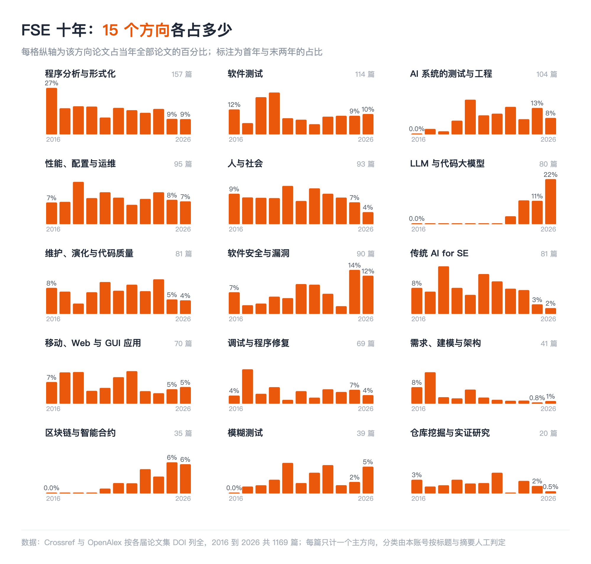
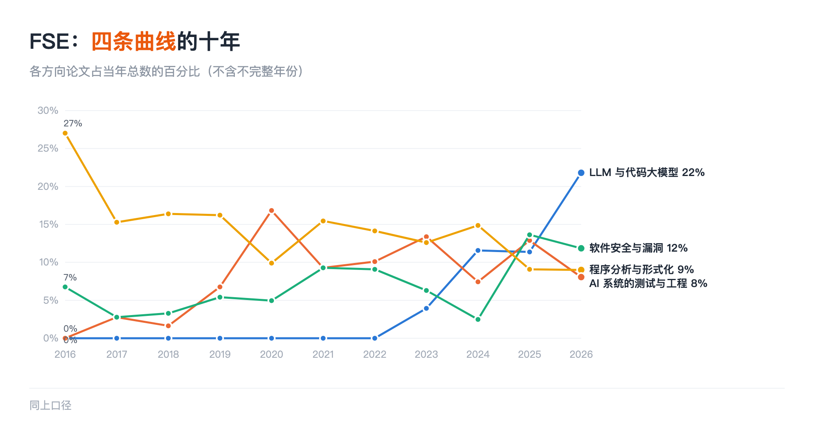
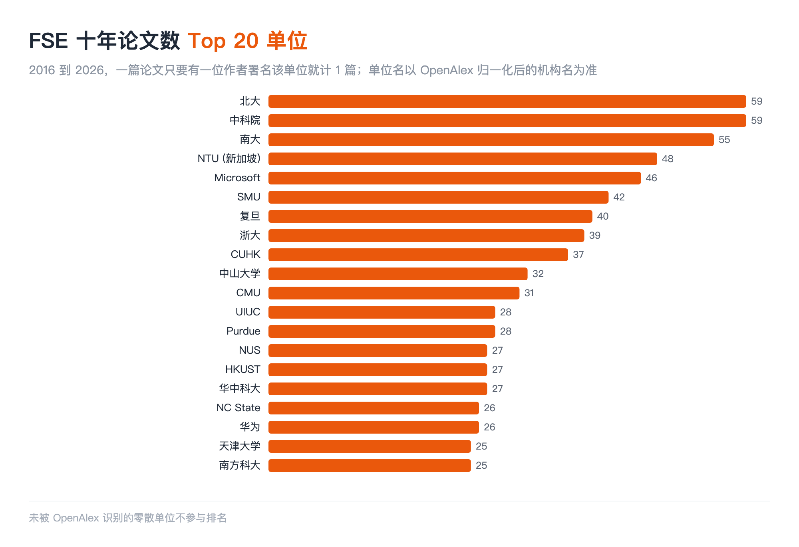
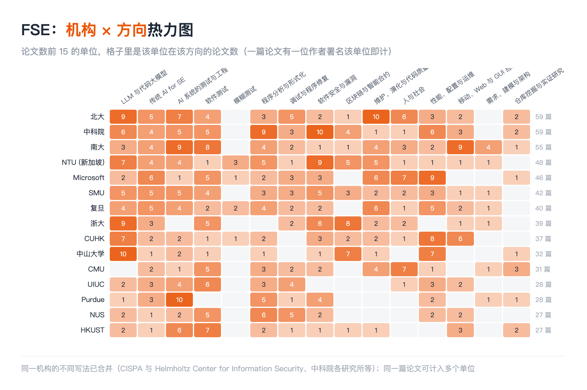
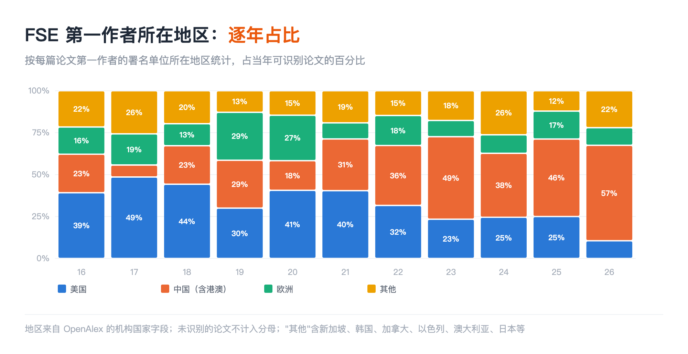

## LIST INFO|本期说明

【范围】FSE（ACM International Conference on the Foundations of Software Engineering，2017 到 2023 年称 ESEC/FSE）2016 到 2026 十一届研究轨的全部论文，共 1169 篇。FSE 2026 已于年中开完，论文集完整，本期计入
【来源】按每届论文集从 Crossref 列全标题与作者，再用 OpenAlex 补摘要、作者单位和国家，并逐年和 DBLP 目录、官网的研究轨录用清单核对；工业轨（Industry Papers，2019 到 2023 年每年 20 到 34 篇）、NIER、Demo、Journal-First、特邀论文等其他轨道不计。2024 年起 FSE 的研究轨论文改在 PACMSE 期刊发表，本期按 FSE 的会议年份计
【口径】每篇只归一个主方向（可带一个次方向），共 15 个方向，和本账号 ICSE 那期用的是同一套分类，对照了 ICSE 2026、ASE 2025、FSE 2026、ISSTA 2026 四家 CFP 的主题分区。分类是逐篇人工判定，个位数的出入不影响趋势

分类规则和 ICSE 那期一样：**"用大模型做某个任务"的论文归到任务方向，大模型只记为次方向；只有研究对象就是代码大模型本身的论文才把"LLM 与代码大模型"记为主方向。**

@stats
- 74 → 211 篇 | 研究轨年接收量，2026 年是历年最多
- 7% → 47% | 主方向或次方向涉及大模型的论文比例，2023 到 2026
- 27% → 9% | 程序分析与形式化的份额，2016 到 2026
- 23% → 56% | 第一作者来自中国的论文比例，2016 到 2026

先交代规模。FSE 研究轨的接收量 2016 年 74 篇，2018 年只有 61 篇，2020 年跳到 101 篇，2023 年 127 篇，2024 年改为期刊模式后 121 篇，2026 年 211 篇是历年最多。十一年扩了 2.9 倍，扩张幅度比 ICSE 大，所以看趋势要看占比而不是篇数。

## BIG PICTURE|十年三个大迁移

#### 大模型：三年从 7% 到 47%

主方向记为"LLM 与代码大模型"的论文 2023 年 5 篇（3.9%），2024 年 14 篇（11.6%），2026 年 46 篇（21.8%）。把次方向算进去，2022 年 1 篇，2023 年 9 篇（7.1%），2024 年 30 篇（24.8%），2025 年 44 篇（33.3%），2026 年 99 篇（46.9%）。==2026 年的 FSE 研究轨，接近一半的论文用到了大模型==，这个比例比 ICSE 2025 年的 35% 又高了一截。

#### 程序分析从 27% 跌到 9%，软件安全接位

程序分析与形式化是 FSE 十一年累计最大的方向（157 篇），但 2016 年 20 篇占 27.0%，2026 年 19 篇只占 9.0%。同期软件安全与漏洞从 6.8% 涨到 2025 年的 13.6%（18 篇）和 2026 年的 11.8%（25 篇），加上区块链与智能合约（2026 年 12 篇，5.7%），两者合计 2026 年占 17.5%，把次方向算进去是 44 篇（20.9%）。

#### 人与社会、需求建模、传统 AI for SE 三个方向退潮

人与社会从 2020 年的 11.9% 跌到 2026 年的 3.8%，需求、建模与架构从 2017 年的 15.3% 跌到 2026 年的 1.4%，传统 AI for SE 从 2018 年的 14.8% 跌到 2026 年的 1.9%。前两个是研究社区的兴趣转移，第三个是被大模型方向吸走了。

## LLM|大模型：从 IntelliCode 到 Vibe Coding

@timeline
- 2022 | Less training, more repairing please: revisiting automated program repair via zero-shot learning | 不训练直接用代码模型做修复，效果超过所有专门训练的神经修复模型，FSE 研究轨的第一篇
- 2023 | Baldur: Whole-Proof Generation and Repair with Large Language Models | 用 LLM 生成整段 Isabelle 证明，当年杰出论文
- 2023 | Natural Language to Code: How Far Are We? | 第一篇系统评估
- 2024 | CodePlan: Repository-Level Coding using LLMs and Planning | 微软把仓库级编码当规划问题
- 2024 | Your Code Secret Belongs to Me: Neural Code Completion Tools Can Memorize Hard-Coded Credentials | 代码补全会吐出训练集里的密钥
- 2025 | Demystifying LLM-Based Software Engineering Agents | 系统拆解 SWE-bench 上的 Agent，当年杰出论文
- 2025 | Code Red! On the Harmfulness of Applying Off-the-Shelf Large Language Models to Programming Tasks | 直接拿通用大模型写代码的危害
- 2026 | Building Software by Rolling the Dice: A Qualitative Study of Vibe Coding | 第一篇 Vibe Coding 的定性研究
- 2026 | Reducing Cost of LLM Agents with Trajectory Reduction | Agent 的成本问题进入研究视野

#### 2022 到 2023：修复先行

FSE 研究轨上大模型的起点是 2022 年 **Less training, more repairing please: revisiting automated program repair via zero-shot learning**（UIUC），它证明不训练直接用代码模型做修复就能超过所有专门训练的神经修复模型，这篇之后修复方向整体换了方法。2023 年 5 篇主方向加 4 篇次方向：**Baldur: Whole-Proof Generation and Repair with Large Language Models**（杰出论文）让 LLM 生成整段 Isabelle 证明，**Natural Language to Code: How Far Are We?** 做了第一次系统评估，**CodeMark: Imperceptible Watermarking for Code Datasets against Neural Code Completion Models** 提出给代码数据集打水印，**Grace: Language Models Meet Code Edits**（微软）做代码编辑，**Copiloting the Copilots: Fusing Large Language Models with Completion Engines for Automated Program Repair** 把 LLM 和补全引擎结合起来做修复。

#### 2024 到 2025：记忆、评测和 Agent

2024 年 14 篇主方向、30 篇任意位置。**CodePlan: Repository-Level Coding using LLMs and Planning** 是最早把仓库级编码当规划问题的论文之一，**ClarifyGPT: A Framework for Enhancing LLM-Based Code Generation via Requirements Clarification** 让模型先问清需求再写代码，**Your Code Secret Belongs to Me: Neural Code Completion Tools Can Memorize Hard-Coded Credentials**（港中文）证明代码补全工具会吐出训练集里的密钥，**Glitch Tokens in Large Language Models: Categorization Taxonomy and Effective Detection** 研究让模型失常的异常 token，**AI-Assisted Code Authoring at Scale: Fine-Tuning, Deploying, and Mixed Methods Evaluation** 是 Meta 内部部署的报告，**Can GPT-4 Replicate Empirical Software Engineering Research?**（CMU）问的是 LLM 能不能替代实证研究者。

2025 年 15 篇主方向、44 篇任意位置，评测类占了一半：**Demystifying LLM-Based Software Engineering Agents**（杰出论文）逐条分析 SWE-bench 上 Agent 的成功和失败，**COFFE: A Code Efficiency Benchmark for Code Generation**（杰出论文）测生成代码的效率而不只是正确性，**Code Red! On the Harmfulness of Applying Off-the-Shelf Large Language Models to Programming Tasks**、**Has My Code Been Stolen for Model Training? A Naturalness Based Approach to Code Contamination Detection**、**An Empirical Study of Code Clones from Commercial AI Code Generators**。**AlphaTrans: A Neuro-Symbolic Compositional Approach for Repository-Level Code Translation and Validation** 是仓库级代码翻译的代表。

#### 2026：46 篇主方向，题材全面铺开

2026 年主方向 46 篇、任意位置 99 篇。仓库级是最大的子题材：**RealBench: A Repo-Level Code Generation Benchmark Aligned with Real-World Software Development Practices**、**RepoReasoner: Evaluating Repository-Level Code Reasoning Ability of Long-Context Language Models**、**In Line with Context: Repository-Level Code Generation via Context Inlining**、**One Size Does Not Fit All: Revisiting Code Context Engineering for Repository-Level Code Generation**。Agent 的工程问题开始出现：**Reducing Cost of LLM Agents with Trajectory Reduction**、**SWE Data Construction, Automatically!**、**Not All RAGs Are Created Equal: A Component-Wise Empirical Study for Software Engineering Tasks**。数据集水印从 CodeMark 延续到 2026 年的 **PuzzleMark: Implicit Jigsaw Learning for Robust Code Dataset Watermarking in Neural Code Completion Models** 和 **DuCodeMark: Dual-Purpose Code Dataset Watermarking via Style-Aware Watermark-Poison Design**。人与社会方向也被大模型占了：**Building Software by Rolling the Dice: A Qualitative Study of Vibe Coding**、**How Do Developers Interact with AI? An Exploratory Study on Modeling Developer Programming Behavior**。

按任务看，2026 年 53 篇"次方向是大模型"的论文里，软件测试 9 篇、软件安全 7 篇、维护 7 篇、修复 6 篇、人与社会 5 篇。测试方向的 **Evaluating LLM-Based Regression Test Generation**、**Can Old Tests Do New Tricks for Resolving SWE Issues?**、**WebTestPilot: Agentic End-to-End Web Testing against Natural Language Specification by Inferring Oracles with Symbolized GUI Elements**，形式化方向的 **Agentic Verification of Software Systems** 和 **Event-B Agent: Towards LLM Agent for Formal Model Synthesis and Repair**（都是新加坡国立），运维方向的 **StepFly: Agentic Troubleshooting Guide Automation for Incident Diagnosis**，都是把 Agent 当方法用。

> FSE 上大模型论文的一个特点是评测和质疑类比例高。2025 年两篇杰出论文（Demystifying LLM-Based Software Engineering Agents 和 COFFE）都是评测，2026 年 **Comment Traps: How Defective Commented-Out Code Augment Defects in AI-Assisted Code Generation**、**LoCaL: Countering Surface Bias in Code Evaluation Metrics** 也是。==软工社区对大模型的态度，是先造尺子再造工具==。

## SE4AI|AI 系统的测试与工程：被测对象换了三轮

这个方向十一年 104 篇，2017 年 **Fairness testing: testing software for discrimination**（UMass，杰出论文）是起点，2020 年跳到 17 篇（16.8%）是高峰，2023 年和 2025 年各 17 篇，2026 年 17 篇（8.1%）。被测对象换了三轮。

**第一轮是深度神经网络本身（2019 到 2021）。** 2020 年的 17 篇里，**Deep learning library testing via effective model generation**（天津大学，杰出论文）、**Detecting numerical bugs in neural network architectures**（北大，杰出论文）、**On decomposing a deep neural network into modules**（Iowa State，杰出论文）一届三篇获奖，**Is neuron coverage a meaningful measure for testing deep neural networks?**（UCLA）质疑了神经元覆盖率这个指标。公平性是另一条线：2020 年 **Fairway: a way to build fair ML software**，2021 年 **Bias in machine learning software: why? how? what to do?**（NC State，杰出论文），2022 年 **MAAT: a novel ensemble approach to addressing fairness and performance bugs for machine learning software**，2023 年 **Fix Fairness, Don't Ruin Accuracy: Performance Aware Fairness Repair using AutoML**，2025 年 **Software Fairness Dilemma: Is Bias Mitigation a Zero-Sum Game?**（南洋理工）。

**第二轮是自动驾驶和深度学习框架（2022 到 2024）。** 2022 年 **Testing of autonomous driving systems: where are we and where should we go?**、**MOSAT: finding safety violations of autonomous driving systems using multi-objective genetic algorithm**，2023 年 **NeuRI: Diversifying DNN Generation via Inductive Rule Inference**（UIUC，杰出论文）和 **Benchmarking Robustness of AI-Enabled Multi-sensor Fusion Systems: Challenges and Opportunities**（南大，杰出论文），2024 年 **Misconfiguration Software Testing for Failure Emergence in Autonomous Driving Systems**，2025 年 **A Comprehensive Study of Bug-Fix Patterns in Autonomous Driving Systems** 和 **Multi-modal Traffic Scenario Generation for Autonomous Driving System Testing**。

**第三轮是大模型本身（2024 到 2026）。** 2024 年 **COSTELLO: Contrastive Testing for Embedding-Based Large Language Model as a Service Embeddings**，2025 年 **Hallucination Detection in Large Language Models with Metamorphic Relations**（KCL，杰出论文）和 **Detecting and Reducing the Factual Hallucinations of Large Language Models with Metamorphic Testing**，**VLATest: Testing and Evaluating Vision-Language-Action Models for Robotic Manipulation**，2026 年 **Red Teaming LLMs via Linguistic-Aware Fuzzing**、**InDe-LLM: Defending against Jailbreak Attacks in LLM-Powered Systems via Intention Disentangling**、**Fairness Testing of Large Language Models in Role-Playing**、**AgentBound: Securing Execution Boundaries of AI Agents**、**Spectrum-Based Failure Attribution for Multi-agent Systems**。到 2026 年，"AI 系统的测试"这个方向有三分之一在测 LLM 和 Agent。

## SECURITY|软件安全与漏洞：从旁路到大模型

软件安全与漏洞十一年 90 篇，2016 到 2019 年每年 2 到 5 篇，2021 年 9 篇（9.3%），2025 年 18 篇（13.6%），2026 年 25 篇（11.8%）。这个方向在 FSE 上有几条各自独立的线。

#### 早期：旁路信道和二进制分析

2016 年 **String analysis for side channels with segmented oracles**（UCSB），2018 年 **Adversarial symbolic execution for detecting concurrency-related cache timing leaks**（Virginia Tech，杰出论文），2019 年 **Mitigating power side channels during compilation**，2022 年 **DeJITLeak: eliminating JIT-induced timing side-channel leaks**，2024 年 **Towards Efficient Verification of Constant-Time Cryptographic Implementations**（上海科技大学）。二进制分析从 2016 年 **BinGo: cross-architecture cross-OS binary search**（南洋理工）到 2026 年三篇同届的质疑：**Unveiling the Fragility of Binary Code Similarity Detection via Targeted Attacks with Model Explanations**、**Fool Me If You Can: On the Robustness of Binary Code Similarity Detection Models against Semantics-Preserving Transformations**、**Understanding Binary Code Similarity for Real-World Vulnerability Detection: A Large-Scale Empirical Study**。

#### 深度学习漏洞检测：FSE 上的质疑比 ICSE 更早

2019 年 **The importance of accounting for real-world labelling when predicting software vulnerabilities**（卢森堡，杰出论文）就指出了标签质量问题。2021 年 **Vulnerability detection with fine-grained interpretations**，2022 年 **VulRepair: a T5-based automated software vulnerability repair**（Monash）和 **You see what I want you to see: poisoning vulnerabilities in neural code search**，2023 年 **Learning Program Semantics for Vulnerability Detection via Vulnerability-Specific Inter-procedural Slicing**（新加坡管理大学）和 **Distinguishing Look-Alike Innocent and Vulnerable Code by Subtle Semantic Representation Learning and Explanation**（浙大）。2025 年一届五篇：**One-for-All Does Not Work! Enhancing Vulnerability Detection by Mixture-of-Experts (MoE)**、**Today's Cat Is Tomorrow's Dog: Accounting for Time-Based Changes in the Labels of ML Vulnerability Detection Approaches**（特伦托）、**Statement-Level Adversarial Attack on Vulnerability Detection Models via Out-of-Distribution Features**、**Large Language Models for In-File Vulnerability Localization Can Be "Lost in the End"**（苏黎世大学与 ETH）、**Mystique: Automated Vulnerability Patch Porting with Semantic and Syntactic-Enhanced LLM**（复旦，杰出论文）。2026 年 LLM 全面接管：**VulInstruct: Teaching LLMs Root-Cause Reasoning for Vulnerability Detection via Security Specifications**（北大）、**Three Heads Are Better Than One: A Multi-perspective Reasoning Framework for Enhanced Vulnerability Detection**、**VulKey: Automated Vulnerability Repair Guided by Domain-Specific Repair Patterns**、**PoCGen: Generating Proof-of-Concept Exploits for Vulnerabilities in Npm Packages**（斯图加特）。

#### Java 反序列化：三年三篇

2023 年 **Crystallizer: A Hybrid Path Analysis Framework to Aid in Uncovering Deserialization Vulnerabilities**（普渡），2025 年 **Gleipner: A Benchmark for Gadget Chain Detection in Java Deserialization Vulnerabilities**（于默奥大学，杰出论文），2026 年 **GadgetHunter: Region-Based Neuro-symbolic Detection of Java Deserialization Vulnerabilities**（南洋理工）。这条线是 FSE 独有的，ICSE 上没有。

## SUPPLY|软件供应链：从依赖管理到 Pinning Is Futile

这是本账号最关心的题材。FSE 上的供应链论文散在安全、维护、人与社会三个方向里，按年份排一遍：

- 2016 到 2018：**How to break an API: cost negotiation and community values in three software ecosystems**（CMU）比较 Eclipse、R、npm 三个生态对破坏性变更的态度，**Why do developers use trivial packages? an empirical case study on npm**（Concordia）是 left-pad 事件之后对微型包的研究，**Ecosystem-level determinants of sustained activity in open-source projects: a case study of the PyPI ecosystem**（CMU），**Do the dependency conflicts in my project matter?**，**The impact of regular expression denial of service (ReDoS) in practice: an empirical study at the ecosystem scale**（Virginia Tech，杰出论文）
- 2020 到 2021：**Selecting third-party libraries: the practitioners' perspective**，**Heard it through the Gitvine: an empirical study of tool diffusion across the npm ecosystem**（CMU），**LastPyMile: identifying the discrepancy between sources and packages**（特伦托）检测 PyPI 包和源码仓库之间的差异，是后来"包与源码一致性"这条线的起点，**A longitudinal analysis of bloated Java dependencies**（KTH，杰出论文），**A large-scale empirical study on Java library migrations: prevalence, trends, and rationales**（北大）
- 2022 到 2023：**Tracking patches for open source software vulnerabilities**（复旦），**Software Composition Analysis for Vulnerability Detection: An Empirical Study on Java Projects**（南洋理工与新加坡管理大学）评估 SCA 工具，**Automatically Resolving Dependency-Conflict Building Failures via Behavior-Consistent Loosening of Library Version Constraints**（南大），**"We Feel Like We're Winging It:" A Study on Navigating Open-Source Dependency Abandonment**（CMU）访谈依赖被弃用后开发者怎么办，**Demystifying Dependency Bugs in Deep Learning Stack**（复旦）
- 2024：**AROMA: Automatic Reproduction of Maven Artifacts**（代尔夫特）做 Maven 的可复现构建，**PyRadar: Towards Automatically Retrieving and Validating Source Code Repository Information for PyPI Packages**（北大）接上 LastPyMile 那条线，**Dependency-Induced Waste in Continuous Integration: An Empirical Study of Unused Dependencies in the npm Ecosystem**，**Bloat beneath Python's Scales: A Fine-Grained Inter-Project Dependency Analysis**（ETH）
- 2025：**Pinning Is Futile: You Need More Than Local Dependency Versioning to Defend against Supply Chain Attacks**（CMU，杰出论文）证明锁版本挡不住供应链攻击，因为传递依赖仍然会漂移，**Automatically Fixing Dependency Breaking Changes**（UCL），**Core Developer Turnover in the Rust Package Ecosystem: Prevalence, Impact, and Awareness**，**On the Characteristics and Impacts of Protestware Libraries**（亚利桑那）研究抗议软件
- 2026：**Uncovering Similar but Different Packages in PyPI and Potential Security Threats**（高丽大学），**Understanding the Limitations of C/C++ Binary Third-Party Library Detection Tool: An Empirical Study at Scale**（南洋理工），**PoCGen: Generating Proof-of-Concept Exploits for Vulnerabilities in Npm Packages**，**Break to Adapt: Knowledge-Based Updates of Breaking Dependencies in JavaScript**（浙大）

FSE 上供应链的特点是 CMU 一家贯穿始终：从 2016 年的 How to break an API 到 2018 年的 PyPI 可持续性，到 2023 年的依赖弃用访谈，到 2025 年的 Pinning Is Futile，十年里 CMU 在这个题材上没断过。另一个特点是"包与源码一致性"这条线（LastPyMile、PyRadar、Similar but Different Packages）是 FSE 独有的。

## CHAIN|区块链与智能合约：2020 年才起步

区块链与智能合约 35 篇，2020 年才有第一篇（**Towards automated verification of smart contract fairness**），2025 年 8 篇（6.1%），2026 年 12 篇（5.7%）。浙大 8 篇是该方向第一，中山大学 7 篇，港理工 6 篇。

题材从 2021 年的 **iBatch: saving Ethereum fees via secure and cost-effective batching of smart-contract invocations** 和 **ÐArcher: detecting on-chain-off-chain synchronization bugs in decentralized applications**，到 2023 年的 **TransRacer: Function Dependence-Guided Transaction Race Detection for Smart Contracts**（杰出论文）和 **SmartFix: Fixing Vulnerable Smart Contracts by Accelerating Generate-and-Verify Repair using Statistical Models**，2024 年 **Static Application Security Testing (SAST) Tools for Smart Contracts: How Far Are We?**（华东师大，杰出论文）和 **SmartAxe: Detecting Cross-Chain Vulnerabilities in Bridge Smart Contracts via Fine-Grained Static Analysis**（中山大学），2025 年 **LookAhead: Preventing DeFi Attacks via Unveiling Adversarial Contracts**（浙大）和 **Smart Contract Fuzzing Towards Profitable Vulnerabilities**（南洋理工），2026 年 **V2E: Validating Smart Contract Vulnerabilities through Profit-Driven Exploit Generation and Execution**、**ChainDelta: Automatic Patch-Based Exploit Generation for Ethereum with Fuzzing Agents**（都是中山大学）、**Thought Is All You Need: Smart Contract Vulnerability Detection with Thought-Augmented Large Language Model**。这个方向 2026 年 12 篇里有 4 篇用了 LLM。

## PERF|性能、配置与运维：从微软亚洲研究院到中山大学

性能、配置与运维 95 篇，份额在 6% 到 13% 之间（2018 年 13.1% 最高），是 FSE 最稳定的方向。微软亚洲研究院和微软美国各 8 篇并列该方向第一，纽卡斯尔大学和中山大学各 7 篇。微软亚洲研究院的 AIOps 组在 FSE 上的多数论文走的是工业轨，本期不计，研究轨上这条线从一开始就是微软亚洲研究院、清华、复旦三家在做。

脉络很清楚：2018 年 **Predicting Node failure in cloud service systems**（微软亚洲研究院），2019 年 **Robust log-based anomaly detection on unstable log data**（微软亚洲研究院与南大）和 **Latent error prediction and fault localization for microservice applications by learning from system trace logs**（复旦），2020 年 **Identifying linked incidents in large-scale online service systems**（微软亚洲研究院）和 **Real-time incident prediction for online service systems**（清华），2021 年 **Identifying bad software changes via multimodal anomaly detection for online service systems**（清华），2022 年 **Actionable and interpretable fault localization for recurring failures in online service systems**（清华）、**TraceCRL: contrastive representation learning for microservice trace analysis**（复旦）、**DeepDev-PERF: a deep learning-based approach for improving software performance**（微软）。

日志解析是这个方向的技术核心：2022 年 **SPINE: a scalable log parser with feedback guidance**（清华，杰出论文），2023 年 **Hue: A User-Adaptive Parser for Hybrid Logs** 和 **Log Parsing with Generalization Ability under New Log Types**，2024 年 **LILAC: Log Parsing using LLMs with Adaptive Parsing Cache**（港中文），2025 年 **No More Labelled Examples? An Unsupervised Log Parser with LLMs**，2026 年 **Small Is Beautiful: A Practical and Efficient Log Parsing Framework**。根因分析从 2023 年 **Nezha: Interpretable Fine-Grained Root Causes Analysis for Microservices on Multi-modal Observability Data**（中山大学）到 2024 年 **TraStrainer: Adaptive Sampling for Distributed Traces with System Runtime State**（中山大学，杰出论文）、**ChangeRCA: Finding Root Causes from Software Changes in Large Online Systems**，2026 年 **StepFly: Agentic Troubleshooting Guide Automation for Incident Diagnosis**（清华）和 **TSGuard: Automated User-Centric Incident Diagnosis for AI Workloads in the Cloud**。配置是另一条线：2021 年 **Multi-objectivizing software configuration tuning**，2023 年 **DiagConfig: Configuration Diagnosis of Performance Violations in Configurable Software Systems**（中山大学）和 **Predicting Software Performance with Divide-and-Learn**，2024 年 **Predicting Configuration Performance in Multiple Environments with Sequential Meta-Learning**。

微软在研究轨的论文 2016 到 2022 年每年 3 到 7 篇，2025 年 1 篇、2026 年 3 篇。这条线现在主要由中山大学、港中文、清华、复旦在做。

## HUMAN|人与社会：从 9.5% 到 3.8%

人与社会 93 篇，2020 年 12 篇（11.9%）是高峰，2026 年 8 篇（3.8%）。NC State 10 篇、Oregon State 7 篇、CMU 7 篇、微软 7 篇。

FSE 上这个方向拿杰出论文的比例很高：2016 年 **Foraging and navigations, fundamentally: developers' predictions of value and cost** 和 **Factors influencing code review processes in industry**，2017 年 **Understanding misunderstandings in source code**（NYU），2020 年 **Community expectations for research artifacts and evaluation processes**（帕德博恩），2022 年 **Using nudges to accelerate code reviews at scale** 和 **Asynchronous technical interviews: reducing the effect of supervised think-aloud on communication ability**（IBM），2024 年 **"The Law Doesn't Work Like a Computer": Exploring Software Licensing Issues Faced by Legal Practitioners**。代码评审是最连贯的子题材：2016 年的工业实践，2018 年 **What makes a code change easier to review: an empirical investigation on code change reviewability**，2020 年 **Biases and differences in code review using medical imaging and eye-tracking: genders, humans, and machines**（密歇根），2022 年 **First come first served: the impact of file position on code review**（苏黎世，杰出论文），2026 年 **The Effect of Complexity and Provenance on Code Review Decisions: Evidence from a Controlled Experiment**。

面向从业者的研究是 FSE 的特色：2020 年 **Does stress impact technical interview performance?**（NC State），2022 年 **Correlates of programmer efficacy and their link to experience: a combined EEG and eye-tracking study**（萨尔大学），2023 年 **Building and Sustaining Ethnically, Racially, and Gender Diverse Software Engineering Teams: A Study at Google** 和 **Flow Experience in Software Engineering**。2024 年之后题材转向开发者和 AI：**Beyond Code Generation: An Observational Study of ChatGPT Usage in Software Engineering Practice**、**Rocks Coding, Not Development: A Human-Centric, Experimental Evaluation of LLM-Supported SE Tasks**，2025 年 **Prompts Are Programs Too! Understanding How Developers Build Software Containing Prompts**（CMU）和 **How Do Programming Students Use Generative AI?**，2026 年 8 篇里有 6 篇和 AI 有关。

## ANALYSIS|程序分析、测试与修复：老方向的新题材

程序分析与形式化 157 篇是累计最大的方向，但份额从 27.0% 跌到 9.0%。早期的题材是并发和数据竞争（2016 年 **ECHO: instantaneous in situ race detection in the IDE**，2018 年 **Data race detection on compressed traces**（杰出论文）和 **Concurrency verification with maximal path causality**）、符号执行和模型检验。2023 年之后形式化验证因为 LLM 重新热起来：**Baldur** 之后是 2024 年 **Towards AI-Assisted Synthesis of Verified Dafny Methods** 和 **Can Large Language Models Transform Natural Language Intent into Formal Method Postconditions?**，2025 年 **Why the Proof Fails in Different Versions of Theorem Provers: An Empirical Study of Compatibility Issues in Isabelle**（北大，杰出论文），2026 年 **Agentic Verification of Software Systems**、**Event-B Agent**、**ProofFusion: Improving Neural Theorem Proving via Adaptive Retrieval-Augmented Reasoning**。传统方法拿奖也不少：2023 年 **Speeding up SMT Solving via Compiler Optimization**（佐治亚理工），2024 年 **Fast Graph Simplification for Path-Sensitive Typestate Analysis through Tempo-Spatial Multi-Point Slicing**（UNSW）和 **A Transferability Study of Interpolation-Based Hardware Model Checking for Software Verification**（LMU），2025 年 **QSF: Multi-objective Optimization Based Efficient Solving for Floating-Point Constraints**（国防科大）和 **Expressing and Checking Statistical Assumptions**（CISPA）。

软件测试 114 篇，2019 年 15 篇（20.3%）是高峰。flaky test 这条线 2019 年 **iFixFlakies: a framework for automatically fixing order-dependent flaky tests**（UIUC）和 **Understanding flaky tests: the developer's perspective** 同届；数据库测试 2020 年 **Detecting optimization bugs in database engines via non-optimizing reference engine construction**（ETH）是这条线在软工会议上的开端；2024 年之后 LLM 做测试生成：**Evaluating and Improving ChatGPT for Unit Test Generation**（复旦）、**Code-Aware Prompting: A Study of Coverage-Guided Test Generation in Regression Setting using LLM**，2025 年 **Less Is More: On the Importance of Data Quality for Unit Test Generation**（浙大，杰出论文）、**CoverUp: Effective High Coverage Test Generation for Python**、**LlamaRestTest: Effective REST API Testing with Small Language Models**，2026 年 9 篇。

调试与程序修复 69 篇，2017 年 12 篇（16.7%）是异常高峰（**S3: syntax- and semantic-guided repair synthesis via programming by examples**、**Automatic inference of code transforms for patch generation**、**Automatically diagnosing and repairing error handling bugs in C**（杰出论文））。2019 年 **Empirical review of Java program repair tools: a large-scale experiment on 2,141 bugs and 23,551 repair attempts**（杰出论文）是修复方向最大规模的评估。2022 年之后换成 LLM：**Less training, more repairing please** 开头，2023 年 **Copiloting the Copilots** 和 **RAP-Gen: Retrieval-Augmented Patch Generation with CodeT5 for Automatic Program Repair**，2024 年 **A Deep Dive into Large Language Models for Automated Bug Localization and Repair** 和 **ProveNFix: Temporal Property-Guided Program Repair**（新加坡国立，杰出论文），2025 年 **Demystifying Memorization in LLM-Based Program Repair via a General Hypothesis Testing Framework**、**ChatDBG: Augmenting Debugging with Large Language Models**、**ReproCopilot: LLM-Driven Failure Reproduction with Dynamic Refinement**（微软），2026 年 **ExpeRepair: Dual-Memory Enhanced LLM-Based Repository-Level Program Repair**、**CodeCureAgent: Automatic Classification and Repair of Static Analysis Warnings**、**Empowering Autonomous Debugging Agents with Efficient Dynamic Analysis**。

模糊测试 39 篇，Monash 的 Böhme 那条理论线是 FSE 独有的：2020 年 **Boosting fuzzer efficiency: an information theoretic perspective**（杰出论文）和 **Fuzzing: on the exponential cost of vulnerability discovery**，2021 年 **Estimating residual risk in greybox fuzzing**，2025 年 **MendelFuzz: The Return of the Deterministic Stage**（EPFL），2026 年 **In Bugs We Trust? On Measuring the Randomness of a Fuzzer Benchmarking Outcome**（MPI-SP）和 **An Empirical Study of Fuzz Harness Degradation**。2019 年 **Cerebro: context-aware adaptive fuzzing for effective vulnerability detection**（中科大与南洋理工）和 2020 年 **Intelligent REST API data fuzzing**（微软）是另外两篇代表。

## AWARDS|杰出论文十年：三个偏好

FSE 的 ACM SIGSOFT 杰出论文每年 6 到 13 篇，2016 到 2025 年共 85 篇（2026 年名单还没公布）。按方向数一遍：

- 人与社会和实证研究拿奖最多：十年 14 篇上下，2016 年 7 篇杰出论文里有 2 篇是人与社会
- AI 系统的测试是拿奖最集中的方向之一：Fairness Testing（2017），Deep Learning Library Testing、Detecting Numerical Bugs、On Decomposing a Deep Neural Network into Modules（2020），Bias in Machine Learning Software（2021），NeuRI、Benchmarking Robustness of AI-enabled Multi-sensor Fusion Systems、Mate! Are You Really Aware?（2023），Hallucination Detection in Large Language Models with Metamorphic Relations（2025）
- 安全与供应链从 2018 年起断断续续：ReDoS in Practice、Cache Timing Leaks（2018），Accounting for Real-World Labelling When Predicting Software Vulnerabilities（2019），Bloated Java Dependencies（2021），Minerva（2022），Component Security Ten Years Later、SAST Tools for Smart Contracts（2024），Gleipner、Mystique、Pinning Is Futile（2025）

2025 年的 13 篇杰出论文里，大模型相关的 5 篇（Mystique、COFFE、Hallucination Detection、Demystifying LLM-based Software Engineering Agents、Less is More），安全与供应链 3 篇（Gleipner、Mystique、Pinning Is Futile）。这是 FSE 历史上第一次大模型论文占到杰出论文的三分之一以上。

## WHO|谁在做：机构图谱、团队和地区

按"论文有至少一位作者署名该单位"计，十一年并列榜首的是北大和中科院，各 59 篇。北大的论文散在维护（10 篇，该方向第一）、大模型（9 篇）、AI 系统测试（7 篇）和人与社会（6 篇）四个方向，2021 年 10 篇、2026 年 11 篇是两个高点；中科院（软件所为主，各研究所合并计）集中在软件安全（10 篇，该方向第一）和程序分析（9 篇，该方向第一），2026 年一届 20 篇，占它十一年总数的三分之一。南大 55 篇，移动应用和 AI 系统测试各 9 篇、软件测试 8 篇。南洋理工 48 篇，软件安全 9 篇，2026 年 15 篇是当年最多。微软 46 篇，2016 到 2022 年每年 3 到 7 篇，2023 年之后每年 1 到 4 篇，它在 FSE 上的更多论文走的是工业轨，本期不计。新加坡管理大学 42 篇（2025 年 11 篇），复旦 40 篇，浙大 39 篇（2021 年之前 0 篇，2026 年 17 篇是当年最多），港中文 37 篇，中山大学 32 篇（2023 年之前 2 篇，2026 年 16 篇），CMU 31 篇（2026 年 0 篇）。

热力图里颜色最深的格子只有几个：中山大学的大模型（10 篇）、北大的维护（10 篇）、中科院的软件安全（10 篇）、Purdue 的 AI 系统测试（10 篇）、微软的性能运维（9 篇）、南大的移动应用和 AI 系统测试（各 9 篇）、浙大的大模型（9 篇）和区块链（8 篇）。这些是"一家单位撑起一个方向"的格子。程序分析、软件测试、人与社会三个老方向没有深色格子，头部单位各占 5 到 9 篇，分布最散。反过来看行：北大、中科院、新加坡管理大学、复旦四家在十个以上的方向都有论文，覆盖面最广；中山大学、浙大、Purdue 的论文几乎全压在两三个方向上。下面按方向说，作者名后的"N 篇署名"是该作者在 FSE 十一年的署名总数。

#### 程序分析与形式化：中科院、斯图加特、NUS、Purdue

FSE 累计最大的方向（157 篇）也是最分散的方向，第一名中科院只有 9 篇。软件所 Yan Cai（8 篇署名，其中 4 篇分析）做并发缺陷的检测和预测，2021 年 **Sound and efficient concurrency bug prediction**。斯图加特的 Michael Pradel（15 篇署名，7 篇分析，2019 年之前署名达姆施塔特，2026 年署名 CISPA）是这个方向拿奖最多的作者，三篇杰出论文里两篇在这里：2022 年 **The evolution of type annotations in python: an empirical study** 和 2023 年 **LExecutor: Learning-Guided Execution**。LMU 的 Dirk Beyer（6 篇署名，5 篇分析）做软件验证，2024 年 **A Transferability Study of Interpolation-Based Hardware Model Checking for Software Verification** 是杰出论文。Purdue 的 Xiangyu Zhang（17 篇署名，5 篇分析）从机器人的物理单位类型检查做到神经符号静态分析；UNSW 的 Yulei Sui（10 篇署名）做值流分析，2024 年 **Fast Graph Simplification for Path-Sensitive Typestate Analysis through Tempo-Spatial Multi-Point Slicing** 是杰出论文；UC Riverside 的 Manu Sridharan 一条 nullability 线做了六年，起点是 2019 年 **NullAway: practical type-based null safety for Java**。

#### 软件测试与模糊测试：南大、港科大、UIUC、Monash

软件测试 114 篇，头部是南大（8 篇，Yanyan Jiang、Chang Xu、Xiaoxing Ma）、港科大（7 篇，Shing-Chi Cheung 17 篇署名）、UIUC（6 篇，Darko Marinov、August Shi、Owolabi Legunsen 的 flaky test 和回归测试选择这条线）。UIUC 2017 年 **Trade-offs in continuous integration: assurance, security, and flexibility** 是杰出论文，2019 年 **iFixFlakies: a framework for automatically fixing order-dependent flaky tests** 是 flaky test 自动修复的起点。组合测试是纽卡斯尔 Hongyu Zhang 和北航 Chuan Luo（2019 到 2021 年署名微软）的一条线，2022 年 **SamplingCA: effective and efficient sampling-based pairwise testing for highly configurable software systems**。浙大 Xing Hu 和新加坡管理大学 David Lo 合作的 2025 年 **Less Is More: On the Importance of Data Quality for Unit Test Generation** 是杰出论文，代表测试方向被大模型接管后的新题材。模糊测试只有 39 篇，Marcel Böhme（9 篇署名，先后署名 NUS、Monash、MPI-SP）一个人占 5 篇，2020 年 **Boosting fuzzer efficiency: an information theoretic perspective** 是杰出论文，2025 年 **MendelFuzz: The Return of the Deterministic Stage** 还在同一条线上；EPFL 的 Mathias Payer 2022 年 **Minerva: browser API fuzzing with dynamic mod-ref analysis** 也是杰出论文。

#### AI 系统的测试与工程：Purdue、南大、Iowa State、港科大

104 篇，Purdue 10 篇是第一，Xiangyu Zhang 17 篇署名里 6 篇在这个方向，Tianyi Zhang 6 篇署名，题材从 2021 年 **Exposing numerical bugs in deep learning via gradient back-propagation** 到自动驾驶的场景生成。Iowa State 的 Hridesh Rajan（9 篇署名，8 篇在这个方向）做深度网络的模块化和公平性修复，2020 年 **On decomposing a deep neural network into modules** 是杰出论文。港科大 Shing-Chi Cheung 的两篇杰出论文都在这里：2020 年 **Detecting numerical bugs in neural network architectures**（与北大 Tao Xie 合作）和 2023 年 **Can Machine Learning Pipelines Be Better Configured?**。南大 9 篇（Zenan Li、Xiaoxing Ma、Chang Xu），Baowen Xu 与东京大学 Lei Ma 合作的 2023 年 **Benchmarking Robustness of AI-Enabled Multi-sensor Fusion Systems: Challenges and Opportunities** 是杰出论文。King's College London 的 Jie M. Zhang（8 篇署名，6 篇在此）做公平性测试，2025 年 **Hallucination Detection in Large Language Models with Metamorphic Relations** 是杰出论文，也是这个方向的被测对象从 DNN 换成大模型的标志。新加坡管理大学 Xiaofei Xie 和南洋理工 Yang Liu 早年的 2019 年 **DeepStellar: model-based quantitative analysis of stateful deep learning systems** 是循环网络测试的代表。

#### 性能、配置与运维：微软亚洲研究院、港中文、中山大学、纽卡斯尔

95 篇里微软 9 篇第一，Dongmei Zhang 和 Qingwei Lin（各 9 篇署名，7 篇运维）的微软亚洲研究院 AIOps 组，加上 Yingnong Dang，从 2019 年 **Robust log-based anomaly detection on unstable log data** 到 2022 年的杰出论文 **SPINE: a scalable log parser with feedback guidance** 是日志线。纽卡斯尔（2023 年起署名重庆大学）的 Hongyu Zhang（19 篇署名，9 篇运维）是这个组的长期合作者，2016 年他还署名微软；2024 年 **BARO: Robust Root Cause Analysis for Microservices via Multivariate Bayesian Online Change Point Detection** 是他自己带的根因分析线。2023 年之后接手的是中山大学（7 篇，Pengfei Chen、Guangba Yu），2023 年 **Nezha: Interpretable Fine-Grained Root Causes Analysis for Microservices on Multi-modal Observability Data** 和 2024 年 **TraStrainer: Adaptive Sampling for Distributed Traces with System Runtime State** 做微服务的根因和链路追踪；港中文 8 篇（Pinjia He、Michael R. Lyu）做日志解析和日志语句生成。配置性能这条线在欧洲，魏玛的 Norbert Siegmund（7 篇署名，5 篇运维）。

#### 人与社会：NC State、Oregon State、微软、CMU、北大

93 篇，这是美国团队保住的方向。NC State 10 篇（Chris Parnin 8 篇署名，7 篇在此，做技术面试和开发者认知），2022 年 **Asynchronous technical interviews: reducing the effect of supervised think-aloud on communication ability** 是杰出论文；Oregon State 7 篇（Anita Sarma，导师制和团队多样性）；微软 7 篇，Thomas Zimmermann 和 Denae Ford（2021 年前署名 NC State）的开源社区研究，2023 年 **A Four-Year Study of Student Contributions to OSS vs. OSS4SG with a Lightweight Intervention** 是杰出论文；CMU 7 篇，Bogdan Vasilescu（10 篇署名，5 篇人与社会）和 James D. Herbsleb 做开源可持续性，2025 年 **Scientific Open-Source Software Is Less Likely to Become Abandoned Than One Might Think! Lessons from Curating a Catalog of Maintained Scientific Software**。中国单位里只有北大的 Minghui Zhou（9 篇署名，5 篇人与社会）持续在做，2023 年 **How Early Participation Determines Long-Term Sustained Activity in GitHub Projects?**。这个方向的份额从 9.5% 跌到 3.8%，和这批团队没有新一代接棒有关。

#### 软件安全与漏洞：中科院、南洋理工、复旦、华中科大

90 篇，中科院 10 篇第一，软件所 Yan Cai 的并发漏洞线，2021 年 **Detecting concurrency vulnerabilities based on partial orders of memory and thread events**。南洋理工 9 篇，Yang Liu 34 篇署名，是 FSE 上署名最多的作者，其中 7 篇软件安全；Zhengzi Xu 做二进制相似性和 SCA。2023 年 **Comparison and Evaluation on Static Application Security Testing (SAST) Tools for Java** 评测 SAST 工具，2026 年 **GadgetHunter: Region-Based Neuro-symbolic Detection of Java Deserialization Vulnerabilities**。复旦的 Xin Peng（27 篇署名，FSE 第二多）和 Bihuan Chen（12 篇署名）做漏洞补丁：2022 年 **Tracking patches for open source software vulnerabilities**，2025 年的杰出论文 **Mystique: Automated Vulnerability Patch Porting with Semantic and Syntactic-Enhanced LLM**。华中科大 6 篇（Hai Jin、Ming Wen、Haoyu Wang）做深度学习漏洞检测的鲁棒性；华为的 Jiayuan Zhou 三篇全是漏洞检测。这个方向的增量几乎全来自中国单位。

#### 软件供应链：CMU、南洋理工、复旦、北大

供应链论文散在安全、维护、人与社会三个方向里，团队却很清楚。CMU 的 Christian Kästner（11 篇署名）和 Bogdan Vasilescu 是唯一贯穿十一年的组，2023 年 **“We Feel Like We’re Winging It:” A Study on Navigating Open-Source Dependency Abandonment** 访谈依赖弃用之后开发者怎么办，2025 年的杰出论文 **Pinning Is Futile: You Need More Than Local Dependency Versioning to Defend against Supply Chain Attacks**。南洋理工和新加坡管理大学做 SCA 工具评测，2023 年 **Software Composition Analysis for Vulnerability Detection: An Empirical Study on Java Projects**（Jun Sun、Zhengzi Xu），2026 年 **Understanding the Limitations of C/C++ Binary Third-Party Library Detection Tool: An Empirical Study at Scale**。复旦做漏洞补丁追踪和受影响版本，北大 Minghui Zhou 组做 PyPI 包与源码仓库的一致性。安全四大会上没有的"包与源码一致性"和"依赖弃用的人"两条线，都在 FSE。

#### 大模型：中山大学、北大、浙大、港中文

80 篇（2022 年才起步），中山大学 10 篇第一（Zibin Zheng 17 篇署名，7 篇大模型；Yanlin Wang 7 篇署名），2026 年 **SWE Data Construction, Automatically!** 做 SWE 类训练数据的自动构造；北大 9 篇（Ge Li、Zhi Jin 的代码生成组），2024 年 **IRCoCo: Immediate Rewards-Guided Deep Reinforcement Learning for Code Completion**；浙大 9 篇（Chao Ni、Xing Hu）；港中文 7 篇，Michael R. Lyu（19 篇署名）和 Yichen Li，2024 年 **Your Code Secret Belongs to Me: Neural Code Completion Tools Can Memorize Hard-Coded Credentials** 和 2025 年的杰出论文 **COFFE: A Code Efficiency Benchmark for Code Generation**。南洋理工 Yang Liu 组 2024 年 **Glitch Tokens in Large Language Models: Categorization Taxonomy and Effective Detection**。UIUC 的 Lingming Zhang（11 篇署名）是修复和大模型两个方向的交点，2025 年的杰出论文 **Demystifying LLM-Based Software Engineering Agents** 是四会里最早系统拆解 SE Agent 的工作之一。

#### 维护与修复：北大、复旦、NUS、UIUC

维护 81 篇，北大 10 篇第一（Lu Zhang 11 篇署名、Minghui Zhou），北理工 Hui Liu、Yanjie Jiang、Yuxia Zhang 的重构和命名线拿了 2023 年的杰出论文 **An Automated Approach to Extracting Local Variables**，复旦 Xin Peng、Yiling Lou、Mingwei Liu 的 2023 年 **Recommending Analogical APIs via Knowledge Graph Embedding** 也是杰出论文。修复 69 篇，NUS 和北大各 5 篇：NUS 的 Abhik Roychoudhury（7 篇署名）从搜索式修复做到 2024 年 **ProveNFix: Temporal Property-Guided Program Repair**；北大 Lu Zhang 的 2021 年杰出论文 **Probabilistic Delta debugging**；UIUC 的 Lingming Zhang 2022 年 **Less training, more repairing please: revisiting automated program repair via zero-shot learning** 和 2023 年 **Copiloting the Copilots: Fusing Large Language Models with Completion Engines for Automated Program Repair** 是大模型修复的起点；CISPA 的 Andreas Zeller 2023 年 **Semantic Debugging**。

#### 人在动，方向跟着动

Xin Xia 2021 年署名 Monash，2022 到 2024 年署名华为，2025 年起署名浙大，浙大 2025 年 11 篇、2026 年 17 篇的爆发里有他；Hongyu Zhang 2016 年署名微软，2018 年起署名纽卡斯尔，2023 年起署名重庆大学，微软亚洲研究院的 AIOps 线上一直有他的名字；Xiaofei Xie 从天津大学到南洋理工（2019）再到新加坡管理大学（2022），AI 系统测试这条线跟着挪；Michael Pradel 从达姆施塔特（2018）到斯图加特（2020）到 CISPA（2026），程序分析方向的杰出论文跟着他走；Marcel Böhme 从 NUS 到 Monash（2018）到 MPI-SP（2023），fuzzing 理论线到了欧洲；Bihuan Chen 2016 年署名南洋理工，2019 年起署名复旦，复旦的补丁和供应链线从那时开始；Chunyang Chen 2025 年起署名慕尼黑工大，Monash 的移动应用方向随之收缩。看一个单位的方向曲线，先要看它的人是不是还在。

按第一作者的署名单位所在地区看，变化比 ICSE 更陡。2016 年美国 39%，2017 年 47%，中国大陆与港澳 23% 和 7%。2021 年美国 39%、中国 30%，2022 年中国 34% 第一次超过美国的 30%，2023 年中国 48%，==2026 年中国 56%、美国 10%==。欧洲从 2019 年的 27% 跌到 2026 年的 10%。"其他"地区（新加坡、澳大利亚、加拿大、韩国等）稳在 12% 到 26%，2026 年 22%。地区由 OpenAlex 的机构国家字段推断，每年最多有 5% 的论文没能识别，不计入分母。

方向和地区的耦合：中国团队集中在软件安全、区块链、性能运维、大模型和移动应用，美国团队在人与社会和模糊测试上仍占优但份额在缩，欧洲团队在程序分析与形式化上最强（斯图加特、LMU、CISPA、亚琛）。

## TAKEAWAYS|一点观察

**FSE 十一年最大的变化是"谁在写"。** 第一作者来自中国的比例从 23% 到 56%，美国从 39% 到 10%，这个幅度在八个顶会里数一数二。微软在研究轨从每年 3 到 7 篇退到 1 到 3 篇，CMU 2026 年一篇没有。这不是研究质量的判断，是研究社区的重心确实移了。

**FSE 上大模型的渗透比 ICSE 深一截。** 2022 年零样本修复是起点，2024 年一年从 7% 跳到 25%，2026 年接近一半的论文用到大模型。但杰出论文的偏好告诉我们社区更看重"尺子"：2025 年获奖的五篇大模型论文里四篇是评测或实证。

**对做供应链的人，三条建议。** 一是 FSE 上供应链的线比 ICSE 更偏"生态与人"（依赖弃用、维护者流失、抗议软件、包与源码一致性），和 ICSE 偏"工具与检测"互补；二是 Pinning Is Futile 那篇值得细读，它把"锁版本"这个最常见的防御手段的局限讲清楚了；三是 2026 年 PoCGen、Similar but Different Packages、Binary TPL Detection 三篇说明供应链攻击的检测正在从"包元数据"走向"包内容"和"二进制"，这是下一年的方向。
