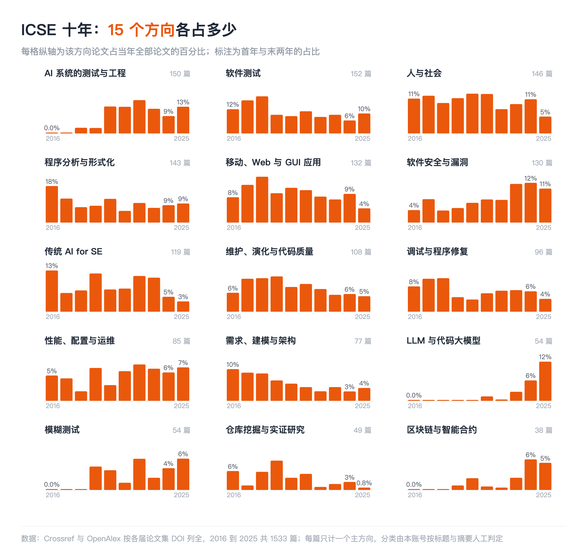
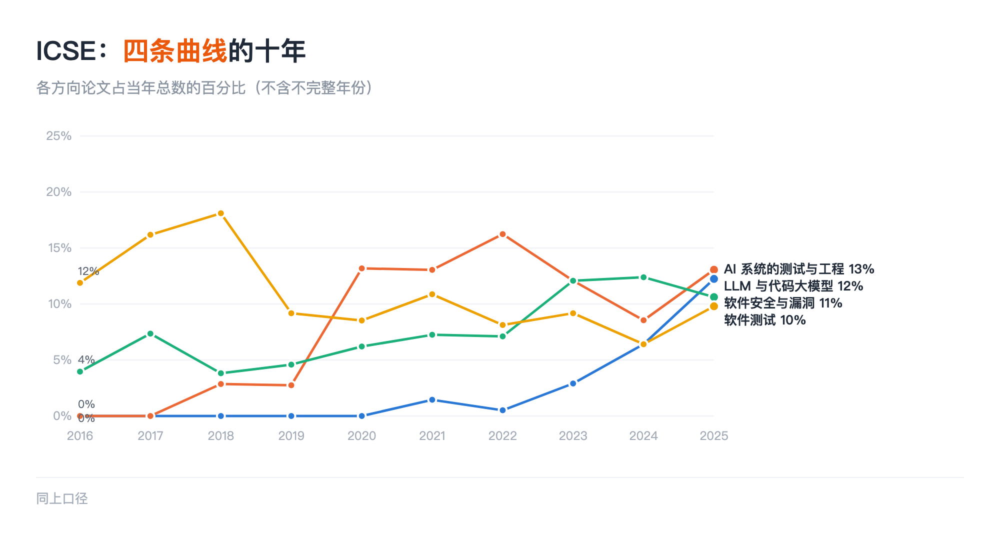
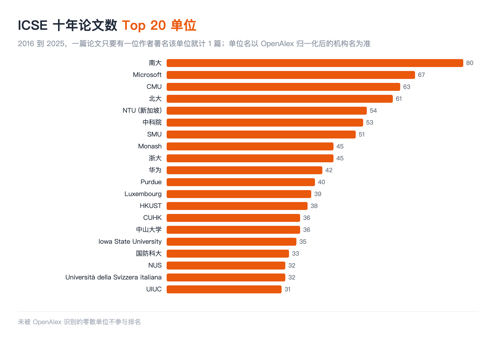
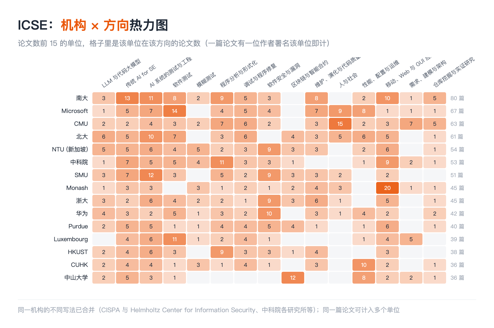
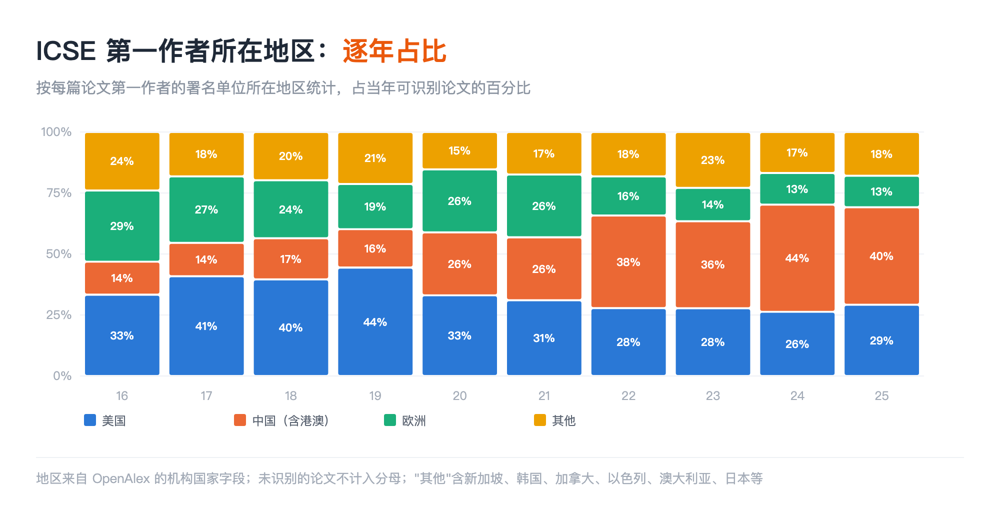

## LIST INFO|本期说明

【范围】ICSE（International Conference on Software Engineering）2016 到 2025 十届研究轨（Technical/Research Track）的全部论文，共 1533 篇。ICSE 2026 已于 4 月开过，但研究轨的论文集在 Crossref 里还没有完整登记，本期不含；2026 年的杰出论文名单在文末单独列了一段
【来源】按每届论文集从 Crossref 列全标题与作者，再用 OpenAlex 补摘要、作者单位和国家；SEIP、NIER、SEET、SEIS、Demo、Journal-First 等其他轨道不计，正文页数不足 8 页的条目按非正式论文剔除，逐年和 DBLP 目录核对过（IEEE Xplore 重复登记的 1 篇已去重）。逐年篇数与官方公布的研究轨接收数一致
【口径】每篇只归一个主方向（可带一个次方向），共 15 个方向，方向的设计对照了 ICSE 2026、ASE 2025、FSE 2026、ISSTA 2026 四家 CFP 的主题分区，本账号接下来的 FSE、ASE、ISSTA 三期用同一套分类。分类是逐篇人工判定，个位数的出入不影响趋势

分类里有一条规则要先说明：**"用大模型做某个任务"的论文归到任务方向（测试、修复、维护等），大模型只记为次方向；只有研究对象就是代码大模型本身的论文（代码生成、评测、幻觉、Agent 框架）才把"LLM 与代码大模型"记为主方向。**这样能同时看到"任务份额"和"大模型渗透率"两条曲线。

@stats
- 101 → 245 篇 | 研究轨年接收量，2022 年跳到 197 篇后逐年小涨
- 1% → 35% | 主方向或次方向涉及大模型的论文比例，2021 到 2025
- 4% → 12% | 软件安全与漏洞的份额，2023 年起是第一大方向
- 12% → 5% | 人与社会方向的份额，2021 到 2025

先交代规模。ICSE 研究轨的接收量 2016 年 101 篇，2017 年只有 68 篇（那年是双轨投稿的过渡年），2022 年跳到 197 篇，2025 年 245 篇，十年扩了 2.4 倍。扩张比安全四大会温和，所以 ICSE 的曲线里绝对数和占比走向基本一致，下面仍按占比说。

## BIG PICTURE|十年三个大迁移

#### 大模型三年渗透到三分之一

主方向记为"LLM 与代码大模型"的论文 2021 年 2 篇，2023 年 6 篇，2024 年 15 篇，2025 年 30 篇（12.2%）。但更能说明问题的是渗透率：把次方向算进去，2023 年 11 篇（5%），2024 年 36 篇（15%），2025 年 86 篇（35%）。==2025 年 ICSE 研究轨每三篇里就有一篇用到了大模型==，而其中三分之二的论文主方向是测试、修复、维护、性能这些传统任务。

#### 安全从 4% 到 12%，成了第一大方向

软件安全与漏洞从 2016 年的 4 篇（4.0%）涨到 2023 年的 25 篇（12.1%），2024 年 29 篇（12.4%），2025 年 26 篇（10.6%），2023 年起连续三年是第一大方向。加上区块链与智能合约（2024 年 14 篇、6.0%），两者合计 2024 年占 18.4%。这个变化的一半来自深度学习漏洞检测，另一半来自软件供应链。

#### 人与社会退潮，AI 系统的测试与工程接位

人与社会从 2016 到 2021 年稳在 10% 到 12%，2025 年跌到 5.3%。同期 AI 系统的测试与工程从 2019 年的 2.8% 跳到 2020 年的 13.2%，之后一直在 8.5% 到 16.2% 之间。传统 AI for SE（用非大模型的机器学习做软件工程任务）从 2016 年的 12.9% 跌到 2025 年的 3.3%，题材被大模型吸走了。

## LLM|大模型：从代码补全到 Agent

@timeline
- 2021 | Siri, Write the Next Method | ICSE 研究轨第一篇用 Transformer 生成整个方法的论文
- 2021 | Code Prediction by Feeding Trees to Transformers | Facebook 把语法树喂给 Transformer 做代码预测
- 2022 | Jigsaw: large language models meet program synthesis | 微软给 Codex 加程序分析做后处理，是"LLM 加程序分析"这个范式的开端
- 2023 | On the Robustness of Code Generation Techniques: An Empirical Study on GitHub Copilot | 改一改描述的措辞，Copilot 的输出就变了
- 2023 | Automated Program Repair in the Era of Large Pre-trained Language Models | 系统评估 9 个代码大模型直接做修复的效果
- 2024 | CoderEval: A Benchmark of Pragmatic Code Generation with Generative Pre-trained Models | 从 HumanEval 式的独立函数走向依赖上下文的真实代码
- 2024 | Large Language Models are Edge-Case Generators: Crafting Unusual Programs for Fuzzing Deep Learning Libraries | 让 LLM 生成边缘程序去 fuzz 深度学习库
- 2025 | RepairAgent: An Autonomous, LLM-Based Agent for Program Repair | 自主调用工具的修复 Agent
- 2025 | Unseen Horizons: Unveiling the Real Capability of LLM Code Generation Beyond the Familiar | 把评测题改写到训练集没见过的形式，能力大幅下降，当年杰出论文
- 2025 | Rango: Adaptive Retrieval-Augmented Proving for Automated Software Verification | 用检索增强的 LLM 写 Coq 证明，当年杰出论文

#### 2021 到 2023：代码模型进入 ICSE

2021 年 **Siri, Write the Next Method** 和 **Code Prediction by Feeding Trees to Transformers** 是 ICSE 研究轨最早的两篇大模型论文，2022 年 **Jigsaw: large language models meet program synthesis** 提出了"LLM 生成、程序分析修正"的组合。2023 年一届 6 篇主方向加 5 篇次方向，题材是评测和第一次应用：**On the Robustness of Code Generation Techniques: An Empirical Study on GitHub Copilot** 测 Copilot 对措辞的敏感性，**CCTEST: Testing and Repairing Code Completion Systems** 把代码补全系统当被测软件，**Large Language Models are Few-shot Testers: Exploring LLM-based General Bug Reproduction** 用 LLM 从 bug 报告复现 bug，**CodaMosa: Escaping Coverage Plateaus in Test Generation with Pre-trained Large Language Models** 在搜索式测试生成卡住时让 LLM 补种子，**Impact of Code Language Models on Automated Program Repair** 和 **Automated Program Repair in the Era of Large Pre-trained Language Models** 两篇同届评估 LLM 修 bug。

#### 2024：评测、记忆和安全

2024 年 15 篇主方向、36 篇任意位置。评测占了大头：**CoderEval**、**Evaluating Large Language Models in Class-Level Code Generation**、**Language Models for Code Completion: A Practical Evaluation**、**Lost in Translation: A Study of Bugs Introduced by Large Language Models while Translating Code**。记忆与安全是新题材：**Unveiling Memorization in Code Models** 和 **Traces of Memorisation in Large Language Models for Code** 两篇同届研究代码模型记住了多少训练数据，**A User-centered Security Evaluation of Copilot** 做用户研究。方法上，**Code Search is All You Need? Improving Code Suggestions with Code Search**（杰出论文）证明给 LLM 加检索比换大模型更划算。

#### 2025：Agent、仓库级和"能力到底有多少"

2025 年 30 篇主方向、86 篇任意位置。三条线最清楚。一是仓库级和 Agent：**RLCoder: Reinforcement Learning for Repository-Level Code Completion**、**HumanEvo: An Evolution-Aware Benchmark for More Realistic Evaluation of Repository-Level Code Generation**、**RepairAgent**、**SOEN-101: Code Generation by Emulating Software Process Models Using Large Language Model Agents**。二是"真实能力"的质疑：**Unseen Horizons**（杰出论文）、**Reasoning Runtime Behavior of a Program with LLM: How Far are We?**、**Model Editing for LLMs4Code: How Far are we?**、**Calibration and Correctness of Language Models for Code**。三是 LLM 进形式化验证：**Rango**（杰出论文）、**Towards Neural Synthesis for SMT-Assisted Proof-Oriented Programming**（杰出论文）、**Gpass: A Goal-Adaptive Neural Theorem Prover Based on Coq for Automated Formal Verification**、**SpecGen: Automated Generation of Formal Program Specifications via Large Language Models**。

渗透率最高的任务方向是测试和修复。2025 年软件测试方向的 25 篇里有 11 篇次方向是大模型（**TOGLL: Correct and Strong Test Oracle Generation with LLMS**、**exLong: Generating Exceptional Behavior Tests with Large Language Models**、**Rug: Turbo Llm for Rust Unit Test Generation**、**Feature-Driven End-to-End Test Generation** 等），调试与修复的 10 篇里有 7 篇（**Aligning the Objective of LLM-Based Program Repair**、**The Fact Selection Problem in LLM-Based Program Repair**、**Template-Guided Program Repair in the Era of Large Language Models**、**RustAssistant: Using LLMs to Fix Compilation Errors in Rust Code** 等）。

> ICSE 上大模型的三年，题材从"用它能不能做"走到"它做的到底对不对"再走到"让它自己调工具"。==2025 年的 86 篇里，评测类和质疑类合计超过 20 篇，这个比例在安全四大会的大模型论文里看不到==。软工社区对新工具的怀疑习惯，在这里体现得最清楚。

## SE4AI|AI 系统的测试与工程：2020 年的跳变

这个方向 2018 年从 **DeepTest: automated testing of deep-neural-network-driven autonomous cars** 开始，2019 年 3 篇，2020 年跳到 17 篇（13.2%），2022 年 32 篇（16.2%）是高峰，2025 年 32 篇（13.0%）。十年 150 篇。

2020 年的跳变集中在三件事：自动驾驶（**DeepBillboard: systematic physical-world testing of autonomous driving systems**、**Misbehaviour prediction for autonomous driving systems**、**A comprehensive study of autonomous vehicle bugs**）、机器翻译（**Automatic testing and improvement of machine translation** 和 **Structure-invariant testing for machine translation** 两篇同届）、以及深度学习系统的缺陷分类（**Taxonomy of real faults in deep learning systems**、**An empirical study on program failures of deep learning jobs**，后者是杰出论文）。同年 **White-box fairness testing through adversarial sampling**（杰出论文）开了公平性测试这条线。

2022 年的高峰题材更散：公平性（**NeuronFair**、**FairNeuron**、**Training data debugging for the fairness of machine learning software**、**Fairness-aware configuration of machine learning libraries**），深度学习库测试（**EAGLE: creating equivalent graphs to test deep learning libraries**、**Muffin: testing deep learning libraries via neural architecture fuzzing**、**Free lunch for testing: fuzzing deep-learning libraries from open source**），模型的模块化（**Decomposing convolutional neural networks into reusable and replaceable modules**），还有一篇 **An exploratory study of deep learning supply chain** 第一次把"深度学习供应链"当题目。2023 年 **An Empirical Study of Pre-Trained Model Reuse in the Hugging Face Deep Learning Model Registry** 继续这条线。

自动驾驶仍是最大的子题材（2024 年 **SCTrans**、**S3C: Spatial Semantic Scene Coverage for Autonomous Vehicles**、**REDriver: Runtime Enforcement for Autonomous Vehicles**，2025 年 **FIXDRIVE: Automatically Repairing Autonomous Vehicle Driving Behaviour for $0.08 per Violation** 和 **Decictor**），模型模块化拿了 2024 年的杰出论文（**Modularizing while Training: A New Paradigm for Modularizing DNN Models**），2025 年 **A Test Oracle for Reinforcement Learning Software Based on Lyapunov Stability Control Theory** 是杰出论文，**Are LLMs Correctly Integrated into Software Systems?** 把 LLM 应用当成新的被测系统。

## SECURITY|软件安全与漏洞：第一大方向

软件安全与漏洞十年 130 篇，从 2016 年的 4 篇到 2024 年的 29 篇。曲线的拐点在 2023 年，两条线同时起来。

#### 深度学习漏洞检测：从提出到质疑

2022 年 **MVD: memory-related vulnerability detection based on flow-sensitive graph neural networks** 和 **VulCNN: an image-inspired scalable vulnerability detection system** 是这条线在 ICSE 上的开端。2023 年 **An Empirical Study of Deep Learning Models for Vulnerability Detection** 和 **Does data sampling improve deep learning-based vulnerability detection? Yeas! and Nays!** 已经在做评估。2024 年一届至少 8 篇：**Toward Improved Deep Learning-based Vulnerability Detection**、**Towards Causal Deep Learning for Vulnerability Detection**、**Dataflow Analysis-Inspired Deep Learning for Efficient Vulnerability Detection**、**VGX: Large-Scale Sample Generation for Boosting Learning-Based Software Vulnerability Analyses**、**Coca: Improving and Explaining Graph Neural Network-Based Vulnerability Detection Systems**、**On the Effectiveness of Function-Level Vulnerability Detectors for Inter-Procedural Vulnerabilities**。2025 年出现了两篇系统性的质疑：**Are We Learning the Right Features? A Framework for Evaluating DL-Based Software Vulnerability Detection Solutions** 和 **Vulnerability Detection with Code Language Models: How Far are We?**，结论都是现有模型学到的多是表面特征。这条线三年走完了"提出、扩散、质疑"一个周期，和 USENIX Security 2024 年那篇 Uncovering the Limits of Machine Learning for Automatic Vulnerability Detection 的结论一致。

#### 软件供应链：ICSE 是这条线最密的软工会议

这是本账号最关心的题材。ICSE 上的供应链论文散在安全、维护和实证三个方向里，按年份排一遍：

- 2021：**CENTRIS: A Precise and Scalable Approach for Identifying Modified Open-Source Software Reuse** 识别被修改过的开源组件复用，**Containing Malicious Package Updates in npm with a Lightweight Permission System** 给 npm 包加权限系统，**ATVHunter: Reliable Version Detection of Third-Party Libraries for Vulnerability Identification in Android Applications**（杰出论文），**Technical Leverage in a Software Ecosystem: Development Opportunities and Security Risks** 定义了"技术杠杆"来量化依赖的收益与风险
- 2022：**Demystifying the vulnerability propagation and its evolution via dependency trees in the NPM ecosystem** 和 **The extent of orphan vulnerabilities from code reuse in open source software** 测量漏洞传播，**Practical automated detection of malicious npm packages** 检测恶意包，**What the fork?: finding hidden code clones in npm** 找 npm 里的隐藏克隆
- 2023：**Compatible Remediation on Vulnerabilities from Third-Party Libraries for Java Projects**（杰出论文）在不破坏兼容性的前提下修依赖漏洞，**Bad Snakes: Understanding and Improving Python Package Index Malware Scanning** 评估 PyPI 的恶意软件扫描，**An Empirical Study on Software Bill of Materials: Where We Stand and the Road Ahead** 是 SBOM 的第一篇系统实证，**Understanding the Threats of Upstream Vulnerabilities to Downstream Projects in the Maven Ecosystem**，**UPCY: Safely Updating Outdated Dependencies**，**What Challenges Do Developers Face About Checked-in Secrets in Software Artifacts?**
- 2024：**BOMs Away! Inside the Minds of Stakeholders: A Comprehensive Study of Bills of Materials for Software Systems** 访谈 SBOM 的利益相关方，**RogueOne: Detecting Rogue Updates via Differential Data-flow Analysis Using Trust Domains** 检测恶意更新，**Identifying Affected Libraries and Their Ecosystems for Open Source Software Vulnerabilities**，**Strengthening Supply Chain Security with Fine-grained Safe Patch Identification**，**Empirical Analysis of Vulnerabilities Life Cycle in Golang Ecosystem**，**CNEPS: A Precise Approach for Examining Dependencies among Third-Party C/C++ Open-Source Components**
- 2025：**Understanding the Response to Open-Source Dependency Abandonment in the npm Ecosystem**（杰出论文）研究依赖被弃用后下游怎么办，**ZTD_JAVA: Mitigating Software Supply Chain Vulnerabilities via Zero-Trust Dependencies** 给 Java 依赖做零信任，**An Empirical Study on Reproducible Packaging in Open-Source Ecosystems**，**Leveraging Large Language Models to Detect NPM Malicious Packages**，**Who's Pushing the Code? An Exploration of GitHub Impersonation** 测量 GitHub 上的身份冒充，**AssetHarvester: A Static Analysis Tool for Detecting Secret-Asset Pairs in Software Artifacts**，**Understanding and Detecting Peer Dependency Resolving Loop in npm Ecosystem**

十年下来，ICSE 上供应链的题材从"检测复用和漏洞传播"走到"SBOM、零信任、依赖弃用、身份冒充"，每一步都比安全四大会早一到两年。原因很简单：软工社区本来就在研究依赖管理和生态演化，供应链安全只是给这条老线加了一个安全的视角。

#### 区块链与智能合约：中山大学的主场

区块链与智能合约 38 篇，2024 年 14 篇（6.0%）、2025 年 13 篇（5.3%）。中山大学一家 12 篇是该方向第一，从 2023 年 **Turn the Rudder: A Beacon of Reentrancy Detection for Smart Contracts on Ethereum** 和 **BSHUNTER: Detecting and Tracing Defects of Bitcoin Scripts** 到 2025 年 **Smartreco: Detecting Read-Only Reentrancy via Fine-Grained Cross-DApp Analysis** 和 **Definition and Detection of Centralization Defects in Smart Contracts**。这个方向拿杰出论文的比例很高：2024 年 **Towards Finding Accounting Errors in Smart Contracts** 和 **Safeguarding DeFi Smart Contracts against Oracle Deviations**，2025 年 **Demystifying and Detecting Cryptographic Defects in Ethereum Smart Contracts** 和 **Enhancing the Open Network: Definition and Automated Detection of Smart Contract Defects**。2024 年 **GPTScan: Detecting Logic Vulnerabilities in Smart Contracts by Combining GPT with Program Analysis** 是 LLM 加程序分析做合约审计的开端。

## HUMAN|人与社会：从 12% 到 5%

人与社会十年 146 篇，是 ICSE 区别于另外三家软工会议的最大特点。这个方向在 ICSE 上有三条别处少见的线。

**一是认知神经科学。** 2017 年 **Decoding the Representation of Code in the Brain: An fMRI Study of Code Review and Expertise**（杰出论文）第一次用 fMRI 看程序员读代码时的大脑活动，2019 年 **Distilling Neural Representations of Data Structure Manipulation using fMRI and fNIRS**（杰出论文），2020 年 **Neurological divide: an fMRI study of prose and code writing**，2021 年 **Program Comprehension and Code Complexity Metrics: An fMRI Study**（杰出论文），2024 年 **Causal Relationships and Programming Outcomes: A Transcranial Magnetic Stimulation Experiment**（杰出论文）用经颅磁刺激做因果实验，2025 年 **Studying Programmers Without Programming: Investigating Expertise Using Resting State fMRI**。密歇根大学一家 12 篇，这条线大半是他们的。

**二是开源社区的可持续性。** 2016 年 **Work practices and challenges in pull-based development: the contributor's perspective**（杰出论文），2019 年 **Going Farther Together: The Impact of Social Capital on Sustained Participation in Open Source**（杰出论文），2020 年 **How to not get rich: an empirical study of donations in open source**，2021 年 **What Makes a Great Maintainer of Open Source Projects?**（杰出论文），2022 年 **GitHub sponsors: exploring a new way to contribute to open source** 和 **"Did you miss my comment or what?": understanding toxicity in open source discussions**，2023 年 **Do I Belong? Modeling Sense of Virtual Community Among Linux Kernel Contributors**（杰出论文），2024 年 **How Are Paid and Volunteer Open Source Developers Different? A Study of the Rust Project**。对做供应链的人来说，这条线是理解"维护者为什么会弃坑"的一手材料。

**三是多样性与包容。** 2019 年 **FLOSS Participants' Perceptions About Gender and Inclusiveness: A Survey**，2020 年 **Engineering gender-inclusivity into software: ten teams' tales from the trenches**，2021 年 **AID: An Automated Detector for Gender-Inclusivity Bugs in OSS Project Pages**，2023 年 **"STILL AROUND": Experiences and Survival Strategies of Veteran Women Software Developers**（杰出论文），2024 年 **GenderMag Improves Discoverability in the Field, Especially for Women**（杰出论文），2025 年 **"Get Me in the Groove": a Mixed Methods Study on Supporting Adhd Professional Programmers**。

2024 年之后这个方向的新题材是开发者与 AI 的关系：**A Large-Scale Survey on the Usability of AI Programming Assistants: Successes and Challenges**、**Using an LLM to Help With Code Understanding**、**Development in times of hype: How freelancers explore Generative AI?**，2025 年 **Trust Dynamics in AI-Assisted Development: Definitions, Factors, and Implications** 和 **What Guides Our Choices? Modeling Developers' Trust and Behavioral Intentions Towards Genai**。但整体份额从 2021 年的 12.3% 跌到 2025 年的 5.3%，跌幅是所有方向里最大的。

## TESTING|软件测试、模糊测试与程序分析：老方向的新题材

软件测试 152 篇（份额 6% 到 18%）、模糊测试 54 篇、程序分析与形式化 143 篇（份额 6% 到 18%），三个方向合计占了四分之一。

测试方向十年最连贯的一条线是 flaky test：2018 年 **DeFlaker: automatically detecting flaky tests**，2020 年 **A study on the lifecycle of flaky tests**，2021 年 **FlakeFlagger: Predicting Flakiness Without Rerunning Tests** 和 **Domain-Specific Fixes for Flaky Tests with Wrong Assumptions on Underdetermined Specifications**，2022 年 **Preempting flaky tests via non-idempotent-outcome tests** 和 **Repairing order-dependent flaky tests via test generation**，2024 年 **FlakeSync: Automatically Repairing Async Flaky Tests** 和 **Do Automatic Test Generation Tools Generate Flaky Tests?**，2025 年 **Ranking Relevant Tests for Order-Dependent Flaky Tests** 和 **NIODebugger: A Novel Approach to Repair Non-Idempotent-Outcome Tests with LLM-Based Agent**。第二条线是数据库和编译器这类系统软件的测试：2023 年 **Testing Database Engines via Query Plan Guidance**（杰出论文）和 **Testing Database Systems via Differential Query Execution**，2024 年 **Mozi: Discovering DBMS Bugs via Configuration-Based Equivalent Transformation** 和两篇图数据库测试，2025 年 **Thanos: DBMS Bug Detection via Storage Engine Rotation Based Differential Testing**（杰出论文）。JVM 和编译器这边，2019 年 **Deep Differential Testing of JVM Implementations**，2022 年 **History-driven test program synthesis for JVM testing**，2023 年 **Detecting JVM JIT Compiler Bugs via Exploring Two-Dimensional Input Spaces**。

模糊测试从 2019 年才在 ICSE 上单独成气候：**RESTler: Stateful REST API Fuzzing** 和 **Superion: Grammar-Aware Greybox Fuzzing**，2022 年 12 篇是高峰（**One fuzzing strategy to rule them all**、**BeDivFuzz**、**WindRanger**、**On the reliability of coverage-based fuzzer benchmarking**），2024 年 **Fuzz4All: Universal Fuzzing with Large Language Models** 用 LLM 做通用 fuzzer，**EDEFuzz: A Web API Fuzzer for Excessive Data Exposures**（杰出论文），2025 年 15 篇里有 **Tumbling Down the Rabbit Hole: How do Assisting Exploration Strategies Facilitate Grey-Box Fuzzing?**（杰出论文）、**ROSA: Finding Backdoors with Fuzzing** 和 **Clozemaster: Fuzzing Rust Compiler by Harnessing Llms for Infilling Masked Real Programs**。

程序分析方向有一条 HKUST 的线：2019 年 **SMOKE: Scalable Path-Sensitive Memory Leak Detection for Millions of Lines of Code**（杰出论文），2020 年 **Pipelining bottom-up data flow analysis** 和 **Conquering the extensional scalability problem for value-flow analysis frameworks**，2022 年 **Precise divide-by-zero detection with affirmative evidence**，2025 年 **Boosting Path-Sensitive Value Flow Analysis Via Removal of Redundant Summaries**。形式化验证在 2025 年因为 LLM 重新热起来：除了前面说的 Rango 和 SMT 证明合成，**Formally Verified Cloud-Scale Authorization**（杰出论文）是 AWS 写的部署报告，**QEDCartographer: Automating Formal Verification Using Reward-Free Reinforcement Learning**，**Hetrify: Efficient Verification of Heterogeneous Programs on RISC-V**（杰出论文）。Rust 从 2020 年 **Is rust used safely by software developers?** 到 2024 年 **Is unsafe an Achilles' Heel? A Comprehensive Study of Safety Requirements in Unsafe Rust Programming** 再到 2025 年 **A Study of Undefined Behavior Across Foreign Function Boundaries in Rust Libraries**，是分析方向里增长最稳的题材。

## REPAIR|调试与程序修复：从符号到神经再到 LLM

调试与程序修复 96 篇，份额从 2017 到 2018 年的 10% 跌到 2025 年的 4.1%。这个方向的题材换了三轮，每一轮在 ICSE 上都有标志性论文。

@timeline
- 2016 | Angelix: scalable multiline program patch synthesis via symbolic analysis | 符号执行做多行补丁合成
- 2017 | Precise Condition Synthesis for Program Repair | 北大的 ACS，精确合成条件表达式
- 2018 | Identifying patch correctness in test-based program repair | 补丁正确性判定成为独立问题
- 2020 | On the efficiency of test suite based program repair: A Systematic Assessment of 16 Automated Repair Systems for Java Programs | 16 个修复系统的系统评估
- 2021 | CURE: Code-Aware Neural Machine Translation for Automatic Program Repair | 神经修复的代表作
- 2022 | Neural program repair with execution-based backpropagation | 把执行结果反传回神经修复模型
- 2023 | Automated Program Repair in the Era of Large Pre-trained Language Models | 直接用代码大模型修复，效果超过所有专门训练的神经修复
- 2024 | Automated Program Repair, What Is It Good For? Not Absolutely Nothing! | 回头审视修复研究到底解决了什么
- 2025 | RepairAgent: An Autonomous, LLM-Based Agent for Program Repair | 修复进入 Agent 时代

2023 年是分水岭。**Impact of Code Language Models on Automated Program Repair** 和 **Automated Program Repair in the Era of Large Pre-trained Language Models** 两篇同届，证明直接用代码大模型（甚至不微调）就能超过此前所有专门训练的神经修复模型，之后的修复论文几乎全部换成了 LLM：2024 年 **Large Language Models for Test-Free Fault Localization** 和 **Domain Knowledge Matters: Improving Prompts with Fix Templates for Repairing Python Type Errors**，2025 年 **Aligning the Objective of LLM-Based Program Repair**、**The Fact Selection Problem in LLM-Based Program Repair**、**Revisiting Unnaturalness for Automated Program Repair in the Era of Large Language Models**。2024 年 **Exploring Experiences with Automated Program Repair in Practice** 和 **Automated Program Repair, What Is It Good For? Not Absolutely Nothing!** 两篇从实践和方法论上反思了这个方向十年的成果。

## MOBILE|移动、Web 与 GUI：从 14% 到 5%

移动、Web 与 GUI 应用 132 篇，2018 年 15 篇（14.3%）是高峰，2025 年 11 篇（4.5%）。Monash 一家 20 篇是该方向第一，中科院 13 篇，南大 12 篇。

早年的主题是 Android 应用分析和 GUI 测试：2017 年 **LibD: Scalable and Precise Third-Party Library Detection in Android Markets**，2018 年 **Large-scale analysis of framework-specific exceptions in Android apps**（杰出论文），2020 年 **Time-travel testing of Android apps**（杰出论文）和 **ComboDroid: generating high-quality test inputs for Android apps via use case combinations**，2023 年 **Efficiency Matters: Speeding Up Automated Testing with GUI Rendering Inference**（杰出论文）。可访问性是 2020 年之后增长最快的子题材：**Unblind your apps: predicting natural-language labels for mobile GUI components by deep learning**（杰出论文），2024 年 **MotorEase: Automated Detection of Motor Impairment Accessibility Issues in Mobile App UIs** 和 **"I tend to view ads almost like a pestilence": On the Accessibility Implications of Mobile Ads for Blind Users**，2025 年 **Automated Generation of Accessibility Test Reports from Recorded User Transcripts**（杰出论文）和 **Scenario-Driven and Context-Aware Automated Accessibility Testing for Android Apps**。小程序是中国团队带来的题材：2022 年 **Characterizing and detecting bugs in WeChat mini-programs**，2023 年 **Taintmini: Detecting Flow of Sensitive Data in Mini-Programs with Static Taint Analysis**。2024 年 GUI 测试也换上了 LLM：**Make LLM a Testing Expert: Bringing Human-like Interaction to Mobile GUI Testing via Functionality-aware Decisions** 和 **Prompting Is All You Need: Automated Android Bug Replay with Large Language Models**。

## PERF|性能、配置与运维：日志和 AIOps

性能、配置与运维 85 篇，份额在 2% 到 7% 之间，2022 年之后稳在 6% 上下。港中文一家 10 篇是该方向第一，几乎全是日志分析和云运维：2022 年 **Adaptive performance anomaly detection for online service systems via pattern sketching**，2023 年 **SemParser: A Semantic Parser for Log Analytics**、**Eadro: An End-to-End Troubleshooting Framework for Microservices on Multi-source Data**、**Incident-aware Duplicate Ticket Aggregation for Cloud Systems**，2024 年 **DivLog: Log Parsing with Prompt Enhanced In-Context Learning** 和 **UniLog: Automatic Logging via LLM and In-Context Learning**，2025 年 **COCA: Generative Root Cause Analysis for Distributed Systems with Code Knowledge**。日志解析这条线 2023 年就开始用 LLM（**Log Parsing with Prompt-based Few-shot Learning**），2024 年 **LLMParser: An Exploratory Study on Using Large Language Models for Log Parsing**，2025 年 **LibreLog: Accurate and Efficient Unsupervised Log Parsing Using Open-Source Large Language Models**，是软工里 LLM 落地最早的任务之一。

配置这条线从 2017 年 **On Cross-Stack Configuration Errors** 到 2021 年 **White-Box Performance-Influence Models: A Profiling and Learning Approach**，2023 年 **Understanding and Detecting On-The-Fly Configuration Bugs**（杰出论文），2025 年 **Large Language Models as Configuration Validators**。能耗从 2016 年 **Energy profiles of Java collections classes**（杰出论文）到 2025 年 **Unveiling the Energy Vampires: A Methodology for Debugging Software Energy Consumption**（杰出论文），正好首尾各拿了一次奖。

## FADE|退潮的三个方向：传统 AI for SE、需求与建模、维护

传统 AI for SE 从 2016 年的 12.9% 跌到 2025 年的 3.3%。这个方向早年是缺陷预测和努力估算（2016 年 **Automatically learning semantic features for defect prediction**、**Automated parameter optimization of classification techniques for defect prediction models**），2019 到 2023 年是代码表示学习（2020 年 **Big code != big vocabulary: open-vocabulary models for source code** 是杰出论文，2021 年 **InferCode: Self-Supervised Learning of Code Representations by Predicting Subtrees**，2022 年 **SPT-code: sequence-to-sequence pre-training for learning source code representations** 和 **What do they capture?: a structural analysis of pre-trained language models for source code**，2023 年 **ContraBERT**，2024 年 **FAIR: Flow Type-Aware Pre-Training of Compiler Intermediate Representations** 是杰出论文）。2025 年只剩 8 篇，题材被大模型方向吸走了，这是分类口径下的必然结果，不是这些方法消失了。

需求、建模与架构从 9.9% 跌到 4.1%。留下的是特拉维夫大学的反应式合成（GR(1)）那条线，从 2019 年 **Symbolic Repairs for GR(1) Specifications** 到 2025 年 **Constrained LTL Specification Learning from Examples**，几乎每年一篇；还有追踪链接恢复从 2021 年 **Traceability Transformed: Generating More Accurate Links with Pre-Trained BERT Models**（杰出论文）到 2025 年 **LiSSA: Toward Generic Traceability Link Recovery Through Retrieval-Augmented Generation**。2025 年 **UML is Back. Or is it? Investigating the Past, Present, and Future of UML in Open Source Software** 回头看了建模这个方向自己的处境。

维护、演化与代码质量从 2019 年的 11% 跌到 2025 年的 4.9%。但依赖管理这一支在增长：2019 年 **Could I Have a Stack Trace to Examine the Dependency Conflict Issue?**，2020 年 **Watchman: monitoring dependency conflicts for Python library ecosystem**，2021 年 **Hero: On the Chaos When PATH Meets Modules**（杰出论文），2022 年 **Nufix: escape from NuGet dependency maze**，2023 年 **Flexible and Optimal Dependency Management via Max-SMT**，2024 年 **ModuleGuard: Understanding and Detecting Module Conflicts in Python Ecosystem** 和 **Less is More? An Empirical Study on Configuration Issues in Python PyPI Ecosystem**，2025 年 **An Empirical Study on Package-Level Deprecation in Python Ecosystem**。这条线和安全方向的供应链论文是同一群人在做。

## AWARDS|杰出论文十年：人与社会拿奖最多

ICSE 的 ACM SIGSOFT 杰出论文每年 6 到 23 篇（研究轨论文数的 10% 上限），2016 到 2025 年共 100 多篇。按方向数一遍，有三个明显的偏好。

- 人与社会拿奖最多：十年至少 20 篇，fMRI 系列一篇不落，开源可持续性系列（Going Farther Together、What Makes a Great Maintainer、Do I Belong）全部获奖，2024 年 14 篇杰出论文里有 4 篇是人与社会
- 安全与供应链从 2021 年起每年都有：ATVHunter（2021）、Compatible Remediation（2023）、Attention! Your Copied Data is Under Monitoring 和 Semantic-Enhanced Static Vulnerability Detection in Baseband Firmware（2024）、Understanding the Response to Open-Source Dependency Abandonment 和 Demystifying and Detecting Cryptographic Defects in Ethereum Smart Contracts（2025）
- 大模型相关的杰出论文从 2024 年开始：Code Search is All You Need?（2024），Unseen Horizons、Rango、Towards Neural Synthesis for SMT-Assisted Proof-Oriented Programming、Search-Based LLMs for Code Optimization、Automated Generation of Accessibility Test Reports from Recorded User Transcripts（2025）

ICSE 2026 研究轨的 22 篇杰出论文本期数据没有覆盖，但名单已经公布，可以当作趋势的延伸看：大模型相关的至少 7 篇（Think Like Human Developers: Harnessing Community Knowledge for Structured Code Reasoning、The Hidden Cost of Readability: How Code Formatting Silently Consumes Your LLM Budget、SEAlign: Alignment Training for Software Engineering Agent、Synthetic Repo-level Bug Dataset for Training Automated Program Repair Models、Evaluating Generated Commit Messages with Large Language Models、What Makes Code Generation Ethically Sourced?、"Maybe We Need Some More Examples": Individual and Team Drivers of Developer GenAI Tool Use），安全 3 篇（An Empirical Study on Static Application Security Testing (SAST) Tools for Python、Well Begun is Half Done: Location-Aware and Trace-Guided Iterative Automated Vulnerability Repair、Towards Understanding and Characterizing Vulnerabilities in Intelligent Connected Vehicles through Real-World Exploits），形式化 2 篇（Accurate Inference of Termination Conditions、Accelerating IC3 Verification by Exploiting Unsatisfiable Cores and Satisfying Models）。这些标题不在本期数据库里，来自 ICSE 2026 官网的奖项页。

## WHO|谁在做：机构图谱、团队和地区

按"论文有至少一位作者署名该单位"计，同一机构的不同写法合并后，十年榜首是南大，80 篇，2020 年起每年 9 篇以上，2025 年 14 篇；它的论文散在传统 AI for SE（13 篇）、AI 系统测试（11 篇）、移动应用（10 篇）、程序分析（9 篇）五个方向上，是覆盖面最广的单位。微软 67 篇排第二，软件测试 14 篇是该方向第一，但 2016 年 8 篇、2025 年 9 篇，十年几乎没涨。CMU 63 篇，人与社会 15 篇是该方向第一。北大 61 篇，2022 年起每年 10 篇以上。南洋理工 54 篇，2024 年 12 篇、2025 年 15 篇，两年占了它十年的一半。中科院（软件所、计算所等合并计）53 篇，2023 年起每年 10 篇以上。新加坡管理大学 51 篇，2024 年一届 17 篇。Monash 和浙大各 45 篇，一个在跌（2025 年 1 篇），一个在涨（2024 年 17 篇）。华为 42 篇，2021 年之前合计 2 篇，2022 年之后 40 篇，软件安全 10 篇是该方向第一。

热力图上最深的几个格子都是"一家独大"的方向：Monash 的移动应用 20 篇，其他单位没有超过 10 篇的；中山大学的区块链 12 篇，第二名电子科大 6 篇；CMU 的人与社会 15 篇；微软的软件测试 14 篇；南大的传统 AI for SE 13 篇。相反，软件安全、AI 系统测试、程序分析三个方向的头部单位都在 9 到 12 篇之间，没有一家能拉开差距，是竞争最分散的方向。下面按方向说，作者名按十年在 ICSE 的署名次数取前几位。

#### AI 系统的测试：新加坡管理大学、南大、Iowa State、Virginia

这个方向十年 150 篇，头部是新加坡管理大学 12 篇、南大 11 篇、Iowa State 11 篇、Virginia 10 篇、北大 10 篇。新加坡管理大学的主力是 Jun Sun（17 篇署名，其中 9 篇 AI 系统测试）和 Christopher M. Poskitt，从 2020 年的公平性测试 **White-box fairness testing through adversarial sampling**（杰出论文）做到自动驾驶的因果分析和修复，2025 年 **FIXDRIVE: Automatically Repairing Autonomous Vehicle Driving Behaviour for $0.08 per Violation**。Iowa State 几乎是 Hridesh Rajan 一个组（18 篇署名，11 篇 AI 系统测试），题材是神经网络的模块化和公平性验证，2023 年 **Fairify: Fairness Verification of Neural Networks**。Virginia 的 Sebastian Elbaum 和 Matthew Dwyer 做感知系统测试，2022 年 **Semantic image fuzzing of AI perception systems**。南大的 Zhenyu Chen、Yang Feng、Baowen Xu 三个组从 DeepGini 做到多传感器融合感知系统的测试。纽卡斯尔和重庆大学的 Hongyu Zhang（38 篇署名，ICSE 上署名第二多的作者）在这个方向拿过两次杰出论文，2024 年 **Modularizing while Training: A New Paradigm for Modularizing DNN Models**。

#### 软件测试：微软、卢森堡大学、UT Austin 和 UIUC 的 flaky test 线

软件测试十年 152 篇，微软 14 篇第一，Shuvendu K. Lahiri 一个人有三篇杰出论文，2017 年 **Optimizing Test Placement for Module-Level Regression Testing**、2022 年 **TOGA: a neural method for test oracle generation**、2025 年 **Towards Neural Synthesis for SMT-Assisted Proof-Oriented Programming**。卢森堡大学 11 篇，Mike Papadakis（12 篇署名，7 篇测试）、Lionel Briand、Yves Le Traon 做变异测试和 flakiness。UT Austin 和 UIUC 各 8 篇，是同一条线：Darko Marinov 的组和从那里出来的 August Shi（6 篇全是测试），2017 年在微软的杰出论文之后一直做 flaky test，2024 年 **FlakeSync: Automatically Repairing Async Flaky Tests**。ETH 的 Zhendong Su（15 篇署名）做编译器和覆盖工具的差分测试。清华的 Yu Jiang 组把差分测试用到数据库，2025 年 **Thanos: DBMS Bug Detection via Storage Engine Rotation Based Differential Testing** 拿了杰出论文。帕绍大学的 Gordon Fraser 从 2017 年的 **Code Defenders: Crowdsourcing Effective Tests and Subtle Mutants with a Mutation Testing Game** 到 2025 年的 **Increasing the Effectiveness of Automatically Generated Tests by Improving Class Observability**，两篇杰出论文相隔八年。

#### 人与社会：CMU、Oregon State、Northern Arizona、密歇根

这是美国单位优势最明显的方向，十年 146 篇，CMU 15 篇、Oregon State 13 篇、Michigan 12 篇、Northern Arizona 12 篇，前四名全在美国，中国单位没有进前八。CMU 的 Bogdan Vasilescu（16 篇署名，9 篇人与社会）做开源可持续性，从捐赠、fork 到依赖弃用，2025 年 **Understanding the Response to Open-Source Dependency Abandonment in the npm Ecosystem** 拿了杰出论文，也是供应链的题材；Christian Kästner（13 篇署名）横跨人与社会、供应链和配置。Oregon State 的 Anita Sarma 和 Northern Arizona 的 Igor Steinmacher（14 篇署名，全部是人与社会）、Marco Gerosa 是一个长期合作的圈子，做开源社区的归属感和新人，2021 年 **What Makes a Great Maintainer of Open Source Projects?** 拿了杰出论文。密歇根的 Westley Weimer 和 Madeline Endres 做程序员的认知神经科学，两篇杰出论文都是脑科学实验，2024 年 **Causal Relationships and Programming Outcomes: A Transcranial Magnetic Stimulation Experiment**。微软的 Thomas Zimmermann 和 Google 的 Emerson Murphy-Hill 是工业界在这个方向的两个稳定来源，2024 年 **GenderMag Improves Discoverability in the Field, Especially for Women: An Multi-Year Case Study of Suggest Edit, a Code Review Feature** 是 Google 内部的多年案例。

#### 程序分析与形式化：中科院、港科大、南大、CMU

程序分析十年 143 篇，中科院 11 篇、港科大 9 篇、南大 9 篇、CMU 7 篇。港科大 Charles Zhang 的组（7 篇全是程序分析）是这个方向最集中的团队，做大规模值流分析，2019 年 **SMOKE: Scalable Path-Sensitive Memory Leak Detection for Millions of Lines of Code** 拿了杰出论文，2024 年 **LibAlchemy: A Two-Layer Persistent Summary Design for Taming Third-Party Libraries in Static Bug-Finding Systems** 处理第三方库的摘要；从这个组出来的 Qingkai Shi 2024 年起署名南大，把这条线带了过去。中科院软件所的 Yan Cai 做并发缺陷的可靠预测，2025 年 **Reduce Dependence for Sound Concurrency Bug Prediction** 是连续三年同一主题的第三篇。韩国的 Kihong Heo（KAIST）和 Hakjoo Oh（高丽大学）做机器学习引导的静态分析，2019 年 **Resource-Aware Program Analysis Via Online Abstraction Coarsening** 拿了杰出论文。国防科大 Wei Dong 的组做程序验证，2025 年 **Hetrify: Efficient Verification of Heterogeneous Programs on RISC-V** 是杰出论文。CMU 的 Jonathan Aldrich 和 Joshua Sunshine 偏语言设计和可用性。

#### 移动、Web 与 GUI：Monash 一家独大，南大、中科院、港理工跟进

移动应用十年 132 篇，Monash 20 篇，是全表最集中的一个格子，几乎全是 Chunyang Chen（20 篇署名，16 篇移动）一个组的 GUI 工作：2020 年 **Unblind your apps: predicting natural-language labels for mobile GUI components by deep learning** 和 2023 年 **Efficiency Matters: Speeding Up Automated Testing with GUI Rendering Inference** 都是杰出论文。他 2024 年署名慕尼黑工大之后，Monash 的移动论文从 2023 年的 8 篇降到 2025 年的 1 篇。中科院软件所的 Qing Wang、Junjie Wang、Zhe Liu 做 GUI 测试的文本输入和大模型化，2024 年 **Make LLM a Testing Expert: Bringing Human-like Interaction to Mobile GUI Testing via Functionality-aware Decisions**。港理工的 Xiapu Luo（15 篇署名）偏安全和隐私，2024 年 **Attention! Your Copied Data is Under Monitoring: A Systematic Study of Clipboard Usage in Android Apps** 拿了杰出论文。UC Irvine 的 Sam Malek（10 篇署名，8 篇移动）十年只做一件事：无障碍，2020 年 **Accessibility issues in Android apps: state of affairs, sentiments, and ways forward**。南开的 Lingling Fan 和天津大学的 Sen Chen 从南洋理工出来，做第三方库版本识别和兼容性，2021 年 **ATVHunter: Reliable Version Detection of Third-Party Libraries for Vulnerability Identification in Android Applications**。

#### 软件安全与漏洞：华为、南洋理工、浙大、新加坡管理大学

软件安全十年 130 篇，华为 10 篇第一，南洋理工、浙大、新加坡管理大学各 9 篇，华中科大 8 篇，NC State 和清华各 7 篇。华为和浙大的安全论文有一个共同的名字：Xin Xia（31 篇署名，9 篇软件安全），他在华为期间的漏洞评估、静默修复识别和受影响版本识别，2022 年 **V-SZZ: automatic identification of version ranges affected by CVE vulnerabilities**、2023 年 **CoLeFunDa: Explainable Silent Vulnerability Fix Identification**，合作方是浙大的 Xing Hu 和新加坡管理大学的 David Lo（27 篇署名，8 篇软件安全）。南洋理工是 Yang Liu 的组（44 篇署名，ICSE 上署名最多的作者），2024 年 **Semantic-Enhanced Static Vulnerability Detection in Baseband Firmware** 拿了杰出论文，他组里的 Zhengzi Xu、Lyuye Zhang、Chengwei Liu 做的是第三方库和依赖漏洞。华中科大的 Deqing Zou、Hai Jin、Zhen Li 是深度学习漏洞检测这条线的主力。NC State 的 Laurie Williams 做基础设施即代码和密钥泄露，2019 年 **The Seven Sins: Security Smells in Infrastructure as Code Scripts** 拿了杰出论文。Iowa State 的 Wei Le 和 Benjamin Steenhoek 是 2023 到 2025 年质疑深度学习漏洞检测器的那几篇的作者。

#### 软件供应链：南洋理工、东北大学、港科大、CMU、复旦

供应链论文散在软件安全、维护和人与社会三个方向里，按团队看有四条线。一是南洋理工 Yang Liu 组的依赖漏洞线，2023 年 **Compatible Remediation on Vulnerabilities from Third-Party Libraries for Java Projects**、2024 年 **Empirical Analysis of Vulnerabilities Life Cycle in Golang Ecosystem**，2022 年 **Demystifying the vulnerability propagation and its evolution via dependency trees in the NPM ecosystem** 也是这条线的人。二是东北大学 Ying Wang、Zhiliang Zhu 和港科大 Shing-Chi Cheung 合作的依赖冲突线，从 2020 年 **Watchman: monitoring dependency conflicts for Python library ecosystem** 到 2021 年的杰出论文 **Hero: On the Chaos When PATH Meets Modules**、2022 年 **Nufix: escape from NuGet dependency maze**，2024 年 **Efficiently Trimming the Fat: Streamlining Software Dependencies with Java Reflection and Dependency Analysis**。三是 CMU 的生态与人线，Kästner 组 2021 年 **Containing Malicious Package Updates in npm with a Lightweight Permission System**、2025 年 **An Empirical Study on Reproducible Packaging in Open-Source Ecosystems**，加上 Vasilescu 组的依赖弃用研究。四是复旦 Bihuan Chen 组的受影响库识别，2024 年 **Identifying Affected Libraries and Their Ecosystems for Open Source Software Vulnerabilities**。港中文 Michael Lyu 和 Pinjia He 的组 2024 到 2025 年也进来了，做 PyPI 的配置问题和包级弃用，2025 年 **An Empirical Study on Package-Level Deprecation in Python Ecosystem**。

#### 大模型与代码智能：北大、南洋理工、国防科大、哈工大、USI

大模型方向十年 54 篇，北大 6 篇、南洋理工 5 篇、国防科大 5 篇、哈工大 5 篇、华为 4 篇。北大是 Ge Li 和 Zhi Jin 的组，从 2023 年 **SkCoder: A Sketch-based Approach for Automatic Code Generation** 做到 2025 年的回溯式生成和运行时行为推理。哈工大的 Cuiyun Gao（13 篇署名，早年在港中文 Michael Lyu 组）两年拿了两篇杰出论文，2024 年 **Code Search is All You Need? Improving Code Suggestions with Code Search**、2025 年 **Search-Based LLMs for Code Optimization**。国防科大的 Shangwen Wang 做代码补全的效率和模型编辑。南洋理工的 Chong Wang 2025 年 **Unseen Horizons: Unveiling the Real Capability of LLM Code Generation Beyond the Familiar** 是杰出论文。把传统 AI for SE 一起看，南大 13 篇是该方向第一（Chuanyi Li、Bin Luo 的代码预训练，2024 年 **FAIR: Flow Type-Aware Pre-Training of Compiler Intermediate Representations** 拿了杰出论文），瑞士 USI 的 Gabriele Bavota（25 篇署名）是欧洲在这条线上最稳定的组，2021 年 **Siri, Write the Next Method** 是 ICSE 研究轨最早用 Transformer 生成整个方法的论文，2023 年 **Automating Code-Related Tasks Through Transformers: The Impact of Pre-training**。

#### 调试与修复：北大、CMU、NUS

修复十年 96 篇，CMU 和北大各 6 篇，微软、NUS、南大各 5 篇。三个团队各代表一个时代：NUS 的 Abhik Roychoudhury 和 Sergey Mechtaev 是符号执行修复，2016 年 **Angelix: scalable multiline program patch synthesis via symbolic analysis**，Mechtaev 到 UCL 之后 2023 年 **Rete: Learning Namespace Representation for Program Repair** 拿了杰出论文；北大的 Yingfei Xiong 和 Lu Zhang 是神经修复，2023 年 **Tare: Type-Aware Neural Program Repair**；CMU 的 Claire Le Goues 从 2018 年的杰出论文 **Static automated program repair for heap properties** 做到 2024 年反思修复到底有什么用。Purdue 的 Lin Tan 2023 年最早系统评估代码大模型对修复的影响。

#### 性能、配置与运维：港中文、微软、纽卡斯尔、中山大学

运维十年 85 篇，港中文 10 篇、微软 8 篇、纽卡斯尔 8 篇、中山大学 8 篇，四家其实是一条线。微软亚洲研究院的 Dongmei Zhang 和 Qingwei Lin 的 AIOps 组，2023 年之后论文减少，2024 年 **Xpert: Empowering Incident Management with Query Recommendations via Large Language Models** 和 **UniLog: Automatic Logging via LLM and In-Context Learning** 是他们最近的两篇；港中文 Michael Lyu（18 篇署名）的组接了日志和事件管理，Zhuangbin Chen 2025 年署名中山大学，Pinjia He 2023 年从 ETH 到港中文，2025 年 **COCA: Generative Root Cause Analysis for Distributed Systems with Code Knowledge**。纽卡斯尔的 Hongyu Zhang 做日志解析，2023 年 **Log Parsing with Prompt-based Few-shot Learning**。欧洲这个方向是另一个题材：萨尔大学的 Sven Apel 和莱比锡的 Norbert Siegmund 做可配置系统的性能建模，2023 年 **Twins or False Friends? A Study on Energy Consumption and Performance of Configurable Software**。

#### 人在动，方向跟着动

ICSE 十年署名前 30 的作者里，一半以上换过主要单位，几条流动直接改写了单位的方向曲线。Xin Xia 2019 到 2021 年署名 Monash，2022 年起署名华为，Monash 的维护方向和华为的软件安全方向是同一个人前后两段。Chunyang Chen 从南洋理工到 Monash（2019）再到慕尼黑工大（2024），Li Li 2024 年署名北航，Monash 的移动应用从 2023 年的 8 篇跌到 2025 年的 1 篇。Xiaofei Xie 2023 年从南洋理工到新加坡管理大学，Jun Sun 2020 年从 SUTD 到新加坡管理大学，两人是它 AI 系统测试第一的来源。Hongyu Zhang 从微软（2016）到纽卡斯尔（2017）再到重庆大学（2023），运维和代码智能两条线跟着走。Tao Xie 2022 年从 UIUC 到北大，Lingming Zhang 从北大到 UT Dallas 再到 UIUC，Haoyu Wang 2023 年从北邮到华中科大，Marcel Böhme 2023 年从 Monash 到 MPI-SP。看一个单位的方向曲线，先要看它的人是不是还在。

按第一作者的署名单位所在地区看，2016 年美国 32%，中国大陆与港澳 13%，欧洲 28%，其他地区（新加坡、澳大利亚、加拿大、韩国等）23%。==2022 年中国 36% 第一次超过美国的 26%，2024 年到 44%，2025 年 39%==；美国 2019 年 44% 是高点，之后回落到 26% 到 29%；欧洲从 28% 跌到 13%，是三个地区里跌得最多的。"其他"地区稳在 15% 到 23%，主要是新加坡和澳大利亚。地区由 OpenAlex 的机构国家字段推断，每年有 1% 到 8% 的论文没能识别，不计入分母。

方向和地区的耦合：中国团队集中在软件安全、区块链、移动应用、性能运维和大模型，美国团队在人与社会、程序分析和形式化上仍然领先，欧洲团队在需求建模、测试和实证方法上占优。人与社会方向的退潮和欧美份额的下降是同一件事的两面。

## TAKEAWAYS|一点观察

**ICSE 十年最大的变化不是某个方向的涨跌，是"方法"和"对象"的分离。** 2021 年之前，AI 是一个方向（传统 AI for SE）；2025 年，AI 是三分之一论文的方法（大模型渗透率 35%）加上一个独立的研究对象（代码大模型本身 12%）加上一类被测系统（AI 系统的测试 13%）。按老的分类法，2025 年 ICSE 有一半论文和 AI 有关。

**安全在软工顶会上的地位变了。** 2016 年软件安全是 4% 的边缘方向，2023 年起是第一大方向。推动它的不是漏洞挖掘（那是安全四大会的事），是深度学习漏洞检测和软件供应链两条线，而后者在 ICSE 上比在 CCS、NDSS 上密得多、早得多。想跟供应链安全的前沿，ICSE 是比安全四大会更好的信号源。

**对做供应链的人，三条建议。** 一是看 ICSE 的维护和实证方向，依赖管理、生态演化、维护者研究这三条线是供应链问题的上游；二是留意 2025 年那两篇质疑深度学习漏洞检测的论文，它们对"用 LLM 检测恶意包"这类工作的方法论有直接影响；三是 2026 年的杰出论文里安全占了 3 篇、大模型至少 7 篇，LLM 做漏洞修复和 SAST 工具评估会是下一年的热点。
