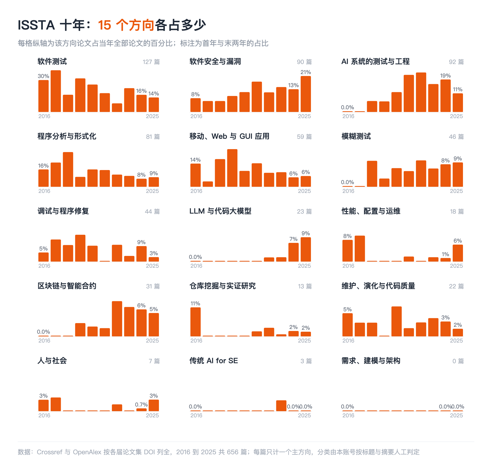
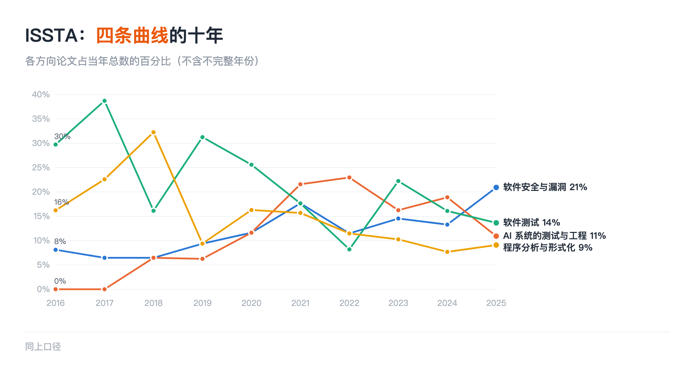
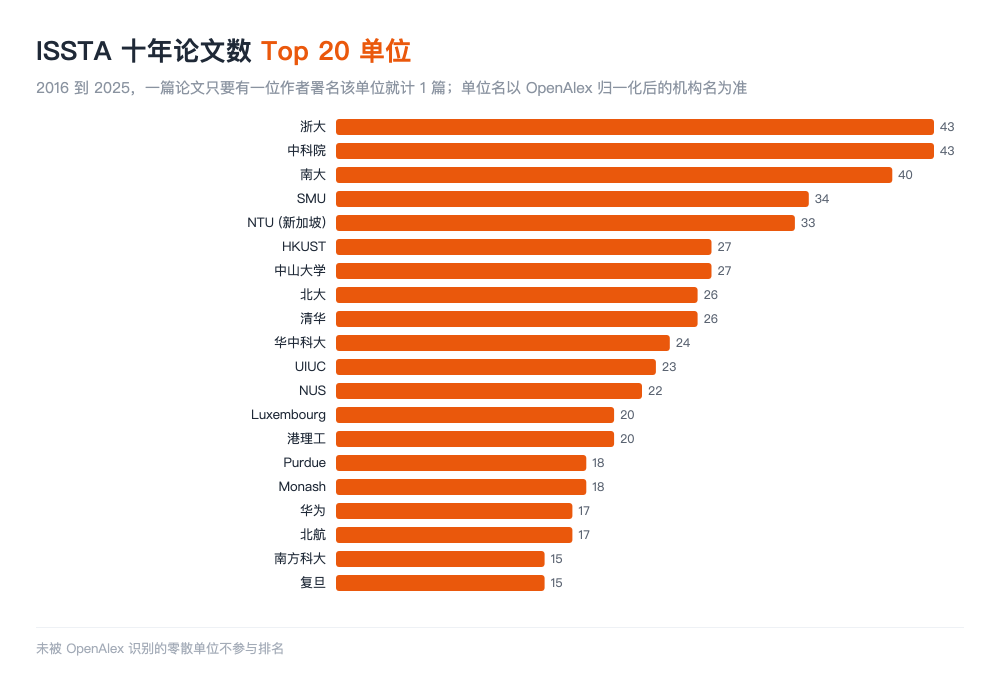
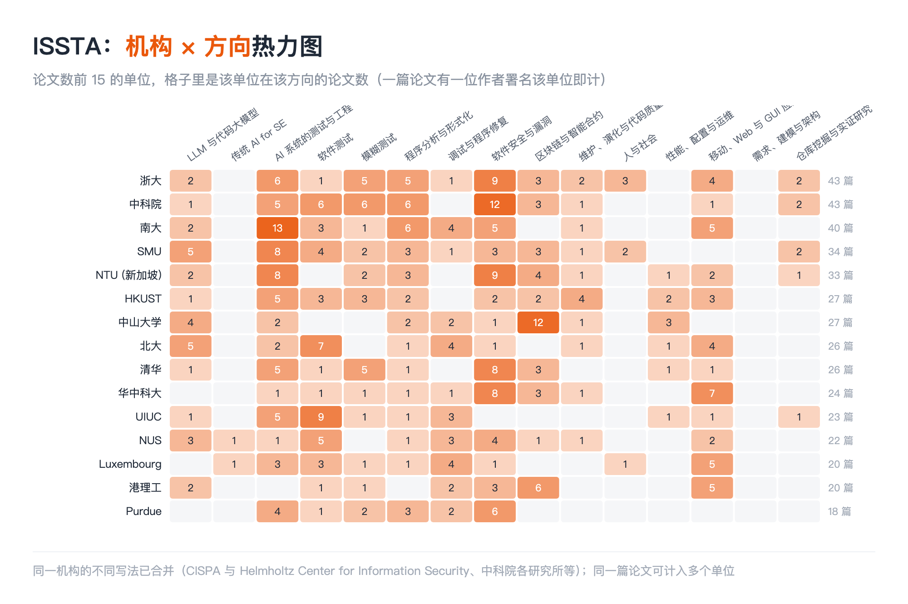
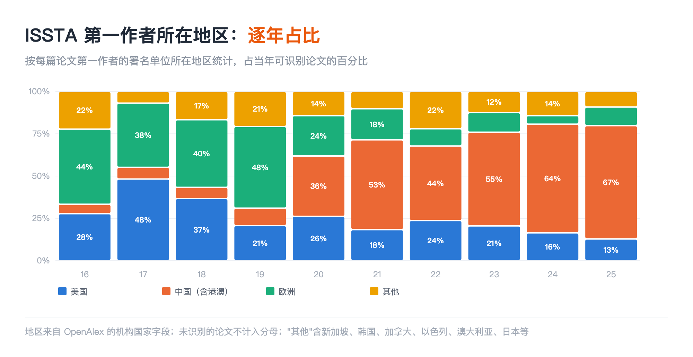

## LIST INFO|本期说明

【范围】ISSTA（ACM SIGSOFT International Symposium on Software Testing and Analysis）2016 到 2025 十届研究轨的全部论文，共 656 篇。ISSTA 2026 要到年底才开，本期不含
【来源】按每届论文集从 Crossref 列全标题与作者，再用 OpenAlex 补摘要、作者单位和国家；Tool Demo、Doctoral Symposium 等其他轨道不计，正文页数不足 8 页的条目按非正式论文剔除，逐年和 DBLP 目录核对过。2025 年起 ISSTA 的论文改在 PACMSE 期刊发表，本期按该期刊 ISSTA 一期的 110 篇计
【口径】每篇只归一个主方向（可带一个次方向），共 15 个方向，和本账号 ICSE、FSE、ASE 三期用的是同一套分类。ISSTA 的题材面比另外三家窄，需求与建模方向十年一篇没有，人与社会只有 7 篇，所以图 1 里有几格是空的

分类规则和前三期一样：**"用大模型做某个任务"的论文归到任务方向，大模型只记为次方向；只有研究对象就是代码大模型本身的论文才把"LLM 与代码大模型"记为主方向。**软件供应链的论文按题材分在软件安全和维护两个方向里。

@stats
- 37 → 110 篇 | 研究轨年接收量，2024 年 143 篇是历年最多
- 39% → 14% | 软件测试的份额，2017 到 2025
- 8% → 21% | 软件安全与漏洞的份额，2016 到 2025
- 5% → 66% | 第一作者来自中国的论文比例，2016 到 2025

先交代规模。ISSTA 2016 到 2019 年每届只有 31 到 37 篇，2020 年 43 篇，2022 年 61 篇，2023 年跳到 117 篇，2024 年 143 篇，2025 年 110 篇。前四年样本太小，单个方向一两篇就是 5% 的波动，所以趋势要看 2020 年之后。

## BIG PICTURE|十年三个大迁移

#### 测试从 39% 跌到 14%，安全从 8% 涨到 21%

ISSTA 的全名里有 Testing，2016 年 30%、2017 年 39% 的论文是软件测试，2025 年只剩 13.6%（15 篇）。同期软件安全与漏洞从 8.1% 涨到 2021 年的 17.6%、2025 年的 20.9%（23 篇），2025 年是第一大方向。加上区块链与智能合约（2025 年 6 篇，5.6%）和模糊测试（10 篇，9.3%），==2025 年 ISSTA 有三分之一的论文在做安全或安全相关的事==，把次方向算进去是 33 篇（31%）。

#### 大模型两年渗透到 35%

主方向记为"LLM 与代码大模型"的论文 2024 年 10 篇（7.0%），2025 年 10 篇（9.1%）。把次方向算进去，2023 年 5 篇（4.3%），2024 年 31 篇（21.7%），2025 年 38 篇（34.5%）。ISSTA 的渗透比 ICSE、FSE、ASE 晚一年起步，但 2024 年一年就追上了。

#### AI 系统的测试：2021 到 2024 年的第一大方向

AI 系统的测试与工程 2018 年 2 篇，2021 年 11 篇（21.6%），2022 年 14 篇（23.0%），2024 年 27 篇（18.9%），连续四年是第一大方向，2025 年回落到 12 篇（10.9%）。程序分析与形式化从 2018 年的 32.3% 跌到 2025 年的 9.3%，移动应用从 2019 年的 21.9% 跌到 6.5%，调试与修复 2024 年 13 篇之后 2025 年只剩 3 篇。

## SECURITY|软件安全与漏洞：第一大方向

软件安全与漏洞十年 90 篇，南洋理工 8 篇第一，浙大、清华、华科各 7 篇。这个方向在 ISSTA 上有五条线。

**旁路信道**是最早的：2018 年 **Symbolic path cost analysis for side-channel detection**（UCSB）和 **Eliminating timing side-channel leaks using program repair**（Virginia Tech）同届，2020 年 **Feedback-driven side-channel analysis for networked applications**，2021 年 **QFuzz: quantitative fuzzing for side channels**（新加坡国立）。

**二进制分析**是最连贯的：2017 年 **CPR: cross platform binary code reuse via platform independent trace program**（普渡），2020 年 **An empirical study on ARM disassembly tools**（港理工）和 **Patch based vulnerability matching for binary programs**（西交），2021 年 **A lightweight framework for function name reassignment based on large-scale stripped binaries**（中科大，杰出论文），2022 年 **jTrans: jump-aware transformer for binary code similarity detection**（清华），2024 年 **CEBin: A Cost-Effective Framework for Large-Scale Binary Code Similarity Detection**（清华）、**CLAP: Learning Transferable Binary Code Representations with Natural Language Supervision**（清华）、**Evaluating the Effectiveness of Decompilers**（信工所）、**Scalable, Sound, and Accurate Jump Table Analysis**，2025 年 **BinDSA: Efficient, Precise Binary-Level Pointer Analysis with Context-Sensitive Heap Reconstruction**（UC Riverside，杰出论文）、**KEENHash: Hashing Programs into Function-Aware Embeddings for Large-Scale Binary Code Similarity Analysis**、**DecLLM: LLM-Augmented Recompilable Decompilation for Enabling Programmatic Use of Decompiled Code**（港科大）、**BinQuery: A Novel Framework for Natural Language-Based Binary Code Retrieval**（信工所）。

**学习式漏洞检测**从 2022 年 **Path-sensitive code embedding via contrastive learning for software vulnerability detection**（悉尼科技大学）开始，2023 年 **Understanding and Tackling Label Errors in Deep Learning-Based Vulnerability Detection (Experience Paper)**（北邮与华科）和 **Interpreters for GNN-Based Vulnerability Detection: Are We There Yet?**（华科）已经在质疑，2024 年 **Graph Neural Networks for Vulnerability Detection: A Counterfactual Explanation** 和 **SCALE: Constructing Structured Natural Language Comment Trees for Software Vulnerability Detection**（哈工大），2025 年 **Top Score on the Wrong Exam: On Benchmarking in Machine Learning for Vulnerability Detection**（MPI-SP，杰出论文）指出现有基准测的不是真实场景，**Recurring Vulnerability Detection: How Far Are We?**（复旦）和 **Enhancing Vulnerability Detection via Inter-procedural Semantic Completion**（南洋理工）。

**内存安全与补丁**：2019 年 **Detecting memory errors at runtime with source-level instrumentation**（南航，杰出论文），2021 年 **UAFSan: an object-identifier-based dynamic approach for detecting use-after-free vulnerabilities** 和 **Automated patch backporting in Linux (experience paper)**（新加坡国立），2023 年 **Catamaran: Low-Overhead Memory Safety Enforcement via Parallel Acceleration**（南大）和 **CGuard: Scalable and Precise Object Bounds Protection for C**，2024 年 **Precise Compositional Buffer Overflow Detection via Heap Disjointness**（港科大，杰出论文）、**Silent Taint-Style Vulnerability Fixes Identification**（南大）、**PatchFinder: A Two-Phase Approach to Security Patch Tracing for Disclosed Vulnerabilities in Open-Source Software**（南洋理工与华东师大），2025 年 **PatchScope: LLM-Enhanced Fine-Grained Stable Patch Classification for Linux Kernel**、**Adding Spatial Memory Safety to EDK II through Checked C (Experience Paper)**（普渡）、**Safe4U: Identifying Unsound Safe Encapsulations of Unsafe Calls in Rust using LLMs**（浙大）。

**LLM 做安全分析**是 2025 年的新线：**Beyond Static Pattern Matching? Rethinking Automatic Cryptographic API Misuse Detection in the Era of LLMs**（浙大）、**Robust Vulnerability Detection across Compilations: LLVM-IR vs. Assembly with Transformer Model**、**ALMOND: Learning an Assembly Language Model for 0-Shot Code Obfuscation Detection**（UC Riverside）、**Validating Network Protocol Parsers with Traceable RFC Document Interpretation**（普渡）。2025 年 23 篇安全论文里 7 篇用了 LLM。

## CHAIN|区块链与智能合约：中山大学的主场

区块链与智能合约 31 篇，2019 年 **Exploiting the laws of order in smart contracts**（新加坡国立）是第一篇，2022 年 5 篇（8.2%），2023 年 8 篇，2024 年 9 篇，2025 年 6 篇。中山大学 12 篇是该方向第一，港理工 6 篇，南洋理工 4 篇。中山大学的线从 2022 年 **Park: accelerating smart contract vulnerability detection via parallel-fork symbolic execution** 和 **SmartDagger: a bytecode-based static analysis approach for detecting cross-contract vulnerability**，到 2023 年 **DeFiTainter: Detecting Price Manipulation Vulnerabilities in DeFi Protocols**、**SmartState: Detecting State-Reverting Vulnerabilities in Smart Contracts via Fine-Grained State-Dependency Analysis**、**Definition and Detection of Defects in NFT Smart Contracts**、**Toward Automated Detecting Unanticipated Price Feed in Smart Contract**，2024 年 **Midas: Mining Profitable Exploits in On-Chain Smart Contracts via Feedback-Driven Fuzzing and Differential Analysis**、**LENT-SSE: Leveraging Executed and Near Transactions for Speculative Symbolic Execution of Smart Contracts**、**DAppFL: Just-in-Time Fault Localization for Decentralized Applications in Web3**、**Identifying Smart Contract Security Issues in Code Snippets from Stack Overflow**（杰出论文），2025 年 **Copy-and-Paste? Identifying EVM-Inequivalent Code Smells in Multi-chain Reuse Contracts**。

其他单位的代表作：2020 年 **How effective are smart contract analysis tools? evaluating smart contract static analysis tools using bug injection**（UBC）是最早的工具评估，2022 年 **Finding permission bugs in smart contracts with role mining**（南洋理工，杰出论文），2023 年 **ItyFuzz: Snapshot-Based Fuzzer for Smart Contract**（伯克利），2024 年 **DeFort: Automatic Detection and Analysis of Price Manipulation Attacks in DeFi Applications**（南洋理工）和 **Empirical Study of Move Smart Contract Security: Introducing MoveScan for Enhanced Analysis**，2025 年 **SoK: A Taxonomic Analysis of DeFi Rug Pulls: Types, Dataset, and Tool Assessment**（南洋理工）、**Why Does My Transaction Fail? A First Look at Failed Transactions on the Solana Blockchain**（浙大）、**Smart-LLaMA-DPO: Reinforced Large Language Model for Explainable Smart Contract Vulnerability Detection**（软件所）。

## SE4AI|AI 系统的测试与工程：连续四年第一

这个方向十年 92 篇，南大 12 篇第一，南洋理工和新加坡管理大学各 8 篇。它在 ISSTA 上的分量比在另外三家都重：2021 到 2024 年连续四年是第一大方向，2022 年占 23.0%。

2018 年 **An empirical study on TensorFlow program bugs**（北大）和 **Identifying implementation bugs in machine learning based image classifiers using metamorphic testing** 是起点，2019 年 **DeepHunter: a coverage-guided fuzz testing framework for deep neural networks**（南洋理工），2020 年 **DeepGini: prioritizing massive tests to enhance the robustness of deep neural networks**（南大）和 **Effective white-box testing of deep neural networks with adaptive neuron-selection strategy**（高丽大学，杰出论文）。2021 年的 11 篇里，**DeepHyperion: exploring the feature space of deep learning-based systems through illumination search** 和 **DeepCrime: mutation testing of deep learning systems based on real faults**（都是 USI），**Predoo: precision testing of deep learning operators** 和 **DialTest: automated testing for recurrent-neural-network-driven dialogue systems**（都是南大），**ModelDiff: testing-based DNN similarity comparison for model reuse detection**（微软亚洲研究院）。2022 年 **MDPFuzz: testing models solving Markov decision processes**（港科大）、**DocTer: documentation-guided fuzzing for testing deep learning API functions**（普渡）、**Detecting multi-sensor fusion errors in advanced driver-assistance systems**（哥伦比亚），MDPFuzz 在 2024 年还有一篇复现研究 **Policy Testing with MDPFuzz (Replicability Study)** 拿了杰出论文。

之后题材扩到内容审核、自动驾驶和公平性。2023 年 **Validating Multimedia Content Moderation Software via Semantic Fusion**（港中文）、**BehAVExplor: Behavior Diversity Guided Testing for Autonomous Driving Systems**（新加坡管理大学）、**FairRec: Fairness Testing for Deep Recommender Systems**（浙大）、**In Defense of Simple Techniques for Neural Network Test Case Selection**（复旦）；2024 年 **VioHawk: Detecting Traffic Violations of Autonomous Driving Systems through Criticality-Guided Simulation Testing**（复旦）、**DiaVio: LLM-Empowered Diagnosis of Safety Violations in ADS Simulation Testing**（复旦）、**NeuFair: Neural Network Fairness Repair with Dropout**、**Interoperability in Deep Learning: A User Survey and Failure Analysis of ONNX Model Converters**（普渡）、**TeDA: A Testing Framework for Data Usage Auditing in Deep Learning Model Development**（华为与浙大）、**See the Forest, not Trees: Unveiling and Escaping the Pitfalls of Error-Triggering Inputs in Neural Network Testing**（港科大）。2025 年被测对象换成大模型：**S-Eval: Towards Automated and Comprehensive Safety Evaluation for Large Language Models**（浙大）、**Fairness Mediator: Neutralize Stereotype Associations to Mitigate Bias in Large Language Models**（北航）、**DeCoMa: Detecting and Purifying Code Dataset Watermarks through Dual Channel Code Abstraction** 把代码数据集水印当成攻击对象。

## LLM|大模型：修复先行，测试跟上

@timeline
- 2022 | An extensive study on pre-trained models for program understanding and generation | 南方科大，第一篇系统评估
- 2023 | Large Language Models Are Zero-Shot Fuzzers: Fuzzing Deep-Learning Libraries via Large Language Models | UIUC 的 TitanFuzz，LLM 直接当 fuzzer
- 2023 | How Effective Are Neural Networks for Fixing Security Vulnerabilities | 普渡，评估 LLM 修漏洞
- 2024 | Automated Program Repair via Conversation: Fixing 162 out of 337 Bugs for $0.42 Each using ChatGPT | UIUC 的 ChatRepair，把修复成本算到分
- 2024 | AutoCodeRover: Autonomous Program Improvement | 新加坡国立，最早的 SWE-bench Agent 之一
- 2024 | When to Stop? Towards Efficient Code Generation in LLMs with Excess Token Prevention | 中山大学，当年杰出论文
- 2024 | AI Coders Are among Us: Rethinking Programming Language Grammar towards Efficient Code Generation | 新加坡管理大学，为 LLM 重新设计语法，当年杰出论文
- 2025 | SWE-GPT: A Process-Centric Language Model for Automated Software Improvement | 阿里，当年杰出论文
- 2025 | LLM Hallucinations in Practical Code Generation: Phenomena, Mechanism, and Mitigation | 中山大学，代码幻觉的系统研究
- 2025 | Can LLMs Replace Human Evaluators? An Empirical Study of LLM-as-a-Judge in Software Engineering | 哈工大

ISSTA 上大模型的第一个落地方向是修复。2024 年 13 篇修复论文里 6 篇用了 LLM：**Automated Program Repair via Conversation: Fixing 162 out of 337 Bugs for $0.42 Each using ChatGPT**、**AutoCodeRover: Autonomous Program Improvement**、**ThinkRepair: Self-Directed Automated Program Repair**（浙大）、**Neurosymbolic Repair of Test Flakiness**（UIUC）、**Face It Yourselves: An LLM-Based Two-Stage Strategy to Localize Configuration Errors via Logs**（中山大学）、**CREF: An LLM-Based Conversational Software Repair Framework for Programming Tutors**。同年 **Benchmarking Automated Program Repair: An Extensive Study on Both Real-World and Artificial Bugs**（UIUC）回头评估了这个方向。但 2025 年修复方向只剩 3 篇，题材转到了 Agent 和评测：**SWE-GPT**、**OmniGIRL: A Multilingual and Multimodal Benchmark for GitHub Issue Resolution**（中山大学）、**AdverIntent-Agent: Adversarial Reasoning for Repair Based on Inferred Program Intent**（UCL）。

测试方向 2024 年 5 篇、2025 年 7 篇用了 LLM。2024 年 **Large Language Models for Equivalent Mutant Detection: How Far Are We?**（天津大学，杰出论文）、**LPR: Large Language Models-Aided Program Reduction**、**UniTSyn: A Large-Scale Dataset Capable of Enhancing the Prowess of Large Language Models for Program Testing**（UC Davis），2025 年 **A Large-Scale Empirical Study on Fine-Tuning Large Language Models for Unit Testing**（南大）、**You Name It, I Run It: An LLM Agent to Execute Tests of Arbitrary Projects**（斯图加特）、**Are Autonomous Web Agents Good Testers?**、**REACCEPT: Automated Co-evolution of Production and Test Code Based on Dynamic Validation and Large Language Models**、**Tratto: A Neuro-Symbolic Approach to Deriving Axiomatic Test Oracles**。模糊测试方向 **How Effective Are They? Exploring Large Language Model Based Fuzz Driver Generation**（南洋理工）和 **Fuzzing JavaScript Interpreters with Coverage-Guided Reinforcement Learning for LLM-Based Mutation**（延世大学）是 2024 年的两篇，2025 年 **Unlocking Low Frequency Syscalls in Kernel Fuzzing with Dependency-Based RAG**（信工所）。

代码大模型本身的研究，ISSTA 上偏安全和效率：2024 年 **FDI: Attack Neural Code Generation Systems through User Feedback Channel**（港理工与新加坡管理大学）、**CoSec: On-the-Fly Security Hardening of Code LLMs via Supervised Co-decoding**（重庆大学）、**When to Stop?**、**AI Coders Are among Us**，2025 年 **LLM Hallucinations in Practical Code Generation**、**Causality-Aided Evaluation and Explanation of Large Language Model-Based Code Generation**（港科大）、**The First Prompt Counts the Most! An Evaluation of Large Language Models on Iterative Example-Based Code Generation**（北大）、**Can LLMs Replace Human Evaluators?**。

> ISSTA 2025 的 9 篇杰出论文里，大模型相关的 2 篇（SWE-GPT、LLM4SZZ），机器学习漏洞检测的方法论 1 篇（Top Score on the Wrong Exam），传统程序分析 2 篇（BinDSA、Bridging the Gaps between Graph Neural Networks and Data-Flow Analysis），模糊测试和性能各 1 篇。==这个会对大模型的态度比 ICSE、FSE 更保守==，2024 年的两篇大模型杰出论文（When to Stop、AI Coders Are among Us）都是在解决效率问题而不是能力问题。

## FUZZ|模糊测试：从 PerfFuzz 到内核

模糊测试 46 篇，2018 年 3 篇同届起步（**PerfFuzz: automatically generating pathological inputs**（伯克利，杰出论文）、**Compiler fuzzing through deep learning**（爱丁堡，杰出论文）、**Badger: complexity analysis with fuzzing and symbolic execution**），2024 年 12 篇，2025 年 10 篇（9.1%）。浙大和清华各 5 篇。

题材从通用 fuzzer（2019 年 **Semantic fuzzing with zest**（伯克利），2021 年 **Seed selection for successful fuzzing**（澳国立）和 **Gramatron: effective grammar-aware fuzzing**（普渡），2022 年 **SLIME: program-sensitive energy allocation for fuzzing**（浙大）、**SnapFuzz: high-throughput fuzzing of network applications**（帝国理工））走到特定目标：SMT 求解器（2021 年 **Fuzzing SMT solvers via two-dimensional input space exploration**（港科大）），Linux 驱动（2022 年 **PrIntFuzz: fuzzing Linux drivers via automated virtual device simulation**（清华）），IoT 固件（2022 年 **Efficient greybox fuzzing of applications in Linux-based IoT devices via enhanced user-mode emulation**（南洋理工），2023 年 **Icicle: A Re-designed Emulator for Grey-Box Firmware Fuzzing**（阿德莱德）和 **Fuzzing Embedded Systems using Debug Interfaces**），协议（2024 年 **Logos: Log Guided Fuzzing for Protocol Implementations**（清华）），机器人（2024 年 **Enhancing ROS System Fuzzing through Callback Tracing**（清华，杰出论文），2025 年 **Reinforcement Learning-Based Fuzz Testing for the Gazebo Robotic Simulator**（大连理工，杰出论文）），浏览器（2024 年 **Tacoma: Enhanced Browser Fuzzing with Fine-Grained Semantic Alignment**（浙大）），WebAssembly（2025 年 **FreeWavm: Enhanced WebAssembly Runtime Fuzzing Guided by Parse Tree Mutation and Snapshot**（浙大）和 **Wemby's Web: Hunting for Memory Corruption in WebAssembly**）。方法论上，2023 年 **Green Fuzzer Benchmarking**（MPI-SWS）和 2024 年 **An Empirical Examination of Fuzzer Mutator Performance** 是两篇评估，2025 年 **Program Feature-Based Benchmarking for Fuzz Testing** 和 **KRAKEN: Program-Adaptive Parallel Fuzzing**（港科大）、**FANDANGO: Evolving Language-Based Testing**（CISPA）。

## TESTING|软件测试与程序分析：份额跌了，题材换了

软件测试 127 篇，UIUC 9 篇第一，北大 7 篇，UT Austin 6 篇。份额从 39% 跌到 13%，但题材换了三轮。

早年是变异测试和测试预言：2016 年 **Predictive mutation testing**（北大），2017 年 **Faster mutation analysis via equivalence modulo states**（北大，杰出论文），2024 年 **Equivalent Mutants in the Wild: Identifying and Efficiently Suppressing Equivalent Mutants for Java Programs** 和用 LLM 判等价变异体的那篇杰出论文。flaky test 是 UIUC 和 UT Austin 的线：2019 年 **Root causing flaky tests in a large-scale industrial setting** 和 **Mitigating the effects of flaky tests on mutation testing**，2020 年 **Dependent-test-aware regression testing techniques**，2022 年 **Evolution-aware detection of order-dependent flaky tests**，2023 年 **Systematically Producing Test Orders to Detect Order-Dependent Flaky Tests**，2024 年 **Reproducing Timing-Dependent GUI Flaky Tests in Android Apps via a Single Event Delay**（复旦）。

2022 年之后是数据库和运行时：图数据库测试从 2022 年 **Finding bugs in Gremlin-based graph database systems via Randomized differential testing**（软件所）到 2023 年 **Testing Graph Database Engines via Query Partitioning**（ETH）和 **GDsmith: Detecting Bugs in Cypher Graph Database Engines**（北大），2024 年 **Testing Graph Database Systems with Graph-State Persistence Oracle**（人大）、**DBStorm: Generating Various Effective Workloads for Testing Isolation Levels**（华东师大），2025 年 **Detecting Isolation Anomalies in Relational DBMSs**（软件所）、**DepState: Detecting Synchronization Failure Bugs in Distributed Database Management Systems**（国防科大）、**Hulk: Exploring Data-Sensitive Performance Anomalies in DBMSs via Data-Driven Analysis**（清华，杰出论文）。WebAssembly 运行时从 2024 年 **WASMaker: Differential Testing of WebAssembly Runtimes via Semantic-Aware Binary Generation**（北邮）和 **Wapplique: Testing WebAssembly Runtime via Execution Context-Aware Bytecode Mutation**（复旦）起。编译器和 JVM：2023 年 **Vectorizing Program Ingredients for Better JVM Testing**（天津大学）、**Pattern-Based Peephole Optimizations with Java JIT Tests**（UT Austin），2024 年 **AsFuzzer: Differential Testing of Assemblers with Error-Driven Grammar Inference**（杰出论文）。自动驾驶测试：2019 年 **Automatically testing self-driving cars with search-based procedural content generation**（帕绍），2023 年 **Building Critical Testing Scenarios for Autonomous Driving from Real Accidents**（软件所）、**PhysCov: Physical Test Coverage for Autonomous Vehicles**、**Testing Automated Driving Systems by Breaking Many Laws Efficiently**，2025 年 **Assessing Scene Generation Techniques for Testing COLREGS-Compliance of Autonomous Surface Vehicles**（林雪平，杰出论文）把题材扩到了船。

程序分析与形式化 81 篇，从 2018 年的 32.3% 跌到 2025 年的 9.3%。早年的题材是指针分析、符号执行和并发：2016 年 **EagerMerge: an optimistic technique for efficient points-to analysis**，2018 年 **Shooting from the heap: ultra-scalable static analysis with heap snapshots**，2019 年 **Judge: identifying, understanding, and evaluating sources of unsoundness in call graphs**（达姆施塔特），2020 年 **Running symbolic execution forever**（帝国理工）。2021 年 **Type and interval aware array constraint solving for symbolic execution**（国防科大，杰出论文），2023 年 **Tai-e: A Developer-Friendly Static Analysis Framework for Java by Harnessing the Good Designs of Classics**（南大）是国内最完整的 Java 静态分析框架，2024 年 **Total Recall? How Good Are Static Call Graphs Really?**（达姆施塔特），2025 年 **Bridging the Gaps between Graph Neural Networks and Data-Flow Analysis: The Closer, the Better**（浙大，杰出论文）、**Bridge the Islands: Pointer Analysis for Microservice Systems**（南大）、**RouthSearch: Inferring PID Parameter Specification for Flight Control Program by Coordinate Search**（复旦，杰出论文）。

## SUPPLY|软件供应链：四会里最薄的一条线

这是本账号最关心的题材。ISSTA 上供应链的论文比另外三家少，十年十几篇，但有几篇值得记：

- 2017 年 **Experience paper: a study on behavioral backward incompatibilities of Java software libraries**，2019 年 **LibID: reliable identification of obfuscated third-party Android libraries**（剑桥）
- 2020 年 **Escaping dependency hell: finding build dependency errors with the unified dependency graph**（港科大），2021 年 **Fixing dependency errors for Python build reproducibility**（UC Davis）
- 2022 年 **A large-scale empirical analysis of the vulnerabilities introduced by third-party components in IoT firmware**（佐治亚理工与浙大）和 **Test mimicry to assess the exploitability of library vulnerabilities**（新加坡管理大学），后者用测试来判定依赖里的漏洞在下游能不能被触发
- 2023 年 **Third-Party Library Dependency for Large-Scale SCA in the C/C++ Ecosystem: How Far Are We?**（南方科大）、**Understanding Breaking Changes in the Wild**（奥克兰）、**LiResolver: License Incompatibility Resolution for Open Source Software**（南开）
- 2024 年 **Maltracker: A Fine-Grained NPM Malware Tracker Copiloted by LLM-Enhanced Dataset**（华科）是 ISSTA 上唯一一篇恶意包检测，**FRIES: Fuzzing Rust Library Interactions via Efficient Ecosystem-Guided Target Generation**（南大）用生态里的真实用法指导库 fuzzing，**Automating Zero-Shot Patch Porting for Hard Forks**（浙大），**Your "Notice" Is Missing: Detecting and Fixing Violations of Modification Terms in Open Source Licenses during Forking**（同济）
- 2025 年 **More Effective JavaScript Breaking Change Detection via Dynamic Object Relation Graph**（浙大），**Fixing Outside the Box: Uncovering Tactics for Open-Source Security Issue Management**（南洋理工）

ISSTA 上供应链的特点是偏"分析"：破坏性变更检测、构建依赖错误、许可证合规、库漏洞可利用性，都是程序分析方法在依赖问题上的应用。恶意包检测和生态测量这两条线基本不在 ISSTA 上。

## MOBILE|移动应用：从 22% 到 7%

移动、Web 与 GUI 应用 59 篇，2019 年 7 篇（21.9%）是历史最高份额，2025 年 7 篇（6.4%）。华科 7 篇第一，Monash 6 篇。2016 年 **Sapienz: multi-objective automated testing for Android applications**（UCL）是这个方向最有影响的一篇，后来被 Facebook 收购部署。2018 年 **Analyzing the analyzers: FlowDroid/IccTA, AmanDroid, and DroidSafe**（UBC，杰出论文）评估了三个安卓污点分析工具，**CiD: automating the detection of API-related compatibility issues in Android apps**（Monash）。2020 年 **Reinforcement learning based curiosity-driven testing of Android applications**（南大，杰出论文），2021 年 **GUIDER: GUI structure and vision co-guided test script repair for Android apps**（南大）、**Parema: an unpacking framework for demystifying VM-based Android packers**（港理工），2022 年 **NCScope: hardware-assisted analyzer for native code in Android apps**（港理工，杰出论文）。2023 年之后偏安全：**DeUEDroid: Detecting Underground Economy Apps Based on UTG Similarity**（浙大）、**What You See Is What You Get? It Is Not the Case! Detecting Misleading Icons for Mobile Applications**（南方科大）、**Precise and Efficient Patch Presence Test for Android Applications against Code Obfuscation**（华科），2025 年 **Walls Have Ears: Demystifying Notification Listener Usage in Android Apps**（华科）、**Uncovering API-Scope Misalignment in the App-in-App Ecosystem**（南开）。2025 年 GUI 测试迁移换上了 LLM：**Automated Test Transfer across Android Apps using Large Language Models**（UC Irvine）、**Intention-Based GUI Test Migration for Mobile Apps using Large Language Models**（南大）。

## AWARDS|杰出论文十年：分析和测试的会

ISSTA 的 ACM SIGSOFT 杰出论文每年 2 到 11 篇，2016 到 2025 年公开可查的共 45 篇（2023 年那届官网需登录，没有找到名单）。三个特点：

- 程序分析和测试拿奖最多：Analyzing Test Completeness for Dynamic Languages、Just-in-Time Static Analysis、Faster Mutation Analysis via Equivalence Modulo States、Analyzing the Analyzers、Type and Interval Aware Array Constraint Solving、Precise Compositional Buffer Overflow Detection、Bridging the Gaps between Graph Neural Networks and Data-Flow Analysis、BinDSA
- 模糊测试每两年一篇：PerfFuzz、Compiler Fuzzing through Deep Learning（2018），Enhancing ROS System Fuzzing through Callback Tracing、AsFuzzer（2024），Reinforcement Learning-Based Fuzz Testing for the Gazebo Robotic Simulator（2025）
- 安全与供应链：Scalable Analysis of Interaction Threats in IoT Systems（2020），A Lightweight Framework for Function Name Reassignment Based on Large-Scale Stripped Binaries、SAND（2021），Finding Permission Bugs in Smart Contracts with Role Mining、NCScope（2022），Identifying Smart Contract Security Issues in Code Snippets from Stack Overflow、Precise Compositional Buffer Overflow Detection（2024），Top Score on the Wrong Exam、BinDSA（2025）

2022 年有一篇杰出论文 Cross-Lingual Transfer Learning for Statistical Type Inference 后来被撤稿，这在四大会的杰出论文里是唯一一例。

## WHO|谁在做：机构图谱、团队和地区

按"论文有至少一位作者署名该单位"计（同一机构的不同写法已合并，中科院各研究所合并计），十年榜首是浙大和中科院，各 43 篇。两家的曲线都是近三年拉起来的：浙大 2023 年之前每年不超过 4 篇，2024 年一届 16 篇、2025 年 13 篇；中科院 2020 年才有第一篇，2024 年 15 篇。南大 40 篇排第三，2020 年起每年都在涨，2025 年 11 篇是当年最多，AI 系统测试 13 篇是该方向第一。新加坡管理大学 34 篇，南洋理工 33 篇（2023 年起每年 8 到 9 篇），港科大和中山大学各 27 篇，北大和清华各 26 篇，华中科大 24 篇。美国单位里最高的是 UIUC，23 篇，软件测试 9 篇是该方向第一；Purdue 18 篇。欧洲最高的是卢森堡大学，20 篇，但它的论文多数在 2016 到 2019 年，2020 年之后每年只有一两篇。前 15 名里中国大陆与港澳 10 家、新加坡 3 家、美国 1 家、欧洲 1 家，这就是 ISSTA 今天的样子。

热力图上最深的几格都是"一家独大"的方向：区块链与智能合约的 31 篇里中山大学占 12 篇，AI 系统测试的 92 篇里南大占 13 篇，软件安全的 90 篇里中科院占 12 篇。另一类是几家平分的方向：软件测试前五名 UIUC、北大、微软、UT Austin、中科院各 6 到 9 篇，程序分析前三名南大、中科院、国防科大各 6 篇，模糊测试中科院、浙大、清华各 5 到 6 篇。还有一类是"横着看"才有意思的行：浙大和南洋理工的论文分散在软件安全、AI 系统测试、区块链、模糊测试、程序分析五六个方向，没有一格特别深，说明它们是靠多个组同时投稿堆出来的总量；中山大学和港理工则恰恰相反，一格区块链就占了自己一半的论文。下面按方向说，作者名后面的"N 篇署名"是该作者十年在 ISSTA 的署名总数。

#### 软件安全与漏洞：中科院、南洋理工、浙大、清华、华中科大

这是 ISSTA 2025 年的第一大方向，也是团队最多的方向，前五家各 8 到 12 篇。中科院 12 篇，主力是信工所 Limin Sun 组的固件与二进制分析，2023 年 **Detecting Vulnerabilities in Linux-Based Embedded Firmware with SSE-Based On-Demand Alias Analysis**，2025 年 **ICEPRE: ICS Protocol Reverse Engineering via Data-Driven Concolic Execution**。清华 8 篇几乎全在 Chao Zhang 组（12 篇署名，其中 6 篇软件安全），主题是二进制相似度和 1day 漏洞复现：2022 年 **jTrans: jump-aware transformer for binary code similarity detection**，2023 年 **1dFuzz: Reproduce 1-Day Vulnerabilities with Directed Differential Fuzzing**，2024 年 **CLAP: Learning Transferable Binary Code Representations with Natural Language Supervision**。南洋理工 9 篇是 Yang Liu 组（16 篇署名，ISSTA 署名第二多）的补丁追踪和开源安全响应，2024 年 **PatchFinder: A Two-Phase Approach to Security Patch Tracing for Disclosed Vulnerabilities in Open-Source Software**。华中科大 8 篇，Hai Jin、Deqing Zou 做深度学习漏洞检测的可解释和混淆对抗，2024 年 **Graph Neural Networks for Vulnerability Detection: A Counterfactual Explanation**。浙大 9 篇分散在 Shouling Ji、Xing Hu、Yajin Zhou 几个组。美国这边只有 Purdue 的 Xiangyu Zhang（10 篇署名）和 UCSB 的 Tevfik Bultan 组（侧信道与访问控制修复）还在稳定投稿。

#### 软件供应链：港科大、南方科大、华中科大、南大、南洋理工

ISSTA 上没有"供应链团队"，只有做供应链的团队，而且每家一两篇。港科大 Qingkai Shi 和 Charles Zhang 的 2020 年 **Escaping dependency hell: finding build dependency errors with the unified dependency graph** 是构建依赖这条线的起点；新加坡管理大学 2022 年 **Test mimicry to assess the exploitability of library vulnerabilities** 把库漏洞的可利用性问题引进来；南方科大 Yepang Liu 组 2023 年 **Third-Party Library Dependency for Large-Scale SCA in the C/C++ Ecosystem: How Far Are We?** 是 C/C++ 生态 SCA 的基准；华中科大 Hai Jin、Ming Wen 组 2024 年 **Maltracker: A Fine-Grained NPM Malware Tracker Copiloted by LLM-Enhanced Dataset** 是十年里唯一一篇恶意包检测；南大 2024 年 **FRIES: Fuzzing Rust Library Interactions via Efficient Ecosystem-Guided Target Generation** 把生态用法拿来指导库 fuzzing；南洋理工 Yang Liu 组 2025 年 **Fixing Outside the Box: Uncovering Tactics for Open-Source Security Issue Management** 看的是开源项目怎么处理安全问题。分工和其他三家软工会一致：新加坡两家做 SCA 与漏洞可达性，华科做恶意包，港科大和南大做依赖与构建。

#### 软件测试：UIUC、北大、UT Austin、微软、中科院

这是 ISSTA 累计最大的方向，127 篇，也是美国团队保留得最完整的一块。UIUC 9 篇是该方向第一，Darko Marinov、August Shi、Wing Lam 那条 flaky test 和回归测试的线从 2019 年一直做到 2024 年：2021 年 **Test-case prioritization for configuration testing**（杰出论文），2023 年 **Systematically Producing Test Orders to Detect Order-Dependent Flaky Tests**。August Shi 2022 年起署名 UT Austin，和 Milos Gligoric 组一起把 UT Austin 也带到了 6 篇，2023 年 **More Precise Regression Test Selection via Reasoning about Semantics-Modifying Changes**。北大 7 篇是 Dan Hao、Lu Zhang、Tao Xie 三个组的变异测试和测试优先级，2017 年 **Faster mutation analysis via equivalence modulo states** 拿了杰出论文。中科院 6 篇集中在软件所 Wensheng Dou、Jun Wei 组的数据库和分布式系统测试，2024 年 **Testing Gremlin-Based Graph Database Systems via Query Disassembling**，2025 年 **Model Checking Guided Incremental Testing for Distributed Systems**。天津大学 Junjie Chen（10 篇署名）做编译器和 JVM 测试，2024 年 **Large Language Models for Equivalent Mutant Detection: How Far Are We?** 拿了杰出论文。微软的 6 篇多在 2016 到 2020 年，之后就没了。

#### AI 系统的测试与工程：南大、南洋理工、新加坡管理大学、浙大

南大 13 篇是该方向第一，Zhenyu Chen（9 篇署名，其中 8 篇 AI 系统测试）和 Chunrong Fang、Yang Feng 三个组，从 2020 年 **DeepGini: prioritizing massive tests to enhance the robustness of deep neural networks** 起，题材一路从模型测试优先级换到语音、对话、V2X 和深度学习框架：2025 年 **Improving Deep Learning Framework Testing with Model-Level Metamorphic Testing**。南洋理工 8 篇和新加坡管理大学 8 篇其实是同一条线，Xiaofei Xie 2019 年在南洋理工发了 **DeepHunter: a coverage-guided fuzz testing framework for deep neural networks**，2022 年起署名新加坡管理大学，做的是自动驾驶和多智能体系统测试：2023 年 **BehAVExplor: Behavior Diversity Guided Testing for Autonomous Driving Systems**，2025 年 **MoDitector: Module-Directed Testing for Autonomous Driving Systems**。新加坡管理大学还有 Jun Sun（11 篇署名）。浙大 6 篇全是 Jingyi Wang 组，从公平性测试到大模型安全评测：2025 年 **S-Eval: Towards Automated and Comprehensive Safety Evaluation for Large Language Models**。欧洲这边 USI 的 Paolo Tonella 组是唯一稳定的团队，2022 年 **Simple techniques work surprisingly well for neural network test prioritization and active learning (replicability study)**。

#### 程序分析与形式化：南大、国防科大、中科院、达姆施塔特、帝国理工

这个方向的份额从 32% 跌到 9%，但团队很稳。国防科大 Ji Wang 组（8 篇署名，其中 6 篇程序分析）十年只做符号执行和抽象解释，2021 年 **Type and interval aware array constraint solving for symbolic execution** 是杰出论文，2025 年 **Program Analysis Combining Generalized Bit-Level and Word-Level Abstractions**。南大 6 篇是 Tian Tan、Yue Li 的指针分析线。中科院 6 篇是软件所的并发和分布式系统分析。欧洲两家是这个方向的老牌团队：达姆施塔特 Mira Mezini 组连续做调用图的健全性，2024 年 **Total Recall? How Good Are Static Call Graphs Really?**；帝国理工 Cristian Cadar 组做符号执行，2020 年 **Running symbolic execution forever**。斯图加特的 Michael Pradel（10 篇署名，2020 年之前署名达姆施塔特）横跨分析、测试和性能，2023 年 **That’s a Tough Call: Studying the Challenges of Call Graph Construction for WebAssembly**。Purdue 的 Xiangyu Zhang 组 2023 年 **NodeRT: Detecting Races in Node.js Applications Practically**。

#### 模糊测试：中科院、浙大、清华、港科大、CISPA、UC Berkeley

模糊测试在 ISSTA 十年 46 篇，前三名中科院 6 篇、浙大 5 篇、清华 5 篇都是近四年的。清华是 Yu Jiang 组（11 篇署名），协议、ROS 和数据库的 fuzzing：2024 年 **Enhancing ROS System Fuzzing through Callback Tracing** 是杰出论文，2024 年 **Logos: Log Guided Fuzzing for Protocol Implementations**；Chao Zhang 组 2025 年 **xFUZZ: A Flexible Framework for Fine-Grained, Runtime-Adaptive Fuzzing Strategy Composition**。港科大 Charles Zhang 组做并行 fuzzing 和求解器 fuzzing，2021 年 **Fuzzing SMT solvers via two-dimensional input space exploration**，2025 年 **KRAKEN: Program-Adaptive Parallel Fuzzing**。方法论上最有影响的两篇来自美国和欧洲：UC Berkeley Koushik Sen 组 2018 年 **PerfFuzz: automatically generating pathological inputs** 拿了杰出论文，2019 年 **Semantic fuzzing with zest** 是 Rohan Padhye 那条线的开端；CISPA Andreas Zeller 组做基于语法和语言的输入生成，2025 年 **FANDANGO: Evolving Language-Based Testing**。

#### 移动应用：华中科大、Monash、卢森堡、南大、南加大

移动方向份额从 22% 跌到 7%，团队却是最"跟人走"的。卢森堡 Tegawendé Bissyandé、Jacques Klein 和 Li Li 是 2016 到 2019 年这个方向的主力，2018 年 **CiD: automating the detection of API-related compatibility issues in Android apps**；Li Li 2018 年起署名 Monash，Monash 的 6 篇随之而来，2022 年 **Automatically detecting API-induced compatibility issues in Android apps: a comparative analysis (replicability study)**；2023 年起他署名北航。华中科大 7 篇是该方向第一，全部在 2022 年之后，Haoyu Wang（12 篇署名）2022 年从北邮过来后华科才有这条线：2024 年 **NativeSummary: Summarizing Native Binary Code for Inter-language Static Analysis of Android Apps**，2025 年 **Walls Have Ears: Demystifying Notification Listener Usage in Android Apps**。南大 Minxue Pan、Xuandong Li 组做 GUI 测试，2020 年 **Reinforcement learning based curiosity-driven testing of Android applications** 是杰出论文，2025 年 **Intention-Based GUI Test Migration for Mobile Apps using Large Language Models**。美国只剩南加大 William Halfond 组的缺陷报告复现，2024 年 **Feedback-Driven Automated Whole Bug Report Reproduction for Android Apps**。

#### 区块链与智能合约：中山大学、港理工、南洋理工

31 篇里中山大学 12 篇，2022 年之前一篇没有，是 ISSTA 上单一团队集中度最高的方向。Zibin Zheng（17 篇署名，ISSTA 署名最多的作者，其中 11 篇区块链）、Jiachi Chen（10 篇署名）、Yuhong Nan 三个组分工清楚：合约缺陷定义与检测、DeFi 价格操纵、链上利用挖掘。2022 年 **Park: accelerating smart contract vulnerability detection via parallel-fork symbolic execution**，2023 年 **DeFiTainter: Detecting Price Manipulation Vulnerabilities in DeFi Protocols**，2024 年 **Identifying Smart Contract Security Issues in Code Snippets from Stack Overflow** 是杰出论文，2024 年 **Midas: Mining Profitable Exploits in On-Chain Smart Contracts via Feedback-Driven Fuzzing and Differential Analysis**。港理工 Xiapu Luo（14 篇署名，其中 5 篇区块链）从合约扩到区块链客户端和 Move 语言，2024 年 **Empirical Study of Move Smart Contract Security: Introducing MoveScan for Enhanced Analysis**。南洋理工 Yang Liu 组做 DeFi 的经济安全，2025 年 **SoK: A Taxonomic Analysis of DeFi Rug Pulls: Types, Dataset, and Tool Assessment**。华中科大 Haoyu Wang 组 2025 年 **OpDiffer: LLM-Assisted Opcode-Level Differential Testing of Ethereum Virtual Machine** 做 EVM 差分测试。

#### 调试修复与大模型：UIUC、北大、卢森堡、NUS、新加坡管理大学、中山大学

修复方向 44 篇，署名最多的是 Lingming Zhang（15 篇署名，其中 7 篇修复，2021 年起署名 UIUC）：2019 年 **History-driven build failure fixing: how far are we?** 是杰出论文，2024 年 **Benchmarking Automated Program Repair: An Extensive Study on Both Real-World and Artificial Bugs**。卢森堡 Bissyandé 组 2019 年 **TBar: revisiting template-based automated program repair** 是模板修复的基线。NUS Abhik Roychoudhury 组是修复和大模型的交叉点，2024 年 **AutoCodeRover: Autonomous Program Improvement** 是 ISSTA 上第一篇 Agent 修复。大模型方向只有 23 篇主方向论文，分在新加坡管理大学、北大、重庆大学各 5 篇和中山大学 4 篇：新加坡管理大学 David Lo（11 篇署名）2024 年 **AI Coders Are among Us: Rethinking Programming Language Grammar towards Efficient Code Generation** 是杰出论文；中山大学 Yanlin Wang 和重庆大学 Hongyu Zhang 合作的 2024 年 **When to Stop? Towards Efficient Code Generation in LLMs with Excess Token Prevention** 也是杰出论文，2025 年 **LLM Hallucinations in Practical Code Generation: Phenomena, Mechanism, and Mitigation**；哈工大 Cuiyun Gao 组 2025 年 **Can LLMs Replace Human Evaluators? An Empirical Study of LLM-as-a-Judge in Software Engineering**。

#### 人在动，方向跟着动

ISSTA 的机构曲线里有几条明显是人带走的：Li Li 从卢森堡（2016）到 Monash（2018）再到北航（2023），Android 兼容性那条线跟着他走了三站，卢森堡 2020 年之后每年只剩一两篇；Haoyu Wang 2022 年从北邮到华中科大，华科的移动和区块链论文从 2021 年的 1 篇跳到 2023 年的 8 篇；Xiaofei Xie 2022 年从南洋理工到新加坡管理大学，深度学习和自动驾驶测试的线一起过去，两家在 AI 系统测试上各 8 篇其实是一条线的前后半段；Michael Pradel 2020 年从达姆施塔特到斯图加特，动态分析和 JavaScript 那条线跟着挪；Yepang Liu 2020 年从港科大到南方科大，南方科大的移动应用和 SCA 论文由此开始；August Shi 2022 年从 UIUC 到 UT Austin，flaky test 的线在两家之间延续。==看一个单位的方向曲线，先要看它的人是不是还在==。

按第一作者的署名单位所在地区看，ISSTA 是八个顶会里变化最大的。2016 年欧洲 43%，美国 27%，中国大陆与港澳只有 5%；2019 年欧洲还有 44%。2020 年中国 35% 第一次超过美国的 26%，2021 年 51%，2023 年 53%，2024 年 63%，==2025 年 66%==；美国 2025 年 12%，欧洲 11%，"其他"地区 8%。十年前这是一个欧美主导的会，现在三分之二的论文第一作者在中国。地区由 OpenAlex 的机构国家字段推断，每年最多有 9% 的论文没能识别，不计入分母。

方向和地区的耦合：中国团队在软件安全、区块链、模糊测试、AI 系统测试、移动应用上占绝对多数，也是数据库测试和 WebAssembly 测试的主力；美国团队保留了 flaky test、编译器测试、变异测试这几条经典线（UIUC、UT Austin、UC Davis）；欧洲团队集中在程序分析和 fuzzing 方法论（达姆施塔特、帝国理工、CISPA、MPI-SWS）。

## TAKEAWAYS|一点观察

**ISSTA 十年最大的变化是它不再是一个"测试会"。** 2017 年 39% 的论文是软件测试，2025 年是 14%；同年软件安全 21%、AI 系统测试 11%、模糊测试 9%、智能合约 6%。按 2025 年的构成，ISSTA 更像一个偏系统和安全的程序分析会。这个变化和第一作者地区的变化是同步的：中国团队带来的题材（智能合约、二进制分析、内核和固件 fuzzing、数据库测试）正是安全份额上涨的来源。

**ISSTA 对大模型的态度最谨慎。** 渗透率 35% 是四会最低，杰出论文里大模型相关的比例也最低，2024 年两篇获奖的大模型论文都在做效率。但修复方向的例子说明它的判断很快：2024 年 6 篇 LLM 修复论文，2025 年只剩 1 篇，题材转向 Agent 和评测，比 ICSE、FSE 早半年到一年。

**对做供应链的人，两条建议。** 一是 ISSTA 不是供应链的主场，但 Test mimicry、FRIES、破坏性变更检测这几篇代表了"用程序分析和测试解决依赖问题"的路线，和 ASE 上的恶意包检测、FSE 上的生态测量互补；二是 ISSTA 上的二进制分析线（信工所、清华、UC Riverside）是做二进制 SCA 和固件供应链的方法来源，2025 年的 BinDSA、KEENHash、DecLLM 值得跟。
