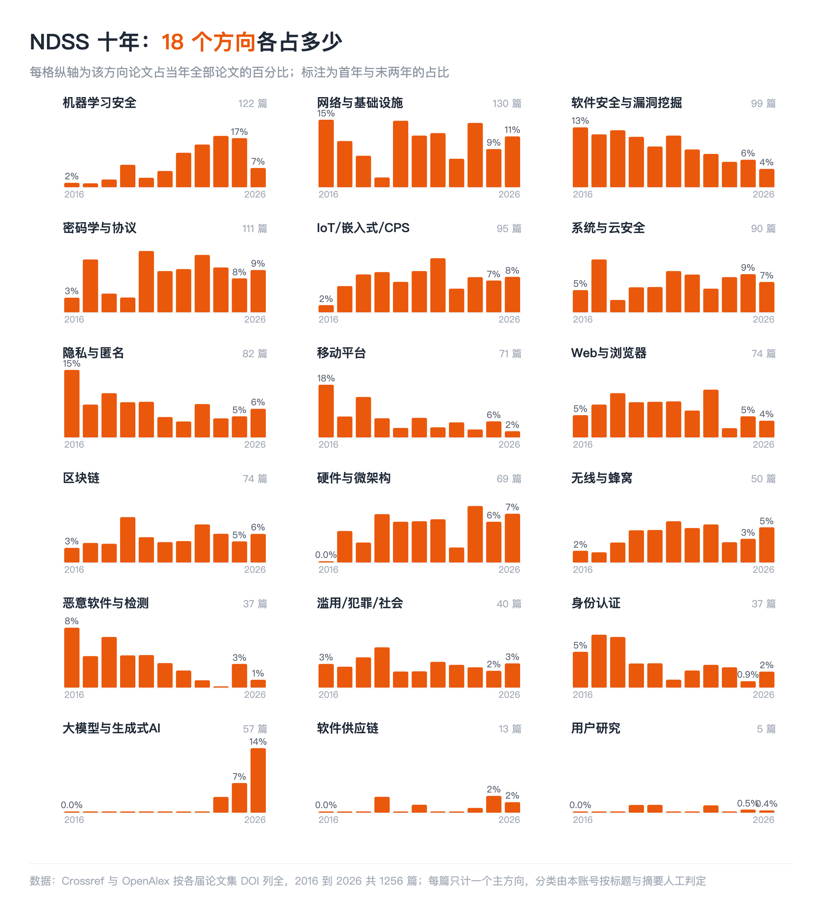
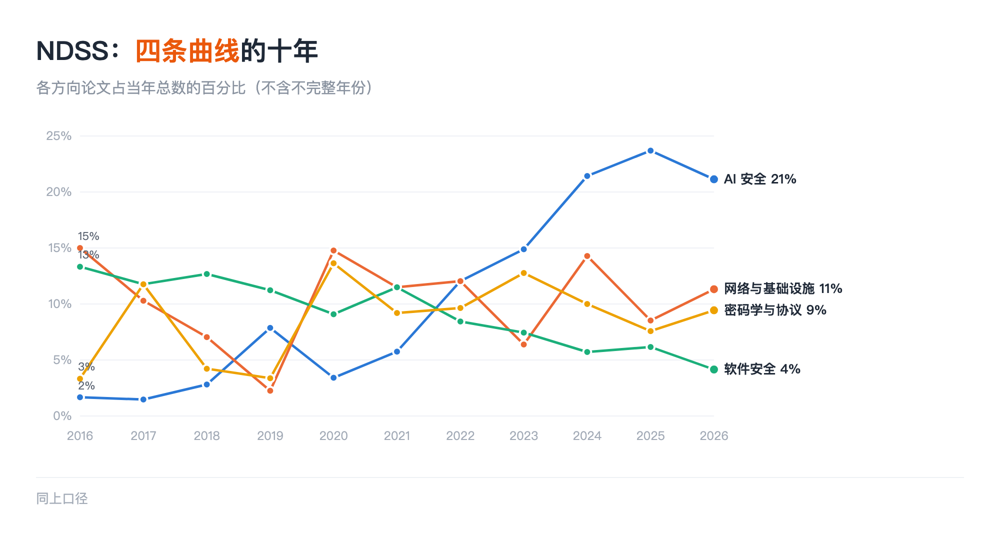
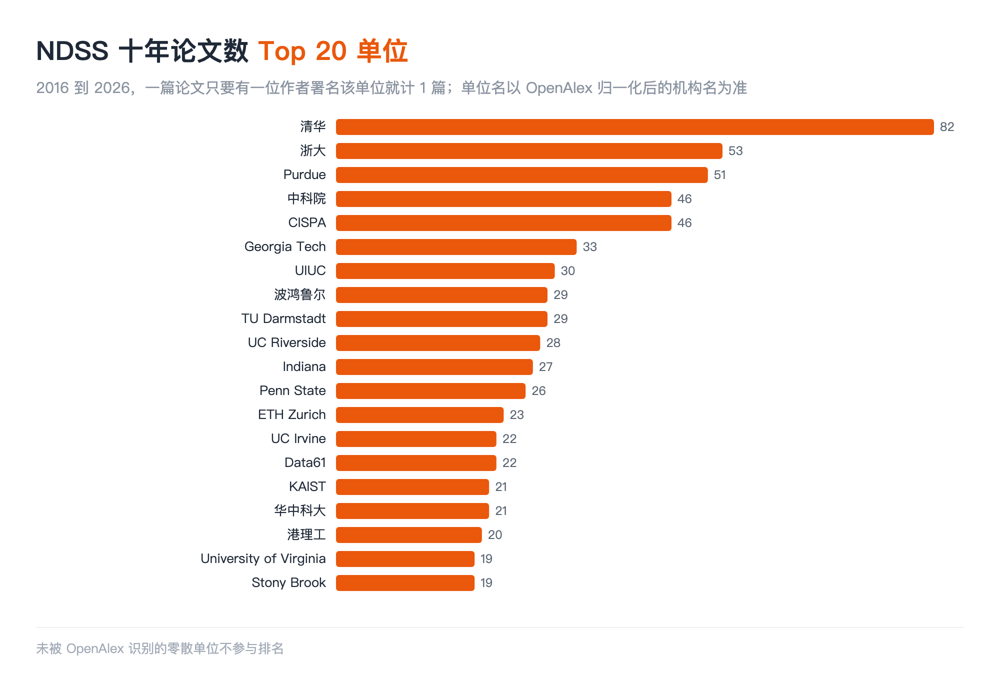
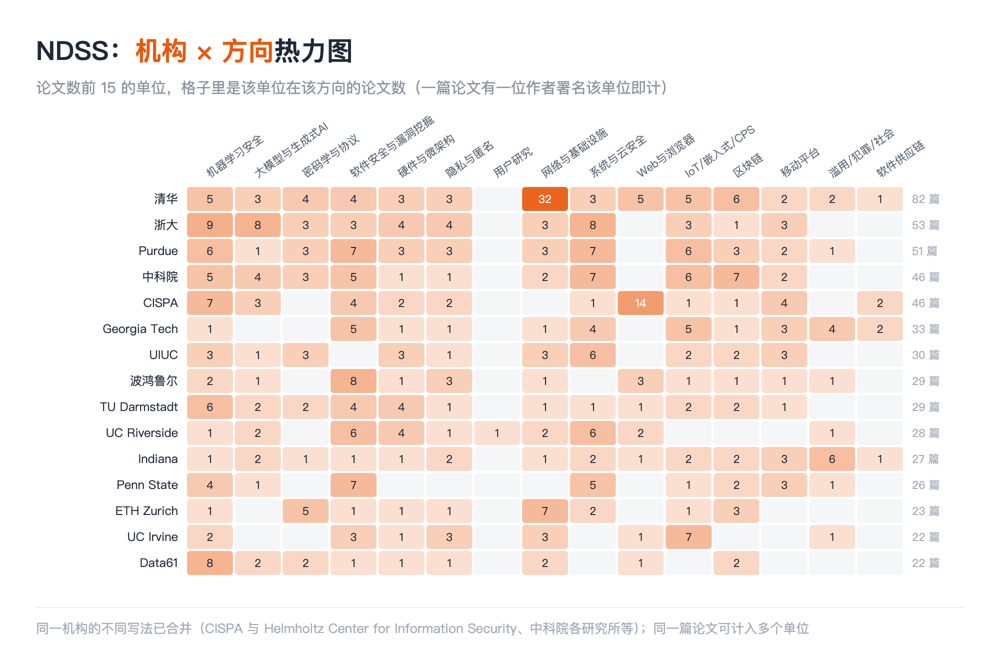
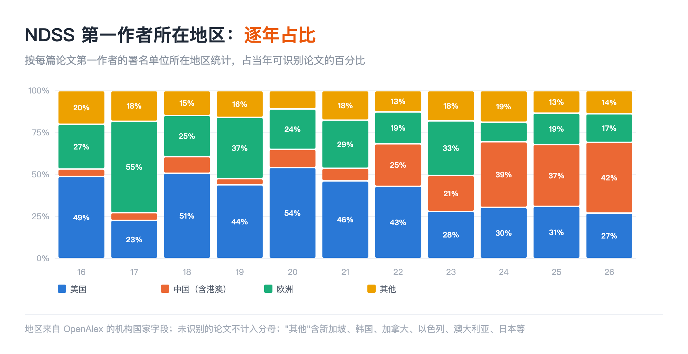

## LIST INFO|本期说明

【范围】Network and Distributed System Security Symposium（NDSS）2016 到 2026 十一届的全部正式论文，共 1256 篇。NDSS 每年 2 月底开会，2026 届已经开过，数据是完整的
【来源】按每届论文集的 DOI（10.14722/ndss.年份）从 Crossref 列全标题与作者，再用 OpenAlex 补摘要、作者单位和国家，逐年和 DBLP 目录核对过；同期的 workshop 论文（MADWeb、VehicleSec、SDIoTSec 等）和 poster 不计
【口径】每篇只归一个主方向（可带一个次方向），共 18 个方向，判定依据是标题和摘要，分类体系与本系列 USENIX Security、CCS、S&P 三期一致。分类是逐篇人工判定，同一篇论文换个人分可能落到相邻方向，个位数的出入不影响趋势。另外，2017 届有 68% 的论文在 OpenAlex 里没有作者单位，那一年的单位和地区统计缺失严重，图 3 和图 4 里 2017 年的数据要打折扣看

@stats
- 60 → 265 篇 | 年接收量，2023 年之后三年翻了近三倍
- 2% → 24% | AI 安全（机器学习加大模型）2016 到 2025 年的份额
- 15% → 11% | 网络与基础设施的份额，十年里只有两年跌破一成
- 18% → 2% | 移动平台的份额，跌幅最大的方向

先交代规模。NDSS 2016 只有 60 篇，2023 年 94 篇，然后 2024 年 140 篇、2025 年 211 篇、2026 年 265 篇，三年翻了近三倍。这个扩张节奏和 USENIX Security 2023 年那次跳变（256 到 422）很像，都是审稿制改成多轮滚动投稿之后的结果。所以看趋势不能看绝对数，得看占比，下面所有的"涨"和"跌"说的都是份额。

NDSS 的另一个特点是它的名字。"网络与分布式系统安全"这个名字在 2016 年还名副其实：网络安全 15%、移动平台 18%、隐私 15% 三个方向占了近一半。十年之后，网络安全守住了，移动和隐私都让出了位置给 AI。

## BIG PICTURE|十年三个大迁移

#### AI 安全从 1 篇到第一大方向

2016 年只有 1 篇论文在讲攻击机器学习，就是 **Automatically Evading Classifiers: A Case Study on PDF Malware Classifiers**，用遗传算法自动改 PDF 绕过恶意软件分类器。2019 年机器学习安全跳到 7 篇，2022 年 10 篇（12.0%），2023 年 14 篇（14.9%），2025 年机器学习加大模型合计 50 篇（23.8%），2026 年 56 篇（21.1%）。其中大模型这一支 2024 年 5 篇，2025 年 14 篇，2026 年 38 篇（14.3%），一年翻了近三倍。把次方向算进去，2026 年涉及 AI 安全的论文有 95 篇，占 36%。

#### 网络安全守住了一成以上，是 NDSS 的看家本领

网络与基础设施十年 130 篇，份额在 6% 到 15% 之间，2020 年 14.8%，2024 年 14.3%，2026 年 11.3%。这是四大会里网络安全份额最高的一家（USENIX Security 5% 上下，CCS 4% 上下，S&P 3% 上下）。DNS、BGP、RPKI、审查测量、加密流量分类，NDSS 上每一届都有。

#### 移动平台从 18% 跌到 2%，隐私从 15% 跌到 6%

2016 年移动平台 11 篇、18.3%，是当年第一大方向；2026 年 6 篇、2.3%。隐私与匿名从 2016 年的 9 篇、15% 跌到 2026 年的 6.4%。这两个方向的跌幅加起来，正好等于 AI 安全的涨幅。==NDSS 十年最大的变化，是"网络会议"变成了"网络加 AI 的会议"==。

## AI|AI 安全：179 篇，三个阶段

机器学习安全 122 篇加大模型 57 篇，合计 179 篇。曲线分三段。

@timeline
- 2016 | Automatically Evading Classifiers: A Case Study on PDF Malware Classifiers | NDSS 上第一篇攻击机器学习的论文，对象是安全领域自己的分类器
- 2018 | Trojaning Attack on Neural Networks | 不用训练数据就能往神经网络里植入木马，后门攻击的奠基作之一
- 2018 | Feature Squeezing: Detecting Adversarial Examples in Deep Neural Networks | 用特征压缩检测对抗样本，早期最常被拿来比较的防御
- 2019 | ML-Leaks: Model and Data Independent Membership Inference Attacks and Defenses on Machine Learning Models | 把成员推断攻击的假设放宽到不需要影子模型和同分布数据
- 2021 | FLTrust: Byzantine-robust Federated Learning via Trust Bootstrapping | 用服务器端的小数据集给联邦学习的客户端打信任分
- 2023 | Machine Unlearning of Features and Labels | 机器遗忘从"忘掉样本"扩到"忘掉特征和标签"
- 2024 | MASTERKEY: Automated Jailbreaking of Large Language Model Chatbots | 用时间侧信道逆向聊天机器人的防御，再自动生成越狱提示
- 2025 | Safety Misalignment Against Large Language Models | 系统研究让对齐过的模型重新失去对齐的攻击面
- 2026 | Prompt Injection Attack to Tool Selection in LLM Agents | 攻击目标从 LLM 的回答换成 Agent 选哪个工具

#### 2016 到 2020：安全领域自己的分类器先被打

早期的机器学习安全论文有一个特点：攻击对象往往是安全领域自己用的模型。2016 年打 PDF 恶意软件分类器，2017 年 **Fake Co-visitation Injection Attacks to Recommender Systems** 打推荐系统，2019 年 **TextBugger: Generating Adversarial Text Against Real-world Applications** 打商用文本分类服务，**Practical Hidden Voice Attacks against Speech and Speaker Recognition Systems** 和 **Adversarial Attacks Against Automatic Speech Recognition Systems via Psychoacoustic Hiding** 打语音识别。2018 年 **Trojaning Attack on Neural Networks** 是这批里影响最大的：不需要原始训练数据，逆向出触发器再重训练部分层就能植入后门，后来所有后门论文都要和它比。

#### 2021 到 2023：联邦学习和隐私接管

2021 年之后联邦学习成了主线：**FLTrust**、**Manipulating the Byzantine: Optimizing Model Poisoning Attacks and Defenses for Federated Learning**，2022 年 **DeepSight: Mitigating Backdoor Attacks in Federated Learning Through Deep Model Inspection** 和 **Local and Central Differential Privacy for Robustness and Privacy in Federated Learning**，2024 年 **FreqFed** 和 **CrowdGuard**，2025 年 **Do We Really Need to Design New Byzantine-robust Aggregation Rules?** 回头质疑这条线是否还需要新的聚合规则。隐私那一支从 2019 年 ML-Leaks 开始，2021 年 **Practical Blind Membership Inference Attack via Differential Comparisons**，2022 年 **MIRROR: Model Inversion for Deep Learning Network with High Fidelity** 和 **Property Inference Attacks Against GANs**，2024 年 **A Duty to Forget, a Right to be Assured? Exposing Vulnerabilities in Machine Unlearning Services** 指出机器遗忘服务本身有漏洞。

模型知识产权和数据审计是 2024 年之后的新支：**SSL-WM: A Black-Box Watermarking Approach for Encoders Pre-trained by Self-Supervised Learning**、**GraphGuard: Detecting and Counteracting Training Data Misuse in Graph Neural Networks**、**ORL-AUDITOR: Dataset Auditing in Offline Deep Reinforcement Learning**，2025 年 **Provably Unlearnable Data Examples**（杰出论文）给"不可学习样本"做了可证明的保证，2026 年 **VICTOR: Dataset Copyright Auditing in Video Recognition Systems**。

#### 2024 到 2026：大模型接管

大模型方向 2024 年 5 篇，2025 年 14 篇，2026 年 38 篇。2024 年的五篇里，**MASTERKEY** 是第一篇自动越狱商用聊天机器人的论文，**LMSanitator: Defending Prompt-Tuning Against Task-Agnostic Backdoors**（杰出论文）防 prompt-tuning 里的后门，**DeGPT: Optimizing Decompiler Output with LLM** 用 LLM 改反编译输出。2025 年题材扩到 LLM 系统本身：**IsolateGPT: An Execution Isolation Architecture for LLM-Based Systems** 给 LLM 应用做执行隔离，**I Know What You Asked: Prompt Leakage via KV-Cache Sharing in Multi-Tenant LLM Serving** 从多租户推理服务的 KV 缓存共享里泄露提示，**The Philosopher's Stone: Trojaning Plugins of Large Language Models** 往插件里下木马。

2026 年的 38 篇可以分成五组：

- Agent 与工具：**Prompt Injection Attack to Tool Selection in LLM Agents**、**ObliInjection: Order-Oblivious Prompt Injection Attack to LLM Agents with Multi-source Data**、**Les Dissonances: Cross-Tool Harvesting and Polluting in Pool-of-Tools Empowered LLM Agents**、**SAGA: A Security Architecture for Governing AI Agentic Systems**、**ACE: A Security Architecture for LLM-Integrated App Systems**
- 推理服务的系统安全：**Cache Me, Catch You: Cache Related Security Threats in LLM Serving Frameworks**、**Shadow in the Cache: Unveiling and Mitigating Privacy Risks of KV-cache in LLM Inference**、**When Cache Poisoning Meets LLM Systems: Semantic Cache Poisoning and Its Countermeasures**、**ThinkTrap: Denial-of-Service Attacks against Black-box LLM Services via Infinite Thinking**
- 越狱与对齐：**NeuroStrike: Neuron-Level Attacks on Aligned LLMs**、**DUALBREACH**、**Odysseus: Jailbreaking Commercial Multimodal LLM-integrated Systems via Dual Steganography**、**Bleeding Pathways: Vanishing Discriminability in LLM Hidden States Fuels Jailbreak Attacks**
- LLM 做安全任务：**FidelityGPT: Correcting Decompilation Distortions with Retrieval Augmented Generation**、**LLMBisect: Breaking Barriers in Bug Bisection with A Comparative Analysis Pipeline**、**What Do They Fix? LLM-Aided Categorization of Security Patches for Critical Memory Bugs**，以及反过来打 LLM 分析工具的 **Trust Me, I Know This Function: Hijacking LLM Static Analysis using Bias**
- 治理与测量：**There is No War in Ba Sing Se: A Global Analysis of Content Moderation in Large Language Models**、**Characterizing the Implementation of Censorship Policies in Chinese LLM Services**、**Benchmarking and Understanding Safety Risks in AI Character Platforms**

2026 年还有一篇 **Chasing Shadows: Pitfalls in LLM Security Research**，系统梳理了 LLM 安全研究里的方法论陷阱。一个方向出现"审视自己"的论文，通常说明它已经过了野蛮生长期。

> NDSS 上 AI 安全的三段，攻击对象分别是"安全自己的模型"、"训练过程"和"LLM 系统"。到 2026 年，==三分之一的 LLM 安全论文打的不是模型，是模型周围的缓存、工具、插件和服务框架==，这和 CCS、USENIX 上的走向完全一致。

## NET|网络与基础设施：130 篇，NDSS 的看家本领

网络安全十年 130 篇，是 NDSS 上仅次于 AI 的第二大方向。题材分四条线。

#### 路由与 RPKI

这是 NDSS 上最连贯的一条线。2017 年 **Are We There Yet? On RPKI's Deployment and Security** 第一次系统测量 RPKI 的部署，2020 年 **DISCO: Sidestepping RPKI's Deployment Barriers** 和 **Withdrawing the BGP Re-Routing Curtain: Understanding the Security Impact of BGP Poisoning through Real-World Measurements**，2021 年 **ROV++: Improved Deployable Defense against BGP Hijacking** 和 **Flexsealing BGP Against Route Leaks: Peerlock Active Measurement and Analysis**，2022 年 **ROV-MI: Large-Scale, Accurate and Efficient Measurement of ROV Deployment**，2024 年一届四篇（**The CURE to Vulnerabilities in RPKI Validation**、**BGP-iSec: Improved Security of Internet Routing Against Post-ROV Attacks**、**dRR: A Decentralized, Scalable, and Auditable Architecture for RPKI Repository**、**Understanding Route Origin Validation Deployment in the Real World and Why MANRS Action 1 Is Not Followed**），2025 年 **Securing BGP ASAP: ASPA and other Post-ROV Defenses**，2026 年 **Pruning the Tree: Rethinking RPKI Architecture from the Ground up**、**Crack in the Armor: Underlying Infrastructure Threats to RPKI Publication Point Reachability** 和 **Demystifying RPKI-Invalid Prefixes: Hidden Causes and Security Risks** 三篇。RPKI 从"有没有人部署"到"部署了能不能防住"再到"RPKI 自己安不安全"，十年在 NDSS 上走完了三个阶段。

#### DNS、TCP 和时间

2016 年 **Attacking the Network Time Protocol** 是 NTP 安全的开端，2018 年 **Preventing (Network) Time Travel with Chronos**，2021 年 **A Devil of a Time: How Vulnerable is NTP to Malicious Timeservers?**，2026 年 **On Borrowed Time: Measurement-Informed Understanding of the NTP Pool's Robustness to Monopoly Attacks**。TCP 侧信道从 2020 年 **SymTCP: Eluding Stateful Deep Packet Inspection with Automated Discrepancy Discovery** 到 2022 年 **PMTUD is not Panacea: Revisiting IP Fragmentation Attacks against TCP**，再到 2024 年 **Exploiting Sequence Number Leakage: TCP Hijacking in NAT-Enabled Wi-Fi Networks** 和 2025 年 **Off-Path TCP Hijacking in Wi-Fi Networks: A Packet-Size Side Channel Attack**。DNS 这边，2023 年 **Ghost Domain Reloaded: Vulnerable Links in Domain Name Delegation and Revocation** 让十年前的幽灵域名攻击复活，同年 **Your Router is My Prober: Measuring IPv6 Networks via ICMP Rate Limiting Side Channels**（杰出论文）用路由器的 ICMP 速率限制测 IPv6 网络，2026 年 **Should I Trust You? Rethinking the Principle of Zone-Based Isolation DNS Bailiwick Checking** 重新审视 bailiwick 规则。

#### 审查测量与规避

2020 年一届三篇：**MassBrowser: Unblocking the Censored Web for the Masses, by the Masses**、**Decentralized Control: A Case Study of Russia**、**Measuring the Deployment of Network Censorship Filters at Global Scale**。2024 年 **Modeling and Detecting Internet Censorship Events** 和 **On Precisely Detecting Censorship Circumvention in Real-World Networks**，2025 年 **Wallbleed: A Memory Disclosure Vulnerability in the Great Firewall of China** 发现 GFW 的 DNS 注入器有内存泄露漏洞，能从它的内存里读出数据，2026 年 **Mirage: Private, Mobility-based Routing for Censorship Evasion** 和 **Huma: Censorship Circumvention via Web Protocol Tunneling with Deferred Traffic Replacement**。

#### 加密流量与入侵检测

2018 年 **Kitsune: An Ensemble of Autoencoders for Online Network Intrusion Detection** 是被引最多的 NDSS 网络论文之一，2023 年 **Detecting Unknown Encrypted Malicious Traffic in Real Time via Flow Interaction Graph Analysis**，2024 年 **Low-Quality Training Data Only? A Robust Framework for Detecting Encrypted Malicious Network Traffic**，2026 年 **A Hard-Label Black-Box Evasion Attack against ML-based Malicious Traffic Detection Systems** 反过来打这类检测器。清华在这个方向一家 32 篇，是第二名的四倍多，RPKI 测量、TCP 侧信道、DNS、DDoS 检测、邮件安全都有。

## SWSEC|软件安全与漏洞挖掘：从 13% 到 4%，fuzzing 的黄金期在 NDSS

软件安全十年 99 篇，份额从 2016 年的 13.3% 降到 2026 年的 4.2%。绝对数没怎么变（8 到 13 篇），是分母涨了。这个方向在 NDSS 上的黄金期是 2016 到 2019 年，fuzzing 的几篇奠基作都在这里。

@timeline
- 2016 | Driller: Augmenting Fuzzing Through Selective Symbolic Execution | 混合 fuzzing 的开端，AFL 卡住时切符号执行
- 2017 | VUzzer: Application-aware Evolutionary Fuzzing | 用轻量的静态和动态分析给变异提供反馈
- 2017 | Ramblr: Making Reassembly Great Again | 二进制重组装的系统化方法，当年杰出论文
- 2018 | IoTFuzzer: Discovering Memory Corruptions in IoT Through App-based Fuzzing | 不碰固件，从手机 App 端 fuzz IoT 设备
- 2018 | What You Corrupt Is Not What You Crash: Challenges in Fuzzing Embedded Devices | 嵌入式设备 fuzzing 为什么难，问题定义之作
- 2019 | REDQUEEN: Fuzzing with Input-to-State Correspondence | 输入到状态的对应关系，解决魔数和校验和
- 2019 | NAUTILUS: Fishing for Deep Bugs with Grammars | 语法感知的 fuzzing
- 2020 | HYPER-CUBE: High-Dimensional Hypervisor Fuzzing | 用自定义操作系统 fuzz hypervisor
- 2021 | SymQEMU: Compilation-based symbolic execution for binaries | 把 SymCC 的编译式符号执行搬到二进制
- 2023 | FUZZILLI: Fuzzing for JavaScript JIT Compiler Vulnerabilities | JavaScript 引擎 fuzzer 的正式论文
- 2024 | Large Language Model guided Protocol Fuzzing | 用 LLM 从 RFC 里提取协议状态机指导 fuzzing

2016 到 2019 年是这个方向的高峰，Driller、VUzzer、REDQUEEN、NAUTILUS 四篇奠定了灰盒 fuzzing 从"覆盖率反馈"到"输入结构感知"的路线。同期还有内存安全防御的一批：2016 年 **Protecting C++ Dynamic Dispatch Through VTable Interleaving** 和 **VTrust: Regaining Trust on Virtual Calls**，2017 年 **SafeInit: Comprehensive and Practical Mitigation of Uninitialized Read Vulnerabilities**，2018 年 **CFIXX: Object Type Integrity for C++**。

2020 年之后题材分散：2020 年 **Precisely Characterizing Security Impact in a Flood of Patches via Symbolic Rule Comparison** 给内核补丁判断是不是安全补丁，2021 年 **Shadow Attacks: Hiding and Replacing Content in Signed PDFs** 打签名 PDF，2022 年 **Cross-Language Attacks** 指出 Rust 和 C 混用时的攻击面，2024 年 **QUACK: Hindering Deserialization Attacks via Static Duck Typing** 和 **Automatic Policy Synthesis and Enforcement for Protecting Untrusted Deserialization** 两篇都在防反序列化，2025 年 **Translating C To Rust: Lessons from a User Study** 研究人怎么把 C 翻成 Rust。

二进制分析和机器学习的交叉在 NDSS 上有一条清楚的线：2019 年 **Neural Machine Translation Inspired Binary Code Similarity Comparison beyond Function Pairs**，2020 年 **DeepBinDiff: Learning Program-Wide Code Representations for Binary Diffing**，2021 年 **XDA: Accurate, Robust Disassembly with Transfer Learning**，2025 年 **Beyond Classification: Inferring Function Names in Stripped Binaries via Domain Adapted LLMs**，2026 年 **Idioms: A Simple and Effective Framework for Turbo-Charging Local Neural Decompilation with Well-Defined Types** 和 **A Deep Dive into Function Inlining and its Security Implications for ML-based Binary Analysis**。

## SHRINK|移动与隐私：让出位置的两个方向

#### 移动平台：从第一大方向到 2%

2016 年移动平台 11 篇，占 18.3%，是当年 NDSS 的第一大方向；2026 年 6 篇，2.3%。2016 年的题材是 Android 平台机制：**Kratos: Discovering Inconsistent Security Policy Enforcement in the Android Framework**、**FLEXDROID: Enforcing In-App Privilege Separation in Android**，2017 年 **WindowGuard: Systematic Protection of GUI Security in Android**，2018 年 **AceDroid: Normalizing Diverse Android Access Control Checks for Inconsistency Detection** 和 **Resolving the Predicament of Android Custom Permissions**（杰出论文）。这条"框架不一致性"的线在 2022 年 **Uncovering Cross-Context Inconsistent Access Control Enforcement in Android** 还有延续。

2020 年之后题材转向生态和应用：2024 年 **50 Shades of Support: A Device-Centric Analysis of Android Security Updates** 测量安全更新的设备覆盖，2025 年 **Vulnerability, Where Art Thou? An Investigation of Vulnerability Management in Android Smartphone Chipsets** 追芯片组厂商的漏洞管理，**An Empirical Study on Fingerprint API Misuse with Lifecycle Analysis in Real-world Android Apps**（杰出论文）。小程序是中国团队带来的新题材：2025 年 **Understanding Miniapp Malware: Identification, Dissection, and Characterization** 和 **The Skeleton Keys: A Large Scale Analysis of Credential Leakage in Mini-apps**，2026 年 **Better Safe than Sorry: Uncovering the Insecure Resource Management in App-in-App Cloud Services**。

#### 隐私与匿名：Tor 的时代过去了

隐私方向 82 篇，从 2016 年的 15% 跌到 2026 年的 6.4%。跌的主要是 Tor：2016 年 **Measuring and Mitigating AS-level Adversaries Against Tor** 和 **Website Fingerprinting at Internet Scale**，2017 年 **The Effect of DNS on Tor's Anonymity**、**Avoiding The Man on the Wire: Improving Tor's Security with Trust-Aware Path Selection** 和 **HisTore: Differentially Private and Robust Statistics Collection for Tor**，2018 年 **Automated Website Fingerprinting through Deep Learning** 和 **Inside Job: Applying Traffic Analysis to Measure Tor from Within**。2020 年之后 Tor 论文每年只剩一两篇，2024 年 **MirageFlow: A New Bandwidth Inflation Attack on Tor**，2026 年 **CELLSHIFT: RTT-Aware Trace Transduction for Real-World Website Fingerprinting**。

留下来的是差分隐私和混合网络。差分隐私这一支在 NDSS 上一直不大，2020 年 **Locally Differentially Private Frequency Estimation with Consistency**，2025 年 **On the Robustness of LDP Protocols for Numerical Attributes under Data Poisoning Attacks**，2026 年 **To Shuffle or not to Shuffle: Auditing DP-SGD with Shuffling** 审计 DP-SGD 里洗牌带来的隐私损失差异。混合网络是 2024 年之后的新支：**LARMix: Latency-Aware Routing in Mix Networks**，2025 年 **LAMP**，2026 年 **When Mixnets Fail: Evaluating, Quantifying, and Mitigating the Impact of Adversarial Nodes in Mix Networks** 和 **OptiMix**。

2026 年有一篇值得单说：**Hey there! You are using WhatsApp: Enumerating Three Billion Accounts for Security and Privacy** 通过联系人发现机制枚举了三十亿 WhatsApp 账号。2021 年的 **All the Numbers are US: Large-scale Abuse of Contact Discovery in Mobile Messengers** 是同一个问题的前作，五年过去，规模从百万级到了十亿级。

## CRYPTO|密码学与协议：从 3% 到 9%，偏应用

密码学 111 篇，份额从 2016 年的 3.3% 涨到 2026 年的 9.4%，2020 年 13.6% 是高峰。NDSS 的密码学和 CCS 不同，更偏应用和协议分析。

TLS 和协议分析是早期主线：2016 年 **Transcript Collision Attacks: Breaking Authentication in TLS, IKE, and SSH** 是 SLOTH 攻击，同年 **Killed by Proxy: Analyzing Client-end TLS Interception Software**，2017 年 **The Security Impact of HTTPS Interception**（这篇的结论直接影响了浏览器厂商对 TLS 拦截的态度）和 **Indiscreet Logs: Diffie-Hellman Backdoors in TLS**，2017 年还有 **WireGuard: Next Generation Kernel Network Tunnel**，是 WireGuard 的正式论文，2024 年 **A Unified Symbolic Analysis of WireGuard** 又回头给它做了符号分析。后量子这条线从 2020 年 **Post-Quantum Authentication in TLS 1.3: A Performance Study** 到 2025 年 **PQConnect: Automated Post-Quantum End-to-End Tunnels** 和 2026 年 **Looma: A Low-Latency PQTLS Authentication Architecture for Cloud Applications**。

隐私计算在 NDSS 上的主题是"给机器学习用"：2020 年 **BLAZE: Blazing Fast Privacy-Preserving Machine Learning** 和 **Trident: Efficient 4PC Framework for Privacy Preserving Machine Learning**，2021 年 **POSEIDON: Privacy-Preserving Federated Neural Network Learning**，2022 年 **Tetrad: Actively Secure 4PC for Secure Training and Inference**，2025 年三篇做 Transformer 的安全推理（**BumbleBee: Secure Two-party Inference Framework for Large Transformers**、**SHAFT**、**Secure Transformer Inference Made Non-interactive**），2026 年 **STIP: Three-Party Privacy-Preserving and Lossless Inference for Large Transformers in Production** 已经写到了生产环境。

另一条线是密码实现的测试：2024 年 **Towards Precise Reporting of Cryptographic Misuses**，2025 年 **MTZK: Testing and Exploring Bugs in Zero-Knowledge (ZK) Compilers** 测 ZK 编译器，这是零知识证明从"怎么证"走到"编译器有没有 bug"的信号。

## SYS|系统与硬件：TEE 和内核

系统安全 90 篇加硬件 69 篇。两个方向在 NDSS 上的交界是 TEE。

SGX 那一波从 2016 年 **OpenSGX: An Open Platform for SGX Research** 开始，2017 年一届三篇（**Panoply: Low-TCB Linux Applications with SGX Enclaves**、**T-SGX: Eradicating Controlled-Channel Attacks Against Enclave Programs**、**SGX-Shield: Enabling Address Space Layout Randomization for SGX Programs**），2018 年 **OBLIVIATE: A Data Oblivious Filesystem for Intel SGX** 和 **ZeroTrace : Oblivious Memory Primitives from Intel SGX**，2019 年 **SANCTUARY: ARMing TrustZone with User-space Enclaves** 和 **TIMBER-V: Tag-Isolated Memory Bringing Fine-grained Enclaves to RISC-V** 把 enclave 搬到 ARM 和 RISC-V。2024 年之后是机密虚拟机：**EnclaveFuzz: Finding Vulnerabilities in SGX Applications**，2025 年 **CounterSEVeillance: Performance-Counter Attacks on AMD SEV-SNP** 和 **The Road to Trust: Building Enclaves within Confidential VMs**，2026 年 **SNPeek: Side-Channel Analysis for Privacy Applications on Confidential VMs** 和 **SoK: Analysis of Accelerator TEE Designs**。

内核安全的主线是漏洞挖掘和利用。2017 年 **Unleashing Use-Before-Initialization Vulnerabilities in the Linux Kernel Using Targeted Stack Spraying**，2018 年 **K-Miner: Uncovering Memory Corruption in Linux**，2020 年 **HFL: Hybrid Fuzzing on the Linux Kernel**，2022 年 **Preventing Kernel Hacks with HAKCs**（杰出论文）用 ARM 的指针认证和内存标签做内核分区，2023 年 **No Grammar, No Problem: Towards Fuzzing the Linux Kernel without System-Call Descriptions**，2024 年 **K-LEAK: Towards Automating the Generation of Multi-Step Infoleak Exploits against the Linux Kernel** 和 **SyzBridge: Bridging the Gap in Exploitability Assessment of Linux Kernel Bugs in the Linux Ecosystem**，2026 年 **DirtyFree: Simplified Data-Oriented Programming in the Linux Kernel** 和 **Cross-Cache Attacks for the Linux Kernel via PCP Massaging**。

溯源图和攻击调查是 NDSS 和 CCS 共享的一条线：2016 年 **ProTracer: Towards Practical Provenance Tracing by Alternating Between Logging and Tainting**，2019 年 **NoDoze: Combatting Threat Alert Fatigue with Automated Provenance Triage**，2020 年 **Unicorn: Runtime Provenance-Based Detector for Advanced Persistent Threats**，2021 年 **WATSON: Abstracting Behaviors from Audit Logs via Aggregation of Contextual Semantics**，2023 年 **Sometimes, You Aren't What You Do: Mimicry Attacks against Provenance Graph Host Intrusion Detection Systems** 反过来打这类检测器，2024 年 **NODLINK: An Online System for Fine-Grained APT Attack Detection and Investigation**。

硬件方向 TU Graz 一家 12 篇，是该方向第一：2017 年 **ASLR on the Line: Practical Cache Attacks on the MMU**，2018 年 **KeyDrown: Eliminating Software-Based Keystroke Timing Side-Channel Attacks**，2020 年 **ConTExT: A Generic Approach for Mitigating Spectre**，2024 年 **IdleLeak: Exploiting Idle State Side Effects for Information Leakage**，2025 年 **Secret Spilling Drive: Leaking User Behavior through SSD Contention**、**KernelSnitch: Side Channel-Attacks on Kernel Data Structures** 和 **A Systematic Evaluation of Novel and Existing Cache Side Channels**，2026 年 **Memory Band-Aid: A Principled Rowhammer Defense-in-Depth**。2026 年的四篇最佳论文里有两篇是硬件侧信道：**OCCUPY+PROBE: Cross-Privilege Branch Target Buffer Side-Channel Attacks at Instruction Granularity** 和 **Peering Inside the Black-Box: Long-Range and Scalable Model Architecture Snooping via GPU Electromagnetic Side-Channel**，后者从几米外用 GPU 的电磁辐射推断模型结构。

## IOT|IoT、嵌入式与无线：物理世界的攻击

IoT 方向 95 篇，从 2016 年的 1.7% 涨到 2022 年的 12%，之后稳在 8% 左右；无线 50 篇，从 1.7% 涨到 4.9%。两个方向加起来是 NDSS 上"物理世界安全"的主场。

传感器和物理信道攻击是 NDSS 的特色题材。2020 年 **SurfingAttack: Interactive Hidden Attack on Voice Assistants Using Ultrasonic Guided Waves** 通过桌面传导超声波给语音助手下命令，2022 年 **GhostTalk: Interactive Attack on Smartphone Voice System Through Power Line** 通过电源线，2023 年 **Paralyzing Drones via EMI Signal Injection on Sensory Communication Channels** 和 **Un-Rocking Drones: Foundations of Acoustic Injection Attacks and Recovery Thereof** 打无人机，2025 年一届四篇：**ReThink: Reveal the Threat of Electromagnetic Interference on Power Inverters**（杰出论文，电磁干扰打光伏逆变器）、**GhostShot: Manipulating the Image of CCD Cameras with Electromagnetic Interference**、**PowerRadio: Manipulate Sensor Measurement via Power GND Radiation**、**LightAntenna: Characterizing the Limits of Fluorescent Lamp-Induced Electromagnetic Interference**，2026 年 **SoK: Understanding the Fundamentals and Implications of Sensor Out-of-band Vulnerabilities** 给这一类"带外"传感器攻击做了系统化。

自动驾驶从 2022 年 **Too Afraid to Drive: Systematic Discovery of Semantic DoS Vulnerability in Autonomous Driving Planning under Physical-World Attacks** 开始，2024 年 **LiDAR Spoofing Meets the New-Gen: Capability Improvements, Broken Assumptions, and New Attack Strategies**，2025 年 **On the Realism of LiDAR Spoofing Attacks against Autonomous Driving Vehicle at High Speed and Long Distance** 和 **PhantomLiDAR: Cross-modality Signal Injection Attacks against LiDAR**，2026 年 **FlyTrap: Physical Distance-Pulling Attack Towards Camera-based Autonomous Target Tracking Systems**。

蜂窝网络是无线方向的主线：2016 年 **Practical Attacks Against Privacy and Availability in 4G/LTE Mobile Communication Systems**，2018 年 **LTEInspector: A Systematic Approach for Adversarial Testing of 4G LTE**，2019 年 **Component-Based Formal Analysis of 5G-AKA: Channel Assumptions and Session Confusion** 和 **Privacy Attacks to the 4G and 5G Cellular Paging Protocols Using Side Channel Information**，2020 年 **IMP4GT: IMPersonation Attacks in 4G NeTworks**，2022 年 **FirmWire: Transparent Dynamic Analysis for Cellular Baseband Firmware** 让基带固件可以被动态分析，2024 年 **5G-Spector: An O-RAN Compliant Layer-3 Cellular Attack Detection Service**，2026 年 **Small Cell, Big Risk: A Security Assessment of 4G LTE Femtocells in the Wild**。工控和固件那一支从 2017 年 **Hey, My Malware Knows Physics! Attacking PLCs with Physical Model Aware Rootkit** 到 2024 年 **Compromising Industrial Processes using Web-Based Programmable Logic Controller Malware** 再到 2026 年 **Discovering Blind-Trust Vulnerabilities in PLC Binaries via State Machine Recovery**，PLC 被打了十年。

## CHAIN|区块链：74 篇，共识与支付通道

区块链 74 篇，2019 年 10.1% 是高峰，2026 年 6.4%。NDSS 上这个方向早期偏协议：2016 年 **Centrally Banked Cryptocurrencies** 是 RSCoin，比各国央行的 CBDC 讨论早了好几年；2017 年 **TumbleBit: An Untrusted Bitcoin-Compatible Anonymous Payment Hub**，2018 年 **Chainspace: A Sharded Smart Contracts Platform**，2019 年 **Anonymous Multi-Hop Locks for Blockchain Scalability and Interoperability**（这篇是闪电网络隐私和跨链的基础）和 **SABRE: Protecting Bitcoin against Routing Attacks**。

2020 年之后偏系统和测量：**Broken Metre: Attacking Resource Metering in EVM** 打以太坊的 gas 计量，2021 年 **As Strong As Its Weakest Link: How to Break Blockchain DApps at RPC Service**，2023 年 **LOKI: State-Aware Fuzzing Framework for the Implementation of Blockchain Consensus Protocols** fuzz 共识协议的实现，**BlockScope: Detecting and Investigating Propagated Vulnerabilities in Forked Blockchain Projects** 追踪分叉链里传播的漏洞，2024 年 **Abusing the Ethereum Smart Contract Verification Services for Fun and Profit**，2025 年 **Mysticeti: Reaching the Latency Limits with Uncertified DAGs** 是 Sui 的新共识，2026 年 **BunnyFinder: Finding Incentive Flaws for Ethereum Consensus** 和 **Validity Is Not Enough: Uncovering the Security Pitfall in Chainlink's Off-Chain Reporting Protocol**。

## SUPPLY|软件供应链：12 篇，2025 年之后才成气候

这是本账号最关心的方向，也是 NDSS 上最小的方向之一：十一年 13 篇，2025 年之前每年不超过 2 篇。2019 年 **How Bad Can It Git? Characterizing Secret Leakage in Public GitHub Repositories** 第一次大规模测量 GitHub 上的密钥泄露，是这个题材被引最多的论文；同年 **Automating Patching of Vulnerable Open-Source Software Versions in Application Binaries** 给 Android 应用里的开源库二进制打补丁。2021 年 **Towards Measuring Supply Chain Attacks on Package Managers for Interpreted Languages** 系统测量 npm、PyPI 和 RubyGems 上的恶意包，是恶意包检测这条线的起点。2024 年 **UntrustIDE: Exploiting Weaknesses in VS Code Extensions**（杰出论文）把 IDE 扩展当成供应链攻击面。

2025 年五篇分成三组：一组是依赖和 SBOM（**Enhancing Security in Third-Party Library Reuse - Comprehensive Detection of 1-day Vulnerability through Code Patch Analysis** 用补丁分析找第三方库里的 1-day，**JBomAudit: Assessing the Landscape, Compliance, and Security Implications of Java SBOMs** 审计 Java SBOM 的质量），一组是 Git 和贡献者（**Rethinking Trust in Forge-Based Git Security**，**Attributing Open-Source Contributions is Critical but Difficult: A Systematic Analysis of GitHub Practices and Their Impact on Software Supply Chain Security**），还有一篇 **Welcome to Jurassic Park: A Comprehensive Study of Security Risks in Deno and its Ecosystem** 测量 Deno 运行时和它的模块生态。2026 年四篇：**VulSCA: A Community-Level SCA Approach for Accurate C/C++ Supply Chain Vulnerability Analysis**、**Action Required: A Mixed-Methods Study of Security Practices in GitHub Actions**、**RTrace: Towards Better Visibility of Shared Library Execution**、**From Noise to Signal: Precisely Identify Affected Packages of Known Vulnerabilities in npm Ecosystem**。

> 和 CCS、USENIX 一样，NDSS 上最有供应链含义的论文也散在别的方向里：2017 年 **Thou Shalt Not Depend on Me: Analysing the Use of Outdated JavaScript Libraries on the Web** 在 Web（这篇是"过时依赖"测量的经典），2018 年 **SYNODE: Understanding and Automatically Preventing Injection Attacks on NODE.JS** 在 Web，2023 年 **Accountable Javascript Code Delivery** 在 Web，2026 年 **Bullseye: Detecting Prototype Pollution in NPM Packages with Proof of Concept Exploits** 在 Web，**Understanding the Status and Strategies of the Code Signing Abuse Ecosystem** 在恶意软件。==把这些算上，供应链在 NDSS 上是一条从 2017 年就开始的线，只是前八年每年只有一两篇==。

## OTHER|其他方向：Web、社会议题、认证、恶意软件

Web 安全 74 篇，份额在 2% 到 11% 之间波动。CISPA 一家 14 篇是该方向第一：2019 年 **Don't Trust The Locals: Investigating the Prevalence of Persistent Client-Side Cross-Site Scripting in the Wild**，2020 年 **Complex Security Policy? A Longitudinal Analysis of Deployed Content Security Policies**，2021 年 **Who's Hosting the Block Party? Studying Third-Party Blockage of CSP and SRI**，2025 年 **Cascading Spy Sheets: Exploiting the Complexity of Modern CSS for Email and Browser Fingerprinting** 和 **Do (Not) Follow the White Rabbit: Challenging the Myth of Harmless Open Redirection**。2019 年 **Tranco: A Research-Oriented Top Sites Ranking Hardened Against Manipulation** 是所有 Web 测量论文都在用的站点排名，2020 年 **Cross-Origin State Inference (COSI) Attacks: Leaking Web Site States through XS-Leaks** 是 XS-Leaks 这个名字的出处之一，2022 年 **Probe the Proto: Measuring Client-Side Prototype Pollution Vulnerabilities of One Million Real-world Websites** 开了原型污染大规模测量的线。

社会议题 40 篇，主题是诈骗和欺诈：2017 年 **Dial One for Scam: A Large-Scale Analysis of Technical Support Scams**（杰出论文），2020 年 **Into the Deep Web: Understanding E-commerce Fraud from Autonomous Chat with Cybercriminals** 用聊天机器人和骗子对话，2023 年 **Double and Nothing: Understanding and Detecting Cryptocurrency Giveaway Scams**，2024 年 **Like, Comment, Get Scammed: Characterizing Comment Scams on Media Platforms**（杰出论文），2025 年 **SCAMMAGNIFIER: Piercing the Veil of Fraudulent Shopping Website Campaigns**，2026 年 **Loki: Proactively discovering online scams by mining toxic search queries**（最佳论文）从有毒搜索词里主动发现诈骗网站。

身份认证 37 篇，2026 年一届出现三篇口令猜测（**CoT-DPG**、**Targeted Password Guessing Using k-Nearest Neighbors**、**Success Rates Doubled with Only One Character: Mask Password Guessing**），是这条线在 NDSS 上的第一次集中出现。恶意软件 37 篇，从 2016 年的 8.3% 跌到 2026 年的 1.1%，2020 年 **When Malware is Packin' Heat; Limits of Machine Learning Classifiers Based on Static Analysis Features** 指出加壳让静态特征失效，2025 年 **All your (data)base are belong to us: Characterizing Database Ransom(ware) Attacks** 测量数据库勒索。用户研究是 NDSS 上几乎不存在的方向，十一年只有 5 篇，这类论文去了 SOUPS 和 USENIX Security。

## AWARDS|杰出论文十年：网络和物理攻击的偏好

NDSS 的杰出论文每年 1 到 4 篇，2026 年改叫 Best Paper。把 2017 到 2026 年的 24 篇按方向数一遍：网络 3 篇（TCP 拥塞控制的自动攻击发现、IPv6 侧信道测量、DARWIN 是软件安全）、社会议题 4 篇（技术支持诈骗、域名下架、评论区诈骗、Loki）、系统与硬件 4 篇（软件信任根、HAKCs、VR 手柄声学键盘推断、BTB 侧信道）、AI 4 篇（LMSanitator、SafeSplit、Provably Unlearnable、GPU 电磁侧信道推断模型结构）、隐私 2 篇（聚合位置数据的成员推断、Service Worker 隐私泄露）、其余是移动、Web、IoT、恶意软件各一两篇。

两个偏好很清楚：一是测量类论文，24 篇里至少 8 篇是"测量一个生态"（Mirai 清理、域名下架、评论诈骗、指纹 API 误用、邮件别名混淆）；二是物理世界的攻击，2024 年之后的 8 篇里有 3 篇涉及电磁或声学信道。

## WHO|谁在做：机构图谱、团队和地区

按"论文有至少一位作者署名该单位"计（同一机构的不同写法已合并，中科院各研究所合并计），十一年榜首是清华，82 篇，其中 2024 年 19 篇、2026 年 30 篇，而 2016 到 2022 年合计只有 13 篇；82 篇里 32 篇是网络与基础设施，一家占了这个方向的四分之一。浙大 53 篇排第二，2024 年之后每年 11 篇以上，机器学习安全 9 篇、大模型 8 篇、系统安全 8 篇都在该方向前列。Purdue 51 篇，2018 年一届 10 篇是它的高峰，软件安全、系统、机器学习安全、IoT 四个方向各 6 到 7 篇，是分布最均匀的一家。中科院和 CISPA 各 46 篇：中科院 2025 年一届 18 篇、2026 年 12 篇，区块链和系统各 7 篇；CISPA 的 46 篇里 14 篇是 Web，是该方向第一。之后是 Georgia Tech（33）、UIUC（30）、波鸿鲁尔和 TU Darmstadt（各 29）、UC Riverside（28）、Indiana（27）、Penn State（26）、ETH Zurich（23）、UC Irvine 和 Data61（各 22）、KAIST（21）。

热力图上最深的格子只有两个：清华的网络（32 篇）和 CISPA 的 Web（14 篇），这两个方向各有一家单位拉开了差距。其次是浙大的机器学习安全（9）和大模型（8）、Data61 的机器学习安全（8）、波鸿鲁尔的软件安全（8）、UC Irvine 的 IoT（7）、Penn State 和 Purdue 的软件安全（各 7）、中科院的区块链和系统（各 7）。硬件方向的第一名 TU Graz（12 篇）因为总量不到前 15 没有出现在图上。密码学、隐私、区块链这几个方向没有一家超过 7 篇，头部很分散；用户研究在 NDSS 几乎是空白，前 15 家合计只有 1 篇。下面按方向说，作者名后的"N 篇署名"是该作者十一年在 NDSS 的署名总数。

#### 网络与基础设施：清华一家 32 篇，ETH、北航、George Mason 在 5 到 7 篇

这个方向 130 篇，清华 32 篇，第二名 ETH Zurich 和北航各 7 篇。清华的三条线分得很清楚：Qi Li（22 篇署名，13 篇网络）和 Ke Xu 做传输层与路由，2024 年 **Exploiting Sequence Number Leakage: TCP Hijacking in NAT-Enabled Wi-Fi Networks**，2026 年 **Understanding the Stealthy BGP Hijacking Risk in the ROV Era**；Haixin Duan（18 篇署名，10 篇网络）和 Jianjun Chen 做 DNS、CDN、邮件等基础设施的协议逻辑，2023 年 **Ghost Domain Reloaded: Vulnerable Links in Domain Name Delegation and Revocation**；Baojun Liu（13 篇署名）做域名滥用和邮件安全的测量，2026 年 **One Email, Many Faces: A Deep Dive into Identity Confusion in Email Aliases** 是杰出论文。George Mason 的 Kun Sun 和清华的 TCP 劫持系列是合作关系。ETH 的 Adrian Perrig（7 篇署名，全部是网络）做 SCION 一脉的架构与带宽隔离，2021 年 **Mondrian: Comprehensive Inter-domain Network Zoning Architecture**；Amir Herzberg（7 篇署名）从 Bar-Ilan 到 UConn 一直做 BGP 防御，2024 年 **BGP-iSec: Improved Security of Internet Routing Against Post-ROV Attacks**。Michigan 的 Roya Ensafi 组做审查测量。

#### AI 安全：浙大、Data61、CISPA、TU Darmstadt、Purdue

机器学习安全 122 篇加大模型 57 篇，是 NDSS 十一年最大的方向，但头部分散：浙大 9 篇加 8 篇大模型，Data61 8 篇，CISPA 7 篇加 3 篇，Purdue 和 TU Darmstadt 各 6 篇。Purdue 的 Xiangyu Zhang（16 篇署名）和 Shiqing Ma 是最早的一批，2018 年 **Trojaning Attack on Neural Networks** 开了神经网络后门这条线，2023 年 **BEAGLE: Forensics of Deep Learning Backdoor Attack for Better Defense** 还在同一条线上。TU Darmstadt 的 Ahmad-Reza Sadeghi（25 篇署名，NDSS 十一年署名最多的作者）和 Phillip Rieger 做联邦学习投毒防御，2022 年 **DeepSight: Mitigating Backdoor Attacks in Federated Learning Through Deep Model Inspection**，2025 年 **SafeSplit: A Novel Defense Against Client-Side Backdoor Attacks in Split Learning** 是杰出论文。Data61 的 Minhui Xue（13 篇署名，9 篇机器学习安全）做数据保护和反学习，2025 年 **Provably Unlearnable Data Examples** 是杰出论文。CISPA 的 Yang Zhang 和 Michael Backes 做成员推断和数据蒸馏后门，2023 年 **Backdoor Attacks Against Dataset Distillation**。大模型方向 2025 年之后才成气候，浙大 8 篇（Wenyuan Xu、Zhan Qin，越狱与提示注入防御），2026 年 **Attention is All You Need to Defend Against Indirect Prompt Injection Attacks in LLMs**；中科院信工所的 Kai Chen 组把大模型用到逆向和 API 规则生成，2024 年 **DeGPT: Optimizing Decompiler Output with LLM**；UC Riverside 的 Zheng Zhang 和南方科大的 Yinqian Zhang 盯着 LLM 服务系统本身，2025 年 **I Know What You Asked: Prompt Leakage via KV-Cache Sharing in Multi-Tenant LLM Serving**。

#### 密码学与协议：港中文、ETH、Waterloo、IISc，偏应用密码学

密码学 111 篇，没有一家超过 7 篇。港中文的 Sherman S. M. Chow（5 篇署名，全部是密码学）做门限签名和安全推理，2023 年 **Real Threshold ECDSA**，2025 年 **SHAFT: Secure, Handy, Accurate and Fast Transformer Inference**；印度科学院的 Arpita Patra 和 Ajith Suresh 做多方计算的机器学习，2020 年 **BLAZE: Blazing Fast Privacy-Preserving Machine Learning**，2022 年 **Tetrad: Actively Secure 4PC for Secure Training and Inference**；浙大和阿里的 Wenjie Lu 做两方 Transformer 推理，2025 年 **BumbleBee: Secure Two-party Inference Framework for Large Transformers**。ETH 的 Karl Wüst 和 Kari Kostiainen 的密码学论文其实偏区块链支付；美国海军学院的 Daniel S. Roche 和 Adam J. Aviv 做 ORAM，2019 年 **rORAM: Efficient Range ORAM with O(log2 N) Locality**。NDSS 的密码学论文里"安全推理"这一小类近三年集中出现，和大模型方向是同一波。

#### 软件安全与漏洞挖掘：波鸿鲁尔、Purdue、Penn State、UC Riverside，fuzzing 的主场

软件安全 99 篇，波鸿鲁尔 8 篇第一，Purdue 和 Penn State 各 7 篇，UC Riverside 6 篇。波鸿鲁尔的 Thorsten Holz（16 篇署名，7 篇软件安全）、Cornelius Aschermann、Sergej Schumilo 是 2019 到 2020 年 fuzzing 黄金期的核心，2019 年 **REDQUEEN: Fuzzing with Input-to-State Correspondence**，2020 年 **HYPER-CUBE: High-Dimensional Hypervisor Fuzzing**，2023 年 **FUZZILLI: Fuzzing for JavaScript JIT Compiler Vulnerabilities**。更早的一批是 UC Santa Barbara 和后来 Arizona State 的 Ruoyu Wang、Yan Shoshitaishvili，2016 年 **Driller: Augmenting Fuzzing Through Selective Symbolic Execution**，2017 年 **Ramblr: Making Reassembly Great Again** 是杰出论文；VU Amsterdam 的 Cristiano Giuffrida 2017 年 **VUzzer: Application-aware Evolutionary Fuzzing**。Mathias Payer（12 篇署名）从 Purdue 到 EPFL 一直做内存安全防御，2025 年 **type++: Prohibiting Type Confusion with Inline Type Information**；TU Darmstadt 的 Sadeghi 组 2023 年 **DARWIN: Survival of the Fittest Fuzzing Mutators** 是杰出论文。中科院软件所 Purui Su 和 Penn State 的 Hong Hu 合作做脚本语言绑定代码的测试，2022 年 **COOPER: Testing the Binding Code of Scripting Languages with Cooperative Mutation**。UC Riverside 的 Heng Yin 做二进制相似性，Zhiyun Qian 和 Chengyu Song 做内核漏洞的静态发现，2025 年 **Statically Discover Complex Cross-Entry Use-After-Free Vulnerabilities in the Linux Kernel**。

#### IoT、物理世界与无线：UC Irvine、浙大、Purdue、Georgia Tech、波鸿鲁尔

IoT 95 篇加无线 50 篇。UC Irvine 7 篇第一，全是 Qi Alfred Chen（12 篇署名，8 篇 IoT）组的自动驾驶感知攻击，2022 年 **Too Afraid to Drive: Systematic Discovery of Semantic DoS Vulnerability in Autonomous Driving Planning under Physical-World Attacks**，2024 年 **LiDAR Spoofing Meets the New-Gen: Capability Improvements, Broken Assumptions, and New Attack Strategies**。浙大的 Wenyuan Xu（16 篇署名，8 篇 IoT）、Xiaoyu Ji、Yan Chen 做传感器和电磁信道的物理攻击，2025 年 **ReThink: Reveal the Threat of Electromagnetic Interference on Power Inverters** 是杰出论文。Purdue 的 Dongyan Xu 和 Z. Berkay Celik 做车载 CAN 和智能家居策略，2019 年 **IoTGuard: Dynamic Enforcement of Security and Safety Policy in Commodity IoT**；Georgia Tech 的 Raheem Beyah 做工控和电网，2024 年 **Compromising Industrial Processes using Web-Based Programmable Logic Controller Malware**。无线与蜂窝方向最稳定的是 Purdue 和 Iowa 合作的 Syed Rafiul Hussain、Omar Chowdhury、Elisa Bertino 那条 4G/5G 协议测试线，2018 年 **LTEInspector: A Systematic Approach for Adversarial Testing of 4G LTE**，2021 年 **PHOENIX: Device-Centric Cellular Network Protocol Monitoring using Runtime Verification**；波鸿鲁尔的 David Rupprecht 和 Katharina Kohls 2020 年 **IMP4GT: IMPersonation Attacks in 4G NeTworks**；牛津的 Ivan Martinović 组做航空和充电桩，2023 年 **Brokenwire: Wireless Disruption of CCS Electric Vehicle Charging**。

#### 系统与硬件：浙大、Purdue、中科院、UIUC、Minnesota，TU Graz 的侧信道

系统与云安全 90 篇，浙大 8 篇，Purdue 和中科院各 7 篇，UIUC 和 UC Riverside 各 6 篇。UIUC 的 Adam Bates（8 篇署名）和 Wajih Ul Hassan 做溯源图和审计，2019 年 **NoDoze: Combatting Threat Alert Fatigue with Automated Provenance Triage**，2020 年 **Custos: Practical Tamper-Evident Auditing of Operating Systems Using Trusted Execution**；Purdue 的 Byoungyoung Lee 做 SGX 上的数据无关计算，2018 年 **OBLIVIATE: A Data Oblivious Filesystem for Intel SGX**；Minnesota 的 Kangjie Lu（13 篇署名，8 篇系统）做内核隔离和驱动分析，2025 年 **BULKHEAD: Secure, Scalable, and Efficient Kernel Compartmentalization with PKS**；UC Riverside 的 Zhiyun Qian 和 Chengyu Song 做 Linux 内核 bug 的增量检测，2022 年 **Progressive Scrutiny: Incremental Detection of UBI bugs in the Linux Kernel**；中科院信工所的 Rui Hou、Dan Meng 做 TEE 和机密计算。硬件 69 篇里 TU Graz 一家 12 篇，Daniel Gruss（15 篇署名，11 篇硬件）和 Stefan Mangard、Jonas Juffinger 从缓存侧信道做到 Rowhammer 普查，2018 年 **KeyDrown: Eliminating Software-Based Keystroke Timing Side-Channel Attacks**，2020 年 **ConTExT: A Generic Approach for Mitigating Spectre**，2026 年 **FLIPPYRAM: A Large-Scale Study of Rowhammer Prevalence**；VU Amsterdam 的 Herbert Bos 和 Cristiano Giuffrida 做瞬态执行 gadget 扫描和 Rowhammer 防御，2022 年 **Kasper: Scanning for Generalized Transient Execution Gadgets in the Linux Kernel**，2023 年 **Copy-on-Flip: Hardening ECC Memory Against Rowhammer Attacks**。

#### 隐私与 Web：Virginia、KU Leuven、UCL 做隐私，CISPA 一家占 Web 的两成

隐私 82 篇，没有一家超过 5 篇。Tianhao Wang（11 篇署名，5 篇隐私）从 Purdue 到 Virginia 一直做本地差分隐私，2020 年 **Locally Differentially Private Frequency Estimation with Consistency**；UCL 的 Emiliano De Cristofaro 2018 年 **Knock Knock, Who's There? Membership Inference on Aggregate Location Data** 是杰出论文；KU Leuven 的 Claudia Díaz 和 Mahdi Rahimi 做混合网络延迟，2024 年 **LARMix: Latency-Aware Routing in Mix Networks**；美国海军实验室的 Rob Jansen 做 Tor 测量，2018 年 **Inside Job: Applying Traffic Analysis to Measure Tor from Within**。Web 74 篇里 CISPA 14 篇，Ben Stock（7 篇署名，全部是 Web）一个人做了 CSP 十年的纵向研究，2020 年 **Complex Security Policy? A Longitudinal Analysis of Deployed Content Security Policies**，2023 年 **DiffCSP: Finding Browser Bugs in Content Security Policy Enforcement through Differential Testing**；Christian Rossow 和 Giancarlo Pellegrino 做客户端 XSS 和指纹，2025 年 **Cascading Spy Sheets: Exploiting the Complexity of Modern CSS for Email and Browser Fingerprinting**。Johns Hopkins 的 Yinzhi Cao 做原型污染和 GDPR 合规，2022 年 **Probe the Proto: Measuring Client-Side Prototype Pollution Vulnerabilities of One Million Real-world Websites**；UIC 的 Jason Polakis 做浏览器扩展指纹和 Service Worker；清华的 Haixin Duan 组在 Web 方向也有 5 篇，题材是 CDN 和 HTTP/2。

#### 区块链：中科院、清华、港理工做系统，Purdue、TU Wien、IMDEA 做支付通道

区块链 74 篇，中科院 7 篇，清华和港理工各 6 篇，北大和山东大学各 5 篇。支付通道和二层协议这条线是 Purdue 的 Aniket Kate（11 篇署名，6 篇区块链）、Pedro Moreno-Sánchez（Purdue 到 TU Wien 再到 IMDEA）和 TU Wien 的 Matteo Maffei 三个人合作的产物，2019 年 **Anonymous Multi-Hop Locks for Blockchain Scalability and Interoperability**，2023 年 **Breaking and Fixing Virtual Channels: Domino Attack and Donner**，2024 年 **Front-running Attack in Sharded Blockchains and Fair Cross-shard Consensus**。港理工的 Xiapu Luo（13 篇署名，5 篇区块链）做 DApp 和 MEV 的实证，2021 年 **As Strong As Its Weakest Link: How to Break Blockchain DApps at RPC Service**，2024 年 **Abusing the Ethereum Smart Contract Verification Services for Fun and Profit**。共识协议这条线在清华的 Sisi Duan 和中科院的 Jing Xu 组，2026 年 **Pando: Extremely Scalable BFT Based on Committee Sampling**；UCL 的 George Danezis 2018 年 **Chainspace: A Sharded Smart Contracts Platform** 是分片合约平台的早期工作。

#### 移动与滥用：UC Santa Barbara、复旦、KAIST 做移动，Indiana、Stony Brook 做滥用

移动 71 篇，UC Santa Barbara、KAIST、复旦各 5 篇。UCSB 的 Yanick Fratantonio、Christopher Kruegel、Giovanni Vigna 是 Android 平台机制那条线，2018 年 **Broken Fingers: On the Usage of the Fingerprint API in Android**；UIUC 的 Carl A. Gunter 2018 年 **Resolving the Predicament of Android Custom Permissions** 是杰出论文；复旦的 Min Yang（11 篇署名，5 篇移动）组接着做 API 误用和跨应用内容共享，2025 年 **An Empirical Study on Fingerprint API Misuse with Lifecycle Analysis in Real-world Android Apps** 是杰出论文；Ohio State 的 Zhiqiang Lin（14 篇署名）做小程序，2025 年 **Understanding Miniapp Malware: Identification, Dissection, and Characterization**。滥用与社会议题 40 篇，Indiana 6 篇第一，Xiaojing Liao（11 篇署名，6 篇滥用）、XiaoFeng Wang、Peng Wang 做地下市场和搜索投毒，2019 年 **Cracking the Wall of Confinement: Understanding and Analyzing Malicious Domain Take-downs** 是杰出论文，2020 年 **Into the Deep Web: Understanding E-commerce Fraud from Autonomous Chat with Cybercriminals**；Stony Brook 的 Nick Nikiforakis 拿了两次杰出论文，2017 年 **Dial One for Scam: A Large-Scale Analysis of Technical Support Scams** 和 2024 年 **Like, Comment, Get Scammed: Characterizing Comment Scams on Media Platforms**。

#### 软件供应链：Georgia Tech、NC State、CISPA，没有一家超过 3 篇

供应链 13 篇，NC State 3 篇，Georgia Tech 和 CISPA 各 2 篇，其余每家 1 篇。Georgia Tech 的 Wenke Lee、Brendan Saltaformaggio 和 Ruian Duan 是最早的一条线，2021 年 **Towards Measuring Supply Chain Attacks on Package Managers for Interpreted Languages** 是包管理器投毒测量的起点。NC State 的 Bradley Reaves 和 William Enck 组做开发者侧的泄露和扩展，2019 年 **How Bad Can It Git? Characterizing Secret Leakage in Public GitHub Repositories**，2024 年 **UntrustIDE: Exploiting Weaknesses in VS Code Extensions**。CISPA 2025 年两篇，一篇是 Cristian-Alexandru Staicu 组的 **Welcome to Jurassic Park: A Comprehensive Study of Security Risks in Deno and its Ecosystem**，一篇是 Jan-Ulrich Holtgrave 的 **Attributing Open-Source Contributions is Critical but Difficult: A Systematic Analysis of GitHub Practices and Their Impact on Software Supply Chain Security**。2026 年华科 Deqing Zou 组的 **VulSCA: A Community-Level SCA Approach for Accurate C/C++ Supply Chain Vulnerability Analysis** 和 Chalmers 的 **RTrace: Towards Better Visibility of Shared Library Execution** 说明 SCA 和运行时可见性正在进入 NDSS。这个方向在 NDSS 还没有形成稳定团队，每家都是一到两篇。

#### 人在动，方向跟着动

十一年的署名单位有几条清楚的流动：Thorsten Holz 2023 年起署名从波鸿鲁尔换成 CISPA，2026 年署名 MPI-SP，波鸿鲁尔的 fuzzing 线在 2023 年之后没有再出现在 NDSS，Michael Schwarz 的署名 2025 年起也从 TU Graz 换成 CISPA，侧信道方向跟着分了两处；Mathias Payer 2016 年署名 Purdue，2022 年起署名 EPFL，内存安全防御那条线跟着到了欧洲；Kangjie Lu 2016 年在 Georgia Tech，2020 年起在 Minnesota，Chengyu Song 2018 年起从 Georgia Tech 到 UC Riverside，Georgia Tech 的系统和内核两条线各分出一支；Byoungyoung Lee 从 Purdue 到首尔大学，SGX 那条线跟着挪到韩国；Tianhao Wang 2025 年从 Purdue 到 Virginia，本地差分隐私的论文从 Purdue 名下变成了 Virginia 名下；Pedro Moreno-Sánchez 从 Purdue 到 TU Wien 再到 IMDEA，支付通道那条线的三个合作者因此分在三个国家；Yinqian Zhang 从 Ohio State 到上海交大再到南方科大，LLM 服务系统的缓存侧信道那条线现在挂在南方科大名下。看一个单位在某个方向的曲线，先要看它的人是不是还在。

按第一作者的署名单位所在地区看，2016 年美国 37%，中国大陆与港澳 3%，欧洲 20%。2022 年中国跳到 24%，==2024 年中国 36% 第一次超过美国的 28%，2025 年 33% 对 28%，2026 年 35% 对 22%==。欧洲在 2019 年 34% 和 2023 年 31% 两个高点之后回落到 14% 到 16%。需要说明的是，NDSS 的作者单位在 OpenAlex 里缺失比另外三家严重：2017 年 68% 未识别，2026 年 18% 未识别，其余年份 5% 到 14%，未识别的不计入分母。图 5 里 2017 年那一列基本不可信，2016 年和 2026 年也要打折扣。

方向和地区的耦合和 CCS 类似：中国团队集中在网络、AI、区块链和 IoT，美国团队在系统、软件安全和隐私，欧洲团队在硬件、密码学和 Web。

## TAKEAWAYS|一点观察

**NDSS 是四大会里"名字和内容"变化最大的一家。** 2016 年它是网络、移动和隐私的会议；2026 年它是 AI 和网络的会议。网络安全守住了，是因为 RPKI、DNS、审查测量这几条线有人持续做了十年；移动和隐私让出了位置，是因为它们的题材（Android 框架、Tor）本身进入了平台期。

**NDSS 的扩张比另外三家晚，但更猛。** 2023 年还是 94 篇，2026 年 265 篇。扩张主要落在 AI、网络和硬件三个方向，这三个方向 2026 年合计 106 篇，占 40%。

**对做供应链的人，NDSS 的信号在 2025 年之后。** 2025 年 5 篇、2026 年 4 篇供应链论文，题材是 SBOM 审计、1-day 检测、Git 信任、GitHub Actions 实践和 npm 受影响包识别，这些正好是供应链安全从"检测恶意包"扩到"管理依赖"的那一步。加上散在 Web 方向的原型污染、过时依赖、代码签名滥用，NDSS 上供应链的论文比它的方向份额显示的多一倍。
