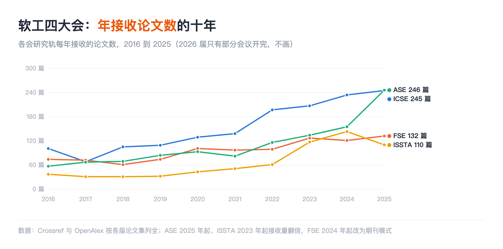
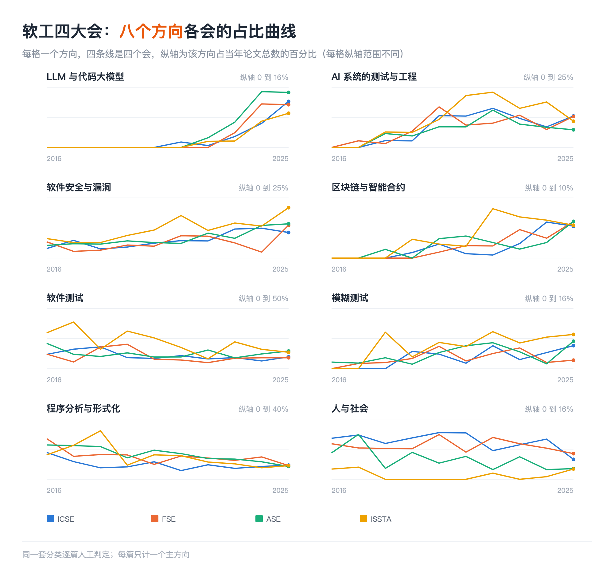
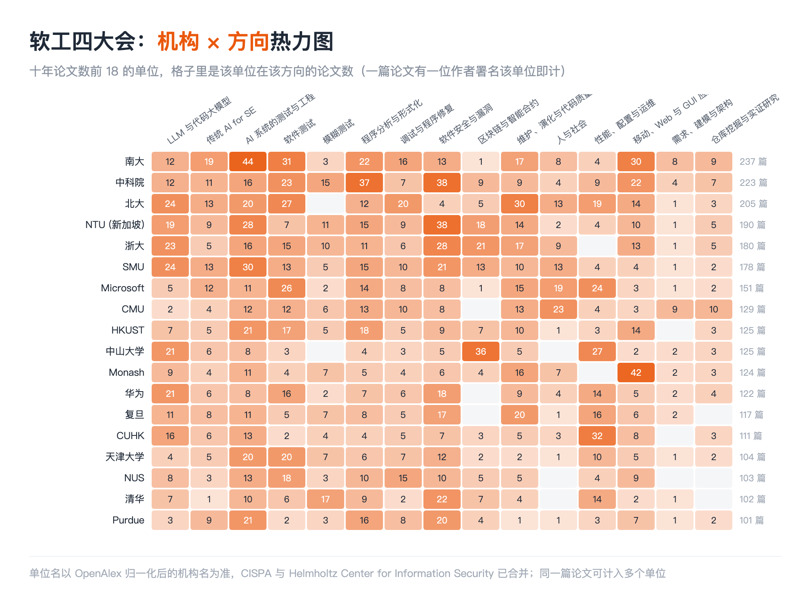
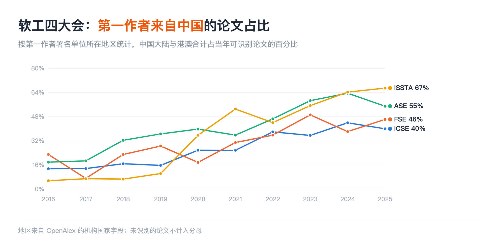

## LIST INFO|本期说明

昨天笔者推送了 USENIX Security 2026 Cycle 1 中稿论文的盘点，顺手起了个念头：软工和安全这两个圈子近十年到底都在做什么？于是把四大安全顶会和四大软工顶会 2016 年以来的论文全部拉下来逐篇分了类，逐会各写一期，再各写一期综合，一共十期，会陆续推送。今天先发软工这一期，把 ICSE、FSE、ASE、ISSTA 四家放在一起看

【范围】软工四大会十年的全部研究轨论文：ICSE 2016 到 2025（1533 篇），FSE 2016 到 2026（1169 篇），ASE 2016 到 2025（1103 篇），ISSTA 2016 到 2025（656 篇），合计 4461 篇。四家逐会的十年趋势各有一期，会陆续推送；这期先把四家放在一起看
【来源】按每届论文集从 Crossref 列全标题与作者，再用 OpenAlex 补摘要、单位和国家，逐年和 DBLP 目录、各会官网的研究轨录用清单核对；工业轨（FSE 2019 到 2023 年每年 20 到 34 篇，ASE 2023 到 2025 年每年 12 到 54 篇）、NIER、Demo、Journal-First、Workshop 等其他轨道不计
【口径】四家用同一套 15 个方向的分类，每篇只归一个主方向（可带一个次方向），逐篇人工判定。"用大模型做某任务"记为次方向，只有研究代码大模型本身才记主方向。横向比较时统一用 2016 到 2025 十个完整年份（4250 篇），FSE 2026 的 211 篇只在文中单独提及

@stats
- 269 → 733 篇 | 四会年接收总量，十年扩了 2.7 倍
- 13% → 47% | 主方向或次方向是 AI（传统机器学习加大模型）的论文比例
- 5.6% → 13.9% | 软件安全与漏洞占四会论文总数的份额，2025 年是第一大方向
- 16% → 50% | 第一作者来自中国大陆与港澳的比例，四会合计

先交代规模。四会合计 2016 年 269 篇，2020 年 366 篇，2023 年 585 篇，2025 年 733 篇。扩张的节奏各家不同：ICSE 最平稳，从 101 篇到 245 篇；FSE 2020 年跳到 101 篇，2024 年改期刊模式后 121 篇，2026 年 211 篇是历年最多；ISSTA 2023 年从 61 跳到 117；ASE 最猛，2025 年一届 246 篇，比 2024 年多了 91 篇。软工四会的扩张（2.7 倍）比安全四会（3.8 倍）温和，所以份额曲线和绝对数曲线的走向大体一致。

## COMMON|四会共同的四个趋势

#### 大模型：两年从 9% 渗透到 38%

主方向记为"LLM 与代码大模型"的论文四会合计 2022 年 5 篇（1.1%），2023 年 22 篇（3.8%），2024 年 62 篇（9.5%），2025 年 91 篇（12.4%）。把次方向算进去，2023 年 8.5%，2024 年 23.4%，2025 年 38.1%。再把传统机器学习方法（缺陷预测、代码表示学习、神经修复）算进去，==2025 年四会有 47.2% 的论文，方法或对象是 AI==。四家的渗透率排序是 ASE（45%）、ISSTA（35%）、ICSE（35%）、FSE（33%，2026 年 47%），差距不大，说明这是整个社区的迁移，不是某一家的偏好。

#### 软件安全从 5.5% 到 13.7%，2025 年是四会合计的第一大方向

软件安全与漏洞四会合计 2016 年 15 篇（5.6%），2021 年 33 篇（9.0%），2025 年 102 篇（13.9%），加上区块链与智能合约（42 篇，5.7%）合计 19.6%，把次方向算进去 2025 年有 23.5% 的论文和安全沾边。四家的曲线形状一样：ICSE 从 4% 到 12%（2023 年起是第一大方向），FSE 从 7% 到 14%，ASE 从 5% 到 14%，ISSTA 从 8% 到 21%。推动它的是两条线：深度学习漏洞检测（2022 年起）和软件供应链（2021 年起），后面单说。

#### 程序分析从 21% 跌到 9%，四家同步

程序分析与形式化是 2016 年四会合计的第一大方向（57 篇，21.2%），2025 年 66 篇（9.0%）。四家的跌幅一致：ICSE 18% 到 9%，FSE 27% 到 9%，ASE 23% 到 9%，ISSTA 32%（2018）到 9%。绝对数没有跌，是分母涨了，而且这个方向的一部分题材（用 LLM 做不变量推断、证明合成、类型推断）被记到了任务方向的次方向里。2024 年之后形式化验证因为 LLM 重新热起来，FSE 2023 年 **Baldur: Whole-Proof Generation and Repair with Large Language Models**（杰出论文）是起点，ICSE 2025 年 **Rango: Adaptive Retrieval-Augmented Proving for Automated Software Verification**（杰出论文）和 ASE 2025 年 **Bridging Natural Language and Formal Specification: Automated Translation of Software Requirements to LTL via Hierarchical Semantics Decomposition Using LLMs**（杰出论文）跟上。

#### 人与社会、需求建模、仓库挖掘、传统 AI for SE 同步退潮

四个方向的份额十年都在跌：人与社会从 8.6% 到 4.4%，需求、建模与架构从 7.1% 到 2.0%，仓库挖掘与实证研究从 7.1% 到 1.1%（但作为次方向每年仍有几十篇），传统 AI for SE 从 7.1% 到 1.8%。前三个是社区兴趣的转移，第四个是被大模型方向吸走了：2020 年 ICSE 的 **Big code != big vocabulary: open-vocabulary models for source code**（杰出论文）还在做代码词表，2025 年这类工作全部换成了 LLM。

## DIFF|四家各自的性格

同一套分类下，四家 2025 年的前三大方向：

- ICSE：AI 系统的测试与工程 13.0%，LLM 与代码大模型 12.2%，软件安全 10.6%。人与社会（十年 146 篇）是它区别于另外三家的特点，fMRI、开源可持续性、多样性三条线只在 ICSE 上成气候
- FSE：LLM 与代码大模型 11.4%（2026 年 21.8%），软件安全 13.6%，AI 系统测试 12.9%。程序分析（十一年 157 篇）是它累计最大的方向，性能运维早年是微软亚洲研究院的主场，供应链偏"生态与人"
- ASE：软件测试 14.6%，LLM 与代码大模型 14.6%，软件安全 14.2%。四家里 AI 渗透最深、恶意包检测最密的一家，2025 年至少 10 篇大模型或 Agent 安全的论文是四家里最早集中出现的
- ISSTA：软件安全 20.9%，软件测试 13.6%，AI 系统测试 10.9%。名字里有 Testing，但 2017 年 39% 的测试份额到 2025 年只剩 14%，智能合约（中山大学 12 篇）和模糊测试（9.3%）是新支柱

AI 系统的测试与工程是最能体现四家差异的方向：ISSTA 2021 到 2024 年连续四年是第一大方向（2022 年 23%），ICSE 2020 年起稳在 8% 到 16%，FSE 2020 年 16.8% 是高峰，ASE 2022 年 15.5%。四家合计十年 414 篇，是软工会上"AI 相关"论文里最早成气候的一支，比大模型早了三年。

人与社会是另一个分化点：ICSE 和 FSE 十年都在 4% 到 13%，ASE 3% 到 12%，ISSTA 几乎没有（十年 7 篇）。需求、建模与架构在 ISSTA 上十年一篇没有。做人的研究投 ICSE 和 FSE，做工具投 ASE 和 ISSTA，这个分工十年没变。

## LLM|大模型：四会合起来看的三年

把四家的大模型论文按年排在一起，能看到一条比单看一家更清楚的路径。

@timeline
- 2021 | Siri, Write the Next Method | ICSE，用 Transformer 生成整个方法，四会研究轨的第一篇
- 2022 | Less training, more repairing please: revisiting automated program repair via zero-shot learning | FSE，不训练直接用代码模型修复，超过所有专门训练的神经修复
- 2022 | Compressing Pre-trained Models of Code into 3 MB | ASE，代码模型的工程问题
- 2023 | Large Language Models Are Zero-Shot Fuzzers: Fuzzing Deep-Learning Libraries via Large Language Models | ISSTA，LLM 直接当 fuzzer
- 2023 | Automated Program Repair in the Era of Large Pre-trained Language Models | ICSE，系统评估代码大模型做修复
- 2024 | Automated Program Repair via Conversation: Fixing 162 out of 337 Bugs for $0.42 Each using ChatGPT | ISSTA，把修复成本算到分
- 2024 | AutoCodeRover: Autonomous Program Improvement | ISSTA，最早的 SWE-bench Agent 之一
- 2024 | Code Search is All You Need? Improving Code Suggestions with Code Search | ICSE 杰出论文，给 LLM 加检索比换大模型划算
- 2025 | Demystifying LLM-Based Software Engineering Agents | FSE 杰出论文，逐条拆解 SWE-bench 上 Agent 的成功和失败
- 2025 | Understanding Software Engineering Agents: A Study of Thought-Action-Result Trajectories | ASE 杰出论文，拆解 Agent 的轨迹
- 2025 | SWE-GPT: A Process-Centric Language Model for Automated Software Improvement | ISSTA 杰出论文，阿里的过程中心模型
- 2026 | Building Software by Rolling the Dice: A Qualitative Study of Vibe Coding | FSE，第一篇 Vibe Coding 的定性研究

#### 2021 到 2023：修复先行

四会上大模型的第一个落地方向都是程序修复。FSE 2022 年 **Less training, more repairing please** 之后，ICSE 2023 年 **Impact of Code Language Models on Automated Program Repair** 和 **Automated Program Repair in the Era of Large Pre-trained Language Models** 两篇同届，ASE 2023 年 **The Plastic Surgery Hypothesis in the Era of Large Language Models** 和 **Gamma: Revisiting Template-Based Automated Program Repair Via Mask Prediction**，FSE 2023 年 **Copiloting the Copilots: Fusing Large Language Models with Completion Engines for Automated Program Repair**，ISSTA 2024 年一届 6 篇。修复方向的题材在两年里从"直接用"走到"怎么用"再走到 Agent，比其他任务方向快一年。

测试紧随其后：ICSE 2023 年 **CodaMosa: Escaping Coverage Plateaus in Test Generation with Pre-trained Large Language Models** 和 **Large Language Models are Few-shot Testers: Exploring LLM-based General Bug Reproduction**，ISSTA 2023 年 **Large Language Models Are Zero-Shot Fuzzers**，ASE 2023 年 **Nuances are the Key: Unlocking ChatGPT to Find Failure-Inducing Tests with Differential Prompting**，FSE 2024 年 **Evaluating and Improving ChatGPT for Unit Test Generation**。到 2025 年，四会的软件测试论文里有三分之一到一半用了 LLM。

#### 2024 到 2025：评测、质疑和 Agent

2024 年四会合计 62 篇主方向、153 篇任意位置。评测是主线：ICSE 的 **CoderEval: A Benchmark of Pragmatic Code Generation with Generative Pre-trained Models**，ASE 的 **JavaBench: A Benchmark of Object-Oriented Code Generation for Evaluating Large Language Models**，ISSTA 的 **CoderUJB: An Executable and Unified Java Benchmark for Practical Programming Scenarios**。记忆与泄露：ICSE 的 **Unveiling Memorization in Code Models**，FSE 的 **Your Code Secret Belongs to Me: Neural Code Completion Tools Can Memorize Hard-Coded Credentials**，ASE 的 **Promise and Peril of Collaborative Code Generation Models: Balancing Effectiveness and Memorization**。效率：ISSTA 2024 年两篇杰出论文 **When to Stop? Towards Efficient Code Generation in LLMs with Excess Token Prevention** 和 **AI Coders Are among Us: Rethinking Programming Language Grammar towards Efficient Code Generation** 都在解决效率而不是能力。

2025 年四会合计 91 篇主方向、279 篇任意位置。三条线最清楚。一是 Agent：三家 2025 年各有一篇拆解 SE Agent 的杰出论文（FSE 的 Demystifying LLM-Based Software Engineering Agents、ASE 的 Understanding Software Engineering Agents、ISSTA 的 SWE-GPT），ASE 还有 **SPICE: An Automated SWE-Bench Labeling Pipeline for Issue Clarity, Test Coverage, and Effort Estimation** 和 **Why AI Agents Still Need You: Findings from Developer-Agent Collaborations in the Wild**（微软），ICSE 有 **RepairAgent: An Autonomous, LLM-Based Agent for Program Repair**。二是"能力到底有多少"的质疑：ICSE 的 **Unseen Horizons: Unveiling the Real Capability of LLM Code Generation Beyond the Familiar**（杰出论文），FSE 的 **Code Red! On the Harmfulness of Applying Off-the-Shelf Large Language Models to Programming Tasks** 和 **COFFE: A Code Efficiency Benchmark for Code Generation**（杰出论文），ISSTA 的 **LLM Hallucinations in Practical Code Generation: Phenomena, Mechanism, and Mitigation** 和 **Can LLMs Replace Human Evaluators? An Empirical Study of LLM-as-a-Judge in Software Engineering**。三是代码大模型自身的安全，集中在 ASE：**HFuzzer: Testing Large Language Models for Package Hallucinations via Phrase-based Fuzzing** 测包名幻觉，**DrainCode: Stealthy Energy Consumption Attacks on Retrieval-Augmented Code Generation via Context Poisoning**、**Effective Code Membership Inference for Code Completion Models via Adversarial Prompts**、**Backdoors in Code Summarizers: How Bad Is It?**，还有 **Security Debt in LLM Agent Applications: A Measurement Study of Vulnerabilities and Mitigation Trade-offs**（复旦）。

> 四会合起来看，软工社区对大模型的态度有一个明显的特点：==评测和质疑类论文的比例远高于安全四大会==。2025 年四会 91 篇主方向论文里，评测、基准和"how far are we"类超过 25 篇，四家 2025 年给大模型颁的杰出论文里一半以上是评测。软工社区的习惯是先造尺子再造工具，这个习惯在大模型上体现得最清楚。

## SE4AI|AI 系统的测试：软工会上最早的 AI 浪潮

AI 系统的测试与工程四会合计十年 414 篇，比大模型方向（182 篇）多一倍，是软工会上第一波和 AI 有关的浪潮，被测对象换了三轮。

**第一轮是深度神经网络（2017 到 2021）。** FSE 2017 年 **Fairness testing: testing software for discrimination**（杰出论文）是四会第一篇，ICSE 2018 年 **DeepTest: automated testing of deep-neural-network-driven autonomous cars**，ASE 2018 年 **DeepGauge: multi-granularity testing criteria for deep learning systems**（杰出论文），ISSTA 2019 年 **DeepHunter: a coverage-guided fuzz testing framework for deep neural networks**，2020 年四家同时爆发：ICSE 17 篇，FSE 17 篇（三篇杰出论文），ISSTA **Effective white-box testing of deep neural networks with adaptive neuron-selection strategy**（杰出论文），ASE **Problems and opportunities in training deep learning software systems: an analysis of variance**（杰出论文）。同期出现了对这条线的质疑：FSE 2020 年 **Is neuron coverage a meaningful measure for testing deep neural networks?**，ISSTA 2022 年 **Simple techniques work surprisingly well for neural network test prioritization and active learning (replicability study)** 和 2023 年 **In Defense of Simple Techniques for Neural Network Test Case Selection**。

**第二轮是自动驾驶、深度学习框架和公平性（2020 到 2024）。** 自动驾驶在四家都有：ICSE 2020 年 **DeepBillboard: systematic physical-world testing of autonomous driving systems**，FSE 2022 年 **Testing of autonomous driving systems: where are we and where should we go?**，ISSTA 2023 年 **Building Critical Testing Scenarios for Autonomous Driving from Real Accidents**，ASE 2024 年 **ROCAS: Root Cause Analysis of Autonomous Driving Accidents via Cyber-Physical Co-mutation**（杰出论文）。深度学习框架测试：FSE 2020 年 **Deep learning library testing via effective model generation**（杰出论文），ICSE 2022 年 **Free lunch for testing: fuzzing deep-learning libraries from open source**，ISSTA 2022 年 **DocTer: documentation-guided fuzzing for testing deep learning API functions**，FSE 2023 年 **NeuRI: Diversifying DNN Generation via Inductive Rule Inference**（杰出论文）。公平性从 FSE 2017 年到 ICSE 2020 年 **White-box fairness testing through adversarial sampling**（杰出论文）再到 FSE 2021 年 **Bias in machine learning software: why? how? what to do?**（杰出论文）和 2025 年 **Software Fairness Dilemma: Is Bias Mitigation a Zero-Sum Game?**。

**第三轮是大模型本身（2024 到 2026）。** FSE 2025 年 **Hallucination Detection in Large Language Models with Metamorphic Relations**（杰出论文），ISSTA 2025 年 **S-Eval: Towards Automated and Comprehensive Safety Evaluation for Large Language Models**，ICSE 2025 年 **Are LLMs Correctly Integrated into Software Systems?**，ASE 2025 年 **Watson: A Cognitive Observability Framework for the Reasoning of LLM-Powered Agents**，FSE 2026 年 **AgentBound: Securing Execution Boundaries of AI Agents** 和 **Spectrum-Based Failure Attribution for Multi-agent Systems**。到 2026 年，这个方向有三分之一在测 LLM 和 Agent。

## SECURITY|软件安全：两条线推动的第一大方向

软件安全与漏洞四会合计十年 392 篇，2025 年 102 篇是四会合计的第一大方向。推动它的两条线在四家都能看到。

#### 深度学习漏洞检测：三年走完"提出、扩散、质疑"

ICSE 2022 年 **MVD: memory-related vulnerability detection based on flow-sensitive graph neural networks** 和 **VulCNN: an image-inspired scalable vulnerability detection system**，ISSTA 2022 年 **Path-sensitive code embedding via contrastive learning for software vulnerability detection**。2023 年四家同时出现评估：ICSE **An Empirical Study of Deep Learning Models for Vulnerability Detection**，ISSTA **Understanding and Tackling Label Errors in Deep Learning-Based Vulnerability Detection (Experience Paper)** 和 **Interpreters for GNN-Based Vulnerability Detection: Are We There Yet?**，ASE **When Less is Enough: Positive and Unlabeled Learning Model for Vulnerability Detection**。2024 年 ICSE 一届至少 8 篇。2025 年四家同时质疑：ICSE **Are We Learning the Right Features? A Framework for Evaluating DL-Based Software Vulnerability Detection Solutions** 和 **Vulnerability Detection with Code Language Models: How Far are We?**，FSE **Today's Cat Is Tomorrow's Dog: Accounting for Time-Based Changes in the Labels of ML Vulnerability Detection Approaches** 和 **One-for-All Does Not Work! Enhancing Vulnerability Detection by Mixture-of-Experts (MoE)**，ISSTA **Top Score on the Wrong Exam: On Benchmarking in Machine Learning for Vulnerability Detection**（杰出论文）。这条线和安全四大会上 USENIX Security 2024 年那篇 Uncovering the Limits of Machine Learning for Automatic Vulnerability Detection 的结论一致，但软工会上的质疑更系统，ISSTA 2025 年那篇直接拿了杰出论文。

#### 智能合约：四家合计 123 篇，中山大学的主场

区块链与智能合约四会合计 2016 年 0 篇，2025 年 42 篇（5.7%）。ISSTA 2019 年 **Exploiting the laws of order in smart contracts**、ASE 2018 年 **ContractFuzzer: fuzzing smart contracts for vulnerability detection**、FSE 2020 年 **Towards automated verification of smart contract fairness** 是各家的起点，ICSE 2023 年 **Turn the Rudder: A Beacon of Reentrancy Detection for Smart Contracts on Ethereum** 之后中山大学在四家都是第一或前三（ICSE 12 篇、ISSTA 12 篇、FSE 7 篇、ASE 5 篇）。这个方向拿奖的比例很高：ICSE 2024 年 **Towards Finding Accounting Errors in Smart Contracts** 和 **Safeguarding DeFi Smart Contracts against Oracle Deviations**，2025 年 **Demystifying and Detecting Cryptographic Defects in Ethereum Smart Contracts**，FSE 2023 年 **TransRacer: Function Dependence-Guided Transaction Race Detection for Smart Contracts** 和 2024 年 **Static Application Security Testing (SAST) Tools for Smart Contracts: How Far Are We?**，ISSTA 2022 年 **Finding permission bugs in smart contracts with role mining** 和 2024 年 **Identifying Smart Contract Security Issues in Code Snippets from Stack Overflow**，ASE 2020 年 **Summary-based symbolic evaluation for smart contracts**。2025 年之后 LLM 进入这个方向，ASE 2025 年 15 篇里 9 篇用了 LLM。

## SUPPLY|软件供应链：软工会比安全会早一到两年

这是本账号最关心的题材。软工四会没有单独的供应链方向，这些论文分在安全、维护、人与社会三个方向里，按标题关键词粗算，四会涉及依赖、包、生态、SBOM 的论文从 2016 年的 5 篇涨到 2023 年的 27 篇、2024 年的 35 篇，比安全四大会同期的供应链方向（2023 年 13 篇、2024 年 5 篇）多一倍以上。四家合起来排，能看到一条比安全会更早的线。

@timeline
- 2017 | Can automated pull requests encourage software developers to upgrade out-of-date dependencies? | ASE，Dependabot 类工具最早的实证
- 2017 | Why do developers use trivial packages? an empirical case study on npm | FSE，left-pad 事件之后的微型包研究
- 2018 | Ecosystem-level determinants of sustained activity in open-source projects: a case study of the PyPI ecosystem | FSE，生态可持续性
- 2021 | LastPyMile: identifying the discrepancy between sources and packages | FSE，包与源码一致性这条线的起点
- 2021 | A longitudinal analysis of bloated Java dependencies | FSE 杰出论文，依赖膨胀
- 2021 | CENTRIS: A Precise and Scalable Approach for Identifying Modified Open-Source Software Reuse | ICSE，修改过的开源组件复用识别
- 2022 | Has My Release Disobeyed Semantic Versioning? Static Detection Based on Semantic Differencing | ASE 杰出论文，语义化版本违规
- 2023 | An Empirical Study on Software Bill of Materials: Where We Stand and the Road Ahead | ICSE，SBOM 的第一篇系统实证
- 2023 | A Needle is an Outlier in a Haystack: Hunting Malicious PyPI Packages with Code Clustering | ASE，恶意 PyPI 包检测，同届还有一篇 PyPI 恶意代码实证
- 2023 | Compatible Remediation on Vulnerabilities from Third-Party Libraries for Java Projects | ICSE 杰出论文，不破坏兼容性地修依赖漏洞
- 2024 | BOMs Away! Inside the Minds of Stakeholders: A Comprehensive Study of Bills of Materials for Software Systems | ICSE，SBOM 利益相关方访谈
- 2024 | SpiderScan: Practical Detection of Malicious NPM Packages Based on Graph-Based Behavior Modeling and Matching | ASE，npm 恶意包的行为图匹配
- 2025 | Pinning Is Futile: You Need More Than Local Dependency Versioning to Defend against Supply Chain Attacks | FSE 杰出论文，锁版本挡不住供应链攻击
- 2025 | Understanding the Response to Open-Source Dependency Abandonment in the npm Ecosystem | ICSE 杰出论文，依赖被弃用后下游怎么办
- 2025 | ZTD_JAVA: Mitigating Software Supply Chain Vulnerabilities via Zero-Trust Dependencies | ICSE，给 Java 依赖做零信任
- 2026 | PoCGen: Generating Proof-of-Concept Exploits for Vulnerabilities in Npm Packages | FSE，给 npm 漏洞自动生成利用

四家的分工很清楚。ICSE 最密，题材偏工具和检测：从 CENTRIS 到 SBOM 实证到零信任依赖，每年三到六篇，2023 到 2025 年三年各有一篇供应链论文拿杰出论文。FSE 偏生态与人：2023 年的依赖弃用访谈 **"We Feel Like We're Winging It:" A Study on Navigating Open-Source Dependency Abandonment**，2025 年的维护者流失 **Core Developer Turnover in the Rust Package Ecosystem: Prevalence, Impact, and Awareness** 和抗议软件 **On the Characteristics and Impacts of Protestware Libraries**，加上包与源码一致性那条线（2021 年 LastPyMile，2024 年 **PyRadar: Towards Automatically Retrieving and Validating Source Code Repository Information for PyPI Packages**，2026 年 **Uncovering Similar but Different Packages in PyPI and Potential Security Threats**），CMU 从 2016 年的 **How to break an API: cost negotiation and community values in three software ecosystems** 到 2025 年的 Pinning Is Futile 十年没断。ASE 偏恶意包检测：2023 年 A Needle is an Outlier in a Haystack 和 **An Empirical Study of Malicious Code In PyPI Ecosystem** 同届，2024 年 **1+1>2: Integrating Deep Code Behaviors with Metadata Features for Malicious PyPI Package Detection** 和 SpiderScan，2025 年 **ProfMal: Detecting Malicious NPM Packages by the Synergy between Static and Dynamic Analysis**，软件所、复旦、扬州大学是主力（华科的 MalWuKong 和 Models Are Codes 走的是 ASE 的工业轨，本期不计）；"受影响版本识别"是新热点，2024 年 **Vision: Identifying Affected Library Versions for Open Source Software Vulnerabilities**，2025 年 **Vulnerability-Affected Versions Identification: How Far Are We?**。ISSTA 最薄，但偏分析方法：2022 年 **Test mimicry to assess the exploitability of library vulnerabilities** 用测试判定依赖里的漏洞在下游能不能触发，2024 年 **FRIES: Fuzzing Rust Library Interactions via Efficient Ecosystem-Guided Target Generation** 用生态里的真实用法指导库 fuzzing。

> 把软工四会和安全四会的供应链论文对着看，==软工会在几个关键题材上比安全会早了一到两年==：SBOM 的系统实证 ICSE 2023 年就有，安全会要到 NDSS 2025 年的 JBomAudit；恶意包检测 ASE 2023 年一届两篇，USENIX 2024 年才有 DONAPI、2025 年才有 MalGuard；依赖弃用和维护者流失的研究 FSE 2023 年就在做，安全会的开源维护者访谈集中在 2024 到 2025 年。原因很简单：软工社区本来就在研究依赖管理和生态演化，供应链安全只是给这条老线加了一个安全的视角。想跟供应链安全的前沿，软工四会是比安全四会更早的信号源。

## AWARDS|拿奖论文十年：四家的口味

四家的 ACM SIGSOFT 杰出论文每年 3 到 23 篇，2016 到 2025 年四家合计三百篇上下（ICSE 2022、ASE 2021 和 2023、ISSTA 2023 的部分名单没有找到官方页面）。按方向和题材数一遍：

- ICSE 偏人与社会：fMRI 系列一篇不落（2017、2019、2021、2024），开源可持续性系列（Going Farther Together、What Makes a Great Maintainer、Do I Belong）全部获奖，2024 年 14 篇里 4 篇是人与社会；安全与供应链从 2021 年起每年都有
- FSE 偏 AI 系统的测试和实证：Fairness Testing（2017）、2020 年三篇深度学习测试、Bias in Machine Learning Software（2021）、NeuRI 和 Benchmarking Robustness of AI-enabled Multi-sensor Fusion Systems（2023）、Hallucination Detection（2025）；人与社会和实证研究十年 14 篇上下
- ASE 偏测试和程序分析：2018 年 6 篇里 4 篇，2019 年 6 篇里 4 篇，2022 年 11 篇里 6 篇；2025 年 21 篇里三篇 fuzzing（DualFuzz、WingMuzz、Tephra）是 ASE 历史上最多的一年
- ISSTA 偏分析和 fuzzing：PerfFuzz 和 Compiler Fuzzing through Deep Learning（2018）、Precise Compositional Buffer Overflow Detection（2024）、BinDSA 和 Bridging the Gaps between Graph Neural Networks and Data-Flow Analysis（2025）；对大模型最保守，2024 年两篇大模型杰出论文都在解决效率问题

四家给大模型颁奖的比例 2025 年拉开了差距：ASE 21 篇里至少 9 篇，ICSE 至少 5 篇，FSE 13 篇里 5 篇，ISSTA 9 篇里 2 篇。四家 2025 年大模型获奖论文的共同点是评测和拆解多于方法：Unseen Horizons、COFFE、Demystifying LLM-Based Software Engineering Agents、Understanding Software Engineering Agents、Less Is More: On the Importance of Data Quality for Unit Test Generation、Clarifying Semantics of In-Context Examples for Unit Test Generation。

供应链方向的获奖论文集中在 ICSE 和 FSE：ATVHunter（ICSE 2021）、A Longitudinal Analysis of Bloated Java Dependencies（FSE 2021）、Has My Release Disobeyed Semantic Versioning?（ASE 2022）、Compatible Remediation（ICSE 2023）、How Does Code Optimization Impact Third-party Library Detection for Android Applications?（ASE 2024）、Pinning Is Futile 和 Understanding the Response to Open-Source Dependency Abandonment（2025）。

ISSTA 2022 年有一篇杰出论文 Cross-Lingual Transfer Learning for Statistical Type Inference 后来被撤稿，是四家杰出论文里唯一一例。

## WHO|机构图谱：哪些团队在做什么

按"论文有至少一位作者署名该单位"计，四会十年合计的前十是南京大学（237 篇）、中科院（223，软件所、计算所等各所合并计）、北大（205）、南洋理工（190）、浙大（180）、新加坡管理大学（178）、微软（151）、CMU（129）、港科大和中山大学（各 125）、Monash（124）。前十里中国六家、新加坡两家、美国两家、澳大利亚一家。但榜单只说明规模，热力图和署名作者能说明每家在做什么。下面按方向说，作者名按十年署名次数取前几位。

#### AI 系统的测试：南大、新加坡管理大学、南洋理工、港科大

这个方向最集中的是南大，44 篇，Zhenyu Chen（35 篇署名，18 篇 AI 系统测试）、Chunrong Fang、Baowen Xu 三个组，从 DeepGini 到机器翻译测试再到自动驾驶。新加坡管理大学 30 篇，Jun Sun（54 篇署名，16 篇 AI 系统测试）和 Xiaofei Xie（2022 年从南洋理工过来，50 篇署名）；南洋理工 28 篇，Yang Liu 和 Xiaofei Xie 早期在那里的工作（DeepGauge、DeepHunter）；港科大 21 篇，Shing-Chi Cheung（51 篇署名）和 Shuai Wang（39 篇署名）；天津大学 20 篇，Junjie Chen（60 篇署名）和 Zan Wang；Purdue 21 篇，Xiangyu Zhang（56 篇署名）和 Lin Tan；UIUC 的 Lingming Zhang（53 篇署名，深度学习库 fuzzing 和 LLM 修复）。

#### 软件安全与供应链：南洋理工、中科院、华科、浙大、复旦

软件安全与漏洞方向最集中的是南洋理工，38 篇，Yang Liu 一个人十年署名 134 篇，是软工四会里署名最多的作者，他的组在软件安全（30 篇）、AI 系统测试、区块链、大模型四个方向都在前列；Zhengzi Xu（27 篇署名）和 Chengwei Liu（22 篇）是他的组里做供应链和 SCA 的两条线。中科院 38 篇（软件所 Jingzheng Wu、Xiang Ling、Tianyue Luo 的组做恶意 PyPI 包和安卓第三方库检测）；华科 29 篇，Hai Jin、Deqing Zou（深度学习漏洞检测）、Ming Wen、Haoyu Wang（49 篇署名，2022 年从北邮过来，移动生态和恶意包）；浙大 28 篇，Xin Xia 和 Xing Hu；复旦 17 篇，Bihuan Chen（38 篇署名，12 篇软件安全，依赖漏洞和受影响版本识别）；清华 22 篇，Yu Jiang（37 篇署名，13 篇模糊测试）和 Chao Zhang；Purdue 的 James C. Davis（签名和模型制品）。

按标题关键词粗算供应链相关论文，最活跃的单位是南洋理工（15 篇）、中科院（11 篇）、CMU（11 篇，Christian Kästner 和 Bogdan Vasilescu 做生态与维护者，Pinning Is Futile 和依赖弃用访谈都是他们）、港科大（10 篇）、南大和华科（各 9 篇）、东北大学（7 篇，Ying Wang、Hai Yu、Zhiliang Zhu 做依赖冲突）、天津大学、浙大、NC State、南开（Lingling Fan）、华为、复旦。==软工四会上的供应链团队比安全四会上的多得多，而且分工清楚：南洋理工和复旦做 SCA 和受影响版本，中科院和华科做恶意包，CMU 做生态和人，东北大学和南大做依赖冲突与构建==。

#### 大模型：北大、新加坡管理大学、浙大、中山大学、华为

大模型方向最集中的是北大，24 篇，Zhi Jin（27 篇署名，14 篇大模型）和 Ge Li（23 篇署名，14 篇大模型）两个组，从代码生成到仓库级补全；新加坡管理大学 24 篇，David Lo（78 篇署名，13 篇大模型，另有 12 篇人与社会和 12 篇软件安全，是四会里方向最广的作者之一）；浙大 23 篇；中山大学 21 篇，Yanlin Wang 和 Zibin Zheng；华为 21 篇，Yuchi Ma（14 篇署名，10 篇大模型）；哈工大的 Cuiyun Gao（37 篇署名，15 篇大模型，早年在港中文 Michael Lyu 组）；港中文 16 篇，Michael R. Lyu；南洋理工 19 篇。

#### 测试、修复和程序分析：北大、UIUC、天津大学、NUS、港科大、卢森堡

软件测试方向北大 27 篇（Dan Hao 36 篇署名、Lu Zhang 37 篇署名、Tao Xie 31 篇署名），南大 31 篇，UIUC 27 篇（Darko Marinov 18 篇署名 14 篇测试、August Shi，flaky test 那条线），天津大学 20 篇（Junjie Chen，编译器测试和 JVM 测试），微软 26 篇，NUS 18 篇（Manuel Rigger 13 篇署名，数据库测试），卢森堡 21 篇（Lionel Briand 24 篇署名、Mike Papadakis，搜索式测试和变异测试）。调试与修复方向北大 20 篇（Yingfei Xiong、Lu Zhang），UIUC 14 篇（Lingming Zhang 18 篇修复），NUS 15 篇（Abhik Roychoudhury 27 篇署名，11 篇修复），CMU 10 篇（Claire Le Goues 20 篇署名，8 篇修复），卢森堡（Tegawendé F. Bissyandé 28 篇署名）。程序分析方向中科院 37 篇（软件所 Yan Cai 做并发），南大 22 篇，港科大 18 篇（Charles Zhang 18 篇署名，13 篇分析，值流分析），国防科大 19 篇（Ji Wang 23 篇署名，15 篇分析），斯图加特的 Michael Pradel（53 篇署名，16 篇分析，2019 年之前署名达姆施塔特），ETH 的 Zhendong Su（34 篇署名，编译器和 GUI 测试）。

#### 性能运维：微软亚洲研究院、港中文、中山大学、复旦、清华

这个方向早年最集中的是微软，研究轨 24 篇（工业轨上还有二十多篇，本期不计），Dongmei Zhang（25 篇署名，15 篇运维）和 Qingwei Lin（22 篇署名，18 篇运维）的微软亚洲研究院 AIOps 组，但 2024 年之后明显退场：微软在四会研究轨的论文 2020 到 2023 年每年 17 到 19 篇，2024 和 2025 年各 13 篇，2026 年 3 篇。接手的是港中文（32 篇，Michael R. Lyu 60 篇署名 19 篇运维，日志解析，现在是这个方向论文最多的单位）、中山大学（27 篇，Zhuangbin Chen 和 Pengfei Chen，根因分析和链路追踪）、复旦（16 篇，Xin Peng 68 篇署名）、清华（14 篇，Dan Pei）、南开和天津大学（告警和事件管理）。纽卡斯尔和重庆大学的 Hongyu Zhang（79 篇署名，25 篇运维，四会署名第三多的作者，仅次于 Yang Liu 和 Xin Xia）是这条线上另一个稳定的组。

#### 移动应用：Monash、南大、华科、港理工、UC Irvine

移动、Web 与 GUI 应用方向最集中的是 Monash，42 篇，Chunyang Chen（41 篇署名，28 篇移动，2024 年后到慕尼黑工大）、Li Li（41 篇署名，18 篇移动，后到北航）、John Grundy；南大 30 篇（Minxue Pan、Xuandong Li）；华科 14 篇（Haoyu Wang）；港理工 18 篇（Xiapu Luo 51 篇署名，移动 14 篇、区块链 16 篇、软件安全 11 篇）；UC Irvine 21 篇（Sam Malek 29 篇署名，25 篇移动，可访问性）；南方科大 15 篇（Yepang Liu 44 篇署名）；中科院软件所（Qing Wang、Junjie Wang，众包测试和 GUI）。

#### 区块链：中山大学、浙大、南洋理工、港理工

区块链与智能合约方向中山大学 36 篇，Zibin Zheng（61 篇署名，28 篇区块链）、Jiachi Chen（31 篇署名，20 篇区块链）、Yuhong Nan，在 ICSE 和 ISSTA 都是该方向第一；浙大 21 篇；南洋理工 18 篇（Yang Liu、Yi Li）；港理工 19 篇（Xiapu Luo）；港科大 7 篇。这个方向几乎全在中国和新加坡。

#### 人与社会：CMU、北大、微软、新加坡管理大学

人与社会方向最集中的是 CMU，23 篇，Bogdan Vasilescu（29 篇署名，15 篇人与社会，开源可持续性）和 Christian Kästner（30 篇署名，维护、人与社会、配置三个方向）、Brad Myers、James Herbsleb；北大 13 篇，Minghui Zhou（18 篇署名，11 篇人与社会，开源社区）；微软 19 篇，Thomas Zimmermann；新加坡管理大学 13 篇，David Lo；密歇根（fMRI 那条线）、NC State、Oregon State 是美国另外几个稳定的组。中国单位在这个方向的存在感和它们的总量不成比例。

#### 人在动，方向跟着动

十年数据里有几条明显的人员流动，每一条都带走了一个方向：Xin Xia 从浙大（2016）到 Monash（2018 到 2021，每年署名 5 到 11 篇）到华为（2022 到 2024，每年 8 到 12 篇）再回浙大（2023 起，2025 年 12 篇），Monash 的维护方向、华为的软件安全方向、浙大 2025 年的爆发都能看到他的影子；Xiaofei Xie 2019 到 2021 年在南洋理工，2022 年起在新加坡管理大学，AI 系统测试那条线跟着挪；Haoyu Wang 2022 年从北邮到华科，华科在四会研究轨的论文从 2021 年的 5 篇跳到 2022 年的 12 篇、2023 年的 28 篇；Chunyang Chen 2024 年起署名慕尼黑工大、Li Li 2023 年起署名北航，Monash 的移动方向从 2022 年的 10 篇降到 2025 年的 2 篇；Marcel Böhme 从 Monash 到 MPI-SP，fuzzing 理论那条线跟着到了欧洲；Tao Xie 从 UIUC 到北大。==看一个单位的方向曲线，先要看它的人是不是还在==。

按第一作者的署名单位所在地区看，四会合计 2016 年美国 34%、欧洲 27%、中国大陆与港澳 16%、其他地区 22%；2025 年中国 50%、美国 21%、欧洲 13%、其他 16%。==四家都已经超过美国，时间点是 ASE 2018 年、ISSTA 2020 年、ICSE 和 FSE 2022 年==，2025 年的份额是 ISSTA 66%、ASE 54%、FSE 46%（2026 年 56%）、ICSE 40%。欧洲的跌幅比美国还大，从 27% 到 13%，四家都在 10% 到 16% 之间。"其他"地区稳在 15% 到 22%，主要是新加坡和澳大利亚。和安全四大会（2025 年中国 31%、美国 33%）相比，软工四会的重心迁移早了三到四年，幅度也大得多。方向和地区的耦合在四家一致：中国团队集中在软件安全、供应链、区块链、性能运维、模糊测试、移动应用和大模型；美国团队保留了人与社会（CMU、密歇根、NC State）、程序分析与形式化、flaky test 和编译器测试几条经典线；欧洲团队集中在程序分析（达姆施塔特、LMU、CISPA、斯图加特）和实证方法。人与社会方向的退潮和欧美份额的下降是同一件事的两面。

## TAKEAWAYS|一点观察

**软工四会十年最大的变化是"方法"和"对象"的分离。** 2016 年 AI 是一个方向（传统 AI for SE，7%）；2025 年 AI 是 38% 论文的方法（大模型渗透率）加上一个独立的研究对象（代码大模型本身，12%）加上一类被测系统（AI 系统的测试，11%）。按老的分类法，2025 年四会有近一半论文和 AI 有关。这个迁移在四家同步发生，差距不到十个百分点。

**安全在软工顶会上的地位变了。** 2016 年软件安全是 5.6% 的边缘方向，2025 年是四会合计的第一大方向。推动它的不是漏洞挖掘（那是安全四大会的事），是深度学习漏洞检测和软件供应链两条线，而且软工社区对前者的质疑比安全社区更系统，对后者的研究比安全社区早一到两年。

**四家的性格十年没变，变的是分量。** ICSE 和 FSE 做人的研究，ASE 和 ISSTA 做工具，这个分工还在；但 ASE 2025 年 246 篇已经和 ICSE 持平，ISSTA 从测试会变成了偏系统和安全的分析会。想看软工社区对一个新题材的态度，ICSE 的杰出论文和 ISSTA 的收稿口味是两个相反的参照。

**对做供应链的人，三条建议。** 一是看 ICSE 的安全和维护方向、FSE 的人与社会方向、ASE 的恶意包检测线，三家互补，合起来才是供应链的全貌；二是软工会比安全会早一到两年，SBOM、依赖弃用、恶意包检测、受影响版本识别都是先在软工会成气候再进安全会的，2025 年 ASE 的包名幻觉和 FSE 的 Pinning Is Futile 大概率是安全会 2026 到 2027 年的题材；三是 2025 年软工四会给供应链论文颁了至少三篇杰出论文，这个方向在软工社区已经不是边缘题材了。
