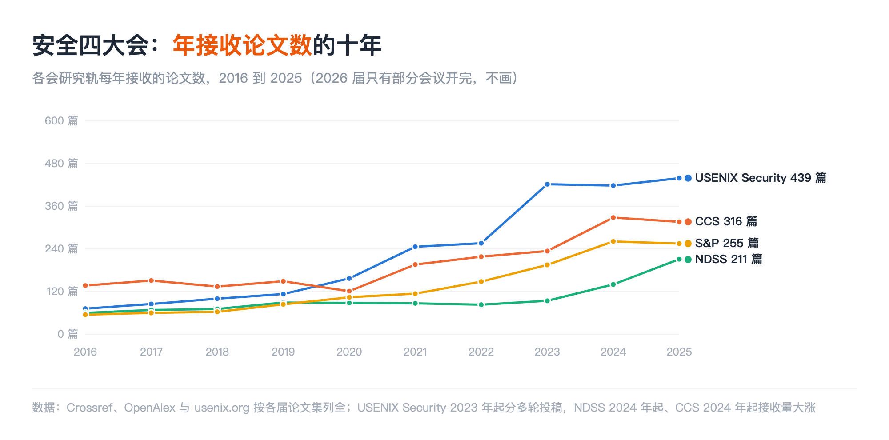
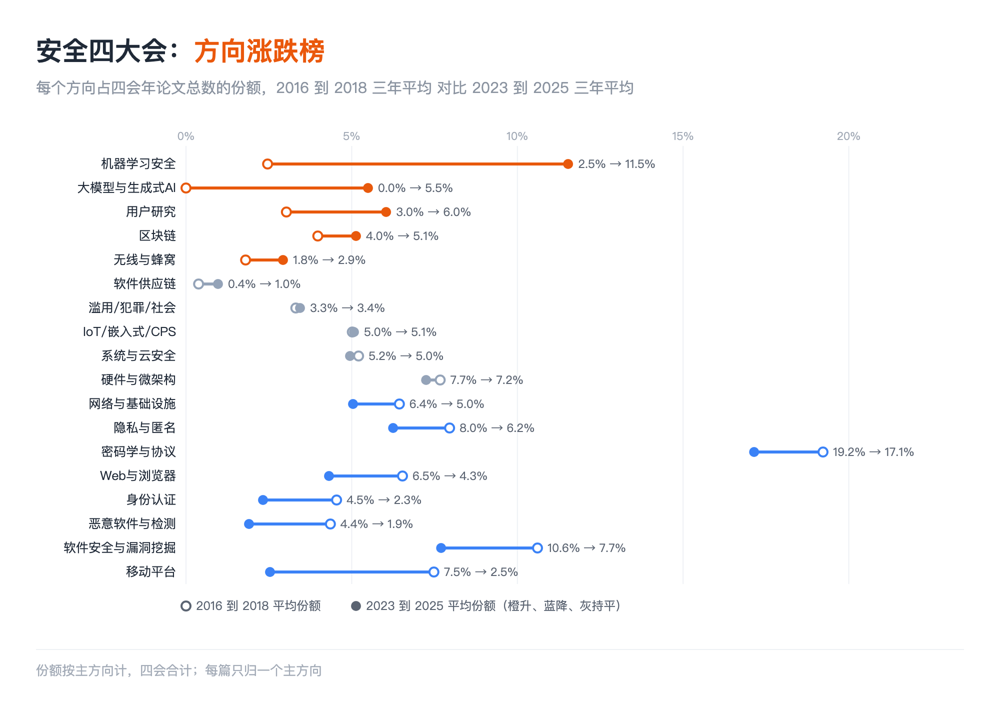
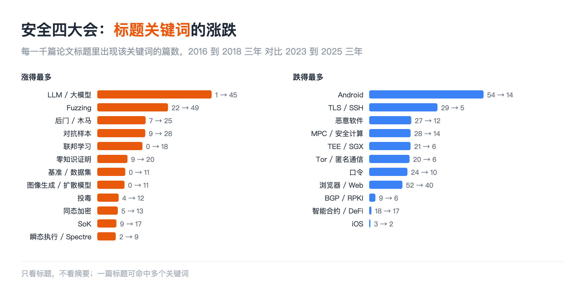
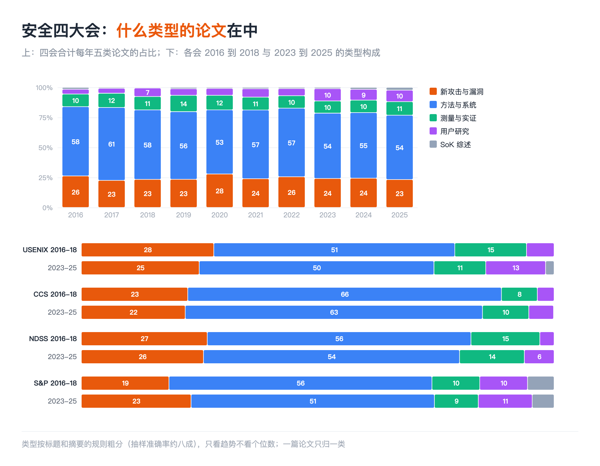
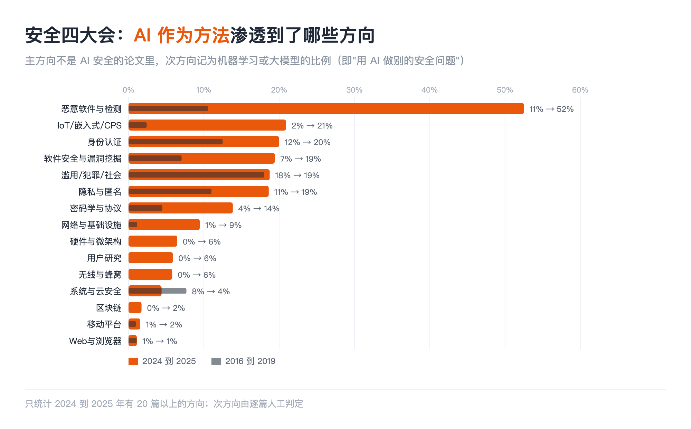
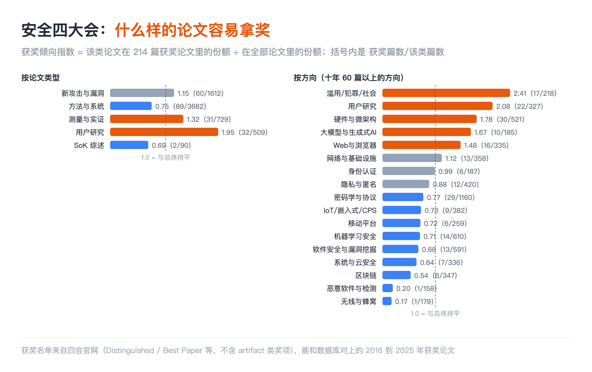
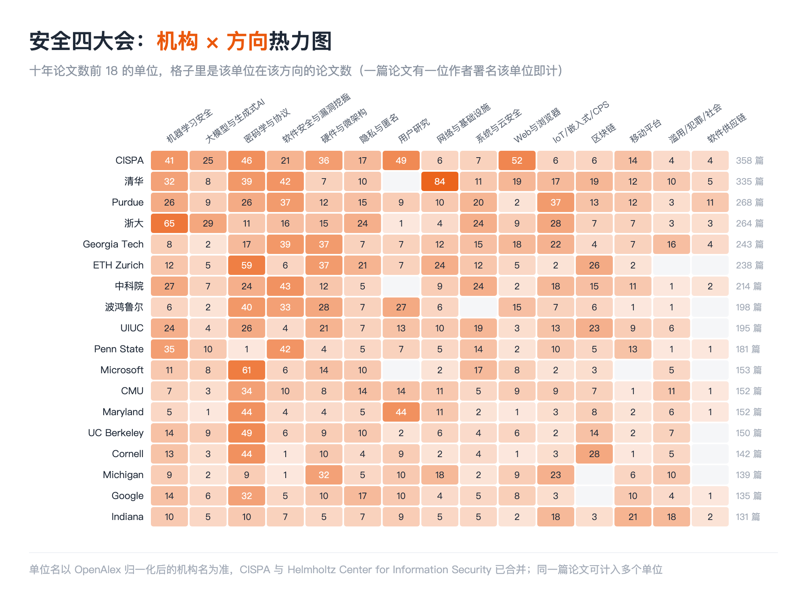
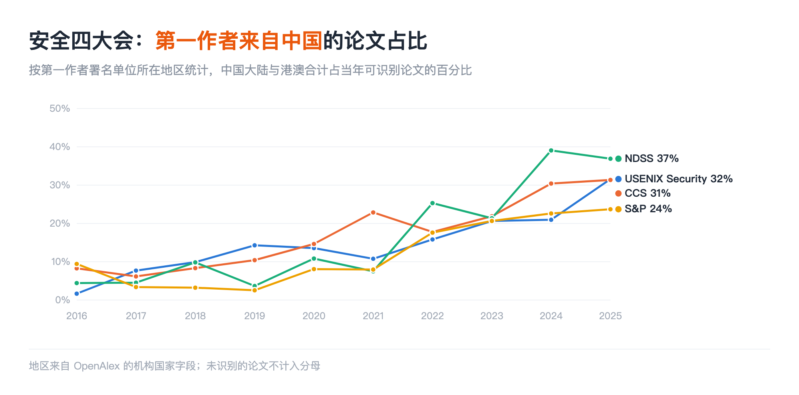

## LIST INFO|本期说明

【范围】安全四大会十年的全部正式论文：USENIX Security 2016 到 2025 十届加 2026 Cycle 1（2473 篇），ACM CCS 2016 到 2025（1984 篇），NDSS 2016 到 2026（1256 篇），IEEE S&P 2016 到 2026（1591 篇），合计 7304 篇。这个系列里四家逐会的十年趋势各有一期，这期把四家放在一起看
【来源】USENIX 取自 usenix.org 各届官方页面，另外三家按论文集 DOI 从 Crossref 列全再用 OpenAlex 补摘要、单位和国家；八十多个会议年份逐年和 DBLP 目录核对过；workshop、poster、demo、keynote 不计
【口径】四家用同一套 18 个方向的分类，每篇只归一个主方向（可带一个次方向），逐篇人工判定。论文类型（攻击、方法、测量、用户研究、SoK）按标题和摘要的规则粗分，抽样准确率约八成，只用来看趋势。获奖论文以四会官网的 Distinguished / Best Paper 名单为准，能和数据库对上的 2016 到 2025 年共 214 篇。横向比较统一用 2016 到 2025 十个完整年份，2026 年的数据只在文中单独提及
【怎么读】这期不讲单篇论文做了什么，讲结构：每一节先给图，再给几条判断。想看逐篇的代表作，去各会那一期

@stats
- 324 → 1221 篇 | 四会年接收总量，十年扩了 3.8 倍
- 14% → 29% | 和 AI 有关（作为对象或方法）的论文比例，2019 到 2025
- 1.95 | 用户研究类论文的获奖倾向指数，方法类只有 0.75
- 2% | 2024 到 2025 年论文里来自四会"新面孔"单位的比例，没有一个方向超过 6%

规模先说清楚。四会合计年接收量 2016 年 324 篇，2020 年 470 篇，2023 年 945 篇，2025 年 1221 篇。S&P 2019 年起逐年涨，2024 年到 261 篇后稳住；USENIX 2023 年从 256 跳到 422；CCS 2024 年从 234 跳到 328；NDSS 最晚，2024 年 140、2025 年 210、2026 年 265。共同原因是审稿制改成多轮滚动投稿。==2016 年一个人一年能把四会的论文读完，2025 年做不到了==。扩张改变了下面每一节的分母：一个方向份额不变，意味着它的绝对篇数已经涨了近四倍。

## WHAT|研究什么：对象从设备和协议迁到生态和模型

@table
- 组 | 方向 | 份额变化 | 一句判断
- 涨 | 机器学习安全、大模型 | 2.5% → 17.0%（两者合计） | 十年新增份额的七成在这里，2025 年合计 235 篇
- 涨 | 用户研究 | 3.0% → 6.0% | 份额翻倍，且拿奖最多（见第 4 节）
- 涨 | 区块链、无线与蜂窝、供应链 | 各涨 0.6 到 1.1 个百分点 | 区块链跟着行情走，无线跟着 5G 和卫星走，供应链基数最小
- 稳 | IoT、系统、硬件、社会议题 | 变化不到 1 个百分点 | 绝对篇数跟着大盘涨了三倍多
- 跌 | 密码学、隐私、网络 | 各跌 1.4 到 2.1 个百分点 | 被摊薄，绝对篇数仍在涨，密码学 2025 年 208 篇仍是第一
- 跌 | 软件安全、Web、身份认证、恶意软件、移动 | 各跌 2.2 到 5.0 个百分点 | 移动从 7.5% 到 2.5% 跌得最狠，恶意软件和认证已不足 2%

方向是我们分的，标题关键词是作者自己写的。把两者放在一起看更清楚：

几条判断：

- **研究对象换了一代。** 跌得最多的关键词是 Android（每千篇 54 到 14）、TLS 和 SSH（29 到 5）、恶意软件（27 到 12）、Tor（20 到 6）、口令（24 到 10），都是"一台设备、一个协议、一个二进制"。涨得最多的是大模型（1 到 45）、后门、对抗样本、联邦学习、投毒、基准和数据集，对象变成了"一个模型、一批数据、一个生态"。==十年前安全研究的对象是机器，现在是模型和它周围的系统==
- **只有 AI 是真正的增量。** 18 个方向里份额涨超过 1 个百分点的只有机器学习安全、大模型和用户研究。其余方向的"热"都是绝对数的热，份额没变或在跌。看一个方向是不是在崛起，要看份额，不看篇数
- **跌的方向有两种跌法。** 密码学、隐私、网络是被摊薄，绝对篇数在涨，只是涨得比 AI 慢；移动、恶意软件、身份认证是题材做完了，Android 框架机制、恶意软件分类器、口令猜测在 2016 到 2019 年做完一轮，之后变成生态测量和补丁追踪，绝对篇数也不涨了
- **有些方向没跌，是换了工具。** 软件安全份额从 10.6% 到 7.7%，但 Fuzzing 这个词从每千篇 22 涨到 49，二进制和反编译也在涨。它的一部分题材（LLM 做漏洞挖掘和修复）被记进了大模型方向，把次方向算回来，软件安全相关论文的份额基本没跌
- **密码学内部也在换题。** MPC 在标题里从 28 跌到 14，同态加密从 5 涨到 13，零知识从 9 涨到 20，PIR 从 2 涨到 7。方向份额只小跌了 2 个百分点，但里面的题材换了一轮，从"多方计算怎么做"走到"证明、检索和同态怎么做得快"

> 十年的方向结构变化可以压缩成一句话：==AI 安全从四会合计 5 篇涨到 235 篇，其他 16 个方向的相对位置几乎没变==。2016 年的前五（密码学、移动、软件安全、网络、Web）里，2025 年移动和 Web 都掉出了前十，另外三个还在。

## HOW|怎么研究：类型没变，方法在换，人进来了

把每篇论文粗分成五类：新攻击与漏洞（提出攻击、发现新漏洞或侧信道）、方法与系统（防御、新协议、分析工具、密码方案）、测量与实证（大规模测量、评测、复现）、用户研究（访谈、问卷、实验）、SoK 综述。

@stats
- 54% | 2025 年方法与系统类的占比，2016 年是 58%
- 23% | 新攻击与漏洞类的占比，十年稳在 23% 到 28%
- 13 → 117 篇 | 用户研究类论文的年篇数，2016 到 2025
- 2.5% → 12.6% | 非 AI 方向里"用 AI 做方法"的论文比例

#### 类型：构成十年几乎不动

- **一半以上是方法与系统，四分之一是攻击，一成是测量。** 会议扩了 3.8 倍，收进来的仍然是同样比例的东西。想靠"换一种论文类型"提高命中率，空间很小
- **用户研究是唯一在结构上扩张的类型。** 年篇数从 13 到 117，占比从 4% 到 10%，USENIX 2023 到 2025 年 13%，S&P 11%，CCS 5%，NDSS 6%。研究对象也在换：关注开发者、维护者、管理员和从业者的用户研究从早三年的 15% 涨到近三年的 26%，"可用安全"从终端用户转向了写代码和运系统的人
- **类型和方向是绑定的。** 密码学 85% 是方法，硬件 60% 是攻击，社会议题 33% 是测量，用户研究 78% 是用户研究（下表）。选了方向就基本选了类型；反过来，一篇"硬件方向的测量研究"或"密码学方向的用户研究"是稀有物种，写得好容易被记住

@table
- 方向 | 攻击 | 方法 | 测量 | 用户研究 | 读法
- 密码学 | 11% | 85% | 2% | 1% | 只收新方案
- 软件安全 | 13% | 77% | 6% | 2% | 工具为主
- 系统与云 | 18% | 72% | 6% | 2% | 偏防御机制
- 区块链 | 15% | 71% | 11% | 3% | 协议与工具
- 隐私 | 20% | 64% | 10% | 5% | 差分隐私方案
- 机器学习安全 | 52% | 35% | 9% | 3% | 攻击型
- 硬件 | 60% | 31% | 6% | 1% | 最攻击型
- 大模型 | 37% | 37% | 18% | 7% | 攻防各半，测量多
- 网络 | 29% | 47% | 20% | 2% | 测量传统深
- Web | 23% | 47% | 25% | 4% | 四分之一测量
- 移动 | 21% | 40% | 29% | 10% | 测量加访谈
- 社会议题 | 10% | 36% | 33% | 17% | 测量与访谈

#### 方法：AI 渗透到了哪些老方向

- **渗透率从 2.5% 到 12.6%，但极不均匀。** 恶意软件检测 52%，IoT 21%，身份认证 20%，软件安全 19%，隐私 19%，密码学 14%（MPC 和 FHE 做机器学习推理）。硬件 6%，区块链 2%，Web 1%
- **渗透率高的方向恰好是份额在跌的方向。** 恶意软件、身份认证、软件安全三个方向份额都跌了，但它们内部用 AI 的比例涨得最快。老方向在用新工具续命，不是被新工具取代
- **Web 和区块链几乎没被渗透。** 这两个方向的问题结构（协议、合约逻辑、浏览器机制）不适合学习型方法，它们的评审标准十年也没被 AI 改变
- **接口换了。** 2016 到 2019 年最常见的主次方向组合是"密码学 + 隐私"和"区块链 + 密码学"；2024 到 2025 年是"机器学习安全 + 隐私"（71 篇）和"密码学 + 机器学习安全"（50 篇）。隐私计算做推理、差分隐私做训练，是老方向和 AI 之间最宽的接口

#### 人：谁能进来

用两个口径看一个方向对新人开不开放。口径一：2024 到 2025 年该方向的论文里，所有署名单位在 2016 到 2021 年都没在这个方向发过的比例（老单位换方向也算）。口径二：所有署名单位在 2016 到 2021 年在四会任何方向都没发过的比例（真正的新面孔）。只看 2016 到 2021 年有 60 篇以上、基数够大的方向：

@table
- 方向 | 口径一：换方向进来 | 口径二：新面孔 | 读法
- 身份认证 | 40% | 0% | 老方向，头部团队已散，老单位在补位
- 恶意软件 | 30% | 0% | 同上
- 社会议题 | 30% | 2% | 开放且分散
- 移动 | 29% | 0% | 题材做完，换了一批单位在做生态测量
- 用户研究 | 26% | 4% | 头部最集中，CISPA 和 Maryland 占近三成
- 机器学习安全 | 25% | 3% | 已经形成头部团队
- 隐私 | 24% | 6% | 新面孔最多的方向，也只有 6%
- 硬件 | 17% | 2% | 四五个组的天下
- 密码学 | 15% | 5% | 单位最分散，但换方向进来的最少：门槛在知识不在关系
- 网络 | 12% | 3% | 清华一家 74 篇
- Web | 8% | 1% | 最封闭的方向

- **四会几乎没有新面孔。** 任何方向 2024 到 2025 年的论文里，来自 2016 到 2021 年从没在四会发过的单位的比例都不超过 6%，多数方向在 0% 到 3%。所谓"新进入者"，几乎全是四会的老单位换了个方向
- **大模型方向不是新人的窗口。** 2024 到 2025 年 168 篇大模型论文里，85% 背后有 2016 到 2021 年就在做机器学习安全的单位，14% 是老单位从软件安全、密码学、IoT、移动转过来的，只有 2% 是四会新面孔。这个方向的扩张是老团队的扩张
- **换方向进来最多的是退潮的老方向。** 身份认证、恶意软件、移动三个份额在跌的方向，换方向进来的比例反而最高（29% 到 40%），因为原来的头部团队走了，留下的题材由别的单位顺手做

> 合作的形态也在变：平均作者数从 2016 年的 4.8 人到 2025 年的 5.7 人，跨单位合作稳定在三分之二，跨国合作四分之一，工业界参与从 14% 降到 10%。==四会论文越来越是大学之间的多人合作，工业界的存在感在下降==，只在密码学（微软 59 篇、Google 28 篇）和 AI 安全里还很强。

## JUDGE|怎么被评价：拿奖的是测量和访谈，SoK 在 2024 年后翻三倍

四会 2016 到 2025 年能对上的获奖论文 214 篇，获奖率 3.2%（S&P 4.2%，USENIX 和 CCS 3.2%，NDSS 2.1%）。获奖倾向指数是"该类论文在获奖论文里的份额"除以"在全部论文里的份额"，1.0 是持平。

@stats
- 1.95 | 用户研究类的获奖倾向，四类里最高
- 1.32 | 测量与实证类
- 0.75 | 方法与系统类，收得最多，拿奖最少
- 2.41 | 社会议题方向的获奖倾向，方向里最高

- **拿奖的和收得多的不是一回事。** 方法与系统占论文的 54%，只占获奖的 42%；用户研究占 7%，占获奖的 15%。程序委员会用奖来奖励它们平时收得少的东西
- **"测量一个真实生态"和"访谈一群真实的人"最容易拿奖。** 社会议题（2.41）、用户研究（2.08）两个方向和测量（1.32）、用户研究（1.95）两个类型同时领先。NDSS 的 24 篇获奖论文里至少 8 篇是生态测量，USENIX 的获奖名单里人口贩卖幸存者、性工作者、约旦家庭这些题材的比重远高于它们的论文份额
- **硬件是唯一"攻击型"且拿奖多的方向。** 倾向 1.78，30 篇获奖，S&P 从 A2 到 Spectre、TRRespass、WeSee 几乎每年给硬件一个奖。硬件攻击的"新家族"属性强，容易被认成开创性工作
- **最大的方向拿奖最难。** 密码学十年 1160 篇，获奖 29 篇，倾向 0.77；机器学习安全 610 篇，获奖 14 篇，0.71；软件安全 0.68；区块链 0.54。方向越拥挤，一篇论文越难在同类里显得特别
- **"质疑评估方法"是跨四家的加分项。** USENIX 2022 年 **Dos and Don'ts of Machine Learning in Computer Security**，S&P 2024 年 **SoK: Prudent Evaluation Practices for Fuzzing** 和 **Shedding Light on CVSS Scoring Inconsistencies**，USENIX 2025 年 **Confusing Value with Enumeration: Studying the Use of CVEs in Academia**，四篇都拿了奖。共同点是拿领域自己的习惯开刀

#### SoK：从一家的类型变成三家的类型

- **十年 89 篇以 SoK 冠名的论文，2016 到 2022 年每年 2 到 7 篇，2024 年 19 篇，2025 年 28 篇。** 原因是会议政策：S&P 一直单独收 SoK（十年 66 篇），USENIX 2024 年起收（7 篇、16 篇），NDSS 2026 年起收（4 篇），CCS 至今没有
- **SoK 出现在哪个方向，说明那个方向进入了整顿期。** 十年 SoK 最多的方向是密码学和机器学习安全（各 12 篇），其次软件安全、社会议题（各 9 篇）、硬件（8 篇）；大模型方向只有 2 篇，还在扩张期
- **SoK 不容易拿奖，但引用往往最高。** 90 篇 SoK 只有 2 篇获奖，倾向 0.69。奖和影响力是两回事

## VENUE|四家的性格

@table
- 会议 | 2025 年前三方向 | 性格
- USENIX | 密码学 13.9%、大模型 12.3%、机器学习安全 9.3% | 最大最杂，题材最广，新方向最先出现分会场。用户研究 13%，四家最高。获奖率 3.2%
- CCS | 密码学 26.6%、机器学习安全 9.5%、隐私 7.3% | 密码学的绝对主场，MPC、ZK、FHE、PIR 的工程化论文大半在这里。方法与系统 63%，四家最高。获奖率 3.2%
- NDSS | 机器学习安全 17.1%、系统 8.5%、网络 8.5% | 网络和物理世界的会。测量 14%，用户研究只有 6%，几乎不收。获奖率 2.1%
- S&P | 密码学 18.4%、用户研究 9.8%、硬件 9.4% | 最"重"的一家，硬件、协议验证、用户研究三个高门槛方向合计超过三分之一。SoK 5%，唯一稳定收 SoK 的会。获奖率 4.2%

四家的口味在获奖名单里最清楚：

@table
- 会议 | 最偏爱 | 典型套路
- CCS | 密码学、"给旧系统找新漏洞" | 2016 到 2017 年的最佳论文几乎全是密码学和协议分析，2022 年后 OpenPGP、DNSSEC KeyTrap、SSH 客户端签名都拿了奖
- S&P | 协议验证、硬件、用户研究 | "打一个真实部署的协议再给出证明"最认（TLS 1.3、Telegram、MEGA、Matrix）
- NDSS | 测量、物理世界 | 24 篇里至少 8 篇是"测量一个生态"，2024 年后 3 篇涉及电磁或声学信道
- USENIX | 用户研究、社会议题 | 获奖名单里高风险人群的研究比重远高于论文份额

- **硬件最能体现四家差异。** S&P 2019 到 2020 年冲到 18%，Spectre、RIDL、TRRespass 都在那两年；CCS 2022 年 11.4%；USENIX 稳在 6% 到 9%；NDSS 2016 年是 0。但十年下来四家的硬件论文 521 篇，每个攻击家族在四家都有代表作，只是首发的会不同
- **用户研究十年前就分好了会。** USENIX 和 S&P 2025 年 8% 到 10%，CCS 3.8%，NDSS 0.5%
- **四家给大模型论文颁奖的时间点排成一条线。** S&P 2022 年 **Asleep at the Keyboard? Assessing the Security of GitHub Copilot's Code Contributions**，CCS 2023 年 **Large Language Models for Code: Security Hardening and Adversarial Testing**，NDSS 2024 年 **LMSanitator: Defending Prompt-Tuning Against Task-Agnostic Backdoors**，USENIX 2025 年 **We Have a Package for You! A Comprehensive Analysis of Package Hallucinations by Code Generating LLMs**。四篇里三篇和代码或开发工具有关

> 一个实用的读法：==看一个方向的绝对热度看 USENIX，看它在同行里的相对位置看 CCS，看领先信号看 S&P，看物理世界和网络看 NDSS==。

## FRONTIER|前沿在哪：什么在起来，什么在退潮

按标题和摘要的关键词数每个题材的年篇数（2026* 列只有 USENIX Cycle 1、NDSS、S&P 三家的部分数据，约相当于半年），可以把题材分成四个阶段：

@table
- 题材 | 2023 | 2024 | 2025 | 2026* | 阶段
- 提示注入与越狱 | 0 | 9 | 19 | 21 | 扩张
- LLM Agent | 0 | 2 | 11 | 17 | 扩张
- RAG 攻防 | 0 | 0 | 11 | 3 | 起步
- 图像生成与深度伪造 | 9 | 22 | 29 | 10 | 扩张
- 后量子 | 8 | 10 | 23 | 9 | 转向实现
- Rowhammer | 5 | 6 | 12 | 7 | 第二波
- Rust | 2 | 4 | 7 | 4 | 起步
- 供应链 | 13 | 6 | 15 | 8 | 上行
- 联邦学习 | 21 | 27 | 26 | 13 | 平台期
- 差分隐私 | 26 | 33 | 33 | 15 | 平台期
- 对抗样本 | 8 | 21 | 6 | 2 | 退潮
- 自动驾驶 | 11 | 14 | 9 | 2 | 退潮
- 口令 | 35 | 27 | 18 | 10 | 退潮
- 比特币与以太坊 | 24 | 22 | 18 | 8 | 回落

几条判断：

- **大模型安全内部已经分层。** 提示注入和 Agent 两条线 2026 年上半年的篇数已经超过 2025 年全年，RAG 第一年就有 11 篇；对抗样本这条传统线 2024 年冲到 21 篇后 2025 年只剩 6 篇。S&P 的 AI 安全 2024 年冲到 23.8% 后回落到 14.9%，就是传统题材做完一轮的信号。另外三家 2025 年还在涨，按 S&P 领先一年的规律，2027 年前后会出现同样的转折
- **攻击面十年往外走了六层。** 模型参数（2016 年 **Stealing Machine Learning Models via Prediction APIs**）→ 训练数据（2017 年 **Membership Inference Attacks Against Machine Learning Models**）→ 训练流程（2018 年 **Trojaning Attack on Neural Networks**）→ 推理时的输入（2024 年 **MASTERKEY: Automated Jailbreaking of Large Language Model Chatbots**）→ 检索到的外部内容（2025 年 **PoisonedRAG: Knowledge Corruption Attacks to Retrieval-Augmented Generation of Large Language Models**）→ Agent 的工具生态（2026 年 **Parasites in the Toolchain: A Large-Scale Analysis of Attacks on the MCP Ecosystem**）。==每往外走一层，"模型"就越不像被攻击的对象，越像一个被攻击的系统的组件==
- **老方向的新一轮题材都和"实现"有关。** 后量子 2025 年 23 篇是前一年的两倍多，Rowhammer 从 DRAM 扩到 GPU 和 DDR5，Rust 从访谈走到静态分析和 C 到 Rust 翻译。 后量子从提方案走到打实现（2025 年 S&P 的 **PQ-Hammer: End-to-End Key Recovery Attacks on Post-Quantum Cryptography Using Rowhammer**），零知识从"证得快"走到"证明系统自己有没有 bug"（2023 年 S&P 的 **Weak Fiat-Shamir Attacks on Modern Proof Systems**），瞬态执行从"发现新攻击"走到"证明每个缓解都不完整"（2025 年 USENIX 的 **Branch Privilege Injection: Compromising Spectre v2 Hardware Mitigations by Exploiting Branch Predictor Race Conditions**）。方案层做完了，实现层是下一个十年的矿
- **四家都出现了"审视自己"的论文，这是一个方向从扩张期进入整顿期的标志。** USENIX 2022 年 **Dos and Don'ts of Machine Learning in Computer Security**，CCS 2023 年 **"Get in Researchers; We're Measuring Reproducibility": A Reproducibility Study of Machine Learning Papers in Tier 1 Security Conferences**，S&P 2024 年 **SoK: Unintended Interactions among Machine Learning Defenses and Risks**，NDSS 2026 年 **Chasing Shadows: Pitfalls in LLM Security Research**。fuzzing 方向 2018 年就走过这一步（CCS 2018 年 **Evaluating Fuzz Testing**），之后这个方向的实验部分明显变严，门槛高了，份额也跌了。大模型方向正在重复这个过程

## WHO|谁在做：机构、人、地区

按"论文有至少一位作者署名该单位"计，四会十年合计的前十是 CISPA（358 篇）、清华（335）、Purdue（268）、浙大（264）、Georgia Tech（243）、ETH Zurich（238）、中科院（214）、波鸿鲁尔（198）、UIUC（195）、Penn State（181）。中国三家、美国四家、欧洲三家。榜单只说明规模，热力图说明每家在做什么：

@table
- 方向 | 头部单位（十年篇数） | 代表团队
- 网络 | 清华 74、ETH 21、Princeton 15 | 清华 Qi Li、Haixin Duan、Baojun Liu 三个组，DNS、邮件、RPKI、审查测量
- 机器学习安全 | 浙大 63、CISPA 41、Penn State 34 | 浙大 Shouling Ji 和 Kui Ren，CISPA Yang Zhang 和 Michael Backes，Duke Neil Gong
- 大模型 | CISPA 22、浙大 19、南洋理工 15 | 南洋理工 Tianwei Zhang 和 Yang Liu 两年 25 篇，增长最快
- 密码学 | 微软 59、ETH 54、UC Berkeley 46 | ETH Paterson（协议分析）和 Basin（验证），微软的 MPC 和验证密码库，Berkeley Popa
- 硬件 | TU Graz 46、Georgia Tech 35、Michigan 32 | Gruss（TU Graz）、Schwarz（CISPA）、Razavi（ETH）、Genkin（Georgia Tech）四个组
- 软件安全 | 中科院 41、Penn State 40、清华 39 | 信工所 Kai Chen，清华 Chao Zhang，Penn State Xinyu Xing，UC Riverside Zhiyun Qian
- IoT | Purdue 36、浙大 26、UC Irvine 24 | Purdue 三个组（Dongyan Xu、Berkay Celik、Bianchi），浙大 Wenyuan Xu 的物理信道
- Web | CISPA 50、UIC 24、Stony Brook 19 | CISPA Ben Stock，Stony Brook Nikiforakis
- 用户研究 | CISPA 49、Maryland 43、波鸿 27 | CISPA Sascha Fahl，Maryland Michelle Mazurek；中国单位几乎没有
- 区块链 | Cornell 26、ETH 26、UIUC 22 | Cornell Ari Juels（MEV、DeFi），Duke Kartik Nayak（共识）

- **集中度和拿奖倾向反着走。** 用户研究前五家占 49%、拿奖倾向 2.08；密码学前五家占 21%、拿奖倾向 0.77。头部团队少的方向，一篇好论文更容易被看见
- **中国单位的方向画像很清楚。** 网络（清华）、机器学习安全（浙大）、软件安全（中科院、清华）、IoT 物理攻击（浙大）四个方向是第一或前三；用户研究、社会议题、密码学基础方案几乎缺席。和第 4 节"拿奖的是测量和访谈"放在一起看，这解释了为什么中国单位论文数第一但获奖比例偏低
- **人在动，方向跟着动。** Daniel Genkin 2022 年从密歇根到 Georgia Tech，之后每年 4 到 7 篇硬件论文跟着走；Thorsten Holz 2022 年从波鸿到 CISPA，CISPA 的软件安全从此前十年 1 篇变成每年 3 到 5 篇；Michael Schwarz 2021 年从 TU Graz 到 CISPA，CISPA 的硬件从 3 篇跳到 8 篇。==看一个单位的方向曲线，先要看它的人是不是还在==

按第一作者的署名单位所在地区看，四会合计 2016 年美国 53%、欧洲 30%、中国大陆与港澳 7%；2025 年美国 33%、中国 31%、欧洲 23%。==NDSS 2024 年中国 36% 第一次超过美国的 28%，USENIX 2025 年 32% 对 31%，CCS 2025 年 30% 对 31%，S&P 2026 年美国 38%、中国 22%，是唯一一家美国仍然明显领先的==。欧洲十年基本稳定。方向和地区的耦合在四家一致：中国团队集中在机器学习安全、大模型、网络、区块链、IoT 和硬件侧信道，正好是近年扩张最快的方向；美国团队在系统、软件安全、隐私和用户研究上仍然领先；欧洲团队在密码学、硬件和用户研究上占优。"第一作者所在地区"不等于"研究做在哪里"，联合署名和跨国流动很常见，这里只是一个粗粒度的指标。

## TAKEAWAYS|往哪走：给三类读者的判断

**如果你在选题**

- 份额涨的只有 AI 和用户研究，其他 16 个方向的相对位置十年没变。看份额判断趋势，看篇数判断名额
- 大模型方向不是新人的窗口：85% 的近两年论文背后是原来做机器学习安全的团队，S&P 2024 年已见顶，传统题材（对抗样本、后门、成员推断）在退，留下的是 Agent、RAG、生态测量和"审视自己"三类题材
- 老方向的下一轮都在"实现层"：后量子实现攻击、零知识编译器的 bug、瞬态执行缓解措施的漏洞、Rust 迁移、LLM 做修复。这些线都还没拥挤
- 稳的方向最好投：IoT、系统、硬件、社会议题份额十年不动，题材没有做完的迹象

**如果你在选会**

- 类型构成十年不动，换类型不能提高命中率，但能改变拿奖概率：用户研究 1.95，测量 1.32，方法 0.75
- 拿奖的是"测量一个真实生态"和"访谈一群真实的人"，以及硬件的新攻击家族；最大的四个方向（密码学、机器学习安全、软件安全、区块链）拿奖都最难
- SoK 现在有三个去处（S&P、USENIX、NDSS），CCS 没有；用户研究只有两个去处（USENIX、S&P）
- 一个新方向的第一个奖，比它的论文数拐点早一到两年。想知道 2027 年的热点，看 2026 年四家的分会场名和获奖名单

**如果你在带组**

- 看方向先看人：头部团队搬家会带走整个方向，Genkin、Holz、Schwarz 三个例子都在数据里
- 中国单位论文数已是第一，但集中在攻击型和测量型的技术方向，用户研究和社会议题几乎缺席，而这两个方向恰好是拿奖倾向最高的。补这两块的团队，回报最高
- 工业界在四会的存在感十年从 14% 降到 10%，只在密码学和 AI 安全里还强。和工业界合作的价值在于数据和部署，不在于发表

顺带说一句本账号关心的供应链：这个方向十年只有 49 篇主方向论文，但把次方向和标题关键词算上有 123 篇，其中三分之二散在软件安全、Web、用户研究和 AI 方向里。它在四会里的类型构成（三成测量、一成用户研究）更像社会议题而不是软件安全，没有专门的团队，最多的 Purdue 十年也只有 8 篇。最重要的新论文在大模型方向的分会场里：包幻觉、代码补全投毒、MCP 生态、恶意模型分发，作者可能没用"supply chain"这个词，讲的都是"上游给你的东西不可信"。
