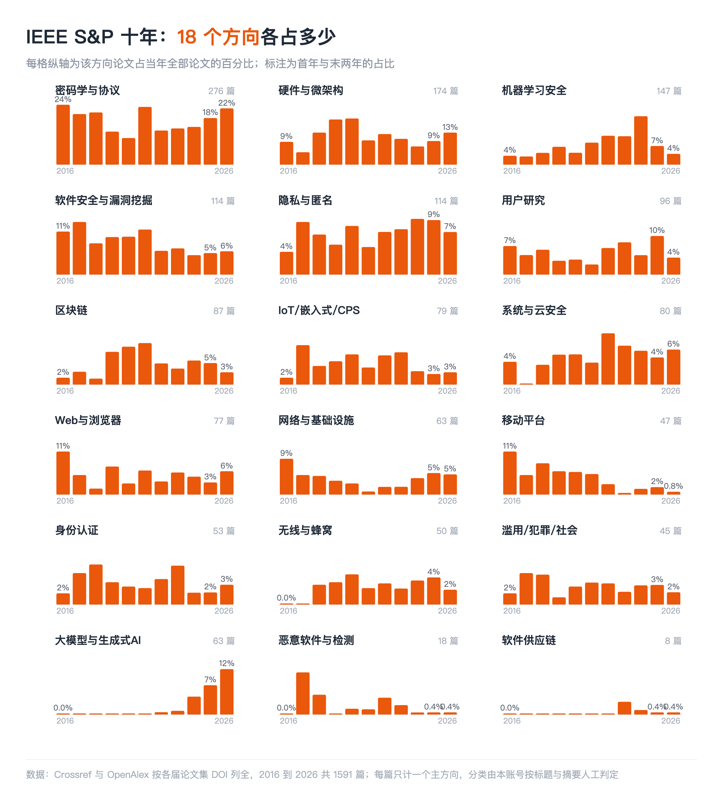
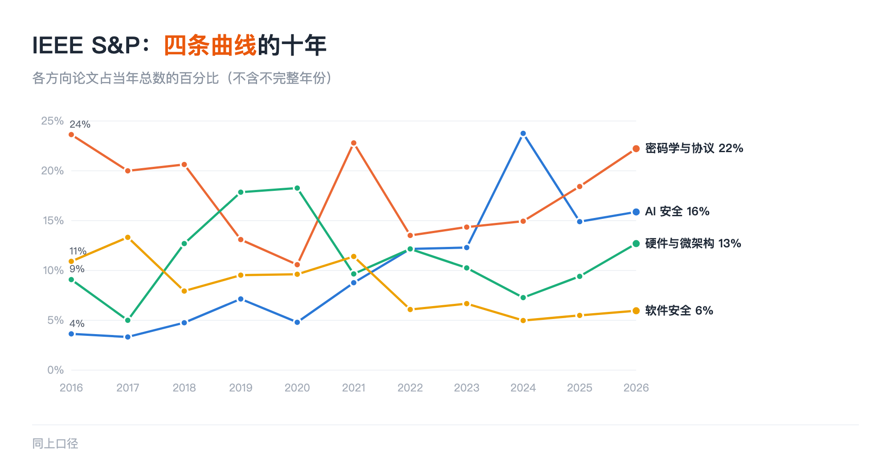
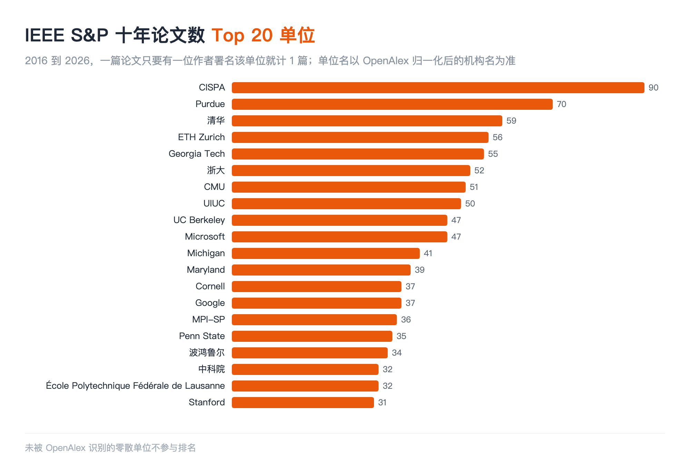
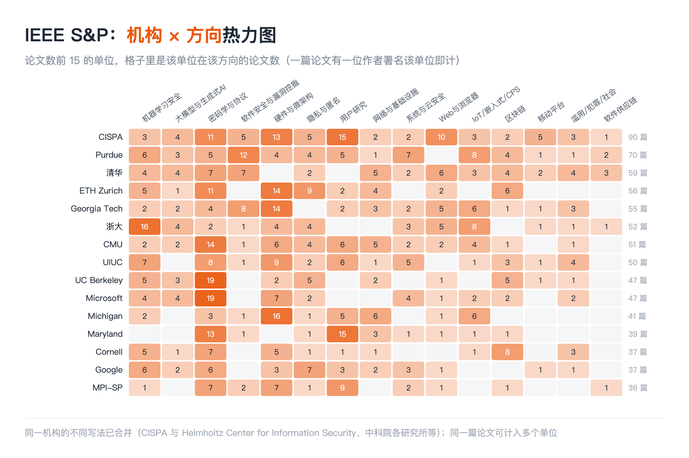
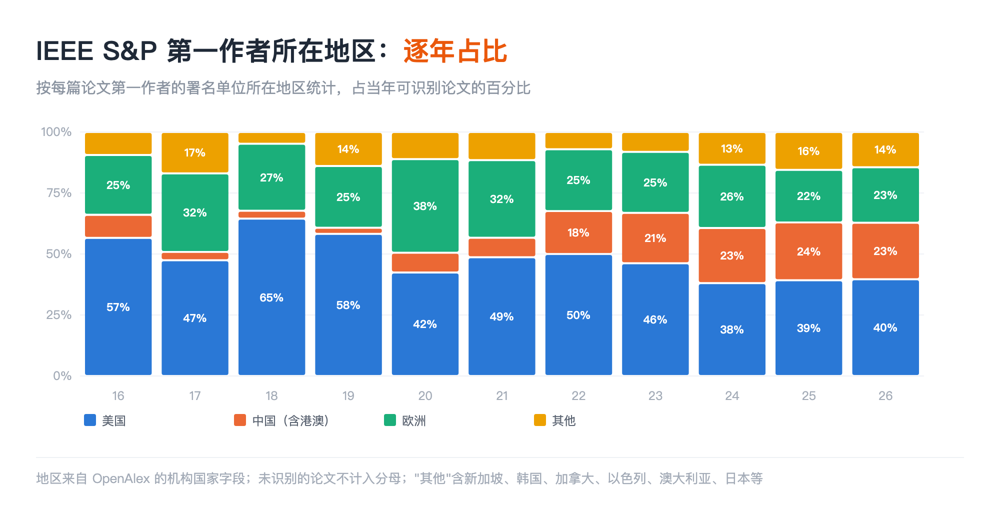

## LIST INFO|本期说明

【范围】IEEE Symposium on Security and Privacy（S&P，Oakland）2016 到 2026 十一届的全部正式论文，共 1591 篇。S&P 每年 5 月开会，2026 届已经开过，数据是完整的
【来源】按每届论文集的 DOI 从 Crossref 列全标题与作者，再用 OpenAlex 补摘要、作者单位和国家，逐年和 DBLP 目录核对过（IEEE Xplore 重复登记的 3 篇已去重）；同期的 workshop 论文、poster 和 short talk 不计
【口径】每篇只归一个主方向（可带一个次方向），共 18 个方向，判定依据是标题和摘要，分类体系与本系列 USENIX Security、CCS、NDSS 三期一致。2026 届在 OpenAlex 里只有四分之一的论文有摘要，那一年的分类主要靠标题，误差比其他年份大。分类是逐篇人工判定，个位数的出入不影响趋势

@stats
- 55 → 252 篇 | 年接收量，2024 年 261 篇是峰值，之后稳在 250 上下
- 18% | 硬件与微架构 2019 和 2020 年的份额，四大会里最高
- 19% → 4% | 机器学习安全（不含大模型）2024 到 2026 年的份额
- 10% | 用户研究 2025 年的份额，四大会里最高

先交代规模。S&P 2016 只有 55 篇，2019 年 84 篇，2022 年 148 篇，2024 年 261 篇，之后两年都在 250 出头。扩张主要发生在 2019 到 2024 年，比 USENIX Security 早一年、比 NDSS 早两年。2024 年之后的接收量稳定，意味着 2025 和 2026 两年的份额变化是真实的结构变化，不是分母效应。

S&P 的特点是"重"：硬件、密码学、用户研究三个方向的比重都高于另外三家。这三个方向的共同点是门槛高，硬件要有芯片和测量设备，密码学要有证明，用户研究要有 IRB 和几百个被试。S&P 的评审传统偏好这类"做得慢"的工作。

## BIG PICTURE|十年三个大迁移

#### 硬件安全两度冲顶

硬件与微架构 2018 年 12.7%，2019 年 17.9%，2020 年 18.3%，之后回落到 7% 到 13% 之间，2026 年 12.7% 又回到高位。两次高峰分别对应瞬态执行攻击的第一波（Spectre、RIDL、Fallout 都在 S&P 2019）和机密计算的第二波（2026 年一届有 TEE.Fail、Battering RAM、BreakFAST、TDXRay、VMSCAPE 五篇打机密虚拟机）。十年 174 篇，是四大会里硬件绝对数最多的一家。

#### AI 安全 2024 年见顶，大模型接棒

机器学习安全从 2016 年的 2 篇涨到 2024 年的 50 篇（19.2%），是当年第一大方向；2025 年 19 篇（7.4%），2026 年 11 篇（4.4%）。大模型方向 2024 年 12 篇，2025 年 19 篇，2026 年 29 篇（11.5%）。两者合计 2024 年 62 篇（23.8%），2025 年 38 篇（14.8%），2026 年 40 篇（15.9%）。==S&P 是四大会里唯一一家 AI 安全份额在 2024 年之后明显回落的==。传统机器学习安全（对抗样本、后门、成员推断）在 2024 年集中释放之后，2025 年起明显减少，大模型方向的增量没有完全补上缺口。

#### 密码学重回两成，移动跌到 1%

密码学 2016 年 23.6%，2020 年 10.6% 是低谷，2021 年反弹到 22.6%，2025 年 18.4%，2026 年 22.2%。移动平台从 2016 年的 6 篇（10.9%）跌到 2026 年的 2 篇（0.8%），是跌幅最大的方向，和 NDSS 上的走向一致。

## HW|硬件与微架构：174 篇，瞬态执行和 Rowhammer 的主场

硬件安全在 S&P 上有两条长线和一条新线。

@timeline
- 2016 | A2: Analog Malicious Hardware | 用一个电容做出的模拟硬件木马，当年杰出论文
- 2018 | Another Flip in the Wall of Rowhammer Defenses | 系统绕过当时所有 Rowhammer 防御
- 2019 | Spectre Attacks: Exploiting Speculative Execution | 正式版发表在 S&P 2019，杰出论文
- 2019 | RIDL: Rogue In-Flight Data Load | 微架构数据采样（MDS）家族的第一篇
- 2020 | TRRespass: Exploiting the Many Sides of Target Row Refresh | 证明 DDR4 的 TRR 防御可绕过，当年最佳论文
- 2020 | LVI: Hijacking Transient Execution through Microarchitectural Load Value Injection | 把瞬态执行从"泄露"变成"注入"
- 2021 | Hardware-Software Contracts for Secure Speculation | 给推测执行的安全性下形式化定义，当年最佳论文
- 2022 | Augury: Using Data Memory-Dependent Prefetchers to Leak Data at Rest | 苹果芯片的数据相关预取器泄露静止数据，是 2024 年 GoFetch 的前作
- 2024 | WeSee: Using Malicious #VC Interrupts to Break AMD SEV-SNP | 用恶意中断打机密虚拟机，杰出论文
- 2025 | SLAP: Data Speculation Attacks via Load Address Prediction on Apple Silicon | 苹果芯片的加载地址预测，杰出论文
- 2026 | TEE.Fail: Breaking Trusted Execution Environments via DDR5 Memory Bus Interposition | 用 DDR5 总线插入器打穿所有主流 TEE

#### 瞬态执行：从 Spectre 到"缓解措施也有漏洞"

S&P 2019 一届同时发表了 **Spectre Attacks: Exploiting Speculative Execution**、**RIDL: Rogue In-Flight Data Load** 和 **Port Contention for Fun and Profit** 三篇，是这条线的起点。2020 年 **LVI** 和 **Spectector: Principled Detection of Speculative Information Flows**，一个攻一个防；2021 年 **CrossTalk: Speculative Data Leaks Across Cores Are Real** 证明推测执行泄露可以跨核，同年 **Hardware-Software Contracts for Secure Speculation**（最佳论文）给这个问题下了形式化定义；2022 年 **SpecHammer: Combining Spectre and Rowhammer for New Speculative Attacks** 和 **Spook.js: Attacking Chrome Strict Site Isolation via Speculative Execution**，后者证明浏览器的站点隔离挡不住 Spectre；2023 年 **Spectre Declassified: Reading from the Right Place at the Wrong Time** 和 **Hide and Seek with Spectres**；2025 年 **Breaking the Barrier: Post-Barrier Spectre Attacks**（杰出论文）证明硬件的屏障指令之后仍然可以攻击，**Training Solo: On the Limitations of Domain Isolation Against Spectre-v2 Attacks** 证明域隔离也不够；2026 年 **VMSCAPE: Exposing and Exploiting Incomplete Branch Predictor Isolation in Cloud Environments** 和 **Rain: Transiently Leaking Data from Public Clouds Using Old Vulnerabilities** 把这条线推到了公有云。七年下来，这条线的主题从"发现新攻击"变成了"证明每一个缓解措施都不完整"。

#### Rowhammer：从 DDR4 到 DDR5 和 GPU

2018 年 **Another Flip in the Wall of Rowhammer Defenses** 系统绕过了当时的所有软件防御，2019 年 **Exploiting Correcting Codes: On the Effectiveness of ECC Memory Against Rowhammer Attacks**（杰出实用论文）证明 ECC 内存也挡不住，2020 年 **TRRespass**（最佳论文）绕过 DDR4 内置的 TRR，2022 年 **BLACKSMITH: Scalable Rowhammering in the Frequency Domain** 用频域的非均匀访问模式打穿所有 DDR4 设备，同年 **ProTRR: Principled yet Optimal In-DRAM Target Row Refresh** 提出原则化的防御；2023 年 **CSI:Rowhammer** 用密码学保证完整性，**Jolt: Recovering TLS Signing Keys via Rowhammer Faults** 用 Rowhammer 恢复 TLS 签名密钥；2025 年 **PQ-Hammer: End-to-End Key Recovery Attacks on Post-Quantum Cryptography Using Rowhammer** 打后量子密码；2026 年三篇：**Phoenix: Rowhammer Attacks on DDR5 with Self-Correcting Synchronization** 打 DDR5，**GDDRHammer** 和 **GPUBreach: Privilege Escalation Attacks on GPUs Using Rowhammer** 打 GPU 显存，同年 **SoK: Systematizing a Decade of Architectural Rowhammer Defenses Through the Lens of Streaming Algorithms** 给十年的防御做了总结。

#### 机密计算：从 SGX 到"所有 TEE 都能被总线插入器打穿"

2020 年 **Plundervolt: Software-based Fault Injection Attacks against Intel SGX** 用软件降压打 SGX，**SEVurity** 打 AMD SEV 的内存加密；2022 年 **A Systematic Look at Ciphertext Side Channels on AMD SEV-SNP**；2024 年 **WeSee**（杰出论文）和 **SoK: SGX.Fail: How Stuff Gets eXposed**，后者总结了 SGX 十年被攻破的所有方式；2025 年 **BadRAM: Practical Memory Aliasing Attacks on Trusted Execution Environments** 用几十美元的硬件改 DRAM 的 SPD 就能打穿 SEV-SNP；2026 年 **TEE.Fail**、**Battering RAM: Low-Cost Interposer Attacks on Confidential Computing via Dynamic Memory Aliasing**、**BreakFAST: Confused Deputy Attack on Infinity Fabric to Break AMD SEV-SNP**、**TDXRay: Microarchitectural Side-Channel Analysis of Intel TDX for Real-World Workloads** 和 **AEX-NStep: Probabilistic Interrupt Counting Attacks on Intel SGX** 五篇。机密计算在云上部署得越广，S&P 上打它的论文就越多，2026 年一届的 32 篇硬件论文里有五分之一在打 TEE。

物理侧信道每年都有一两篇让人记住的：2019 年 **Synesthesia: Detecting Screen Content via Remote Acoustic Side Channels** 用麦克风听出屏幕内容，**Hard Drive of Hearing: Disks that Eavesdrop with a Synthesized Microphone** 把硬盘当麦克风，2021 年 **PLATYPUS: Software-based Power Side-Channel Attacks on x86** 用 RAPL 接口做软件功耗攻击，2024 年 **Video-Based Cryptanalysis** 从电源指示灯的视频里恢复密钥，2026 年 **PrintSpy: Pixel-Level Eavesdropping on Commodity Laser Printers via Electromagnetic Side Channels** 从激光打印机的电磁辐射里恢复打印内容。

## CRYPTO|密码学与协议：276 篇，从协议验证到 ZK 和 PIR

密码学 276 篇，是 S&P 上最大的方向，占 17.4%。题材分三段。

**2016 到 2019 是协议的形式化验证。** 2016 年 **Automated Analysis and Verification of TLS 1.3: 0-RTT, Resumption and Delayed Authentication** 和 **Downgrade Resilience in Key-Exchange Protocols**，2017 年 **Verified Models and Reference Implementations for the TLS 1.3 Standard Candidate**（杰出论文）和 **Implementing and Proving the TLS 1.3 Record Layer**，这几篇直接参与了 TLS 1.3 的标准化过程；2018 年 **DEEPSEC: Deciding Equivalence Properties in Security Protocols Theory and Practice**（杰出论文）给协议等价性判定做了工具；2021 年 **A Security Model and Fully Verified Implementation for the IETF QUIC Record Layer** 和 **The Provable Security of Ed25519: Theory and Practice**。这条线在 S&P 上比另外三家都强，而且直接影响标准。

**2019 到 2023 是隐私计算和加密数据库的攻防。** 加密数据库的泄露攻击是 S&P 的特色题材：2017 年 **Leakage-Abuse Attacks against Order-Revealing Encryption**，2018 年 **Improved Reconstruction Attacks on Encrypted Data Using Range Query Leakage**，2019 年 **Learning to Reconstruct: Statistical Learning Theory and Encrypted Database Attacks** 和 **Data Recovery on Encrypted Databases with k-Nearest Neighbor Query Leakage**，2020 年 **The State of the Uniform: Attacks on Encrypted Databases Beyond the Uniform Query Distribution**，2021 年 **Response-Hiding Encrypted Ranges: Revisiting Security via Parametrized Leakage-Abuse Attacks**，2026 年 **Can I Get More? An Incremental Inference Attack on Encrypted SQL**。隐私计算这边，2017 年 **SecureML: A System for Scalable Privacy-Preserving Machine Learning** 是 MPC 做机器学习的开端，2020 年 **CrypTFlow: Secure TensorFlow Inference**，2021 年 **CryptGPU**，2024 年 **BOLT: Privacy-Preserving, Accurate and Efficient Inference for Transformers** 和 **Orca: FSS-based Secure Training and Inference with GPUs**，2025 年 **Comet: Accelerating Private Inference for Large Language Model by Predicting Activation Sparsity**。

**2022 到 2026 是零知识证明和 PIR 的实用化。** ZK 这边 2018 年 **Bulletproofs: Short Proofs for Confidential Transactions and More** 和 **Doubly-Efficient zkSNARKs Without Trusted Setup** 是两篇奠基作，2021 年 **Wolverine** 和 **Zero Knowledge for Everything and Everyone: Fast ZK Processor with Cached ORAM for ANSI C Programs**，2023 年 **Weak Fiat-Shamir Attacks on Modern Proof Systems**（杰出论文）发现多个生产级证明系统的 Fiat-Shamir 实现有漏洞，2024 年 **Certifying Zero-Knowledge Circuits with Refinement Types** 和 **Scalable Verification of Zero-Knowledge Protocols** 开始给 ZK 电路做形式化验证，2025 年 **CoBBL: Dynamic Constraint Generation for SNARKs**（杰出论文），2026 年 **zkFuzz: Foundation and Framework for Effective Fuzzing of Zero-Knowledge Circuits** 和 **Language-Agnostic Detection of Computation-Constraint Inconsistencies in ZKP Programs Via Value Inference** 两篇在找 ZK 电路的 bug。这条线从"怎么证得快"走到了"证明系统自己有没有 bug"。PIR 这边，2018 年 **PIR with Compressed Queries and Amortized Query Processing** 是 SealPIR，2022 年 **SPIRAL: Fast, High-Rate Single-Server PIR via FHE Composition**，2024 年 **Piano: Extremely Simple, Single-Server PIR with Sublinear Server Computation**，2026 年 **InsPIRe**、**VIA**、**ZELDA** 和 **Verifiable PIR with Small Client Storage** 四篇同届。

真实系统的密码学漏洞在 S&P 上有一条稳定的线，而且多次拿奖：2022 年 **Four Attacks and a Proof for Telegram**（杰出论文），2023 年 **MEGA: Malleable Encryption Goes Awry** 和 **Practically-exploitable Cryptographic Vulnerabilities in Matrix**（两篇都是杰出论文），2024 年 **Injection Attacks Against End-to-End Encrypted Applications** 和 **Device-Oriented Group Messaging: A Formal Cryptographic Analysis of Matrix' Core**，2025 年 **An Attack on TON's ADNL Secure Channel Protocol** 和 **Post-Quantum Cryptographic Analysis of SSH**，2026 年 **Automated Formal Analysis of Signal's Double Ratchet: Attacks, Fixes and Security Proofs**。

## AI|AI 安全：2024 年见顶的曲线

机器学习安全 147 篇加大模型 63 篇，合计 210 篇。这个方向在 S&P 上的走势和另外三家不同：不是持续上涨，而是 2024 年冲顶后回落。

@timeline
- 2016 | Distillation as a Defense to Adversarial Perturbations Against Deep Neural Networks | 蒸馏防御，被引最多的早期防御之一
- 2017 | Towards Evaluating the Robustness of Neural Networks | C&W 攻击，打穿了蒸馏防御，当年杰出学生论文
- 2017 | Membership Inference Attacks Against Machine Learning Models | 成员推断攻击的出处
- 2018 | AI2: Safety and Robustness Certification of Neural Networks with Abstract Interpretation | 用抽象解释给神经网络做鲁棒性认证
- 2019 | Neural Cleanse: Identifying and Mitigating Backdoor Attacks in Neural Networks | 后门检测的基线方法
- 2021 | Machine Unlearning | SISA 训练，机器遗忘这个词的出处之一
- 2022 | Membership Inference Attacks From First Principles | LiRA，重新定义了成员推断的评估标准
- 2024 | Poisoning Web-Scale Training Datasets is Practical | 证明往网络规模的训练集投毒只要几十美元
- 2024 | Nightshade: Prompt-Specific Poisoning Attacks on Text-to-Image Generative Models | 艺术家用来对抗文生图模型的投毒工具
- 2025 | DataSentinel: A Game-Theoretic Detection of Prompt Injection Attacks | 提示注入检测，当年杰出论文
- 2026 | Parasites in the Toolchain: A Large-Scale Analysis of Attacks on the MCP Ecosystem | MCP 生态的第一次大规模测量

#### 2016 到 2019：奠基作集中在 S&P

S&P 上的早期机器学习安全论文有一个特点：数量少，但奠基作多。2016 年 **Distillation as a Defense to Adversarial Perturbations Against Deep Neural Networks** 提出蒸馏防御，2017 年 **Towards Evaluating the Robustness of Neural Networks** 就把它打穿了，后者提出的 C&W 攻击成了之后所有对抗样本论文的必比基线。2017 年 **Membership Inference Attacks Against Machine Learning Models** 是成员推断攻击的出处。2018 年 **AI2** 是神经网络形式化验证的开端，**Stealing Hyperparameters in Machine Learning** 和 **Manipulating Machine Learning: Poisoning Attacks and Countermeasures for Regression Learning** 分别开了模型窃取和投毒两条线。2019 年 **Neural Cleanse** 是后门检测的基线，**Comprehensive Privacy Analysis of Deep Learning: Passive and Active White-box Inference Attacks against Centralized and Federated Learning** 把成员推断扩到联邦学习。

#### 2020 到 2024：所有子题材集中释放

2021 年 **Machine Unlearning** 提出 SISA 训练，是机器遗忘的开端之一；同年 **Proof-of-Learning: Definitions and Practice** 提出训练过程的证明，2022 年 **"Adversarial Examples" for Proof-of-Learning** 就打了它。2022 年 **Membership Inference Attacks From First Principles** 重新定义了成员推断的评估标准，之后所有成员推断论文都要报 TPR@低FPR；**BadEncoder: Backdoor Attacks to Pre-trained Encoders in Self-Supervised Learning** 把后门搬到自监督编码器，**Bad Characters: Imperceptible NLP Attacks** 用 Unicode 不可见字符攻击 NLP 模型，**Spinning Language Models: Risks of Propaganda-As-A-Service and Countermeasures** 是最早讨论语言模型被用来做宣传的论文之一。

2024 年是这个方向的峰值，一届 50 篇。题材几乎覆盖了所有子方向：后门（**BELT**、**DeepVenom**、**OdScan**、**MM-BD**、**Baffle**、**Backdooring Multimodal Learning**）、联邦学习（**FLShield**、**Loki**、**Attacking Byzantine Robust Aggregation in High Dimensions**、**BadVFL**）、模型知识产权（**MEA-Defender**、**GrOVe**、**Revisiting Black-box Ownership Verification for Graph Neural Networks**）、遗忘（**Few-shot Unlearning**、**Learn What You Want to Unlearn: Unlearning Inversion Attacks against Machine Unlearning**）、投毒（**Poisoning Web-Scale Training Datasets is Practical**、**Nightshade**），以及两篇系统化工作 **SoK: Explainable Machine Learning in Adversarial Environments** 和 **SoK: Unintended Interactions among Machine Learning Defenses and Risks**（杰出论文）。

#### 2025 到 2026：大模型接棒，但总量回落

2025 年传统机器学习安全只剩 19 篇，大模型 19 篇；2026 年 11 篇对 29 篇。大模型这一支在 S&P 上的起点是 2022 年 **Asleep at the Keyboard? Assessing the Security of GitHub Copilot's Code Contributions**（杰出论文），这是第一篇系统评估代码补全模型生成漏洞代码的论文；2023 年 **Examining Zero-Shot Vulnerability Repair with Large Language Models**，2024 年 **TrojanPuzzle: Covertly Poisoning Code-Suggestion Models** 和 **Poisoned ChatGPT Finds Work for Idle Hands: Exploring Developers' Coding Practices with Insecure Suggestions from Poisoned AI Models**，一攻一测。2024 年 **LLMs Cannot Reliably Identify and Reason About Security Vulnerabilities (Yet?)** 给"用 LLM 找漏洞"泼了一盆冷水。

2025 年的题材集中在提示注入和 LLM 应用生态：**DataSentinel**（杰出论文）、**Fun-tuning: Characterizing the Vulnerability of Proprietary LLMs to Optimization-Based Prompt Injection Attacks via the Fine-Tuning Interface** 利用微调接口的损失值做优化攻击、**On the (In)Security of LLM App Stores** 和 **GPTracker: A Large-Scale Measurement of Misused GPTs** 测量 GPT 商店、**On the Effectiveness of Prompt Stealing Attacks on In-the-Wild Prompts**。2026 年的 29 篇里，Agent 和生态占了大头：**Parasites in the Toolchain: A Large-Scale Analysis of Attacks on the MCP Ecosystem**、**Investigating the Impact of Dark Patterns on LLM-Based Web Agents**、**WebCloak: Characterizing and Mitigating Threats From LLM-Driven Web Agents as Intelligent Scrapers**、**Site Isolation is Dead: How Site Isolation is Broken in Agentic Browsers and Extensions**、**Towards Automating Data Access Permissions in AI Agents**，还有两篇 SoK（**SoK: Robustness in Large Language Models against Jailbreak Attacks**、**Sok: Evaluating Jailbreak Guardrails for Large Language Models**）和一篇 **LLMs in the SOC: An Empirical Study of Human-AI Collaboration in Security Operations Centres**。

> S&P 上 AI 安全的曲线是四大会里最值得琢磨的。2024 年 50 篇传统机器学习安全论文里，后门和联邦学习占了一半，这两个子题材在 2025 年之后几乎从 S&P 消失。==不是 AI 安全退潮了，是传统机器学习安全的题材已经做完了一轮，而大模型安全在 S&P 上的评审门槛比在 CCS、NDSS 上高==。

## USABLE|用户研究：96 篇，四大会里最重视的一家

用户研究 96 篇，份额在 2.6% 到 9.8% 之间，2025 年 25 篇是峰值。S&P 是四大会里用户研究比重最高的一家，而且有两个明显的偏好。

**一是开发者和从业者。** 2016 年 **You Get Where You're Looking for: The Impact of Information Sources on Code Security** 证明开发者从 Stack Overflow 抄代码会带进漏洞，2017 年 **Stack Overflow Considered Harmful? The Impact of Copy&Paste on Android Application Security** 和 **Comparing the Usability of Cryptographic APIs**，2018 年 **Hackers vs. Testers: A Comparison of Software Vulnerability Discovery Processes**，2022 年 **"They're not that hard to mitigate": What Cryptographic Library Developers Think About Timing Attacks** 和 **Committed to Trust: A Qualitative Study on Security & Trust in Open Source Software Projects**（杰出论文），2023 年 **"Always Contribute Back": A Qualitative Study on Security Challenges of the Open Source Supply Chain** 和 **No One Drinks From the Firehose: How Organizations Filter and Prioritize Vulnerability Information**，2024 年 **"False negative - that one is going to kill you": Understanding Industry Perspectives of Static Analysis based Security Testing**（杰出论文）和 **Shedding Light on CVSS Scoring Inconsistencies**（杰出论文），2025 年 **A Deep Dive into How Open-Source Project Maintainers Review and Resolve Bug Bounty Reports**。这一支对做供应链的人来说是最直接的一手材料。

**二是高风险和边缘人群。** 2018 年 **Computer Security and Privacy for Refugees in the United States** 和 **On Enforcing the Digital Immunity of a Large Humanitarian Organization**（杰出论文，红十字国际委员会），2021 年 **Defensive Technology Use by Political Activists During the Sudanese Revolution**，2022 年 **SoK: A Framework for Unifying At-Risk User Research** 给这条线做了框架，2023 年 **"In Eighty Percent of the Cases, I Select the Password for Them"**（杰出论文，肯尼亚网吧）和 **Not Yet Another Digital ID: Privacy-Preserving Humanitarian Aid Distribution**（杰出论文），2024 年 **SoK: Safer Digital-Safety Research Involving At-Risk Users** 和 **Digital Security — A Question of Perspective: A Large-Scale Telephone Survey with Four At-Risk User Groups**，2026 年 **Toward Inclusive Security and Privacy for Deaf and Hard-of-Hearing People**、**Usable Anonymity in Reproductive Health Privacy** 和 **Perceived Privacy Risk and Mitigation Post-Roe**。

方法论上的自我审视也在这里：2022 年 **"Flawed, but like democracy we don't have a better system": The Experts' Insights on the Peer Review Process of Evaluating Security Papers** 访谈安全领域的审稿人，2025 年 **Transparency in Usable Privacy and Security Research: Scholars' Perspectives, Practices, and Recommendations** 和 **SoK: A Framework and Guide for Human-Centered Threat Modeling in Security and Privacy Research**。

## SWSEC|软件安全与漏洞挖掘：从 11% 到 6%

软件安全 114 篇，份额从 2016 到 2017 年的 11% 到 13% 降到 2022 年之后的 5% 到 6%。绝对数没有跌（2024 年 13 篇，2026 年 15 篇），是分母涨了。

fuzzing 在 S&P 上的黄金期是 2017 到 2020 年：2017 年 **Skyfire: Data-Driven Seed Generation for Fuzzing**，2018 年 **T-Fuzz: Fuzzing by Program Transformation**、**CollAFL: Path Sensitive Fuzzing** 和 **Angora: Efficient Fuzzing by Principled Search** 三篇同届，2019 年 **NEUZZ: Efficient Fuzzing with Neural Program Smoothing** 和 **Full-Speed Fuzzing: Reducing Fuzzing Overhead through Coverage-Guided Tracing**，2020 年 **Ijon: Exploring Deep State Spaces via Fuzzing** 和 **RetroWrite: Statically Instrumenting COTS Binaries for Fuzzing and Sanitization**。2022 年之后转向定向 fuzzing：**BEACON: Directed Grey-Box Fuzzing with Provable Path Pruning**，2023 年 **SelectFuzz**，2024 年 **Titan: Efficient Multi-target Directed Greybox Fuzzing**，2026 年 **TRIGFUZZ: Triggering Conditions Guided Directed Fuzzing**。2024 年 **SoK: Prudent Evaluation Practices for Fuzzing**（杰出论文）审视了 150 篇 fuzzing 论文的评估方法，结论是多数论文的评估都有问题，这篇之后 fuzzing 论文的实验部分明显变严了。

二进制分析和逆向是 S&P 的传统强项：2016 年 **SOK: (State of) The Art of War: Offensive Techniques in Binary Analysis** 是 angr 的正式论文，2019 年 **Asm2Vec**，2021 年 **SoK: All You Ever Wanted to Know About x86/x64 Binary Disassembly But Were Afraid to Ask** 和 **OSPREY: Recovery of Variable and Data Structure via Probabilistic Analysis for Stripped Binary**，2022 年 **SoK: Demystifying Binary Lifters Through the Lens of Downstream Applications**，2024 年 **"Len or index or count, anything but v1": Predicting Variable Names in Decompilation Output with Transfer Learning**，2026 年 **Oxidizer: Toward Concise and High-fidelity Rust Decompilation**。LLM 在 2026 年进入这个方向：**Agentic Concolic Execution**、**Cottontail: Large Language Model-Driven Concolic Execution for Highly Structured Test Input Generation**、**deepSURF: Detecting Memory Safety Vulnerabilities in Rust Through Fuzzing LLM-Augmented Harnesses**、**PILOT: Command-Line Interface Fuzzing Via Path-Guided, Iterative Large Language Model Prompting**。

内存安全的硬件辅助防御是 S&P 和硬件方向共享的一条线：2020 年 **Rigorous engineering for hardware security: Formal modelling and proof in the CHERI design and implementation process** 和 **Cornucopia: Temporal Safety for CHERI Heaps**，2024 年 **Sticky Tags: Efficient and Deterministic Spatial Memory Error Mitigation using Persistent Memory Tags**，2025 年 **Tiktag: Breaking ARM's Memory Tagging Extension with Speculative Execution** 反过来打 MTE，**Mon CHERI: Mitigating Uninitialized Memory Access with Conditional Capabilities**，2026 年 **NanoTag: Systems Support for Efficient Byte-Granular Overflow Detection on ARM MTE**。

## PRIVACY|隐私与匿名：差分隐私的审计

隐私 114 篇，份额在 3.6% 到 8.8% 之间。S&P 上隐私方向的主线是差分隐私，而且偏"验证实现对不对"：2021 年 **DP-Sniper: Black-Box Discovery of Differential Privacy Violations using Classifiers**，2022 年 **Are We There Yet? Timing and Floating-Point Attacks on Differential Privacy Systems** 证明浮点和时序侧信道能打穿差分隐私实现，2024 年 **DP-Auditorium: A Large-Scale Library for Auditing Differential Privacy** 和 **Eureka: A General Framework for Black-box Differential Privacy Estimators**，2026 年 **Auditing Apple's DifferentialPrivacy.framework: Implementation Bugs, Misconfigurations, and Practical Risks** 直接审计了苹果的差分隐私框架。另一条线是差分隐私的部署管理：2024 年 **Cohere: Managing Differential Privacy in Large Scale Systems**，2025 年 **DPolicy: Managing Privacy Risks Across Multiple Releases with Differential Privacy** 和 **Differentially Private Release of Israel's National Registry of Live Births**（真实的国家级数据发布），2026 年 **Making Privacy Public: Toward a Differential Privacy Deployment Registry**。

匿名通信在 S&P 上偏理论：2018 年 **Anonymity Trilemma: Strong Anonymity, Low Bandwidth Overhead, Low Latency - Choose Two** 证明三者不可兼得，2020 年 **Breaking and (Partially) Fixing Provably Secure Onion Routing**，2025 年 **Mixnets on a Tightrope: Quantifying the Leakage of Mix Networks Using a Provably Optimal Heuristic Adversary**。合规测量是 2024 年之后的新题材：**SoK: Technical Implementation and Human Impact of Internet Privacy Regulations**，2026 年 **Setting the Course, but Forgetting to Steer: Analyzing Compliance with GDPR's Right of Access to Data by Instagram, TikTok, and YouTube** 和 **Consumer Beware! Exploring Data Brokers' CCPA Compliance**。

## CHAIN|区块链：87 篇，DeFi 的经济安全

区块链 87 篇，2019 到 2021 年 8% 到 10% 是高峰，2026 年 3.2%。S&P 上这个方向的特色是 DeFi 的经济安全：2020 年 **Flash Boys 2.0: Frontrunning in Decentralized Exchanges, Miner Extractable Value, and Consensus Instability** 是 MEV 这个概念的出处，2021 年 **On the Just-In-Time Discovery of Profit-Generating Transactions in DeFi Protocols** 和 **High-Frequency Trading on Decentralized On-Chain Exchanges**，2022 年 **Quantifying Blockchain Extractable Value: How dark is the forest?**，2023 年 **SoK: Decentralized Finance (DeFi) Attacks** 和 **Clockwork Finance: Automated Analysis of Economic Security in Smart Contracts**，2024 年 **Non-Atomic Arbitrage in Decentralized Finance** 和 **POMABuster: Detecting Price Oracle Manipulation Attacks in Decentralized Finance**，2025 年 **Decentralization of Ethereum's Builder Market**，2026 年 **Mad-Dag: Protecting Blockchain Consensus From MEV**。从 2020 年定义 MEV 到 2026 年在共识层防 MEV，正好六年。

共识与协议层，2018 年 **OmniLedger: A Secure, Scale-Out, Decentralized Ledger via Sharding**，2020 年 **Sync HotStuff: Simple and Practical Synchronous State Machine Replication** 和 **OHIE: Blockchain Scaling Made Simple**，2021 年 **Ebb-and-Flow Protocols: A Resolution of the Availability-Finality Dilemma**（这篇解释了以太坊共识设计的核心矛盾），2025 年 **Sailfish: Towards Improving the Latency of DAG-Based BFT**，2026 年 **Mechanized Safety and Liveness Proofs for the Mysticeti Consensus Protocol Under the LiDO-DAG Framework** 给生产链的共识做了机器证明。智能合约层，2020 年 **VerX: Safety Verification of Smart Contracts** 和 **VERISMART**，2021 年 **Compositional Security for Reentrant Applications**（最佳论文）给重入问题下了形式化定义，2022 年 **SAILFISH: Vetting Smart Contract State-Inconsistency Bugs in Seconds**，2024 年 **Large-Scale Study of Vulnerability Scanners for Ethereum Smart Contracts** 系统评估了合约扫描器。

## OTHER|IoT、Web、网络、系统与无线

IoT 与嵌入式 79 篇，2017 年 10% 是高峰。2016 年 **Security Analysis of Emerging Smart Home Applications**（杰出实用论文）是智能家居安全的开端，2017 年 **IoT Goes Nuclear: Creating a ZigBee Chain Reaction** 用飞利浦灯泡做了蠕虫，2019 年 **SoK: Security Evaluation of Home-Based IoT Deployments**，2020 年 **Karonte: Detecting Insecure Multi-binary Interactions in Embedded Firmware**，2022 年 **Invisible Finger: Practical Electromagnetic Interference Attack on Touchscreen-based Electronic Devices**（杰出论文）和 **WIGHT: Wired Ghost Touch Attack on Capacitive Touchscreens**，2023 年 **Space Odyssey: An Experimental Software Security Analysis of Satellites**（杰出论文）是第一次对真实卫星固件做安全分析，2024 年 **From Virtual Touch to Tesla Command**（杰出论文），2026 年 **SatBleed: Security of Commoditized Communication Modules in Satellites**。

Web 77 篇，CISPA 一家 10 篇是该方向第一：2022 年 **The State of the SameSite: Studying the Usage, Effectiveness, and Adequacy of SameSite Cookies**，2023 年 **It's (DOM) Clobbering Time** 和 **The Leaky Web**（两篇都是杰出论文），2024 年 **The Great Request Robbery**（杰出论文）。原型污染这条线 2024 年 **Undefined-oriented Programming: Detecting and Chaining Prototype Pollution Gadgets in Node.js Template Engines for Malicious Consequences**，2025 年 **Follow My Flow: Unveiling Client-Side Prototype Pollution Gadgets from One Million Real-World Websites**（杰出论文），2026 年 **The First Large-Scale Systematic Study of Python Class Pollution Vulnerability** 把同类问题搬到了 Python。2026 年 **Site Isolation is Dead** 把浏览器隔离和 Agent 接了起来。

网络 63 篇，主题偏审查测量和 DNS：2017 年 **Augur: Internet-Wide Detection of Connectivity Disruptions**，2020 年 **ICLab: A Global, Longitudinal Internet Censorship Measurement Platform**，2025 年 **Transport Layer Obscurity: Circumventing SNI Censorship on the TLS-Layer**（杰出论文）和 **A Wall Behind A Wall: Emerging Regional Censorship in China**，2024 年 **DNSBomb: A New Practical-and-Powerful Pulsing DoS Attack Exploiting DNS Queries-and-Responses** 和 **TuDoor Attack**，2026 年 **One Char to Rule Them All: Systematically Exploring and Exploiting DNS Silent Vulnerabilities in Domain Name Resolution**。RPKI 在 2026 年一届有三篇（**Batch Me If You Can: Coverage-Guided RPKI Fuzzing at Scale**、**The Fault in Our Drafts: Vulnerabilities in RPKI Specification and Software**、**The Threat Landscape of IP Leasing in the RPKI Era**）。

系统 80 篇，内核 fuzzing 和溯源图两条线：2019 年 **Razzer: Finding Kernel Race Bugs through Fuzzing** 和 **Fuzzing File Systems via Two-Dimensional Input Space Exploration**，2021 年 **A Secure and Formally Verified Linux KVM Hypervisor**，2023 年 **SyzDescribe** 和 **SegFuzz**，2024 年 **SyzGen++**；溯源图从 2019 年 **HOLMES: Real-Time APT Detection through Correlation of Suspicious Information Flows** 到 2023 年 **SoK: History is a Vast Early Warning System: Auditing the Provenance of System Intrusions** 再到 2024 年 **Kairos** 和 **Flash**。无线 50 篇，2020 年 **Dragonblood: Analyzing the Dragonfly Handshake of WPA3 and EAP-pwd** 和 **BIAS: Bluetooth Impersonation AttackS**，2024 年 **The Dark Side of Scale: Insecurity of Direct-to-Cell Satellite Mega-Constellations** 和 **Surveilling the Masses with Wi-Fi-Based Positioning Systems**，2026 年 **One Tap to Hijack Them All: A Security Analysis of the Google Fast Pair Protocol**。

## SUPPLY|软件供应链：8 篇，但一篇 SoK 定了框架

这是本账号最关心的方向，也是 S&P 上最小的方向：十一年 8 篇。但这 8 篇里有几篇是这个领域的基础文献。2023 年一届 4 篇：**SoK: Taxonomy of Attacks on Open-Source Software Supply Chains** 给开源供应链攻击做了一棵 100 多个节点的攻击树，是后来所有供应链论文引用最多的分类框架；**Investigating Package Related Security Threats in Software Registries** 测量包注册中心的威胁；**It's like flossing your teeth: On the Importance and Challenges of Reproducible Builds for Software Supply Chain Security** 访谈可复现构建的实践者；**Continuous Intrusion: Characterizing the Security of Continuous Integration Services** 测量 CI 服务的攻击面。2024 年 **Signing in Four Public Software Package Registries: Quantity, Quality, and Influencing Factors** 测量四个包注册中心的签名采用率，**More Haste, Less Speed: Cache Related Security Threats in Continuous Integration Services** 找 CI 缓存的安全问题。2025 年 **Unveiling Security Vulnerabilities in Git Large File Storage Protocol**（杰出论文），2026 年 **COSSETER: GitHub Actions Permission Reduction Using Demand-Driven Static Analysis**。

> S&P 上供应链的论文比它的方向份额显示的多得多，因为它们散在用户研究、大模型、机器学习和系统里。用户研究里有 2022 年 **Committed to Trust**（杰出论文）、2023 年 **"Always Contribute Back"**、2024 年 **Everyone for Themselves? A Qualitative Study about Individual Security Setups of Open Source Software Contributors**；软件安全里有 2017 年 **VUDDY: A Scalable Approach for Vulnerable Code Clone Discovery**、2020 年 **SPIDER: Enabling Fast Patch Propagation In Related Software Repositories**、2024 年 **Measuring the Effects of Stack Overflow Code Snippet Evolution on Open-Source Software Security**；社会议题里有 2022 年 **Robbery on DevOps: Understanding and Mitigating Illicit Cryptomining on Continuous Integration Service Platforms** 和 2025 年 **Hey, Your Secrets Leaked! Detecting and Characterizing Secret Leakage in the Wild**；2026 年模型供应链集中出现：**On the (In)Security of Loading Machine Learning Models**、**Exploiting Leaderboards for Large-Scale Distribution of Malicious Models**、**Parasites in the Toolchain**（MCP 生态），还有系统方向的 **Death Is Not the End: a Longitudinal Study on the Impact of Automatic Updates on Container Vulnerability Lifespans**。==把这些算上，S&P 十一年涉及供应链的论文有二十多篇，2026 年的重心明显转向了模型和 Agent 的供应链==。

## AWARDS|杰出论文十年：协议、硬件、用户研究三足鼎立

S&P 的论文奖 2016 到 2021 年分 Distinguished Paper、Practical Paper 和 Student Paper 三类各一两篇，2022 年起统一为 Distinguished Paper，2023 年 12 篇，2024 年 9 篇，2025 年 13 篇，2026 年的奖项还没公布。把 2016 到 2025 年的 50 多篇按方向数一遍，三个偏好很清楚。

- 密码学与协议分析拿奖最多：TLS 1.3 验证（2017）、DEEPSEC（2018）、EMV（2021）、Telegram（2022）、MEGA 和 Matrix（2023）、CoBBL（2025），"打一个真实部署的协议再给出证明"是 S&P 评委最认的套路
- 硬件与微架构其次：A2（2016）、FPGA 远程功耗侧信道（2018）、Spectre 和 ECC Rowhammer（2019）、TRRespass（2020）、推测执行契约（2021）、Invisible Finger（2022）、硬件木马检测（2023）、WeSee（2024）、Post-Barrier Spectre 和 SLAP（2025）
- 用户研究第三：人道组织的数字免疫（2018）、密码管理器与网站的交互问题（2021）、开源项目的信任（2022）、肯尼亚网吧和人道援助（2023）、CVSS 评分不一致和 SAST 的工业界视角（2024）

2022 年 **Asleep at the Keyboard?** 是 S&P 第一篇拿杰出论文的大模型相关论文，2024 年 **From Chatbots to Phishbots?: Phishing Scam Generation in Commercial Large Language Models**，2025 年 **DataSentinel**。软件安全方向十年只有 2024 年 **Benzene: A Practical Root Cause Analysis System with an Under-Constrained State Mutation** 和 **SoK: Prudent Evaluation Practices for Fuzzing**、2025 年 **Empc: Effective Path Prioritization for Symbolic Execution with Path Cover** 三篇，和这个方向在全部论文里的份额相比偏少。

## WHO|谁在做：机构图谱、团队和地区

按"论文有至少一位作者署名该单位"计，把同一机构的不同写法合并之后，十一年榜首是 CISPA，90 篇，2016 年 2 篇，2021 年 8 篇，2024 年 18 篇，2026 年 14 篇。它的论文分在用户研究（15 篇，与 Maryland 并列该方向第一）、硬件（13 篇）、密码学（11 篇）和 Web（10 篇，该方向第一）四个方向上，没有一个方向独大。Purdue 70 篇排第二，2023 和 2024 年各 14 篇，软件安全 12 篇是该方向第一，IoT 8 篇并列第一。清华 59 篇，2022 年之前累计只有 5 篇，2023 年跳到 13 篇，2024 年 15 篇。ETH Zurich 56 篇，硬件 14 篇并列第一，隐私 9 篇是该方向第一。Georgia Tech 55 篇（硬件 14 篇），浙大 52 篇（机器学习安全 16 篇，该方向第一），CMU 51 篇，UIUC 50 篇，UC Berkeley 和微软各 47 篇（密码学各 19 篇并列第一）。工业界在 S&P 上比在另外三家都强：微软 47 篇、Google 37 篇、Intel 30 篇都进了前 25，Intel 的 30 篇里 8 篇是隐私方向。2020 年才开始在 S&P 上署名的 MPI-SP 已经有 36 篇，2026 年一届 12 篇。

热力图能看出两类方向。一类是"有主场"的：机器学习安全的最深格子在浙大，密码学在 UC Berkeley 和微软，硬件在 Michigan、ETH 和 Georgia Tech，用户研究在 CISPA 和 Maryland，区块链在 Cornell，软件安全在 Purdue。另一类是"摊开"的：隐私、系统、IoT 和 Web 没有哪家超过 10 篇，最大的格子也只有 9 篇上下。CISPA 的那一行最平，七个方向都在 5 篇以上；清华、浙大、Purdue 的行则明显偏向各自的两三个方向。下面按方向说，作者后面的"N 篇署名"指该作者在 S&P 十一年里的署名总数。

#### 密码学：UC Berkeley、微软、CMU、Inria、Maryland

密码学 276 篇是 S&P 最大的方向，头部却很分散：UC Berkeley 和微软各 19 篇，CMU 和 Inria 各 14 篇，Maryland 13 篇，CISPA 11 篇。微软的 19 篇几乎全是形式化验证的密码实现那条线，Jonathan Protzenko、Antoine Delignat-Lavaud、Cédric Fournet 三人各 5 到 6 篇署名，和 Inria 的 Karthikeyan Bhargavan（8 篇署名，全部密码学）是同一批人，从 2017 年的杰出论文 **Verified Models and Reference Implementations for the TLS 1.3 Standard Candidate** 到 2020 年 **EverCrypt: A Fast, Verified, Cross-Platform Cryptographic Provider** 再到 2021 年 **A Security Model and Fully Verified Implementation for the IETF QUIC Record Layer**，把 TLS、密码库、QUIC 一个个验证过去。UC Berkeley 的 Raluca Ada Popa（12 篇署名，7 篇密码学、3 篇隐私）做加密数据库和 PIR，Maryland 的 Jonathan Katz、Charalampos Papamanthou（8 篇密码学）和 Xiao Wang 做 MPC 和零知识，2021 年 **Wolverine: Fast, Scalable, and Communication-Efficient Zero-Knowledge Proofs for Boolean and Arithmetic Circuits** 是这条线的代表。CMU 的 Wenting Zheng 和 Riad S. Wahby 做 PIR 和 SNARK，2024 年 **Piano: Extremely Simple, Single-Server PIR with Sublinear Server Computation** 是这条线的代表。协议分析在 CISPA 的 Cas Cremers（10 篇署名，8 篇密码学）和 ETH 的 Kenneth G. Paterson 手里，2022 年的杰出论文 **Four Attacks and a Proof for Telegram** 和 2025 年 **Impossibility Results for Post-Compromise Security in Real-World Communication Systems** 都是他们的。

#### 硬件与微架构：Michigan、ETH、Georgia Tech、CISPA、TU Graz

硬件 174 篇里，Michigan 16 篇，ETH 和 Georgia Tech 各 14 篇，CISPA 13 篇，VU Amsterdam 11 篇，TU Graz 和 Adelaide 各 10 篇。这个方向的人比单位更集中：Daniel Genkin 20 篇署名（18 篇硬件），是 S&P 十一年署名最多的作者，2019 年在 Michigan 参与的杰出论文 **Spectre Attacks: Exploiting Speculative Execution** 之后，2021 年 **CacheOut: Leaking Data on Intel CPUs via Cache Evictions**、2024 年 **SoK: SGX.Fail: How Stuff Gets eXposed**、2025 年 **PQ-Hammer: End-to-End Key Recovery Attacks on Post-Quantum Cryptography Using Rowhammer** 一路跟着他从 Michigan 到 Georgia Tech。Yuval Yarom（14 篇署名，全部硬件）、Michael Schwarz（13 篇，全部硬件）、Daniel Gruss（13 篇）是 Spectre 那批作者里另外三个持续产出的人，Schwarz 2021 年从 TU Graz 到 CISPA 之后 CISPA 的硬件格子才亮起来。Rowhammer 这条线归 Kaveh Razavi（13 篇署名，12 篇硬件）和 VU Amsterdam 的 Cristiano Giuffrida、Herbert Bos，2019 年 **Exploiting Correcting Codes: On the Effectiveness of ECC Memory Against Rowhammer Attacks** 和 2020 年 **TRRespass: Exploiting the Many Sides of Target Row Refresh** 两篇杰出论文都是他们的，2026 年 **Phoenix: Rowhammer Attacks on DDR5 with Self-Correcting Synchronization** 把这条线推到 DDR5。MPI-SP 的 Peter Schwabe 和 Gilles Barthe 从密码实现的角度进入这个方向，2023 年的杰出论文 **Typing High-Speed Cryptography against Spectre v1** 是两个方向交叉的产物。

#### AI 安全：浙大、Purdue、UIUC、Google、Duke

机器学习安全 147 篇加大模型 63 篇，浙大一家 16 篇机器学习安全是该方向第一，Shouling Ji（9 篇署名）、Kui Ren（8 篇）、Wenyuan Xu（12 篇）三个组，题材从对抗样本到 2024 年 **Sophon: Non-Fine-Tunable Learning to Restrain Task Transferability For Pre-trained Models** 这类模型保护。Purdue 的 Xiangyu Zhang（15 篇署名，机器学习安全和软件安全各 5 篇）和 Guanhong Tao 做后门检测，2022 年 **Piccolo: Exposing Complex Backdoors in NLP Transformer Models** 是代表；UIUC 的 Bo Li（11 篇署名，8 篇机器学习安全）做可证明鲁棒性，2023 年 **RAB: Provable Robustness Against Backdoor Attacks**；Google 的 Nicholas Carlini 那条线从 2022 年 **Membership Inference Attacks From First Principles** 到 2024 年 **Poisoning Web-Scale Training Datasets is Practical**。这个方向最早的一篇是 2016 年 Penn State 的 Patrick McDaniel 和 Nicolas Papernot 的 **Distillation as a Defense to Adversarial Perturbations Against Deep Neural Networks**。大模型方向 2024 年之后才有规模，南洋理工 8 篇第一，Duke 的 Neil Zhenqiang Gong 和 Penn State 的 Jinyuan Jia 做提示注入，2025 年 **DataSentinel: A Game-Theoretic Detection of Prompt Injection Attacks**；NYU 的 Hammond Pearce 2022 年的杰出论文 **Asleep at the Keyboard? Assessing the Security of GitHub Copilot’s Code Contributions** 是四大会最早系统评测代码大模型安全的论文。

#### 用户研究：CISPA、Maryland、GWU、MPI-SP

用户研究 96 篇，CISPA 和 Maryland 各 15 篇并列第一，George Washington 12 篇，MPI-SP 9 篇，汉诺威莱布尼茨大学 8 篇。这个方向的作者集中度是全会最高的：Yasemin Acar 18 篇署名（14 篇用户研究），Michelle L. Mazurek 15 篇署名（14 篇用户研究），Sascha Fahl 15 篇署名（11 篇用户研究），三个人参与的论文合计 29 篇，占这个方向的三成。Fahl 和 Acar 的线是"开发者研究"，2022 年 **“They’re not that hard to mitigate”: What Cryptographic Library Developers Think About Timing Attacks** 访谈密码库开发者，2023 年 **"Always Contribute Back": A Qualitative Study on Security Challenges of the Open Source Supply Chain** 和 2024 年 **Everyone for Themselves? A Qualitative Study about Individual Security Setups of Open Source Software Contributors** 访谈开源维护者，是安全四大会里少有的从人的角度看供应链的论文。Mazurek 的线偏终端用户和弱势群体，2023 年的杰出论文 **Characterizing Everyday Misuse of Smart Home Devices** 是和 UIUC 的 Adam Bates 合作的。MPI-SP 的 Yixin Zou 2025 年之后接上了这条线。

#### 软件安全与漏洞挖掘：Purdue、Georgia Tech、清华、波鸿鲁尔

软件安全 114 篇，Purdue 12 篇第一，Georgia Tech 8 篇，清华 7 篇，波鸿鲁尔、HKUST、Waterloo 各 6 篇。Purdue 的 Xiangyu Zhang 组做二进制分析和 fuzzing，2021 年 **StochFuzz: Sound and Cost-effective Fuzzing of Stripped Binaries by Incremental and Stochastic Rewriting**；Mathias Payer（12 篇署名）2018 到 2022 年在 Purdue、之后在 EPFL，2020 年 **RetroWrite: Statically Instrumenting COTS Binaries for Fuzzing and Sanitization** 是他的代表；UCSB 出身的 Yan Shoshitaishvili 和 Ruoyu Wang 2016 年的 **SOK: (State of) The Art of War: Offensive Techniques in Binary Analysis** 是 angr 那条线的起点，两人之后都到了 Arizona State。清华的 Chao Zhang（7 篇署名，5 篇软件安全）从 2018 年 **CollAFL: Path Sensitive Fuzzing** 起持续做 fuzzing。波鸿鲁尔的 Thorsten Holz（12 篇署名）2023 年转到 CISPA，2024 年 **SoK: Prudent Evaluation Practices for Fuzzing** 是对整个 fuzzing 评测方法的一次清算。

#### 隐私、区块链和系统：ETH、Cornell、Stony Brook

隐私 114 篇里 ETH 9 篇第一，Martin Vechev 组 2021 年 **DP-Sniper: Black-Box Discovery of Differential Privacy Violations using Classifiers**；Intel 8 篇几乎都是 Srinivas Devadas 的 PAC 隐私那条线，2025 年 **PAC-Private Algorithms**；Purdue 的 Aniket Kate 做匿名网络，2018 年 **Anonymity Trilemma: Strong Anonymity, Low Bandwidth Overhead, Low Latency - Choose Two**；本地差分隐私在 Purdue 出身、后到 Virginia 的 Tianhao Wang 手里。区块链 87 篇，Cornell 8 篇第一，Ari Juels 组 2020 年 **Flash Boys 2.0: Frontrunning in Decentralized Exchanges, Miner Extractable Value, and Consensus Instability** 提出 MEV，Imperial 的 Arthur Gervais、Kaihua Qin、Liyi Zhou 三人 2022 年 **Quantifying Blockchain Extractable Value: How dark is the forest?** 和 2023 年 **SoK: Decentralized Finance (DeFi) Attacks** 接着量化它；共识协议在 Duke 的 Kartik Nayak（6 篇署名，5 篇区块链），2020 年 **Sync HotStuff: Simple and Practical Synchronous State Machine Replication**。系统方向 80 篇，Stony Brook 8 篇第一，R. Sekar 组做溯源图和 APT 检测，2019 年 **HOLMES: Real-Time APT Detection through Correlation of Suspicious Information Flows**，UIUC 的 Adam Bates 2023 年 **SoK: History is a Vast Early Warning System: Auditing the Provenance of System Intrusions** 总结了这条线；内核 fuzzing 在 UC Riverside 的 Zhiyun Qian（10 篇署名）和 SNU 的 Byoungyoung Lee，2019 年 **Razzer: Finding Kernel Race Bugs through Fuzzing**、2024 年 **SyzGen++: Dependency Inference for Augmenting Kernel Driver Fuzzing**。

#### IoT、Web 和网络：Purdue、浙大、CISPA、清华

IoT 79 篇，Purdue 和浙大各 8 篇并列第一。浙大 Wenyuan Xu、Chen Yan、Xiaoyu Ji 的组做传感器物理攻击，2020 年 **SoK: A Minimalist Approach to Formalizing Analog Sensor Security** 给这类攻击立了框架，2023 年 **PLA-LiDAR: Physical Laser Attacks against LiDAR-based 3D Object Detection in Autonomous Vehicle** 打自动驾驶；Purdue 的 Z. Berkay Celik 和 Dongyan Xu 2024 年 **A Systematic Study of Physical Sensor Attack Hardness** 反过来评估这些攻击有多难；固件分析在 UCSB 的 Christopher Kruegel、Giovanni Vigna 组，2020 年 **Karonte: Detecting Insecure Multi-binary Interactions in Embedded Firmware**。Web 77 篇，CISPA 10 篇第一，Giancarlo Pellegrino（9 篇署名，6 篇 Web）和 Ben Stock 做客户端漏洞和大规模测量，2023 年 **It’s (DOM) Clobbering Time: Attack Techniques, Prevalence, and Defenses**；Johns Hopkins 的 Yinzhi Cao（14 篇署名，7 篇 Web）做原型污染，2024 年 **Undefined-oriented Programming: Detecting and Chaining Prototype Pollution Gadgets in Node.js Template Engines for Malicious Consequences**。网络 63 篇，Michigan 6 篇（Roya Ensafi 的审查测量）和清华 5 篇，清华 Haixin Duan（16 篇署名，分在 Web、社会议题、供应链三个方向）和 Qi Li 的组 2024 年 **DNSBomb: A New Practical-and-Powerful Pulsing DoS Attack Exploiting DNS Queries-and-Responses**。

#### 软件供应链：清华、Delaware、NC State、Purdue

供应链主方向只有 8 篇，但团队很清楚。清华 Haixin Duan 组和 Delaware 的 Xing Gao 组是同一批作者，2023 年 **Investigating Package Related Security Threats in Software Registries** 测量包仓库的威胁，2024 年 **More Haste, Less Speed: Cache Related Security Threats in Continuous Integration Services** 看 CI 缓存。NC State 的 William Enck 组 2023 年 **It’s like flossing your teeth: On the Importance and Challenges of Reproducible Builds for Software Supply Chain Security** 访谈可重现构建，2026 年 **COSSETER: GitHub Actions Permission Reduction Using Demand-Driven Static Analysis** 做 GitHub Actions 的权限收缩。Purdue 的 Taylor R. Schorlemmer 等人 2024 年 **Signing in Four Public Software Package Registries: Quantity, Quality, and Influencing Factors** 测量四个包仓库的签名采纳，2026 年的 COSSETER 也有 Purdue 的 Antonio Bianchi 参与。把次方向也算上，2025 年浙大 Shouling Ji 组的杰出论文 **Unveiling Security Vulnerabilities in Git Large File Storage Protocol** 和 CISPA 用户研究那条线上的几篇开源维护者访谈也都是供应链题材，S&P 上做供应链的人比这个方向的篇数多。

#### 人在动，方向跟着动

十一年的署名数据里有几条明显的人员流动。Daniel Genkin 2019 年在 Michigan、2022 年起署名 Georgia Tech，Michigan 硬件方向的高峰（2019 到 2021）和 Georgia Tech 2023 年之后的硬件论文是同一条线；Michael Schwarz 2021 年从 TU Graz 到 CISPA，Thorsten Holz 2023 年从波鸿鲁尔到 CISPA、2026 年署名 MPI-SP，CISPA 的硬件和软件安全两格是这样填上的；Kaveh Razavi 2021 年从 VU Amsterdam 到 ETH，Rowhammer 那条线跟着到了苏黎世；Cas Cremers 2021 年从 Oxford 到 CISPA，协议分析跟着走；Mathias Payer 2023 年从 Purdue 回 EPFL，Purdue 的论文数 2025 年从 14 篇回落到 7 篇，时间点对得上；Yasemin Acar 十年换了四家单位（CISPA、汉诺威、GWU、Paderborn），用户研究方向的头部单位名单也跟着换了一遍。看一个单位的方向曲线，先要看它的人是不是还在。

按第一作者的署名单位所在地区看，2016 年美国 55%，中国大陆与港澳 9%，欧洲 24%。此后美国逐年下滑但仍然领先，==2026 年美国 38%、欧洲 22%、中国 22%，S&P 是四大会里唯一一家美国第一作者仍然明显多于中国的==。中国的份额 2022 年跳到 17%，2023 年 19%，之后稳在 21% 到 22%，没有像 NDSS 那样继续涨。地区由 OpenAlex 的机构国家字段推断，每年有 4% 到 9% 的论文没能识别，不计入分母。

方向和地区的耦合：美国团队在密码学、系统、隐私和用户研究上占优，欧洲团队在硬件、密码学和用户研究上占优，中国团队集中在机器学习安全、IoT 和 Web。

## TAKEAWAYS|一点观察

**S&P 是四大会里最"重"的一家。** 硬件、密码学、用户研究三个高门槛方向合计占了三分之一以上，而且这三个方向十年里份额都没有明显下降。想看安全研究里"做得慢但做得深"的那部分，S&P 是最好的样本。

**AI 安全在 S&P 上的走势是一个信号。** 2024 年 62 篇冲顶，2025 年 38 篇，2026 年 40 篇。传统机器学习安全的题材（对抗样本、后门、成员推断、联邦学习）在 2024 年做完了一轮，大模型方向的增量集中在 Agent 和生态测量。这个转折在 CCS 和 NDSS 上还没出现，但按 S&P 领先一年的规律，2027 年可能会。

**对做供应链的人，S&P 的信号在用户研究和 2026 年的模型供应链里。** 2023 年的 SoK 定了攻击分类的框架，2022 到 2024 年三篇开源维护者的访谈研究给了一手材料，2026 年模型加载、模型排行榜、MCP 生态三篇把供应链从"包"扩到了"模型和工具"。加上 Git LFS 拿了杰出论文，供应链在 S&P 上正在从边缘走向被认真对待。
