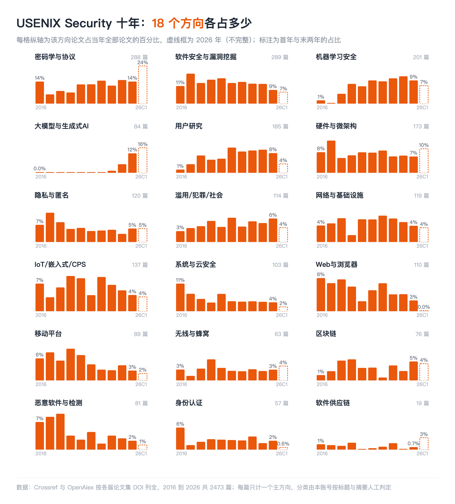
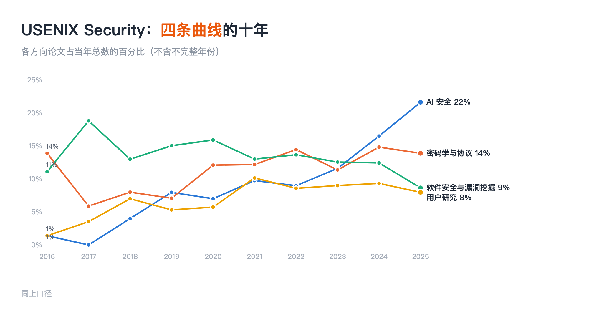
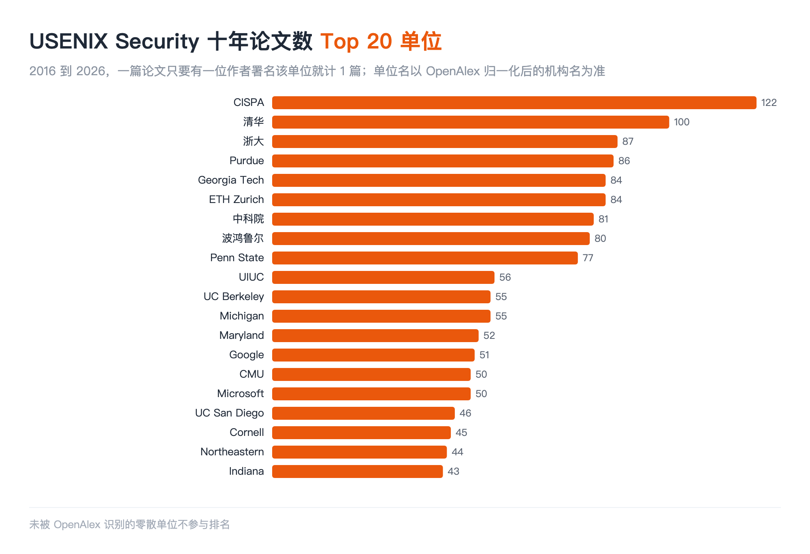
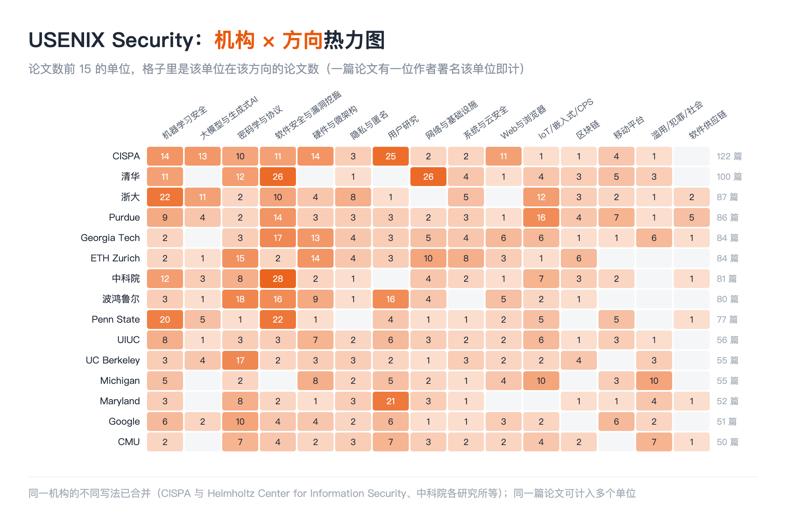
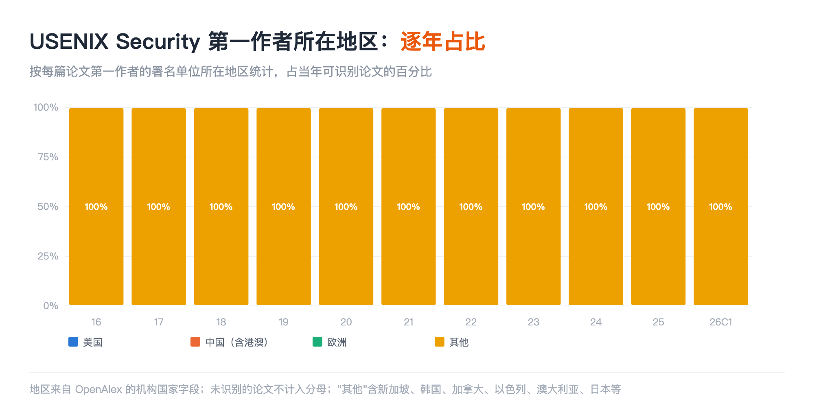

## LIST INFO|本期说明

【范围】USENIX Security Symposium 2016 到 2025 十届全部正式论文，共 2308 篇；另加 2026 年第 35 届的 Cycle 1 接收论文 165 篇，合计 2473 篇
【来源】usenix.org 每届的 Technical Sessions 页面与 2026 Cycle 1 接收列表，标题、作者、单位、摘要、所在分会场全部取自官方页面原文，逐年和 DBLP 目录核对过；keynote、invited talk、panel 和 2025 年并入的 Enigma 演讲不计
【口径】每篇论文只归一个主方向（可带一个次方向），共 18 个方向，判定依据是标题、摘要和官方分会场名。分类是本账号逐篇人工判定，不是关键词匹配；同一篇论文换个人分可能落到相邻方向，个位数的出入不影响趋势

@stats
- 72 → 439 篇 | 年接收量，2023 年从 256 跳到 422 之后稳在四百多
- 1% → 22% | AI 安全（机器学习加大模型）2016 到 2025 年的份额
- 19% → 9% | 软件安全与漏洞挖掘的份额，2017 到 2025
- 2% → 32% | 第一作者来自中国大陆与港澳的比例，2025 年反超美国

先交代一件事。十年间 USENIX Security 的年接收量从 72 篇涨到 439 篇，2023 年从 256 跳到 422 之后就一直稳在四百多。**所以看趋势不能看绝对数，得看占比**：一个方向从 5 篇涨到 15 篇，在 2016 年是翻了三倍，在 2025 年可能只是原地踏步。下面所有的"涨"和"跌"，说的都是份额。

另一件事是 2026。Cycle 1 的 165 篇只是上半年的一批，Cycle 2 还没并进来，所以图里 2026 那一格用虚线框标出来，==它只能当作方向性的信号，不能当作全年的定论==。

## BIG PICTURE|十年三个大迁移

把 18 张小图摊开看，最刺眼的是三件事。

#### AI 安全从无到有，成了最大的单一方向

2016 年整个会议只有 1 篇论文在讲机器学习的安全，就是 Tramèr 等人的 **Stealing Machine Learning Models via Prediction APIs**，讲的是通过预测接口把模型偷出来。2025 年，机器学习安全加上大模型与生成式 AI 两个方向合计 95 篇，占当年 21.7%，比第二名密码学的 61 篇多出一半。其中 LLM 这一支从 2023 年的 6 篇到 2024 年的 23 篇再到 2025 年的 54 篇，两年翻了九倍，2026 Cycle 1 里已经占到 15.8%。

#### 软件安全与漏洞挖掘的份额被吃掉了近一半

这个方向从 2017 年到 2020 年长期是第一大方向，占比在 13% 到 19% 之间，2023 年和 2024 年绝对数还在 52 到 53 篇的高位，但份额已经跌到 12.5%，2025 年只剩 38 篇、8.7%，2026 Cycle 1 是 7.3%。不是 fuzzing 不重要了，是它的增量跟不上会议扩张的速度，而且它的题材正在被 LLM 那条线吸走：2025 年软件安全的 38 篇里，标题带 LLM 的就有 6 篇。

#### 密码学是十年里最稳的大方向，2026 上半年突然放量

密码学与协议这一支 2016 年占 13.9%，2025 年 13.9%，中间从没掉出前三。2026 Cycle 1 一口气收了 39 篇，占 23.6%，是所有方向里最高的。这个数字要等 Cycle 2 出来再验证，但 PIR、PSI、FHE、zkSNARK 这几条线在 2023 年到 2025 年的持续放量是实打实的。

> 一句话概括这十年：USENIX Security 从一个以"找漏洞、打协议、拆硬件"为主的会议，变成了一个 AI 安全、密码学、软件安全三足鼎立、外加用户研究稳占一成的会议。

下面按方向逐个说，重点放在**为什么曲线长成这样**，以及每个时期在做什么问题。

## AI|机器学习与大模型安全：从 1 篇到 95 篇

这一支的十年可以切成四个波次，每个波次都对应一类新的攻击面被打开。

@timeline
- 2016 | Stealing Machine Learning Models via Prediction APIs | 通过预测接口把模型偷出来，USENIX 上第一篇
- 2018 | Turning Your Weakness Into a Strength: Watermarking Deep Neural Networks by Backdooring | 把后门反过来当水印，模型知识产权保护的起点
- 2019 | The Secret Sharer: Evaluating and Testing Unintended Memorization in Neural Networks | 第一套量化"模型记住了多少训练数据"的方法
- 2021 | You Autocomplete Me: Poisoning Vulnerabilities in Neural Code Completion | 给代码补全下毒，AI 编程助手成了供应链上的一环
- 2022 | Dos and Don'ts of Machine Learning in Computer Security | 安全领域用 ML 的常见错误，当年杰出论文
- 2023 | Glaze: Protecting Artists from Style Mimicry by Text-to-Image Models | 生成式 AI 分会场的第一年，当年杰出论文
- 2024 | Formalizing and Benchmarking Prompt Injection Attacks and Defenses | 提示注入的统一定义和评测
- 2025 | PoisonedRAG: Knowledge Corruption Attacks to Retrieval-Augmented Generation of Large Language Models | 攻击面走到检索到的外部内容
- 2025 | We Have a Package for You! A Comprehensive Analysis of Package Hallucinations by Code Generating LLMs | 包幻觉的系统测量，当年杰出论文
- 2026 | SoK: Attack and Defense Landscape of Agentic AI Systems | Agentic AI 攻防的版图

#### 2016 到 2019：模型本身能不能被攻击

2016 年的 **Stealing Machine Learning Models via Prediction APIs** 证明了商用 ML-as-a-Service 的预测接口就足够把模型参数偷出来。2018 年第一次出现名叫 Neural Networks 的分会场，四篇论文里 **Turning Your Weakness Into a Strength: Watermarking Deep Neural Networks by Backdooring** 把后门反过来当水印用，是模型知识产权保护这条线的起点；同年 **With Great Training Comes Great Vulnerability** 指出迁移学习让下游模型继承了上游 teacher 模型的弱点，**When Does Machine Learning FAIL?** 则把对抗和投毒攻击的可迁移性讲成一个统一框架。2019 年的 **The Secret Sharer** 给"模型会不会背下训练数据"这个问题做了第一套量化测试方法，后来所有关于 LLM 记忆训练数据的工作都建在它上面。

#### 2020 到 2022：后门、投毒和联邦学习

2021 年干脆开了一个叫 Backdoor and Poisoning 的分会场，**Blind Backdoors in Deep Learning Models** 把后门注入点从数据挪到训练代码里的损失函数计算，攻击者不用碰数据也能植入后门；**You Autocomplete Me** 给神经代码补全下毒，让它推荐不安全的加密模式，这篇对做供应链的人很重要，它是"AI 编程助手本身就是供应链上一环"这个判断的最早证据之一。2020 年的 **Local Model Poisoning Attacks to Byzantine-Robust Federated Learning** 证明当时号称抗拜占庭的聚合规则挡不住精心构造的本地模型，从此联邦学习的攻防在这个会上每年都有一整场。同期还有一篇值得单拎出来的方法论论文：2022 年的 **Dos and Don'ts of Machine Learning in Computer Security** 系统梳理了安全领域用 ML 时最常犯的错误，从数据泄漏到不现实的威胁模型。

#### 2023：生成式 AI 的起点年

这一年出现了第一个叫 Generative AI 的分会场，4 篇论文，加上散在别处的两篇，这一支当年共 6 篇。**Glaze** 给艺术家的作品加扰动，让文生图模型学不到他们的风格；**Extracting Training Data from Diffusion Models** 证明 Stable Diffusion 这类模型会原样吐出训练集里的图片；**Lost at C** 用 58 人的用户实验测了 Codex 这类编程助手会不会让开发者写出更多漏洞。LLM 这条线更早的种子其实是 2021 年的 **Extracting Training Data from Large Language Models**，它在 GPT-2 上做的训练数据抽取，是后来所有"LLM 隐私"工作的模板。

#### 2024 到 2025：LLM 全面接管

2024 年分会场直接叫 LLM I、II、III 加一个 LLM for Security，2025 年扩到五个：LLM Security and Attacks、LLM Security 2、LLM Security 3、LLM Privacy，再加一个专门的 Vulnerabilities in LLMs。题材上有几条清楚的线：

- 越狱与提示注入：2024 年的 **Formalizing and Benchmarking Prompt Injection Attacks and Defenses** 第一次给提示注入立了统一的形式化定义和评测；**Don't Listen To Me** 从野外收集越狱提示做了大规模测量；2025 年的 **StruQ** 用结构化查询把指令和数据在输入层面分开，是目前最有工程意义的防御思路之一；**Great, Now Write an Article About That** 提出的 Crescendo 多轮越狱，证明单轮对齐挡不住把有害请求拆成一串无害对话的攻击。
- RAG 和 Agent 的攻击面：2025 年 **PoisonedRAG** 证明往知识库里注入少量文档就能操控 RAG 的回答；**Machine Against the RAG** 用"阻断文档"让 RAG 拒答，把拒绝服务搬进了检索层；**Make Agent Defeat Agent** 把污点分析的思路用到 LLM Agent 上，自动找提示能流到危险操作的路径。到 2026 Cycle 1，**SoK: Attack and Defense Landscape of Agentic AI Systems** 给整个 Agentic AI 攻防画了版图（本账号已解读过），**Overcoming the Retrieval Barrier** 则指出间接提示注入真正的难点是让恶意内容先被检索到，这是一个排序问题而不只是提示词构造问题。
- LLM 隐私：2025 年单开了 LLM Privacy 分会场，**I Know What You Said** 用硬件缓存侧信道从本地部署的 LLM 推理里恢复输入；2024 年的 **What Was Your Prompt?** 则从网络上加密的 token 长度序列里恢复 AI 助手的回复。这两篇加起来说明，LLM 的隐私问题不只在模型里，也在它跑的那台机器和那条网线上。
- LLM 作为攻击者和工具：2024 年 **Malla** 测量了地下市场里集成 LLM 的恶意服务；**PentestGPT** 评估了 LLM 做自动渗透测试的能力；2025 年的 **We Have a Package for You!** 系统测量了代码生成 LLM 的包幻觉，这是本账号一直盯着的供应链新入口。2026 Cycle 1 的 **When AIOps Become "AI Oops"** 更进一步：AI 驱动的运维 Agent 读的是遥测数据，篡改遥测就能诱导它做出错误的修复动作。

> 从 Stealing ML Models 到 AIOps 被劫持，攻击面的迁移路径非常清晰：模型参数 → 训练数据 → 训练流程 → 推理时的输入 → 检索到的外部内容 → Agent 的工具和环境。==每往外走一层，安全边界就更难画一次，而 2025 年之后的论文几乎全在最外面两层。==

传统 ML 安全那一支并没有消失，只是换了主题。2024 年到 2025 年最活跃的是模型知识产权（2024 年 **DeepEclipse** 破解白盒水印，2025 年 **A Crack in the Bark** 去掉 Tree-Ring 水印、**LightShed** 打穿基于扰动的图片版权保护）、机器遗忘的可验证性（**Towards Lifecycle Unlearning Commitment Management**）、以及 bit-flip 攻击这条把硬件故障注入和模型安全接起来的线（2025 年 **Rowhammer-Based Trojan Injection** 证明翻一个比特就够植入后门）。

## CRYPTO|密码学与协议：最稳的大方向，主题换了三轮

密码学十年份额几乎没动，但里面的题材换了三轮。

#### 2016 到 2020：打协议

2016 年的 **DROWN** 用支持 SSLv2 的服务器当预言机解密现代 TLS 连接；2018 年的 **Efail** 用密文可塑性从 S/MIME 和 OpenPGP 加密邮件里把明文带出来，**ROBOT** 让 Bleichenbacher 的 1998 年攻击在主流 TLS 实现上复活；2020 年的 **SHA-1 is a Shambles** 做出第一个选择前缀碰撞并直接用它伪造 PGP 信任网。这批论文的共同点是拿真实部署的系统开刀，结论直接推动了协议弃用。

#### 2021 到 2023：隐私计算工程化

2021 年开了 Secure Multiparty Computation 分会场，**ABY2.0** 改进混合协议的两方计算在线开销，**Senate** 做恶意安全的多方协同分析平台；2022 年的 **Cheetah** 把两方安全神经网络推理做到了实用速度，**Piranha** 把 MPC 搬上 GPU；2023 年出现 Private Record Access 分会场，**One Server for the Price of Two** 提出的 SimplePIR 是单服务器 PIR 实用化的转折点，2024 年的 **YPIR** 把吞吐推到接近内存带宽。这条线的意义在于 PIR、PSI、MPC 从论文里的构造变成了可以嵌进产品的组件。

#### 2023 到 2025：安全消息、后量子和零知识的落地分析

2023 年 Secure Messaging 分会场里 **TreeSync** 形式化分析 IETF 正在标准化的 MLS 群组管理；2024 年 **Formal verification of the PQXDH** 给 Signal 的后量子握手做机器验证；2025 年 **A Formal Analysis of Apple's iMessage PQ3 Protocol** 对苹果的后量子消息协议做了同样的事。零知识证明这边，2024 年的 **SoK: What Don't We Know? Understanding Security Vulnerabilities in SNARKs** 和 2025 年的 **SoK: Understanding zk-SNARKs: The Gap Between Research and Practice** 两篇 SoK 前后脚出现，说明这个领域已经从"怎么做得更快"进入"实现到底哪里会出错"的阶段。2026 Cycle 1 的 39 篇里，**Efficient Threshold ML-DSA** 和 **Quorus** 都在做 NIST 后量子签名标准的门限版本，后量子已经从"能不能换"变成"换了之后怎么分布式管钥匙"。

值得一提的是 2024 年的 **Terrapin Attack**，通过操纵序列号打破 SSH 信道完整性，这类"老协议新缺陷"的论文每年都有一两篇，它们是密码学方向里最容易上新闻的那部分，但按篇数算只是小头。

## SWSEC|软件安全与漏洞挖掘：绝对数在涨，份额在跌

这个方向的曲线最容易被误读。绝对数从 2016 年的 8 篇涨到 2023 年的 53 篇，但份额从 2017 年的 18.8% 掉到 2025 年的 8.7%。原因有两个：会议整体扩张得更快，以及这个方向的一部分题材被 LLM 那条线吸走了。

#### 2017 到 2020：fuzzing 的黄金期

2017 年 **kAFL** 用硬件辅助反馈给操作系统内核做 fuzzing；2018 年 **QSYM** 让 concolic 执行终于能配合 fuzzer 跑真实程序；2019 年有了单独叫 Fuzzing 的分会场，**MOPT** 优化变异算子的调度，**GRIMOIRE** 在没有语法的情况下自己合成输入结构；2020 年 **SymCC** 把符号执行从解释改成编译，快了几个数量级。同期固件这条线从 **HALucinator** 和 **P2IM** 开始，2022 年的 **Fuzzware** 用精确的 MMIO 建模把固件 fuzzing 推进了一大步。

#### 2021 到 2023：转向评估方法论

fuzzer 越来越多，怎么比就成了问题。2021 年的 **UNIFUZZ** 建统一评测平台；2023 年的 **Systematic Assessment of Fuzzers using Mutation Analysis** 把软件测试里的变异分析引进来当 fuzzer 的黄金标准。这类"评估评估者"的论文，是一个方向进入成熟期的标志。

#### 2024 到 2025：LLM 和 Rust

2024 年 **Uncovering the Limits of Machine Learning for Automatic Vulnerability Detection** 证明当时最好的 ML 漏洞检测模型分不清有漏洞的函数和打过补丁的同一个函数，这是给整个 ML4VD 泼的一盆冷水；2025 年 Patching and Repair 分会场里同时出现了两篇自动漏洞修复的 SoK（**SoK: Automated Vulnerability Repair** 和 **SoK: Towards Effective Automated Vulnerability Repair**），加上 **PatchAgent**、**APPATCH**、**Logs In, Patches Out** 三篇用 LLM 修漏洞的工作，修复这条线在一年之内从边缘变成了一个完整的分会场。fuzzing 本身也在吃 LLM 的红利：**ELFuzz** 用 LLM 演化出输入生成器，**Hybrid Language Processor Fuzzing via LLM-Based Constraint Solving** 用 LLM 解约束。Rust 这条线从 2023 年的访谈研究 **"I wouldn't want my unsafe code to run my pacemaker"** 开始，2024 年有 **MetaSafe** 和 **RustSan**，2025 年有 **TYPEPULSE**，2026 Cycle 1 有 **SafeFFI**，主题一致：安全 Rust 和 unsafe 代码、C 库之间那条边界怎么守。

反编译是另一条安静但持续的线：2024 年同一个分会场里 **Ahoy SAILR!**、**A Taxonomy of C Decompiler Fidelity Issues** 和 **D-Helix** 三篇论文分别从结构化算法、保真度分类和测试框架三个角度重做反编译器，说明这个二十年的老问题被重新当成了一等公民。

## HW|硬件与微架构：份额稳定，每年一个新家族

硬件安全的份额除 2017 年冲到 12.9% 外，其余年份都在 6% 到 9% 之间，看起来最平，但题材是所有方向里迭代最快的：几乎每一届都有一个新的攻击家族。

2016 年 **Flip Feng Shui** 把 Rowhammer 从"能翻比特"变成"能精确翻攻击者想翻的那个比特"，**DRAMA** 逆向了 DRAM 寻址函数。2018 年 **Meltdown** 和 **Foreshadow** 同一届发表，前者从用户态读内核内存，后者从 SGX 飞地里把密钥掏出来，瞬态执行攻击从此成为每年的固定节目：2019 年 **A Systematic Evaluation of Transient Execution Attacks and Defenses** 给这个家族做了第一次系统分类；2022 年 **Retbleed** 用 return 指令绕过 retpoline，**Hertzbleed** 把功耗侧信道变成远程可用的时序侧信道；2023 年 **Downfall** 利用 gather 指令跨越用户和内核、进程、虚拟机和 TEE 的边界，**Inception** 在训练分支预测器的过程中制造新的攻击面；2024 年 **GoFetch** 证明苹果芯片的数据内存相关预取器会打破常量时间密码实现；2025 年 **FLOP** 打的是 Apple M3 的假负载输出预测，**Branch Privilege Injection** 利用分支预测器的竞争条件绕过 Spectre v2 的硬件缓解。

Rowhammer 在 2024 年到 2025 年出现了明显的第二波：2024 年 **ZenHammer** 第一次在 AMD Zen 上做出来，**SledgeHammer** 用 bank 级并行放大效果；2025 年一届标题里带 Rowhammer 的论文就有七篇，包括 **GPUHammer**（GPU 显存）、**ECC.fail**（带 ECC 的 DDR4 服务器）、**Posthammer**（浏览器内）、**McSee**（评估先进攻防），以及机器学习那边的 **Rowhammer-Based Trojan Injection**，Rowhammer 已经从"客户端 DRAM 的问题"变成"所有内存的问题"。

TEE 攻防是硬件和系统两个方向共享的一条线。2017 年 **Inferring Fine-grained Control Flow Inside SGX Enclaves with Branch Shadowing** 之后，SGX 的侧信道每年不断；2021 年 **CIPHERLEAKS** 在 AMD SEV 上打密文侧信道；2024 年 **HECKLER** 用恶意中断打机密虚拟机；2025 年 **TDXploit** 把单步和缓存攻击搬到 Intel TDX 上。2026 Cycle 1 里 AMD SEV-SNP 被三篇论文围攻：**FABRICKED** 改 Infinity Fabric 路由让安全协处理器错误初始化，**StackWarp** 通过 CPU 栈引擎破坏完整性，**Jailbreaking the AMD Secure Processor** 直接拿下了 ASP 固件的分析能力。机密计算在云上普及得越快，这条线的论文就越多。

2026 Cycle 1 还有一篇 **Loongleak**，在 LoongArch CPU 上做出跨权限边界的架构级数据泄露。这是这个会上第一次出现针对龙芯架构的论文。

## USABLE|用户研究与可用安全：从 1 篇到稳占一成

这个方向的曲线是所有方向里最像"制度化"的：2016 年 1 篇，2018 年 7 篇，2021 年跳到 25 篇、10.2%，此后每年 35 到 39 篇。2021 年是分水岭，那一届第一次出现了三个以 Usable 或 Usability 命名的分会场，2022 年和 2024 年干脆按 User Studies 编号，2024 年一路编到了 VIII。

题材上有三条线一直在扩。

#### 开发者和从业者研究

2017 年的 **"I Have No Idea What I'm Doing"** 研究运维人员部署 HTTPS 为什么会配错；2020 年的 **Understanding security mistakes developers make** 分析 Build It, Break It, Fix It 竞赛里 94 份提交的错误根因；2022 年 **99% False Positives** 访谈 SOC 分析师对告警的看法；2023 年的 **Pushed by Accident** 研究开发者怎么处理代码仓库里的密钥；2025 年一届里同时有开源维护者的漏洞管理（**A Mixed-Methods Study of Open-Source Software Maintainers**）、开源项目的威胁建模、SCA 工具的使用困境（**Context Matters**）三篇，这对做供应链的人来说是最直接的一手材料。

#### 高风险人群

2019 年的 **Clinical Computer Security for Victims of Intimate Partner Violence** 提出"临床式"安全咨询，是这条线的开端；此后每年都有关于家暴幸存者、性工作者、难民、视障用户、政治活动参与者的研究，2022 年直接有了 At-Risk Users 分会场。

#### 对研究方法本身的反思

2024 年的 **How WEIRD is Usable Privacy and Security Research?** 统计了这个领域的被试有多大比例来自西方富裕国家；2025 年的 **Digital Security Perceptions and Practices Around the World** 做了 WEIRD 和非 WEIRD 的大规模跨国比较，同年还有一篇 **How Transparent is Usable Privacy and Security Research?** 审视报告透明度。一个方向开始系统地审视自己的样本偏差和可复现性，说明它已经过了"证明自己值得存在"的阶段。

## PRIVACY|隐私与匿名：差分隐私成了主线

隐私方向按主方向算份额从 2017 年的 11.8% 掉到 2025 年的 5.5%，但这是分类口径的假象：把次方向算进来，2025 年涉及隐私的论文有 71 篇，是所有方向里最多的。隐私不再是一个独立的方向，而是渗进了 ML、密码学、移动、Web 每一支。

主方向里的题材变化很清楚。**2016 到 2019 是 Tor 和网站指纹的时代**，2016 年的 **k-fingerprinting** 用随机森林做网站指纹，此后攻防交替十年，2022 年的 **Online Website Fingerprinting** 第一次在真实 Tor 流量而不是实验室数据上评估这类攻击。**2017 年起差分隐私接管了主线**，**Locally Differentially Private Protocols for Frequency Estimation** 系统比较了 RAPPOR 这类本地差分隐私协议；2019 年 **Evaluating Differentially Private Machine Learning in Practice** 指出实际部署里的 ε 大到几乎没有保护；2021 年 **Data Poisoning Attacks to Local Differential Privacy Protocols** 证明本地差分隐私的分布式设定天然容易被投毒；2023 年 **Tight Auditing of Differentially Private Machine Learning** 之后，"审计"成了差分隐私的新关键词，2025 年一届就有两篇标题里带 audit 的差分隐私论文。

另一条线是隐私合规的自动化测量。2023 年的 **Lalaine** 测 App Store 隐私标签的不合规，2024 年 **Abandon All Hope Ye Who Enter Here** 对 Google Play 的数据安全声明做纵向追踪，2025 年 **Websites' Global Privacy Control Compliance** 测 GPC 信号的遵守率。这批工作把隐私法规从条文变成了可以逐年量化的指标。

## SOCIETY|滥用、犯罪与社会议题：审查测量与人际滥用

这个方向从 2016 年的 2 篇涨到 2025 年的 26 篇、5.9%，加上次方向 2025 年有 55 篇。题材有三条稳定的线。

**审查与规避**这条线十年没断。2017 年 **Global Measurement of DNS Manipulation** 建立远程测量 DNS 篡改的方法；2021 年 **How Great is the Great Firewall?** 做了纵向的 GFW DNS 测量；2023 年 **How the Great Firewall of China Detects and Blocks Fully Encrypted Traffic** 逆向了 GFW 识别全加密流量的规则；2025 年 **Exposing and Circumventing SNI-based QUIC Censorship** 记录了 GFW 从 2024 年 4 月开始解密 QUIC 初始包做 SNI 阻断。2025 年还有 **IRBlock** 对伊朗防火墙的大规模测量。

**地下经济**这条线从 2018 年 Cybercrime 分会场开始，**Plug and Prey?** 量化了匿名市场上网络犯罪的商品化程度；2019 年 **Platforms in Everything** 拿到了一家防弹主机商的真实数据；2025 年 **DarkGram** 分析了 Telegram 上 339 个犯罪活动频道，2026 Cycle 1 的 **Stayin' Alive** 继续追踪 Telegram 上的被盗数据市场，犯罪基础设施从暗网论坛向即时通讯平台的迁移在这两篇里看得很清楚。

**人际滥用**是这个方向增长最快的题材。2020 年 **The Tools and Tactics Used in Intimate Partner Surveillance** 分析出轨论坛里的监控手段；2023 年直接开了 Interpersonal Abuse 分会场，**Abuse Vectors** 给 IoT 设备被用于人际滥用建了框架；2025 年 **Analyzing the AI Nudification Application Ecosystem** 和 **Characterizing the MrDeepFakes Sexual Deepfake Marketplace** 把这条线和生成式 AI 接了起来。2026 Cycle 1 的 **Love, Lies, and Language Models** 研究 LLM 在杀猪盘诈骗里的角色，这是滥用研究和 LLM 研究的交汇点。

## NET|网络与基础设施：DNS 和 BGP 的老问题一直在

网络安全份额多数年份在 4% 到 7%。它的特点是问题老，但每隔几年就有人证明老问题没解决。

DNS 缓存投毒从 2020 年的 **NXNSAttack** 和 **Poison Over Troubled Forwarders**，到 2023 年的 **The Maginot Line**（打 bailiwick 检查），再到 2026 Cycle 1 的 **DNS Cache Poisoning Like it's 2006**（BIND9 上的新一类投毒），标题本身就在说这件事。BGP 那边，2018 年 **Bamboozling Certificate Authorities with BGP** 证明劫持路由就能骗 CA 签证书，直接推动了 Let's Encrypt 的多视角域名验证，2021 年 **Experiences Deploying Multi-Vantage-Point Domain Validation at Let's Encrypt** 是部署报告，2023 年 **How Effective is Multiple-Vantage-Point Domain Control Validation?** 又回头量化了它到底防住了多少。RPKI 这条线从 2022 年 **Stalloris** 的降级攻击到 2025 年的 **SoK: An Introspective Analysis of RPKI Security**，正好覆盖了 RPKI 从部署到被审视的周期。

2024 年的 **SnailLoad** 值得单说：不需要 JavaScript，只靠远程测量网络延迟就能推断用户在看什么视频、访问什么网站，把网络侧信道的门槛降到了"能给你发个包"。

## IOT|IoT、嵌入式与 CPS：自动驾驶热过一轮

这个方向 2019、2020、2022 三年占比都在 8% 以上，2025 年回落到 4.1%。高峰期的主角是车。2020 年开了 Automotive and Drone Security 分会场，**Drift with Devil** 证明多传感器融合定位挡不住 GPS 欺骗；2022 年 Smart Vehicles 分会场里 **Rolling Colors** 用激光打交通灯识别；2023 年 Vehicles and Security 分会场里 **You Can't See Me** 做 LiDAR 的物理移除攻击。到 2025 年，这批自动驾驶的对抗攻击大多归到了 ML 那边的 Physical Adversarial Attacks 分会场，方向的份额下降有一部分是这种口径迁移。

语音和声学是另一条线：2016 年的 **Hidden Voice Commands** 到 2018 年的 **CommanderSong**、2020 年的 **Light Commands**（用激光往麦克风注入命令），一直到 2026 Cycle 1 的 **Sirens' Whisper**（近超声波越狱语音 LLM），攻击对象从语音助手换成了语音大模型，手法一脉相承。

2017 年的 **Understanding the Mirai Botnet** 和 2018 年的 **BlackIoT**（高功耗 IoT 僵尸网络打电网）是这个方向早期最有影响力的两篇，2026 Cycle 1 的 **From Mirai to Gorilla** 回头追踪了 Mirai 衍生的 DDoS 出租平台十年的演化。AR/VR 是 2023 年之后新加的一支，**Unique Identification of 50,000+ Virtual Reality Users from Head & Hand Motion Data** 证明头手动作数据足以唯一识别用户。

2026 Cycle 1 里有一篇 **Design and Implementation of a Physical Implant Attack on the Boeing 737**，威胁模型是攻击者有临时的物理接触。航空这条线从 2019 年打仪表着陆系统到 2024 年打 TCAS 再到这篇，是这个方向里最"重"的一支。

## SYS|系统与云安全：TEE 和 eBPF

系统安全按主方向算从 2016 年的 11.1% 掉到 2025 年的 3.7%，是跌幅最大的方向。原因和软件安全类似：早年"系统安全"是个大筐，隔离、内核、TEE 都往里放；后来 TEE 侧信道归到硬件，内核漏洞挖掘归到软件安全，剩下的是纯粹的系统设计。

留下来的题材有两条。一是 TEE 和机密计算的架构，从 2016 年的 **Sanctum** 到 2019 年的 **ERIM**（用 MPK 做进程内隔离），再到 2025 年的 **TETD**（Intel TDX 里的可信执行）和 **TLBlur**（编译器辅助的 SGX 控制信道加固）。二是内核扩展：2023 年 **Cross Container Attacks: The Bewildered eBPF on Clouds** 指出 eBPF 在云上可以跨容器攻击，2024 年 **MOAT** 给 BPF 加隔离，2025 年 **Approximation Enforced Execution of Untrusted Linux Kernel Extensions** 干脆不信任验证器。eBPF 从"云原生的好东西"变成"内核里的新攻击面"，这三篇正好是三个阶段。

## WEB|Web 与浏览器：份额跌得最狠的方向之一

Web 安全从 2016 年的 8.3% 掉到 2025 年的 2.7%，2026 Cycle 1 一篇都没有。这不是 Web 不重要，是 Web 的问题分散到了别处：追踪归隐私，认证归身份，扩展归供应链。

留在主方向的论文有几条线。浏览器架构：2019 年 **Site Isolation** 是 Chrome 团队自己写的站点隔离设计论文，2023 年 **Isolated and Exhausted** 反过来证明站点隔离本身可以被用来耗尽操作系统资源。服务端漏洞：2020 年 **Cached and Confused** 系统测量 Web 缓存欺骗，2023 年 **Silent Spring** 证明 Node.js 里的原型污染可以一路打到远程代码执行，2025 年 Web Security 分会场的 8 篇里有 7 篇是 Web 应用漏洞的检测与利用，对象集中在 PHP 和 Java Web 应用。追踪与合规：2016 年 **Internet Jones and the Raiders of the Lost Trackers** 用互联网档案馆回溯了 1996 年以来的 Web 追踪史，2024 年 **Fledging Will Continue Until Privacy Improves** 实测 Google 隐私沙盒里的 FLEDGE 到底有没有更隐私。

## MOBILE|移动平台：从平台机制到补丁生态

移动安全从 2016 年的 5.6% 到 2025 年的 2.5%，绝对数还在 10 篇上下。早年是平台机制，2019 年 **50 Ways to Leak Your Data** 系统找出了 App 绕过 Android 权限系统的侧信道和隐蔽信道；近年转向补丁生态，2021 年 **An Investigation of the Android Kernel Patch Ecosystem** 追踪补丁从上游到设备要经过几层，2024 年 **Defects-in-Depth** 分析 Android 内核里针对 1day 漏洞的防御到底集成了多少，2025 年 **The Doom of Device Drivers** 直接给出结论：你的 Android 设备多半带着 Nday 内核漏洞。超级 App 和小程序是中国团队带进来的新题材，2023 年 **One Size Does Not Fit All: Uncovering and Exploiting Cross Platform Discrepant APIs in WeChat** 找微信跨平台 API 的差异，2025 年 **I Can Tell Your Secrets** 从小程序交互历史推断隐私属性。

## WIRELESS|无线与蜂窝：从蓝牙到卫星

无线方向份额稳定在 2% 到 3%，但每一代无线技术都被打了一遍。2019 年 **The KNOB is Broken** 打蓝牙 BR/EDR 的密钥协商熵；2020 年 **ReVoLTE** 窃听加密的 LTE 通话；2021 年 **Fragment and Forge** 从 802.11 标准里找出三个设计缺陷；2023 年 **All cops are broadcasting** 第一次公开分析了警用和军用的 TETRA 标准。2024 年之后两个新方向：一是用 NLP 从蜂窝规范里自动提取状态机或找不一致（**Hermes: Unlocking Security Analysis of Cellular Network Protocols**、**CellularLint**），二是卫星，2024 年一届就有 VSAT 信号注入、LEO 卫星用户定位、空间网络 PKI 的 SoK 三篇。2025 年 **SNI5GECT** 不用伪基站，作为第三方在 5G NR 预认证阶段注入攻击载荷，是蜂窝攻击实用化的一步。

## CHAIN|区块链：随行情起伏

区块链是波动最大的方向：2018 年到 2019 年 5% 上下，2022 年跌到 0.8%（2 篇），2023 年反弹到 16 篇，2025 年 21 篇、4.8%。这个曲线和加密货币市场的周期高度重合。题材从 2018 年 **teEther** 自动生成智能合约的利用，到 2021 年 **Smart Contract Vulnerabilities: Vulnerable Does Not Imply Exploited**（发现大多数报告的漏洞合约并没有真的被利用）和 **Frontrunner Jones**（第一次系统测量以太坊上的抢跑），再到 2023 年 **Token Spammers, Rug Pulls, and Sniper Bots** 发现约 60% 的代币活跃不到一天，2025 年 **Blockchain Address Poisoning** 测量地址投毒这种针对用户习惯的攻击。2026 Cycle 1 的 **Revealing the Dark Side of Smart Accounts** 已经在研究 EIP-7702 这个 2025 年才上线的机制带来的风险，说明这个方向跟协议演进跟得非常紧。

## MALWARE|恶意软件与威胁检测：从检测器到溯源图

按主方向算这也是跌幅靠前的方向，从 2018 年的 9% 到 2025 年的 2.3%。恶意软件检测本身的论文确实少了，2019 年的 **TESSERACT** 指出 Android 恶意软件分类的 F1 高达 0.99 是时空偏差造成的假象，这篇之后再拿"检测率 99%"当卖点的论文基本发不出来了。留下的主线是溯源图和攻击调查：2017 年 **SLEUTH** 从审计日志实时重建攻击场景，2021 年 **ATLAS** 用序列学习做攻击调查，2024 年 **MAGIC** 用图表示学习检测 APT，2025 年 **Sometimes Simpler is Better** 把八个最先进的溯源检测系统放进统一框架重新评估，结论是它们离实际部署还很远。这条线和 2019 年 TESSERACT 是同一个精神：先质疑评估，再谈方法。

## AUTH|身份认证：口令猜测十年没停

身份认证方向 2016 年 5.6% 之后长期在 2% 到 3%。口令猜测这条线十年没断：2016 年 **Fast, Lean, and Accurate** 用神经网络建模口令可猜测性，2023 年 Password Guessing 分会场里一次有五篇（随机森林、编辑模型、双向 Transformer 各一篇），2025 年 **Password Guessing Using Large Language Models** 把 LLM 也用上了。另一条线是无口令认证的落地：2023 年 **Security and Privacy Failures in Popular 2FA Apps**，2024 年 **Why Aren't We Using Passkeys?** 访谈企业为什么不上 passkey，2026 Cycle 1 的 **The State of Passkeys** 大规模测量了网站部署 passkey 的安全性。

## SUPPLY|软件供应链：篇数最少，但 2026 上半年是十年最高

这是本账号最关心的方向，也是 18 个方向里篇数最少的：十年 19 篇，从没超过当年的 2%。但 2026 Cycle 1 一批就有 5 篇、占 3.0%，是十年里最高的份额。

十年的脉络值得完整列一遍。2016 年 **On Omitting Commits and Committing Omissions** 研究 Git 元数据篡改怎么重新引入漏洞；2017 年 **CHAINIAC** 用集体签名的跳表做软件更新透明；2018 年 **The Broken Shield** 测量 Windows 代码签名 PKI 里吊销的失效；2019 年 **Small World with High Risks** 第一次系统测量 npm 生态的依赖风险，同年 **in-toto** 提出软件供应链各环节的元数据证明框架，这两篇是这个方向的奠基之作。2022 年 **Characterizing the Security of Github CI Workflows** 和 2023 年 **ARGUS: A Framework for Staged Static Taint Analysis of GitHub Workflows and Actions** 把 CI 工作流当成攻击面；2023 年是第一次出现名叫 Supply Chains and Third-Party Code 的分会场，**Beyond Typosquatting** 系统分类了包混淆攻击，同年的 **Trojan Source** 用 Unicode 双向字符让源码在编译器和人眼里读出不同的内容。2024 年 **DONAPI** 做 npm 恶意包检测；2025 年 **MalGuard** 做 PyPI 恶意包的实时检测，**ChainFuzz** 沿依赖链利用上游漏洞，**An Industry Interview Study of Software Signing** 访谈业界为什么签名推不动。

2026 Cycle 1 的五篇分成三组：恶意包检测（**Cutting the Gordian Knot**，本账号已解读过）、信任基础设施（**Trustworthy and Confidential SBOM Exchange** 和 **Why Johnny Adopts Identity-Based Software Signing** 研究 Sigstore 采纳）、更新与模型制品（**When Updates Backfire** 黑盒分析桌面软件更新机制，**The Art of Hide and Seek** 让 pickle 模型投毒重新隐蔽）。这五篇本账号在 USENIX Sec 2026 Cycle 1 那期盘点里逐篇写过。

> 供应链这个方向的篇数少，不代表它的论文少。==这十年里最有供应链含义的论文，大多不在这个方向里==：You Autocomplete Me（2021）在 ML，We Have a Package for You!（2025）在 LLM，Mistrust Plugins You Must（2022，WordPress 插件市场里的恶意插件）在 Web，Understanding Malicious Cross-library Data Harvesting on Android（2021）在移动。把这些算进来，"第三方组件不可信"这个主题在每个方向都长了出来。

## WHO|谁在做：机构图谱、团队和地区

按"论文有至少一位作者署名该单位"计（同一机构的不同写法已合并），十年榜首是 CISPA，122 篇。它 2016 年是 0 篇，2020 年 5 篇，2023 年 29 篇，2025 年 27 篇，增长几乎和会议扩张同步，论文集中在用户研究（25 篇，该方向第一）、机器学习安全和硬件（各 14 篇）、大模型（13 篇，该方向第一）、Web（11 篇）。清华 100 篇排第二，软件安全和网络各 26 篇，2023 年起每年 20 篇以上；浙大 87 篇，2021 年之前合计 4 篇，2025 年一届 25 篇，机器学习安全 22 篇是该方向第一。Purdue 86 篇、Georgia Tech 和 ETH Zurich 各 84 篇、波鸿鲁尔和中科院各 81 篇、Penn State 77 篇是第二梯队；UIUC、UC Berkeley、Michigan、Maryland、Google、CMU、Microsoft 在 50 到 56 篇。

热力图能看出两类单位。一类是"单方向"的：清华的网络（26 篇）和软件安全（26 篇）、浙大的机器学习安全（22 篇）、Maryland 的用户研究（21 篇，占它总量的四成）、中科院的软件安全（28 篇，占它总量的三分之一）、UC Berkeley 的密码学（17 篇），一个方向就撑起了半壁江山。另一类是"铺开"的：CISPA 在六个方向上都是 11 篇以上，ETH Zurich 的密码学、硬件、网络、无线四个方向各 10 到 15 篇，Georgia Tech 的软件安全、硬件、恶意软件三个方向各 11 到 17 篇。方向的集中度也不同：用户研究和硬件的头部单位很明显，密码学和 IoT 则分散在十几家单位手里。下面按方向说，作者后面的"N 篇署名"是该作者十年在本会的署名总数。

#### 密码学与协议：波鸿鲁尔、UC Berkeley、ETH Zurich、Cornell

密码学十年 327 篇，是本会最大的方向，但没有一家单位超过 20 篇：波鸿鲁尔 19 篇、UC Berkeley 17 篇、ETH Zurich 15 篇、Cornell 13 篇、清华 12 篇、Microsoft 11 篇、Google 10 篇。波鸿鲁尔的 Jörg Schwenk（18 篇署名，其中 12 篇密码学）和 Juraj Somorovsky（16 篇署名）是"协议实现攻击"这条线的代表，2022 年 **TLS-Anvil: Adapting Combinatorial Testing for TLS Libraries** 系统测试 TLS 库，2024 年杰出论文 **Terrapin Attack: Breaking SSH Channel Integrity By Sequence Number Manipulation** 打的是 SSH。UC Berkeley 的 Raluca Ada Popa（12 篇署名）做 MPC 与加密计算系统，2022 年 **Piranha: A GPU Platform for Secure Computation** 是代表。CISPA 的 Cas Cremers 走形式化协议分析，2023 年一届两篇杰出论文，其中 **Hash Gone Bad: Automated discovery of protocol attacks that exploit hash function weaknesses** 自动找哈希弱点导致的协议攻击。Google 的 Sarvar Patel 组做 PIR 和 PSI，2023 年杰出论文 **Don’t be Dense: Efficient Keyword PIR for Sparse Databases**；CMU 的 Bryan Parno 做验证密码代码，2017 年杰出论文 **Vale: Verifying High-Performance Cryptographic Assembly Code**。

#### 软件安全与漏洞挖掘：中科院、清华、Penn State、Georgia Tech

软件安全十年 301 篇，中国单位最集中：中科院 28 篇（信工所 Kai Chen 22 篇署名，Yang Xiao、Wei Huo 做二进制与漏洞根因），清华 26 篇（Chao Zhang 22 篇署名，其中 16 篇软件安全，fuzzing 和反汇编）。美国这边是 Penn State 22 篇（Xinyu Xing 21 篇署名，其中 12 篇软件安全，内核漏洞利用；Hong Hu 2021 年从 Georgia Tech 过来）、Georgia Tech 17 篇（Wenke Lee 15 篇署名、Taesoo Kim 16 篇署名）、Purdue 和 EPFL 各 14 篇。欧洲的 fuzzing 是波鸿鲁尔和 CISPA 两家，Thorsten Holz 24 篇署名里 16 篇是软件安全，2022 年之后署名 CISPA；EPFL 的 Mathias Payer 24 篇署名，14 篇软件安全。几篇能代表各家路线的论文：波鸿鲁尔 2021 年 **Nyx: Greybox Hypervisor Fuzzing using Fast Snapshots and Affine Types** 和 2022 年 **Fuzzware: Using Precise MMIO Modeling for Effective Firmware Fuzzing**，CISPA 2023 年 **Fuzztruction: Using Fault Injection-based Fuzzing to Leverage Implicit Domain Knowledge**，EPFL 2024 年 **HYPERPILL: Fuzzing for Hypervisor-bugs by Leveraging the Hardware Virtualization Interface**，Penn State 2022 年 **Playing for K(H)eaps: Understanding and Improving Linux Kernel Exploit Reliability**，中科院 2024 年 **Racing on the Negative Force: Efficient Vulnerability Root-Cause Analysis through Reinforcement Learning on Counterexamples**，清华 2025 年 **Tady: A Neural Disassembler without Structural Constraint Violations**。

#### 机器学习安全与大模型：浙大、CISPA、Penn State

机器学习安全 213 篇加大模型 110 篇，头部是浙大（22 篇加 11 篇）、CISPA（14 篇加 13 篇）和 Penn State（20 篇加 5 篇）。浙大是 Shouling Ji（25 篇署名，其中 10 篇机器学习安全）和 Kui Ren（16 篇署名）两个组，题材从后门、联邦学习到扩散模型，2025 年 **Watch the Watchers! On the Security Risks of Robustness-Enhancing Diffusion Models** 是最近的代表。CISPA 的 Yang Zhang（27 篇署名，机器学习安全和大模型各 12 篇）和 Michael Backes（32 篇署名，和复旦的 Min Yang 并列本会署名最多的作者）是一条线，从推理攻击的系统评估到大模型滥用测量：2022 年 **ML-Doctor: Holistic Risk Assessment of Inference Attacks Against Machine Learning Models**，2024 年 **Instruction Backdoor Attacks Against Customized LLMs**，2025 年 **HateBench: Benchmarking Hate Speech Detectors on LLM-Generated Content and Hate Campaigns**。Penn State 的 Ting Wang（16 篇署名，10 篇机器学习安全，2024 年起署名 Stony Brook）和 Jinyuan Jia（13 篇署名，2023 年从 Duke 过来）分别做后门与推理攻击和大模型安全，2024 年 **Formalizing and Benchmarking Prompt Injection Attacks and Defenses** 是提示注入的基准。Google 的 Nicholas Carlini 只有 6 篇署名在本会，但 2021 年 **Extracting Training Data from Large Language Models** 是整个大模型隐私方向的起点。

#### 用户研究：CISPA、Maryland、波鸿鲁尔

用户研究 191 篇，是本会头部最集中的方向：CISPA 25 篇、Maryland 21 篇、波鸿鲁尔 16 篇、芝加哥大学和 George Washington 各 12 篇。Maryland 的 Michelle L. Mazurek 17 篇署名里 16 篇是用户研究，也是本会拿杰出论文最多的作者之一，2020 年 **Understanding security mistakes developers make: Qualitative analysis from Build It, Break It, Fix It** 和 2023 年 **Bug Hunters’ Perspectives on the Challenges and Benefits of the Bug Bounty Ecosystem** 都是杰出论文，长期合作者 Daniel Votipka（10 篇署名）2022 年到 Tufts 后延续这条线。CISPA 的 Sascha Fahl（15 篇署名，14 篇用户研究）做开发者与密码学从业者研究，2025 年杰出论文 **How Transparent is Usable Privacy and Security Research? A Meta-Study on Current Research Transparency Practices** 反过来审视这个方向自己的方法；Katharina Krombholz（10 篇署名）做终端用户的威胁经历。Yasemin Acar（17 篇署名）先后署名 Saarland、汉诺威莱布尼茨和 Paderborn，是德国这条线的另一个核心。CISPA 2025 年的杰出论文 **Confusing Value with Enumeration: Studying the Use of CVEs in Academia** 由硬件和 fuzzing 两个组合写，说明这家的用户研究方法已经渗进了别的方向。

#### 硬件与微架构：TU Graz、ETH Zurich、CISPA、Georgia Tech

硬件 189 篇，是"人跟着走"最明显的方向。TU Graz 20 篇第一，Daniel Gruss（19 篇署名，15 篇硬件）和 Stefan Mangard 是根，2025 年 **TDXploit: Novel Techniques for Single-Stepping and Cache Attacks on Intel TDX** 打的是最新的 TEE。Michael Schwarz（20 篇署名，17 篇硬件）2021 年从 TU Graz 到 CISPA，CISPA 的 14 篇硬件论文几乎都是他的，2024 年 **CacheWarp: Software-based Fault Injection using Selective State Reset**。Kaveh Razavi（15 篇署名，14 篇硬件）2021 年从 VU Amsterdam 到 ETH Zurich，把 Rowhammer 这条线带了过去：2024 年 **ZenHammer: Rowhammer Attacks on AMD Zen-based Platforms**，2025 年杰出论文 **Branch Privilege Injection: Compromising Spectre v2 Hardware Mitigations by Exploiting Branch Predictor Race Conditions**；VU Amsterdam 留下的 Cristiano Giuffrida（20 篇署名）2024 年也拿了杰出论文 **InSpectre Gadget: Inspecting the Residual Attack Surface of Cross-privilege Spectre v2**。Daniel Genkin（16 篇署名，12 篇硬件）2022 年从 Michigan 到 Georgia Tech，和 Yuval Yarom（16 篇署名，2024 年起署名波鸿鲁尔）长期合作，2024 年 **GoFetch: Breaking Constant-Time Cryptographic Implementations Using Data Memory-Dependent Prefetchers** 是这对组合的代表。

#### 网络与基础设施：清华一家独大

网络 125 篇，清华一家 26 篇，第二名 ETH Zurich 只有 10 篇。清华是 Haixin Duan（24 篇署名，13 篇网络）、Baojun Liu（16 篇署名，12 篇网络）、Qi Li（23 篇署名）三个组，题材是 DNS、邮件和路由的测量与攻击，和中关村实验室联合署名的论文两年拿了两篇杰出论文：2023 年 **An Efficient Design of Intelligent Network Data Plane**（Qi Li 组），2024 年 **Learning with Semantics: Towards a Semantics-Aware Routing Anomaly Detection System**。DNS 那条线的代表是 2023 年 **The Maginot Line: Attacking the Boundary of DNS Caching Protection** 和 2024 年 **Rethinking the Security Threats of Stale DNS Glue Records**。ETH Zurich 的 Adrian Perrig（11 篇署名，9 篇网络）做域间路由架构，2025 年 **BGP Vortex: Update Message Floods Can Create Internet Instabilities**；美国这边 Princeton 7 篇、Virginia Tech 的 Taejoong Chung 做 DNSSEC、RPKI 和邮件认证的长期测量，2017 年杰出论文 **A Longitudinal, End-to-End View of the DNSSEC Ecosystem** 是他在 Northeastern 时的工作。

#### IoT、物理世界和无线：Purdue、浙大、UC Irvine、ETH Zurich

IoT 与嵌入式 143 篇，Purdue 16 篇第一，Dongyan Xu（17 篇署名，8 篇 IoT）和 Z. Berkay Celik（18 篇署名，12 篇 IoT，2021 年从 Penn State 过来）、Antonio Bianchi 三个组，做无人机、机器人和工控的固件与协议：2022 年 **ProFactory: Improving IoT Security via Formalized Protocol Customization**，2023 年 **PatchVerif: Discovering Faulty Patches in Robotic Vehicles**。浙大 12 篇，Wenyuan Xu（12 篇署名）和 Xiaoyu Ji（12 篇署名，7 篇 IoT）做传感器与声光电信道的物理攻击，2024 年 **LaserAdv: Laser Adversarial Attacks on Speech Recognition Systems**。UC Irvine 12 篇，Qi Alfred Chen 做自动驾驶感知；Michigan 10 篇，Z. Morley Mao 同一题材。无线与蜂窝 69 篇，ETH Zurich 10 篇第一，Srdjan Capkun（12 篇署名）组做测距、GNSS 和蜂窝：2022 年 **Ghost Peak: Practical Distance Reduction Attacks Against HRP UWB Ranging**，2025 年 **GLaDoS: Location-aware Denial-of-Service of Cellular Networks**；KAIST 的 Yongdae Kim（7 篇署名，5 篇无线）是基带和 LTE 那条线。

#### 隐私、社会议题和 Web：分散的方向，各有一两个中心

隐私与匿名 129 篇，没有一家超过 8 篇，但差分隐私这条线有几个稳定的组：Virginia 的 Tianhao Wang（10 篇署名，7 篇隐私，2023 年从 Purdue 过去）做 DP 合成数据和审计，Duke 的 Neil Zhenqiang Gong 做对本地差分隐私协议的投毒，2022 年 **Poisoning Attacks to Local Differential Privacy Protocols for Key-Value Data**；CISPA 的 Zhikun Zhang（2024 年起署名浙大）2021 年 **PrivSyn: Differentially Private Data Synthesis**；Google 的 Carlini 组 2023 年杰出论文 **Tight Auditing of Differentially Private Machine Learning**。滥用与社会议题 120 篇，Michigan 10 篇第一，Roya Ensafi（11 篇署名）做审查测量，2024 年杰出论文 **Digital Discrimination of Users in Sanctioned States: The Case of the Cuba Embargo**；J. Alex Halderman 做选举安全，2022 年杰出论文 **The Antrim County 2020 Election Incident: An Independent Forensic Investigation**；CMU 的 Nicolas Christin 和 NYU 的 Damon McCoy 做地下市场与平台治理测量，后者 2022 年 **An Audit of Facebook's Political Ad Policy Enforcement** 也是杰出论文。Web 110 篇，CISPA 11 篇（Ben Stock 10 篇署名，2022 年 **The Security Lottery: Measuring Client-Side Web Security Inconsistencies**）、Stony Brook 8 篇（Nick Nikiforakis，2024 年杰出论文 **Smudged Fingerprints: Characterizing and Improving the Performance of Web Application Fingerprinting**）、复旦 8 篇（Min Yang 32 篇署名，2025 年 **XSSky: Detecting XSS Vulnerabilities through Local Path-Persistent Fuzzing**）。

#### 软件供应链：Purdue 和 NYU 的一条线，加上散兵游勇

供应链十年只有 24 篇主方向论文，Purdue 5 篇是唯一超过 3 篇的单位，而且是一条清楚的线：NYU 的 Justin Cappos 组做软件更新与构建的可验证性，2017 年 **CHAINIAC: Proactive Software-Update Transparency via Collectively Signed Skipchains and Verified Builds**，2019 年 **in-toto: Providing farm-to-table guarantees for bits and bytes**；组里的 Santiago Torres-Arias 到 Purdue 之后和 James C. Davis 转向签名与 SBOM 的采纳研究，2025 年 **An Industry Interview Study of Software Signing for Supply Chain Security**，2026 年 **Why Johnny Adopts Identity-Based Software Signing: A Usability Case Study of Sigstore** 和 **Trustworthy and Confidential SBOM Exchange**。NC State 的 Alexandros Kapravelos 组做 CI 流水线，2023 年 **ARGUS: A Framework for Staged Static Taint Analysis of GitHub Workflows and Actions**。其余是中国单位零星的恶意包与生态测量（南开、浙大、四川大学各 2 篇）。把次方向也算上，Indiana 的 Luyi Xing 组是另一支力量，2024 年 **iHunter: Hunting Privacy Violations at Scale in the Software Supply Chain on iOS** 把供应链的视角用到了 iOS 第三方库上。

#### 人在动，方向跟着动

十年数据里有几条明显的人员流动，每一条都带走了一个方向：Michael Schwarz 2021 年从 TU Graz 到 CISPA，CISPA 的 14 篇硬件论文几乎都是他到任之后的；Kaveh Razavi 2021 年从 VU Amsterdam 到 ETH Zurich，Rowhammer 和瞬态执行那条线跟着到了苏黎世；Daniel Genkin 2022 年从 Michigan 到 Georgia Tech，Georgia Tech 2023 年一届 22 篇是它的十年高点；Thorsten Holz 2022 年从波鸿鲁尔到 CISPA，Ali Abbasi、Tobias Scharnowski、Moritz Schloegel 等 fuzzing 组成员 2023 到 2024 年陆续跟着改了署名；Z. Berkay Celik 2021 年从 Penn State 到 Purdue，Purdue 的 IoT 方向此后每年都有新论文；Mathias Payer 2020 年从 Purdue 到 EPFL，EPFL 十年 14 篇软件安全论文基本是他到任之后的。==看一个单位的方向曲线，先要看它的人是不是还在==。

按第一作者的署名单位所在地区看，变化比单位排名更大。2016 年美国占 53%，中国大陆与港澳只有 2%，欧洲 38%。此后美国的份额逐年下滑，中国逐年上升，==2025 年中国大陆与港澳第一作者的比例（32%）第一次超过美国（31%），2026 Cycle 1 拉开到 36% 对 32%==。欧洲十年基本稳在 22% 到 30%。地区由单位名推断，每年有 5% 到 9% 的论文因为单位名不常见没能识别，这部分没有计入分母。

有两点需要提醒。一是地区的变化和方向的变化是耦合的：中国团队在机器学习安全、LLM、网络、移动、区块链这几个方向的集中度高，这些方向恰好是近年扩张最快的。二是"第一作者所在地区"不等于"研究做在哪里"，联合署名和跨国流动很常见，这里只是一个粗粒度的指标。

## TAKEAWAYS|一点观察

**对做安全研究的人来说，这十年最大的教训是方向的边界在快速重画。** 2016 年的分类到 2025 年已经不够用：TEE 从系统挪到硬件，固件 fuzzing 从 IoT 挪到软件安全，自动驾驶从 IoT 挪到 ML，追踪从 Web 挪到隐私。一个方向的份额下跌，先要问是题材消失了还是被别的方向吸走了。按这个标准看，真正在萎缩的是 Web 应用漏洞、传统恶意软件检测和移动平台机制这三块；真正在扩张的是 LLM、隐私计算和用户研究。

**对做供应链的人来说，有两个信号值得记住。** 第一，供应链方向本身的份额在 2026 上半年创了十年新高，而且五篇分别落在检测、信任设施和更新机制三个环节，说明它正在从"恶意包检测"这一个点扩成一条线。第二，==供应链最重要的新论文不在供应链方向里，在 LLM 方向里==：包幻觉、代码补全后门、Agent 的工具链、AIOps 的遥测篡改，这些论文的作者可能从来没用过"supply chain"这个词，但它们讲的都是"你信任的上游给你的东西不可信"。

**对读论文清单的人，一个实用建议。** USENIX Security 的分会场名是程序委员会自己打的标签，跨年对齐之后是很好的趋势信号，比关键词搜索靠谱得多。2023 年第一次出现 Supply Chains and Third-Party Code、Generative AI、Interpersonal Abuse 三个分会场，2024 年出现 LLM 系列，2025 年出现 Patching and Repair 和 LLM Privacy。**一个新分会场名的出现，通常比这个方向的论文数拐点早一到两年。** 想知道下一个方向是什么，看 2026 Cycle 2 的分会场名就够了。
