## LIST INFO|本期说明

【会议】ACM CCS 2026，第 33 届 ACM 计算机与通信安全会议，2026 年 11 月 15 日至 19 日，荷兰海牙
【奖项】Distinguished Paper Award（杰出论文奖），11 月 17 日晚宴上颁出，共 23 篇
【来源】获奖名单以颁奖现场幻灯片为准；每篇的题头截图、作者与单位取自 ACM 论文集中的正式版论文
【口径】每篇的介绍依据论文摘要与正文写成，数字均为论文原文给出的结果

CCS 的杰出论文按方向评选，今年 10 个方向都有获奖，篇数从 1 篇到 4 篇不等。下面先放颁奖现场公布名单的全部幻灯片，再按现场公布的方向顺序逐篇介绍，每篇先放论文题头，再说它做了什么。

赶时间的话，可以先看这几篇：做 Agent 的看 **MetaMancer**（篡改工具描述让 Agent 选中恶意工具）；做网络基础设施的看 **Good Cache, BAD Cache**（DNSSEC 反而成了投毒入口）；做系统安全的看 **MTEscape** 和 **Hello Again**；关心实证研究的看勒索软件谈判那篇，数据来自警方真实案件。

## AWARDS|颁奖现场

11 月 17 日晚的颁奖晚宴上，大会按方向逐页公布了获奖名单，以下 6 张为现场拍摄，按公布顺序排列。每页后半部分颜色较浅的方向，是下一个即将揭晓的方向，名单同样完整。

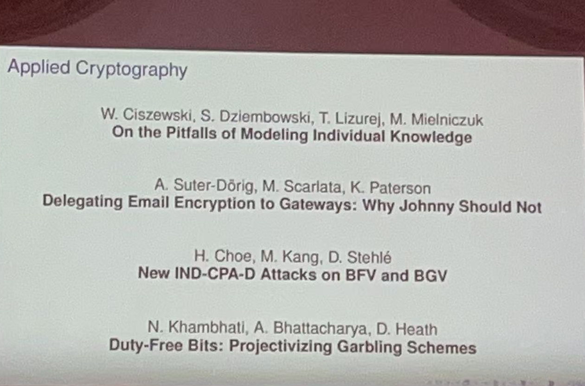

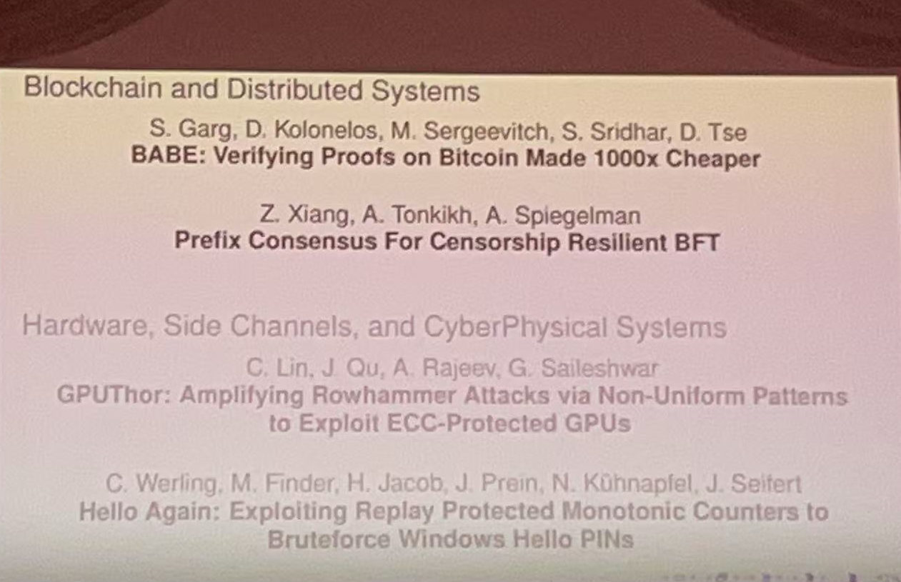

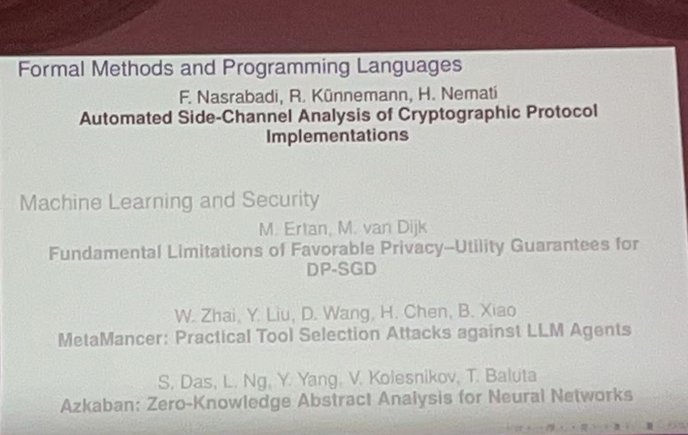

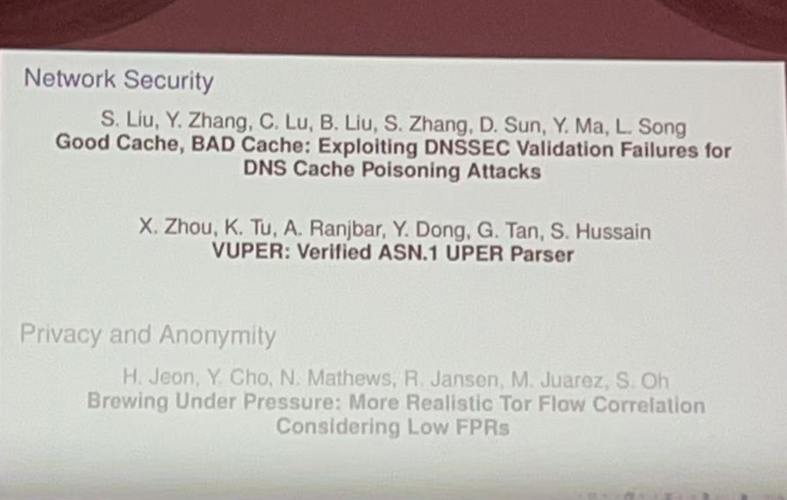

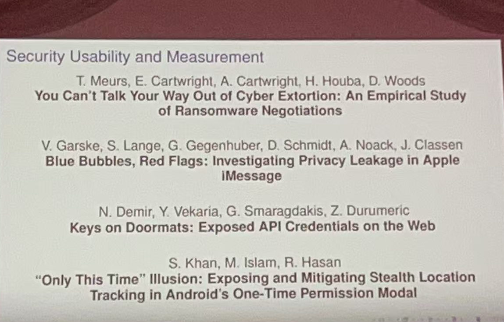

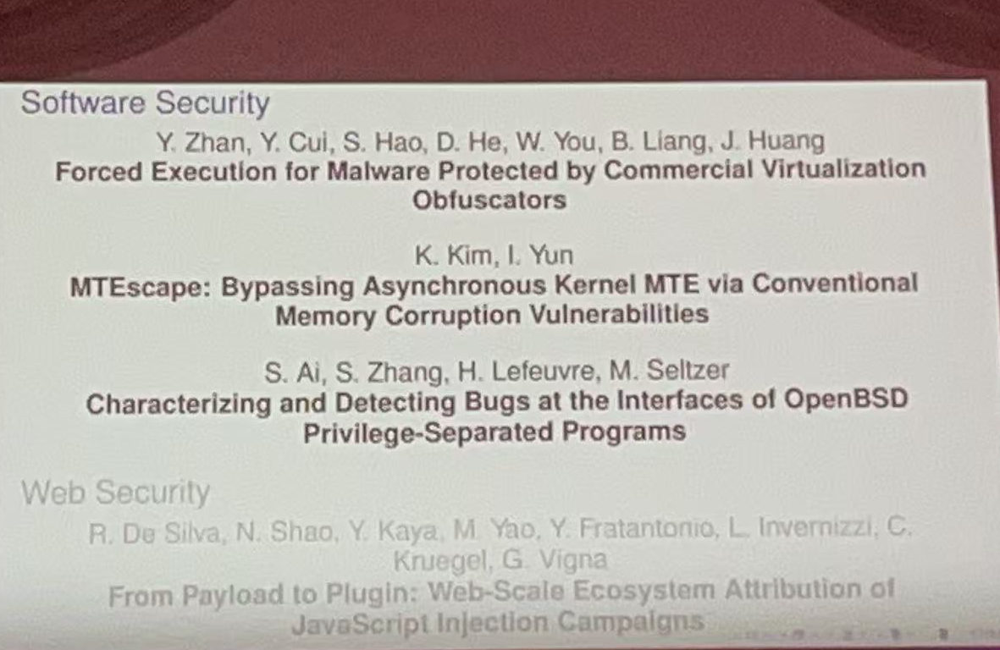

## CRYPTO|应用密码学（4 篇）

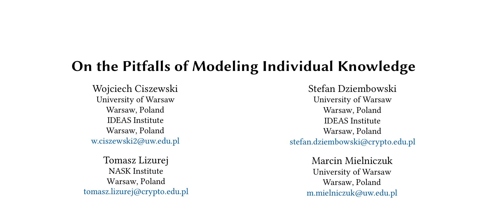

### On the Pitfalls of Modeling Individual Knowledge
Wojciech Ciszewski, Stefan Dziembowski, Tomasz Lizurej, Marcin Mielniczuk | University of Warsaw, IDEAS Institute, NASK Institute
有一类密码协议要证明的不只是"我知道某段数据"，而是"这段数据就存在我自己控制的一台机器上"，用来防止把存储或计算外包出去，挖矿领域的"不可外包谜题"也属于这一类。这些协议普遍假设：对很长的消息算哈希，必须一次性整体算完。==但现实中的哈希函数（Merkle-Damgård、海绵结构）都能对长输入分段预计算==，比特币挖矿的哈希也一样。作者据此对 Miller 等人（CCS 2015）和 Kelkar 等人（CCS 2024）的方案给出了实际攻击，并提出不依赖这条假设的替代构造。

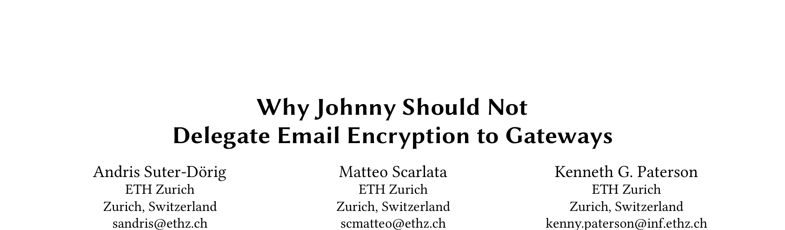

### Why Johnny Should Not Delegate Email Encryption to Gateways
Andris Suter-Dörig, Matteo Scarlata, Kenneth G. Paterson | ETH Zurich
企业里的 S/MIME、PGP 邮件加密，很多是交给服务器端的加密网关统一解密和签名，而不是在每个人的客户端完成。作者系统分析了 SEPPmail、CipherMail、Cisco Email Security Appliance 和 Proton Mail Bridge 四款产品，**找出 29 种攻击**，可以完整解密邮件，或者让用户误判邮件的真实性。核心原因是：把加解密挪到网关后，邮件客户端原本依赖的安全信号被剥掉了，==本以为已经解决的 EFAIL 攻击因此重新可用==，解密后的明文还会流经根本没为此设计的中间邮件设施。结论很直接：网关模式破坏了 PGP 和 S/MIME 本来的端到端安全模型。

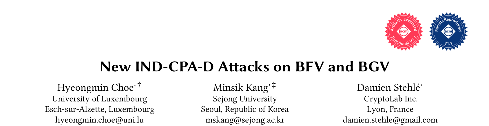

### New IND-CPA-D Attacks on BFV and BGV
Hyeongmin Choe, Minsik Kang, Damien Stehlé | University of Luxembourg, Sejong University, CryptoLab Inc.
IND-CPA-D 是全同态加密里比普通 IND-CPA 更强的安全概念，考虑的是攻击者能看到解密结果的场景，门限解密就必须满足它。BFV 和 BGV 两种主流方案在实际部署时，常用一些启发式的噪声上界来保证解密正确。作者给出三种新攻击：把已有的自举失败攻击扩展到 BFV 和 BGV；构造让噪声上界失效的明文；以及让密文乘法的噪声增长超出预期。前两种能恢复私钥，第三种能攻破 IND-CPA-D 的不可区分性。==在 OpenFHE 上，第二种攻击几分钟到几小时就能完整恢复私钥==。

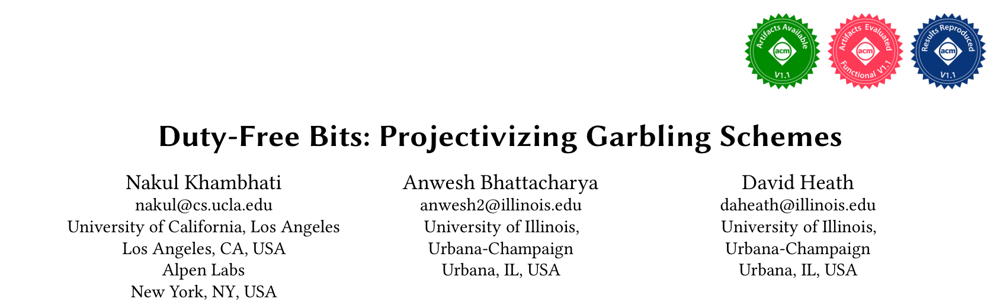

### Duty-Free Bits: Projectivizing Garbling Schemes
Nakul Khambhati, Anwesh Bhattacharya, David Heath | University of California, Los Angeles, Alpen Labs, University of Illinois Urbana-Champaign
混淆电路是安全多方计算的基础工具。"投影式"混淆电路按比特编码输入，能直接和不经意传输等简单工具配合，用起来最灵活；而一些在大有限域上工作的高效方案不是投影式的，用途受限。这篇给出一种低成本转换，把这类方案变成投影式，代价只和输入输出标签的规模成正比，标题里的"免税"就是这个意思。应用上，它可以直接替换比特币跨链桥里 BABE 和 Argo MAC 的编码环节，==把 BABE 的编码缩小 51 倍、Argo MAC 缩小 23 倍==。

## CHAIN|区块链与分布式系统（2 篇）

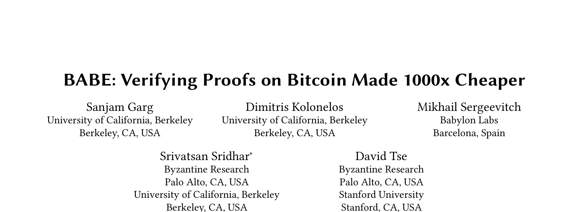

### BABE: Verifying Proofs on Bitcoin Made 1000x Cheaper
Sanjam Garg, Dimitris Kolonelos, Mikhail Sergeevitch, Srivatsan Sridhar, David Tse | University of California, Berkeley, Babylon Labs, Byzantine Research, Stanford University
让比特币能验证简洁证明（SNARK），是比特币扩容和跨链的老难题，因为比特币脚本表达能力弱、区块空间小。现有方案 BitVM2 在出现争议时链上手续费很高；BitVM3 用混淆电路把大部分验证搬到链下，省了链上成本，但每个混淆电路有 42 GiB，链下存储和准备成本巨大。BABE 用一种针对线性配对关系的见证加密来验证 Groth16 证明，再配一个高效的两方计算处理非线性部分，==保留了 BitVM3 的链上节省，同时把链下存储和准备成本降低了三个数量级==，标题里的"1000 倍"指的就是这部分。

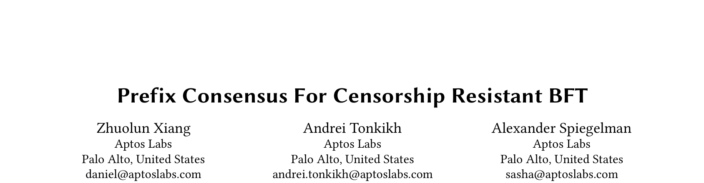

### Prefix Consensus For Censorship Resistant BFT
Zhuolun Xiang, Andrei Tonkikh, Alexander Spiegelman | Aptos Labs
区块链的 BFT 共识普遍有个弱点：出块的 leader 可以选择性地把某些交易排除在外，抗审查能力很弱。作者定义了一个新的共识抽象"前缀共识"，并在此基础上构建了**无 leader、多提案者**的 BFT 状态机复制协议，每个验证者在每个 slot 都能提案，网络稳定之后最多只有 f 个 slot 可能被审查，提交延迟摊下来是 4 轮。论文还给出了相应的轮数下界。这是全部获奖论文里唯一一篇作者全部来自企业的工作；前缀共识的定义，受到同一团队此前 Raptr 协议里基于前缀的机制启发。

## HARDWARE|硬件、侧信道与信息物理系统（2 篇）

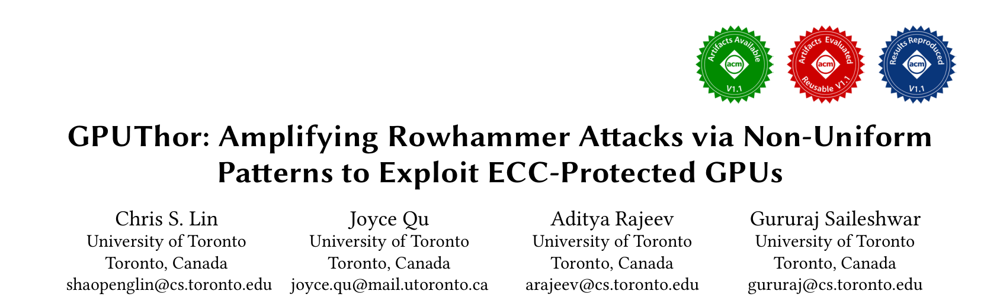

### GPUThor: Amplifying Rowhammer Attacks via Non-Uniform Patterns to Exploit ECC-Protected GPUs
Chris S. Lin, Joyce Qu, Aditya Rajeev, Gururaj Saileshwar | University of Toronto
GPU 的显存同样会被 Rowhammer 攻击：反复快速访问某几行内存，让相邻存储单元的比特翻转。但以往的 GPU 攻击只能翻转几十到几百个比特，比 CPU 上的攻击少好几个数量级，实际威胁有限。原因是它们对攻击行和诱饵行"一视同仁"地敲击，强度不够。GPUThor 逆向了 GPU 的内存访问合并机制，做出"非均匀"的敲击模式，集中火力打攻击行，并卡准内存刷新的时机绕过芯片内的缓解措施。结果是在多款 NVIDIA 显卡（A4000 到 A6000）上==比特翻转数量比以往多 500 到 23500 倍==，接近 CPU 攻击的水平，并且**首次在开启 ECC 的 GPU 上**造成无法纠正的多比特翻转，让拒绝服务和提权攻击变得可行。

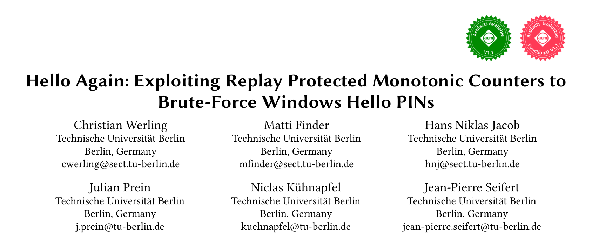

### Hello Again: Exploiting Replay Protected Monotonic Counters to Brute-Force Windows Hello PINs
Christian Werling, Matti Finder, Hans Niklas Jacob, Julian Prein, Niclas Kühnapfel, Jean-Pierre Seifert | Technische Universität Berlin
Windows Hello 允许用短到 4 位的数字 PIN 登录，靠的是 TPM 的防暴力破解机制：输错太多次就锁定。现在主流 x86 平台用的是固件 TPM，锁定状态存在 SPI 闪存里，新平台再用闪存芯片上的"防重放单调计数器"（RPMC）防止状态被回滚。作者用低成本的硬件插件分析了实际出货设备上的 RPMC，发现两个致命问题：华邦（Winbond）SPI 闪存在电压毛刺下会泄露 HMAC 密钥，可以任意伪造计数；AMD 的控制器不检查计数器是否真的递增了，可以悄悄拦掉递增。两条路都能把 TPM 的锁定计数回滚。作者在上锁、加密的真机上端到端验证了 Windows Hello PIN 和 BitLocker PIN 的暴力破解，==4 位 Hello PIN 40 小时内就能试出来==。

## FORMAL|形式化方法与编程语言（1 篇）

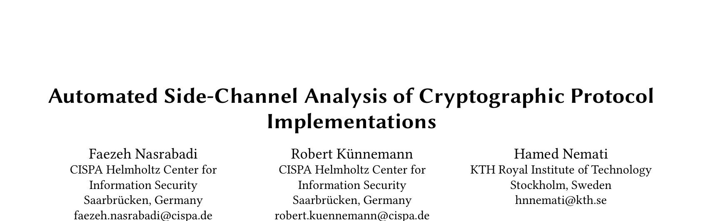

### Automated Side-Channel Analysis of Cryptographic Protocol Implementations
Faezeh Nasrabadi, Robert Künnemann, Hamed Nemati | CISPA Helmholtz Center for Information Security, KTH Royal Institute of Technology
密码协议的形式化验证通常在抽象的符号模型上做，看不到编译后的代码，也看不到微架构侧信道，所以"验证过的规范"和"实际跑的程序"之间有一道缝。这篇做了一条工具链：从真实二进制里截取与协议相关的代码，提升到中间表示，按常数时间和 Spectre 类推测执行的泄露模型做插桩和符号执行，再把得到的轨迹翻译给 Tamarin、ProVerif、DeepSec 等协议验证器。案例里，作者直接从 WhatsApp 桌面版的二进制提取了会话管理和双棘轮组件的模型，并==发现了一个可用于推断社交关系图的指令缓存侧信道==；对电子护照的 BAC 协议，也在微架构观测下复现了已知的不可关联性问题。

## ML|机器学习与安全（3 篇）

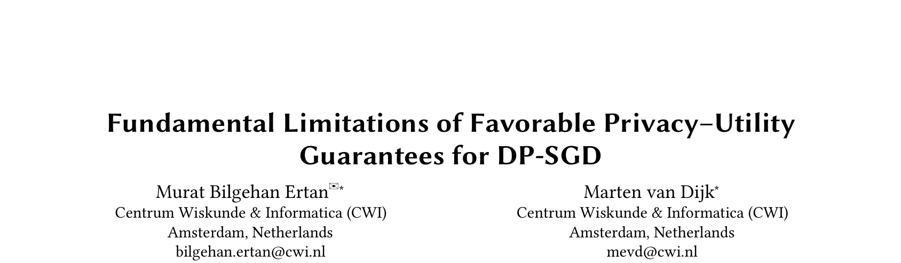

### Fundamental Limitations of Favorable Privacy-Utility Guarantees for DP-SGD
Murat Bilgehan Ertan, Marten van Dijk | Centrum Wiskunde & Informatica (CWI)
DP-SGD 是差分隐私训练的主流方法，但在最坏情况的攻击者模型下它到底能做到什么程度，一直没被讲清楚。作者在 f-差分隐私框架下分析了单轮、打乱采样的 DP-SGD，证明了一个硬约束：要想让攻击者的优势足够小（隐私强），高斯噪声就必须超过一个下界，而这个下界直接限制了模型效用。也就是说，==在标准的最坏情况假设下，DP-SGD 无法同时做到强隐私和高效用==。这个噪声门槛理论上会随训练步数增加而消失，但收敛极慢，实际训练规模下仍然很大；结论对泊松采样同样成立，实验也确认了相应的准确率损失。

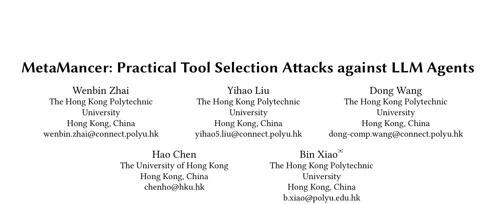

### MetaMancer: Practical Tool Selection Attacks against LLM Agents
Wenbin Zhai, Yihao Liu, Dong Wang, Hao Chen, Bin Xiao | The Hong Kong Polytechnic University, The University of Hong Kong
Agent 越来越依赖第三方工具，"选哪个工具"就成了一道安全边界。攻击者只要改写自己工具的元数据（名称、描述、参数说明），就能让 Agent 在一堆候选里选中恶意工具，进而劫持后续执行，既不需要控制用户的提问，也不用接触受害系统。以往的攻击在现实条件下效果有限，因为攻击者要在严格的黑盒、只能迁移的设定下改写完整元数据，还得同时兼顾有效、隐蔽和稳健。MetaMancer 把这个问题建模成带语义约束的双层优化，用多 Agent 在替代生态里估计效果和约束再统一更新。在 ToolBench 和 MCPTools 上（20 个任务、9729 个候选工具、8 个目标模型、6 种防御），==端到端攻击成功率 92.7% 和 93.8%，加上防御后仍有 91.2% 和 92.2%==，比此前最好的攻击高出 50 个百分点以上。作者也提出了一个轻量防御 CVR：按必填参数界定工具的核心能力，重建元数据，能把成功率压到 18% 左右。

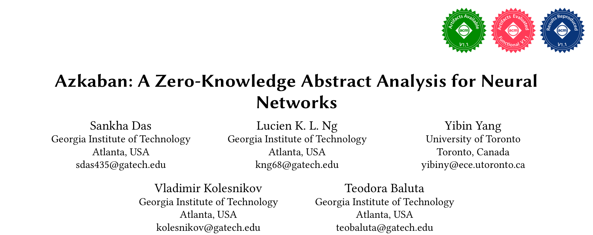

### Azkaban: A Zero-Knowledge Abstract Analysis for Neural Networks
Sankha Das, Lucien K. L. Ng, Yibin Yang, Vladimir Kolesnikov, Teodora Baluta | Georgia Institute of Technology, University of Toronto
用零知识证明来认证神经网络的性质（比如对抗鲁棒性、公平性），可以在不公开模型的前提下让别人相信认证结果。问题在于，认证算法是按实数设计的，而零知识证明只能在有限域上模拟定点数运算，舍入误差会被放大，==以往的协议因此存在可靠性漏洞，可能认证出并不成立的结论==。Azkaban 设计了在有限域上可靠的区间分析算子，包括适合零知识证明的内积和除法，同时防止非线性激活泄露隐私，支持全连接和卷积网络。它在个体公平性认证上比现有最好的协议快两个数量级，能处理更大的模型，也是首个零知识鲁棒性认证方案。

## NETWORK|网络安全（2 篇）

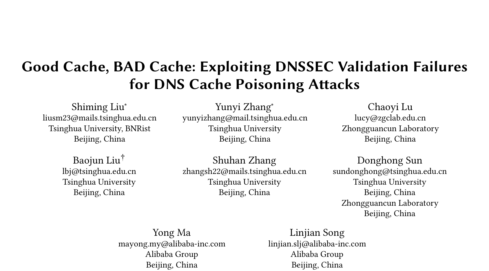

### Good Cache, BAD Cache: Exploiting DNSSEC Validation Failures for DNS Cache Poisoning Attacks
Shiming Liu, Yunyi Zhang, Chaoyi Lu, Baojun Liu, Shuhan Zhang, Donghong Sun, Yong Ma, Linjian Song | Tsinghua University, Zhongguancun Laboratory, Alibaba Group
DNSSEC 用数字签名校验 DNS 记录，一直被视为防 DNS 缓存投毒的最佳实践。这篇提出的 BadDNS 攻击恰恰利用了 DNSSEC 的验证失败：有些解析器在某个域名验证失败后，仍把响应里的记录存进一种叫"BAD cache"的缓存，之后的解析又错误地用上了这些没通过验证的记录。作者审查了 6 款主流 DNS 软件，确认其中 3 款可被利用，包括 PowerDNS 和 Microsoft DNS；测量发现==30 万个做 DNSSEC 验证的开放解析器中约 16.86% 受影响==，10 家公共 DNS 服务（含 OpenDNS、Quad9）也在其列，另有 26930 台权威服务器受影响。漏洞已负责任披露，7 家厂商给了积极回应，部分正在采纳修复方案。

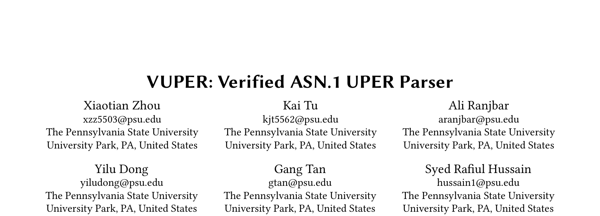

### VUPER: Verified ASN.1 UPER Parser
Xiaotian Zhou, Kai Tu, Ali Ranjbar, Yilu Dong, Gang Tan, Syed Rafiul Hussain | The Pennsylvania State University
ASN.1 是广泛使用的接口描述语言，其中 UPER 编码在 5G 蜂窝网络和车联网（V2X）等安全关键场景里很常见，解析器一旦出错就是攻击面。VUPER 先形式化定义了"比特级精确"的解析器，证明解析器和序列化器之间的往返一致性，并兼顾 ASN.1 的前后向兼容特性；再实现并验证了基本类型和结构的解析组合子，配一个把 ASN.1 定义直接编译成已验证解析器的编译器。拿它当测试基准，作者测了 7 个开源和 4 个商业 ASN.1 解析器，==发现了 20 类不一致==，并演示了利用这些解析漏洞的具体攻击。

## PRIVACY|隐私与匿名（1 篇）

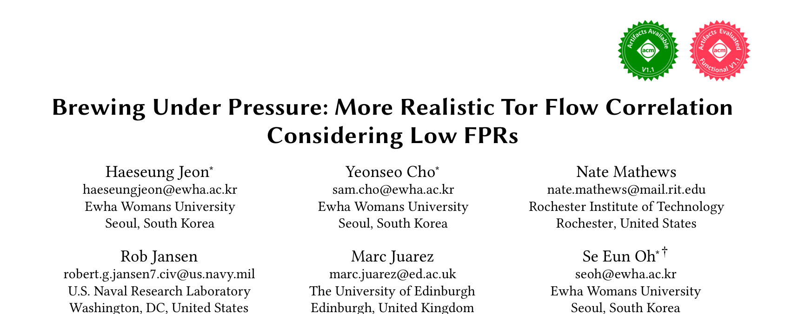

### Brewing Under Pressure: More Realistic Tor Flow Correlation Considering Low FPRs
Haeseung Jeon, Yeonseo Cho, Nate Mathews, Rob Jansen, Marc Juarez, Se Eun Oh | Ewha Womans University, Rochester Institute of Technology, U.S. Naval Research Laboratory, The University of Edinburgh
流量关联攻击通过把 Tor 线路两端的流量对上号来破坏匿名性。以往的关联模型大多在人工构造的数据集上评估，换到稀疏、多变的真实 Tor 流量上效果会大幅下降。作者构建了两个更真实的数据集，其中一个是直接从真实 Tor 网络采集的带标注流量对，并提出了 ESPRESSO 攻击，用核密度估计做按密度划分的窗口表示，适应不同流量规模。结果是：==在误报率 10⁻⁵ 时仍有 88% 的检出率==，而此前最好的 DeepCoFFEA 在同样误报率下几乎为零；只观察到 500 个数据单元、并发连接很多时依然有效。作者的结论是，流量关联仍然是 Tor 迫在眉睫的严重威胁。

## MEASURE|安全可用性与测量（4 篇）

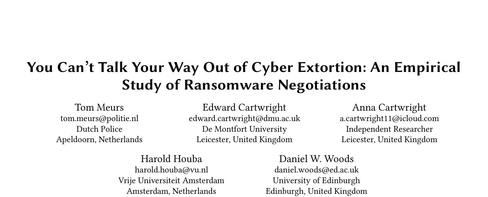

### You Can't Talk Your Way Out of Cyber Extortion: An Empirical Study of Ransomware Negotiations
Tom Meurs, Edward Cartwright, Anna Cartwright, Harold Houba, Daniel W. Woods | Dutch Police, De Montfort University, Independent Researcher, Vrije Universiteit Amsterdam, University of Edinburgh
勒索软件的平均赎金从 2018 年起大幅上涨，为什么攻击者能要到越来越多的钱？作者把勒索谈判拆成六个阶段建模，用两份数据检验技术因素（备份、数据安全）、经济因素（保险、外部顾问）和谈判策略各自的影响：**461 起报到警方的勒索案件**（2019 到 2023 年）和 237 份公开的谈判记录元数据。结论和标题一致：==付不付赎金主要取决于受害者早期的处境，而不是谈判后期的砍价==。有完整可恢复的备份，会大幅降低谈判和支付的概率；受害者营收越高，越可能进入谈判并拿到折扣；谈判拖得越久越可能打折，但支付率反而更低；没有证据表明网络保险会直接提高支付。作者建议把精力放在备份流程上，而不是谈判技巧。第一作者来自荷兰警方。

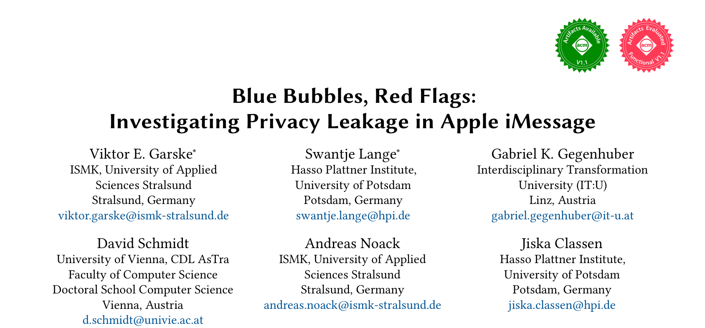

### Blue Bubbles, Red Flags: Investigating Privacy Leakage in Apple iMessage
Viktor E. Garske, Swantje Lange, Gabriel K. Gegenhuber, David Schmidt, Andreas Noack, Jiska Classen | University of Applied Sciences Stralsund, Hasso Plattner Institute, University of Potsdam, Interdisciplinary Transformation University (IT:U), University of Vienna
iMessage 用上了后量子加密，约 14 亿活跃用户，但它在加密之外的协议行为几乎没有公开研究。这是对 iMessage 协议实现的首次系统性隐私分析。作者发现：攻击者可以识别对方每台设备的型号和系统版本，为后续定向攻击做侦察；可以针对同一用户的某一台设备单独发起攻击；==送达回执能暴露对方是否在线和大致位置，附件上传也能推出位置==。所有这些攻击都是静默的，对方毫无察觉。

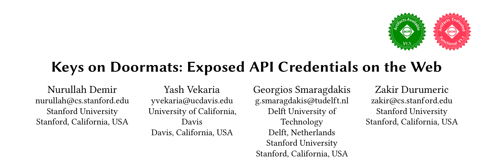

### Keys on Doormats: Exposed API Credentials on the Web
Nurullah Demir, Yash Vekaria, Georgios Smaragdakis, Zakir Durumeric | Stanford University, University of California, Davis, Delft University of Technology
API 密钥一旦公开暴露，攻击者就能借它访问云服务、支付服务等第三方服务。作者渲染并分析了 1000 万个网站，==找到可用于 14 家服务商的 1748 个暴露凭据==，涉及全球性银行和核心基础设施提供商。关键发现是，这些泄露大多是静态分析看不到的：62% 的 JavaScript 泄露只出现在编译后的部署包里，16% 通过引入的第三方资源动态传播；纵向跟踪显示，这些凭据往往暴露数月到数年都没被处理。作者已做负责任披露，并给出了加固 Web 部署流水线的建议。

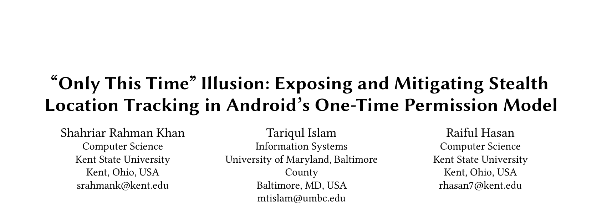

### "Only This Time" Illusion: Exposing and Mitigating Stealth Location Tracking in Android's One-Time Permission Model
Shahriar Rahman Khan, Tariqul Islam, Raiful Hasan | Kent State University, University of Maryland, Baltimore County
安卓的"仅此一次"权限会在应用不再使用时自动收回定位、相机、麦克风等权限。为了不打断导航这类正在进行的任务，系统在应用运行前台服务时会暂停这个收回计时，理由是前台服务必须显示常驻通知，用户看得见。漏洞就出在这里：==应用可以启动前台服务却故意不申请显示通知的权限，进入"隐身状态"，系统照样保活并无限延长那次一次性权限==，实现持续的静默后台追踪。作者动态测量了 Google Play 上的 500 个应用，发现 19.6%（98 个）在主动触发这种状态，主要由激进的商业追踪 SDK 驱动。作者还在 AOSP 中实现了系统级修复。

## SOFTWARE|软件安全（3 篇）

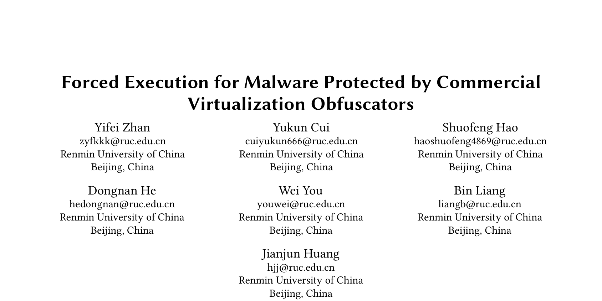

### Forced Execution for Malware Protected by Commercial Virtualization Obfuscators
Yifei Zhan, Yukun Cui, Shuofeng Hao, Dongnan He, Wei You, Bin Liang, Jianjun Huang | Renmin University of China
"强制执行"是挖掘恶意软件隐藏行为的有效手段：强行改变条件跳转的结果，把平时走不到的分支跑出来。但现在的恶意软件越来越多用 VMProtect、Themida 这类商业虚拟化混淆器保护，原生指令被变成自定义的虚拟字节码在运行时解释执行，原生的条件跳转就看不见了，传统工具基本失效。这篇的思路是不做完整的去混淆，而是利用一个观察：虚拟化为了保持原有语义，实现条件跳转时必须遵循特定的数据流和控制流，据此只定位负责"虚拟化条件跳转"的那些指令，再操纵它们模拟强制执行。在有真值的基准上，识别召回率 100%、精确率接近 100%，适用于多款主流混淆器；在真实恶意样本上，==暴露出的行为数是普通执行的 10.97 倍、传统强制执行的 1.89 倍==。

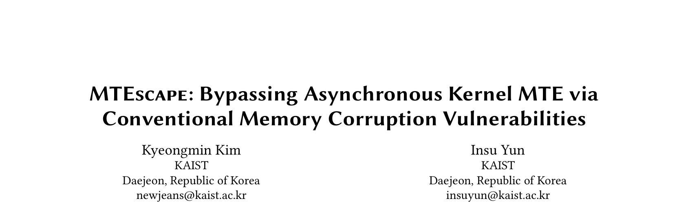

### MTEscape: Bypassing Asynchronous Kernel MTE via Conventional Memory Corruption Vulnerabilities
Kyeongmin Kim, Insu Yun | KAIST
ARM 的内存标记扩展（MTE）用硬件标记来检测缓冲区溢出、释放后使用等常见内存漏洞，已经部署在现代内核里。它的异步模式出于性能考虑，把标记检查推迟到上下文切换时才做，这个窗口一直被认为只是理论上的弱点。MTEscape ==首次在 Linux 内核里证明了这个窗口可被利用==：就在检查生效之前，用一个普通的内存破坏漏洞改掉 MTE 的"关闭开关"变量，让标记错误不再被处理。为了在极短的时间窗口内完成，作者借助特定的内核对象一步完成漏洞转化，并用稳定竞态的技术提高成功率。在合成漏洞和 10 个真实内核 CVE 上全部绕过成功，作者也提出了几乎无性能开销的缓解措施。

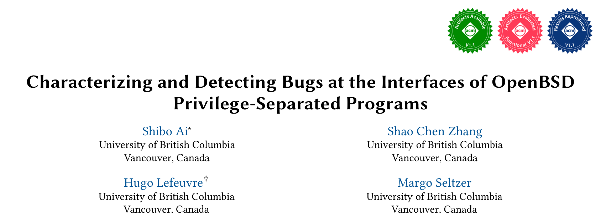

### Characterizing and Detecting Bugs at the Interfaces of OpenBSD Privilege-Separated Programs
Shibo Ai, Shao Chen Zhang, Hugo Lefeuvre, Margo Seltzer | University of British Columbia
权限分离把一个程序拆成若干只拿最小权限的隔离部件，一个部件被攻破也不至于殃及全局。但部件之间的通信接口必须仔细加固，否则就会出现"部件接口漏洞"，让拆分形同虚设。作者用人工分析、模糊测试和大模型 Agent 结合的方式，审计了 OpenBSD 里 25 个常用的权限分离程序，==找出 81 个接口漏洞==，有的存在了十年以上，后果从内存破坏、信息泄露到任意代码执行。研究也肯定了 OpenBSD 的做法，比如不用共享内存直接消灭了一整类问题；但结论是，即便是安全专家拆分的程序，也反复出现同样的高危模式，需要对部件接口做清晰乃至形式化的规范。

## WEB|Web 安全（1 篇）

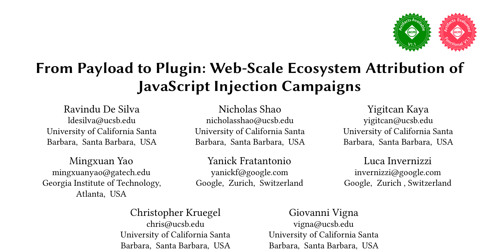

### From Payload to Plugin: Web-Scale Ecosystem Attribution of JavaScript Injection Campaigns
Ravindu De Silva, Nicholas Shao, Yigitcan Kaya, Mingxuan Yao, Yanick Fratantonio, Luca Invernizzi, Christopher Kruegel, Giovanni Vigna | University of California Santa Barbara, Georgia Institute of Technology, Google
外部安全分析人员没有网站后台权限，只能从前端看到被注入的恶意 JavaScript，却不知道是哪个有漏洞的插件让攻击者进来的。结果是站长删掉了看得见的恶意代码，漏洞还在，很快又被感染。作者对 85 万个 WordPress 站点连续监测 84 天，用前后快照的 JavaScript 差异找出注入，聚类成攻击活动，再比较受害站点和未受害站点的插件分布，把每个活动==追溯到具体的插件及版本==。共发现 20 个攻击活动、涉及 1160 个站点，其中 18 个在研究期间完全没被 VirusTotal 检出；顺着线索还挖出了 3 个热门插件的新漏洞，已通过 Wordfence 协调披露。

## TAKEAWAYS|几点观察

#### 超过一半在拆"已经防住了"的假设

23 篇里至少有 12 篇，攻击或质疑的是一个大家默认已经安全的机制：DNSSEC 本是防投毒的最佳实践（Good Cache, BAD Cache），MTE 本是内存安全的硬件防线（MTEscape），ECC 本以为能挡住 GPU Rowhammer（GPUThor），RPMC 本是防回滚的标准机制（Hello Again），EFAIL 本以为已经修好了（Johnny），"仅此一次"权限本是限制追踪的设计（Only This Time），iMessage 本以加密安全著称（Blue Bubbles），OpenBSD 的权限分离出自安全专家之手。密码学方向也一样：哈希的建模假设（Pitfalls）、同态加密的噪声上界（IND-CPA-D）、零知识认证的可靠性（Azkaban）、DP-SGD 的隐私效用承诺（DP-SGD 那篇）。==评委显然偏爱"把一个被当成定论的防御重新打开"的工作==。

#### 获奖的测量研究都落到了真实世界

测量类论文的共同点是能拿出"真实世界里有多少"：30 万解析器中 16.86% 受影响，1000 万网站中 1748 个泄露凭据，500 个应用中 98 个在滥用权限，85 万 WordPress 站点中 20 个攻击活动，461 起警方案件。几乎每篇都伴随负责任披露、厂商回应或系统级修复。

#### AI 方向获奖很少，Agent 只有一篇

机器学习方向的 3 篇里，DP-SGD 和 Azkaban 都偏理论和密码学，真正与大模型应用相关的只有 MetaMancer 一篇。它针对的工具选择环节，和 MCP 生态里的工具投毒是同一类问题：Agent 选工具时看的是攻击者能随意填写的描述。

#### 第一作者单位：美国 8 篇，欧洲 8 篇

按第一作者单位粗略统计，美国 8 篇，欧洲 8 篇（德国 3 篇，荷兰 2 篇，瑞士、波兰、卢森堡各 1 篇），中国 3 篇（清华、人大、香港理工），韩国 2 篇，加拿大 2 篇。企业和机构的身影也不少：Aptos、Google、阿里、CryptoLab，以及第一作者来自荷兰警方的勒索软件研究。
